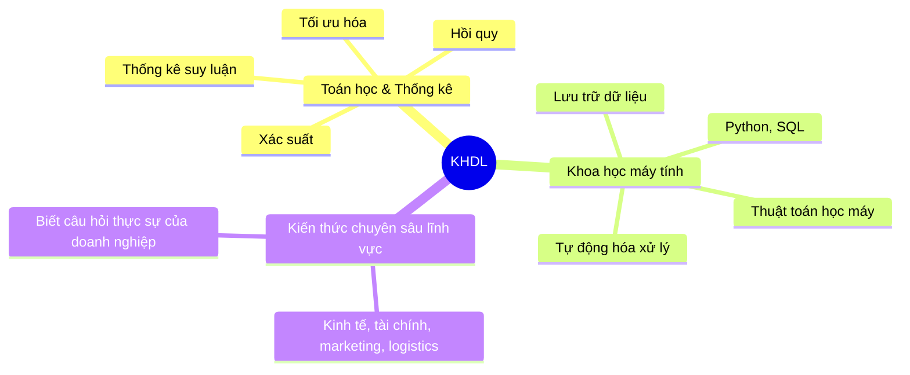
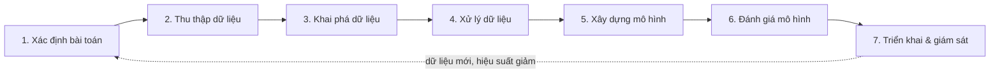

# Chu trình khoa học dữ liệu

> **abstract** Tóm tắt
> - **Khoa học dữ liệu (Data Science, KHDL)** là lĩnh vực liên ngành của 3 trụ cột: *Toán – thống kê*, *Khoa học máy tính*, *Kiến thức chuyên sâu về lĩnh vực*. Mục đích: khám phá tri thức ẩn trong dữ liệu.
> - Chu trình KHDL có **7 bước**: Xác định bài toán → Thu thập → Khai phá → Xử lý → Xây mô hình → Đánh giá → Triển khai & giám sát.
> - Trong **kinh tế – kinh doanh**: bài toán nói bằng KPI, mô hình phải **giải thích được** (hộp trắng), đánh giá theo **chi phí – lợi ích**.
> - KHDL gồm **3 lĩnh vực chuyên sâu**: Kỹ thuật dữ liệu (bước 1–2), Phân tích dữ liệu (bước 3–4), Học máy (bước 5–7).

## Học từ đầu

Một **quan sát** là một đối tượng hoặc sự kiện được ghi nhận. **Thuộc tính** là thông tin về đối tượng đó. **Mô hình** là quy tắc nhận thông tin đầu vào và cho kết quả. Ví dụ shop đang cân nhắc gọi lại cho A và B ở ngày 01/03.

> **note** Bảng dạng chữ
> | Khách | Số đơn trước 01/03 | Có mua trong 30 ngày sau 01/03 |
> | --- | ---: | --- |
> | A | 3 | Có |
> | B | 1 | Không |

Khi đánh giá bằng lịch sử, cột giữa là **đặc trưng**, cột cuối là **nhãn**. Khi dự đoán vào 01/03, cột cuối chưa có. Một quy tắc minh họa là “đoán có nếu số đơn từ 2 trở lên”. Quy tắc đoán A có và B không. Muốn đánh giá khả năng áp dụng cho khách mới, cần dữ liệu chưa dùng để chọn quy tắc.

## 1. Khoa học dữ liệu là gì

### Bài toán mở đầu: giao dịch chứng khoán tự động

Nguồn tr. 5, tr. 6.

- **Tình huống.** Công ty chứng khoán muốn xây hệ thống **giao dịch thuật toán (algorithmic trading)**, mua/bán trong vài mili-giây theo tín hiệu thị trường.
- **Vấn đề.** Dự đoán xu hướng giá vài phút hoặc vài giây tới. Giá chịu tác động của biến động giá, khối lượng giao dịch, tin tức thị trường, dữ liệu vĩ mô.

Vì sao cần KHDL? Slide nêu 3 lý do:

> **note** Bảng dạng chữ
> | Lý do | Ý chính |
> | --- | --- |
> | Phân tích **dữ liệu lớn (big data)** | Giá thầu, giá chào, khối lượng sinh ra cực nhanh. Con người không xử lý kịp. |
> | **Mô hình hóa dự báo** | Mô hình học máy tìm mẫu hình phức tạp, quan hệ **phi tuyến** mà thống kê truyền thống khó thấy. |
> | **Giao dịch tự động** | Mô hình phát tín hiệu mua/bán, nối thẳng vào hệ thống giao dịch, đảm bảo tốc độ. |

### Ba trụ cột

Nguồn tr. 7, tr. 8.

> **note** Bảng dạng chữ
> | Trụ cột | Vai trò chính | Nội dung cốt lõi |
> | --- | --- | --- |
> | Toán học & Thống kê | Nền tảng lý thuyết để xây mô hình, phân tích, **kiểm định** kết quả | Xác suất, hồi quy, tối ưu hóa, thống kê suy luận |
> | Khoa học máy tính | Ngôn ngữ lập trình, thuật toán, công cụ xử lý dữ liệu lớn | Python, SQL, database, thuật toán học máy, tự động hóa |
> | Kiến thức chuyên sâu lĩnh vực | Hiểu đúng vấn đề, chọn mô hình phù hợp, **diễn giải** kết quả có ý nghĩa | Hiểu kinh tế, tài chính, marketing, logistics; biết câu hỏi thực sự của doanh nghiệp |

> **warning** Dễ nhầm
> "Hồi quy" và "tối ưu hóa" thuộc trụ cột **Toán – thống kê**, còn "thuật toán học máy" thuộc **Khoa học máy tính** theo bảng slide. "Biết câu hỏi thực sự của doanh nghiệp" là **kiến thức lĩnh vực**, không phải kỹ năng lập trình.

> **question** Tự kiểm tra: "Chọn mô hình phù hợp và diễn giải kết quả chính xác, có ý nghĩa" là vai trò của trụ cột nào?
> Kiến thức chuyên sâu về lĩnh vực (tr. 8).

## 2. Bảy bước của chu trình

Nguồn tr. 9, tr. 10.

KHDL dùng tri thức, phương pháp luận và công cụ kỹ thuật để làm việc với dữ liệu **toàn diện, có hệ thống, hiệu quả** ở mọi bước của chu trình. Mục tiêu: biến **dữ liệu thô** thành **thông tin có giá trị**, rồi giải quyết vấn đề thực tế.

> **note** Bảng dạng chữ
> | Bước | Việc chính theo slide |
> | --- | --- |
> | 1. Xác định bài toán | Làm rõ mục tiêu kinh doanh/câu hỏi nghiên cứu. Xác định **chỉ số đánh giá thành công** và **yêu cầu dữ liệu**. |
> | 2. Thu thập dữ liệu | Từ CSDL nội bộ, hệ thống giao dịch, API, dữ liệu mở, web scraping. Tuân thủ **pháp lý và đạo đức**. Lưu trữ có hệ thống, an toàn. |
> | 3. Khai phá dữ liệu | Thống kê mô tả + trực quan hóa để thấy cấu trúc, phân phối, xu hướng, quan hệ giữa biến. Phát hiện bất thường, **hình thành giả thuyết**. |
> | 4. Xử lý dữ liệu | Làm sạch: giá trị thiếu, nhiễu, lỗi nhập, chuẩn hóa định dạng. Biến đổi và tích hợp: **mã hóa biến phân loại**, **tạo đặc trưng mới**. |
> | 5. Xây dựng mô hình | Chọn thuật toán (giám sát/không giám sát), huấn luyện trên tập đào tạo. Chia tập huấn luyện, kiểm tra, **kiểm định chéo**; tối ưu tham số. |
> | 6. Đánh giá mô hình | Chỉ số accuracy, precision, recall, F1, AUC… So sánh mô hình; xét **tính khả giải, ổn định, ý nghĩa thực tiễn**. |
> | 7. Triển khai & giám sát | Đưa vào web, ứng dụng, dashboard, báo cáo động. Theo dõi hiệu suất, **cập nhật** khi có dữ liệu mới hoặc hiệu suất giảm. |

> **warning** Dễ nhầm
> - **Khai phá (bước 3) đứng trước Xử lý (bước 4)** trong chu trình 7 bước của slide. Khai phá để *hiểu* dữ liệu và thấy lỗi; xử lý để *sửa*.
> - Chia train/test và tối ưu tham số nằm ở **bước 5**, không phải bước 6. Bước 6 dùng chỉ số để đo.
> - "Tạo đặc trưng mới", "mã hóa biến phân loại" là **bước 4 Xử lý**, không phải bước 5.

### Ví dụ chạy suốt – Siêu thị ABC

Nguồn tr. 11–tr. 18. Câu hỏi: *khách hàng nào dễ quay lại mua hàng?*

> **example** Bảy bước cho siêu thị ABC
> 1. **Xác định bài toán (Business Understanding)** (tr. 12): dự đoán khách nào sẽ quay lại → làm khuyến mãi, ưu đãi cá nhân hóa để giữ chân họ.
> 2. **Thu thập (Data Collection)** (tr. 13): lịch sử giao dịch (ngày mua, mặt hàng, số tiền, phương thức thanh toán); thông tin khách (tuổi, giới tính, địa chỉ, SĐT); thẻ thành viên (điểm tích lũy, khuyến mãi đã dùng).
> 3. **Khai phá (Data Exploration)** (tr. 14): vẽ biểu đồ giờ/ngày mua, mặt hàng bán chạy, độ tuổi chi tiêu cao; tính số lần mua trung bình, tổng chi tiêu, thời gian giữa hai lần mua.
> 4. **Xử lý (Data Pre-processing)** (tr. 15): làm sạch (thiếu, sai như *tuổi = 200*); chuyển "Nam"/"Nữ" → 1/0; tạo đặc trưng "số ngày từ lần mua cuối", "tần suất mua", "tổng chi tiêu".
> 5. **Xây mô hình (Model Building)** (tr. 16): học có giám sát, **phân loại** "sẽ quay lại" (nhãn 1) / "không quay lại" (nhãn 0). Thuật toán: Decision Tree, Random Forest, Logistic Regression.
> 6. **Đánh giá (Model Evaluation)** (tr. 17): chia train/test; dùng Accuracy, F1-score; **đánh giá chi phí – lợi ích**: đoán sai "sẽ quay lại" → tốn khuyến mãi vô ích.
> 7. **Triển khai & giám sát (Deployment & Monitoring)** (tr. 18): tích hợp vào hệ thống quản lý khách hàng, tự chấm điểm khách mới; hành vi đổi theo thời gian → **huấn luyện lại định kỳ**.

> **tip** Mẹo thi
> Gặp câu "việc X thuộc bước nào", tìm **động từ**: *làm rõ mục tiêu/KPI* → 1; *lấy từ nguồn* → 2; *vẽ biểu đồ, thống kê mô tả, hình thành giả thuyết* → 3; *làm sạch, mã hóa, tạo biến* → 4; *chọn thuật toán, huấn luyện, chia tập* → 5; *accuracy, F1, chi phí sai* → 6; *tích hợp hệ thống, theo dõi, huấn luyện lại* → 7.

> **warning** Rò rỉ thông tin tương lai
> Dùng số đơn phát sinh trong chính 30 ngày cần dự đoán làm đầu vào tạo **rò rỉ dữ liệu**. Mô hình khó tái hiện điểm số khi dùng thật.

> **question** Tự kiểm tra: "Chuyển giới tính Nam/Nữ thành 1/0" thuộc bước nào? "Tính thời gian giữa hai lần mua liên tiếp" để hiểu hành vi thuộc bước nào?
> Bước 4 Xử lý (chuyển đổi dữ liệu). Bước 3 Khai phá (thống kê mô tả) theo tr. 14. Lưu ý: nếu dùng nó làm biến đầu vào cho mô hình thì đó là tạo đặc trưng ở bước 4.

## 3. Đặc thù KHDL trong kinh tế và kinh doanh

Nguồn tr. 19–tr. 23.

Ba đặc điểm (tr. 19):
1. Dữ liệu phản ánh **hành vi con người** → phức tạp, biến động, chịu tác động tâm lý, xã hội, vĩ mô. Thông tin thường **bất cân xứng**, thiếu chính xác (khách không khai đủ thu nhập, thị trường đổi do chính sách).
2. Mô hình không chỉ chính xác mà phải **minh bạch, dễ giải thích**, phù hợp lý thuyết kinh tế – quản trị.
3. Mục tiêu là **hiệu quả kinh tế**, tối ưu vận hành, quản trị rủi ro, không chỉ "chính xác kỹ thuật".

> **note** Bảng dạng chữ
> | Bước | KHDL thông thường | KHDL trong Kinh tế & Kinh doanh |
> | --- | --- | --- |
> | 1. Xác định bài toán | Kỹ thuật: nhận diện hình ảnh, tín hiệu, tối ưu hệ thống | Tăng doanh thu, tối ưu chi phí, dự báo nhu cầu, quyết định chiến lược |
> | 2. Thu thập | Cảm biến, hình ảnh, âm thanh, tín hiệu số | **Dữ liệu dạng bảng**: đơn hàng, tài chính, khách hàng, nhân sự; cần hiểu ngữ cảnh & đơn vị đo |
> | 3. Khai phá (EDA) | Thuật toán, phát hiện cấu trúc ẩn | Thống kê mô tả, biểu đồ để hiểu hành vi và xu hướng kinh doanh |
> | 4. Xử lý | Làm sạch tín hiệu, chuẩn hóa đầu vào | Sửa lỗi nhập liệu, xử lý thiếu, phân nhóm khách hàng/sản phẩm |
> | 5. Xây mô hình | Ưu tiên chính xác, mô hình phức tạp (deep learning, boosting) | Ưu tiên **dễ hiểu**: hồi quy, cây quyết định → hợp báo cáo quản trị |
> | 6. Đánh giá | Chỉ số kỹ thuật: accuracy, F1, AUC | **Hiệu quả kinh doanh**: tiết kiệm bao nhiêu chi phí, tăng bao nhiêu doanh thu |
> | 7. Triển khai | Nhúng vào hệ thống, thiết bị thông minh | Dashboard quản trị, báo cáo tuần/tháng, cập nhật theo thị trường |

Nguồn bảng tr. 20.

**Ba điểm nhấn** (tr. 21–tr. 23):

- **Xác định bài toán theo giá trị kinh doanh, gắn KPI.** Không nói "Dự đoán xác suất khách rời bỏ" mà nói "**Giảm tỷ lệ khách rời bỏ 10% để tăng doanh thu**". Thay vì bài toán kỹ thuật như nhận dạng biển số xe.
- **Xây mô hình chú trọng khả năng giải thích.** Nhà quản lý cần biết *tại sao*. Mô hình **hộp trắng (white-box)**: cây quyết định, hồi quy logistic, được ưa chuộng. Mô hình **hộp đen (black-box)**: mạng nơ-ron sâu, có thể chính xác hơn nhưng ít dùng khi cần giải thích.
- **Đánh giá theo chi phí – lợi ích.** KHDL cơ bản dùng accuracy, F1, RMSE. Trong KT&KD, mô hình tốt mang **lợi ích ròng cao nhất**: tính chi phí dự đoán sai (khuyến mãi lãng phí) và lợi ích dự đoán đúng (giữ được khách sắp rời). → **Mô hình chính xác thấp hơn một chút nhưng lợi nhuận cao hơn được ưu tiên.**

> **example** Ví dụ nhỏ: chọn mô hình theo lợi nhuận (số tự đặt)
> Mỗi khách đoán "sẽ rời" được tặng ưu đãi 50 nghìn. Giữ được một khách đúng là sẽ rời mang lại 300 nghìn.
> - Mô hình A: 100 cảnh báo, 40 đúng → $40 \times 300 - 100 \times 50 = 7000$ nghìn.
> - Mô hình B: 60 cảnh báo, 30 đúng → $30 \times 300 - 60 \times 50 = 6000$ nghìn.
> A lợi ích ròng cao hơn dù tỷ lệ cảnh báo đúng thấp hơn (40% so với 50%).

> **warning** Dễ nhầm
> Câu "trong KT&KD luôn chọn mô hình chính xác nhất" là **sai**. Câu "mô hình hộp đen bị cấm" cũng sai: slide chỉ nói *ít được sử dụng* khi cần giải thích rõ.

> **question** Tự kiểm tra: Phát biểu bài toán nào đúng tinh thần KHDL trong kinh doanh? (a) Huấn luyện mạng nơ-ron dự đoán churn; (b) Giảm tỷ lệ rời bỏ 10% trong quý tới để tăng doanh thu.
> (b). Diễn đạt bằng ngôn ngữ kinh doanh, có KPI đo được.

## 4. Ba lĩnh vực chuyên sâu

Nguồn tr. 24, tr. 25.

> **note** Bảng dạng chữ
> | Lĩnh vực | Vai trò chính | Bước của chu trình |
> | --- | --- | --- |
> | **Kỹ thuật dữ liệu** (Data Engineering) | Xây hạ tầng, thu thập dữ liệu đúng cách | Bước 1 (xác định yêu cầu và nguồn dữ liệu khả dụng), Bước 2 (pipeline, tích hợp, lưu trữ) |
> | **Phân tích dữ liệu** (Data Analytics) | Hiểu dữ liệu, khám phá xu hướng, chuẩn bị đầu vào cho mô hình | Bước 3 (phân phối, xu hướng, bất thường), Bước 4 (làm sạch, biến đổi, tạo đặc trưng) |
> | **Học máy** (Machine Learning) | Tạo mô hình dự đoán, hỗ trợ quyết định tự động | Bước 5, 6 (hiệu suất, tính khả giải), 7 (đưa vào hệ thống, theo dõi) |

> **tip** Mẹo nhớ
> **2 – 2 – 3**: Kỹ thuật lo bước 1–2, Phân tích lo 3–4, Học máy lo 5–7.

> **question** Tự kiểm tra: Lĩnh vực nào phụ trách bước "Đánh giá mô hình – kiểm định hiệu suất và tính khả giải"?
> Học máy.

Áp dụng ở F102 Thứ tự quy trình, F107 Đặt mục tiêu, F101 Lĩnh vực và vai trò. Học tiếp [06 Dữ liệu và vị trí công việc](06%20D%E1%BB%AF%20li%E1%BB%87u%20v%C3%A0%20v%E1%BB%8B%20tr%C3%AD%20c%C3%B4ng%20vi%E1%BB%87c.md).
