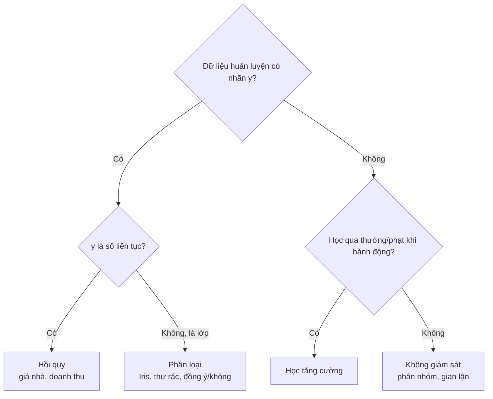

# Nhãn và loại bài toán

> **abstract** Tóm tắt
> - **Học máy (Machine Learning)**: nhánh của **AI**, xây thuật toán và mô hình toán học để **trích xuất tri thức từ dữ liệu**; hệ thống **học từ dữ liệu** thay vì lập trình tường minh từng quy tắc.
> - 3 loại: **có giám sát** (có nhãn), **không giám sát** (không nhãn, tìm cấu trúc ẩn), **tăng cường** (tương tác môi trường, tối đa phần thưởng).
> - Biến mục tiêu **liên tục/số** → **hồi quy**. Biến mục tiêu **phân loại/nhị phân** → **phân loại**.
> - Cần **giải thích** → mô hình **có tham số** (hồi quy tuyến tính, logistic). Cần **chính xác** → có thể dùng **phi tham số** (KNN, random forest).

## 1. Học máy là gì

Nguồn tr. 87, tr. 88.

> **note** Bảng dạng chữ
> | | Hệ thống luật (rule-based) | Học máy |
> | --- | --- | --- |
> | Cách có quy tắc | Chuyên gia viết **if-else** cứng | **Tự phát hiện quy luật** từ dữ liệu |
> | Nhược/ưu | Cứng nhắc, khó mở rộng, phụ thuộc chuyên gia | Linh hoạt, thích ứng môi trường thay đổi |

> **example** Lọc thư rác
> Luật: `if "trúng thưởng" in thư: rác`. Kẻ gửi đổi thành "trúng thưởnq" là lọt. Học máy học từ hàng nghìn thư đã gắn nhãn "rác / không rác", tự cập nhật khi có nhãn mới.

## 2. Ba loại bài toán học máy

Nguồn tr. 89.

> **note** Bảng dạng chữ
> | Loại | Mô tả | Ví dụ slide |
> | --- | --- | --- |
> | **Có giám sát** (Supervised) | Dữ liệu **có gán nhãn**; học để dự đoán đầu ra | Phân loại thư rác, dự đoán giá nhà |
> | **Không giám sát** (Unsupervised) | Dữ liệu **không nhãn**; tìm **cấu trúc ẩn** | Phân nhóm khách hàng, phát hiện gian lận |
> | **Tăng cường** (Reinforcement) | Học qua **tương tác với môi trường**, tối đa hóa **phần thưởng** | Robot học di chuyển, hệ thống đề xuất, quảng cáo tự tối ưu |

**Huấn luyện** là dùng ví dụ đã có để xây quy tắc. **Đặc trưng** (biến giải thích, $X$) là thông tin dùng để dự đoán; **nhãn** (biến mục tiêu, $y$) là đáp án đã biết. Học có giám sát ước lượng hàm $f$ sao cho $y \approx f(X)$.

> **warning** Dễ nhầm
> - "Phát hiện gian lận" được slide xếp vào **không giám sát** (tìm điểm bất thường khi không có nhãn). Nếu đề cho sẵn lịch sử giao dịch **đã gắn nhãn** gian lận thì thành phân loại có giám sát. Đọc kỹ dữ liệu có nhãn hay không.
> - "Hệ thống đề xuất", "quảng cáo tự tối ưu" xuất hiện ở **tăng cường** trong slide.
> - Nhãn mã hóa 0/1/2 (setosa/versicolor/virginica) **vẫn là phân loại**; con số chỉ là mã.
> - "Chia khách thành 3 nhóm **đã định nghĩa, có nhãn lịch sử**" → phân loại. "Tìm 3 nhóm **mới**" → phân cụm.

> **question** Tự kiểm tra: Robot học cách đi bằng thử – sai và nhận điểm thưởng là loại nào? Dự đoán giá nhà là loại nào?
> Học tăng cường. Học có giám sát (hồi quy).

## 3. Chọn hướng mô hình theo biến mục tiêu và bối cảnh

Slide lặp lại cùng một khuôn suy luận cho 4 ca (tr. 95, tr. 104, tr. 112, tr. 122):

| Ca | Biến mục tiêu | → Loại | Bối cảnh | → Họ mô hình | Mô hình chọn |
| --- | --- | --- | --- | --- | --- |
| Quảng cáo | Sales liên tục | Hồi quy | Hỗ trợ quyết định kinh tế | Có tham số | Hồi quy tuyến tính (dữ liệu nhỏ, cần giải thích) |
| Iris | Loài (3 lớp) | Phân loại | Càng chính xác càng tốt | Có tham số **hoặc** phi tham số | k-láng giềng gần nhất |
| Giá nhà Hà Nội | Giá/m² (số) | Hồi quy | Càng chính xác càng tốt | Có tham số hoặc phi tham số | Rừng ngẫu nhiên (dữ liệu lớn, phức tạp) |
| Khách gửi tiết kiệm | Nhị phân 0/1 | Phân loại | Chính xác **nhưng cần giải thích** | Có tham số | Hồi quy logistic (+ mô hình khác để so) |

> **info** Mở rộng: tham số và phi tham số
> Mô hình **có tham số** có số hệ số cố định, đọc được ý nghĩa (ví dụ $\beta_1$ của TV). Mô hình **phi tham số** như KNN không tóm gọn thành vài hệ số; độ phức tạp tăng theo dữ liệu.

> **tip** Mẹo thi
> Hai câu hỏi liên tiếp: (1) **mục tiêu là số hay lớp?** → hồi quy/phân loại; (2) **cần giải thích hay chỉ cần chính xác?** → có tham số / được dùng phi tham số.

## 4. Từ dự đoán đến quyết định

**Dự báo** ước lượng điều gì có thể xảy ra. **Tối ưu hóa** chọn phương án dưới ràng buộc (cấp *định hướng hành động*, tr. 80).

> **example** Hai gói quảng cáo (số tự đặt)
> Gói A tốn 600.000, dự báo 10 đơn. Gói B tốn 500.000, dự báo 9 đơn. Lợi nhuận mỗi đơn 80.000.
> - Mục tiêu "nhiều đơn nhất": chọn A.
> - Mục tiêu lợi nhuận ròng: A $= 10 \times 80\,000 - 600\,000 = 200\,000$; B $= 9 \times 80\,000 - 500\,000 = 220\,000$ → chọn B.

> **question** Tự kiểm tra: Công ty dự đoán số đơn tuần tới và chia khách thành phân khúc chưa biết trước. Xác định loại bài toán.
> Số đơn là mục tiêu số → hồi quy. Phân khúc chưa biết trước → phân cụm không giám sát.

Chi tiết 4 ca ở [Bốn ca học máy trong lecture](B%E1%BB%91n%20ca%20h%E1%BB%8Dc%20m%C3%A1y%20trong%20lecture.md). Áp dụng ở F106 Nhãn và loại bài toán học máy. Cần biết trước [01 Chu trình](01%20Chu%20tr%C3%ACnh%20khoa%20h%E1%BB%8Dc%20d%E1%BB%AF%20li%E1%BB%87u.md).
