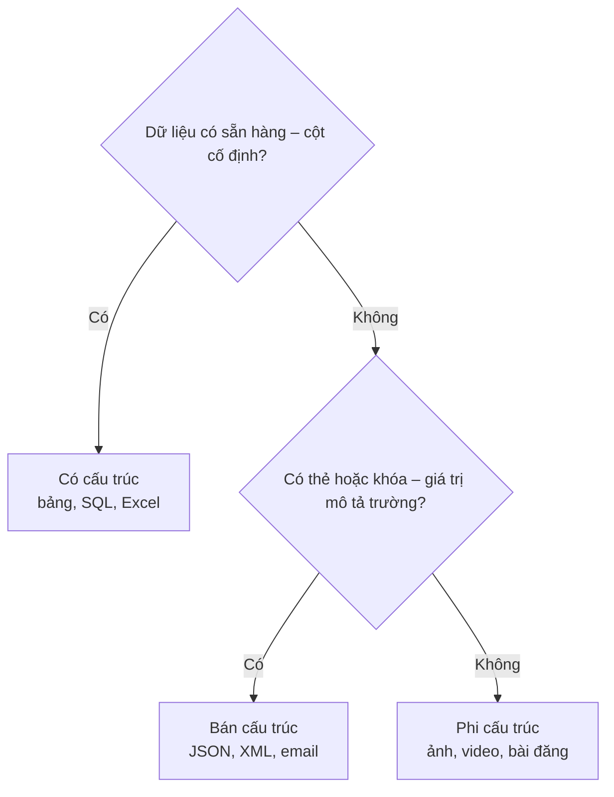

# Dữ liệu và vị trí công việc

> **abstract** Tóm tắt
> - **Dữ liệu**: sự kiện, quan sát, con số, ký hiệu, hình ảnh… ở **dạng thô**, chưa xử lý; là nguyên liệu cho phân tích và ra quyết định.
> - Theo cấu trúc: **có cấu trúc** (bảng), **bán cấu trúc** (JSON, XML, email), **phi cấu trúc** (ảnh, video, bài đăng).
> - Định dạng tệp: CSV/TSV, Excel, JSON, XML, PDF. Nguồn: CSDL, tệp, API, web scraping, streaming.
> - Ngôn ngữ: SQL (truy vấn), Python, R (phân tích), Shell, PowerShell (tự động hóa).
> - 4 vị trí: Data Engineer, Data Analyst, Data Scientist, ML Engineer.

## 1. Dữ liệu là gì

Nguồn tr. 26.

**Dữ liệu (data)** là tập hợp sự kiện, quan sát, con số, ký hiệu, hình ảnh… tồn tại ở **dạng thô**, chưa được phân tích hay xử lý. Nó là **nguyên liệu đầu vào** cho phân tích và ra quyết định dựa trên dữ liệu.

> **example** Ví dụ dữ liệu trong kinh doanh
> Số lượng đơn hàng trong tháng (số); nội dung đánh giá sản phẩm (văn bản); ảnh sản phẩm trên website (hình ảnh).

## 2. Phân loại theo cấu trúc

Nguồn tr. 27 (trang tr. 28 lặp lại bảng).


> **note** Bảng dạng chữ
> | Loại | Đặc điểm | Ví dụ |
> | --- | --- | --- |
> | **Có cấu trúc** (Structured) | Tổ chức rõ theo **hàng – cột**; dễ lưu, truy vấn bằng SQL, Excel | Bảng đơn hàng, danh sách khách hàng, báo cáo tài chính |
> | **Bán cấu trúc** (Semi-structured) | Có cấu trúc nhưng **linh hoạt**, không cố định như bảng | **Email**, tệp **JSON** (JavaScript Object Notation), **XML** |
> | **Phi cấu trúc** (Unstructured) | Không có cấu trúc rõ, khó xử lý trực tiếp | Bài đăng Facebook, ảnh quảng cáo, video YouTube |



> **warning** Dễ nhầm
> - **Email** được slide xếp vào **bán cấu trúc** (có trường người gửi, tiêu đề, ngày… + phần thân tự do), không phải phi cấu trúc.
> - JSON có khóa – giá trị nhưng vẫn là **bán cấu trúc**, vì các bản ghi không bắt buộc cùng tập trường.
> - Một tệp **PDF khảo sát** được slide xếp là phi cấu trúc (tr. 41).

> **question** Tự kiểm tra: Tệp XML hóa đơn điện tử thuộc loại nào? Video YouTube thuộc loại nào?
> XML → bán cấu trúc. Video → phi cấu trúc.

## 3. Định dạng tệp phổ biến

Nguồn tr. 29.


> **note** Bảng dạng chữ
> | Định dạng | Mô tả | Ứng dụng |
> | --- | --- | --- |
> | CSV, TSV | Văn bản phân tách bằng dấu phẩy / tab | Phân tích bằng Excel, Python, R |
> | Excel (.xlsx) | Bảng có **công thức & định dạng** | Báo cáo kế toán, bảng lương |
> | JSON | **Khóa – giá trị**, nhẹ, dễ dùng | Trao đổi dữ liệu giữa website và server |
> | XML | Dữ liệu **phân cấp**, có **thẻ mở/đóng** | Truyền dữ liệu trên web (hóa đơn điện tử) |
> | PDF | Tài liệu cố định, khó chỉnh sửa | Hợp đồng, sao kê ngân hàng |

> **example** JSON và CSV cho cùng một đơn hàng
> ```json
> {"ma_don": "D1", "khach": {"ten": "An", "tinh": "HN"}, "mat_hang": ["sữa", "bánh"]}
> ```
> CSV: `ma_don,ten,tinh` → `D1,An,HN`. JSON chứa được cấu trúc lồng (khách → tên) và danh sách (mặt hàng); CSV phải trải phẳng.

## 4. Nguồn dữ liệu phổ biến

Nguồn tr. 30.


> **note** Bảng dạng chữ
> | Nguồn | Mô tả | Ví dụ |
> | --- | --- | --- |
> | Cơ sở dữ liệu (SQL, Oracle) | Lưu dữ liệu có cấu trúc | Hệ thống bán hàng, quản lý khách hàng |
> | Tệp văn bản, bảng tính, XML | Đầu vào từ khảo sát, sao kê, hành chính | File khảo sát mức độ hài lòng |
> | API & Web Services | Kết nối lấy dữ liệu từ hệ thống bên ngoài | Thời tiết, chứng khoán, tỷ giá |
> | Web Scraping | Tự động thu thập từ website **không có API** | Giá sản phẩm trên sàn TMĐT |
> | Streaming (thời gian thực) | Dữ liệu liên tục từ cảm biến, GPS, mạng xã hội; xử lý bằng **Kafka, Spark, Storm** | Dòng tweet về thương hiệu theo thời gian thực |

> **tip** Mẹo thi
> "Website **có** API" → dùng API. "Website **không có** API" → web scraping. "Liên tục, thời gian thực, Kafka" → streaming.

## 5. Ngôn ngữ phổ biến trong KHDL

Nguồn tr. 31.


> **note** Bảng dạng chữ
> | Loại | Ngôn ngữ | Vai trò | Ứng dụng |
> | --- | --- | --- | --- |
> | Truy vấn dữ liệu | **SQL** | Truy xuất & xử lý dữ liệu trong CSDL quan hệ | Báo cáo doanh số từ bảng đơn hàng |
> | Lập trình phân tích | **Python** | Mã nguồn mở, dễ học, hệ sinh thái mạnh (NumPy, Pandas, Scikit-learn); phân tích, trực quan, học máy | Phân nhóm khách hàng, dự báo doanh thu |
> | Lập trình phân tích | **R** | Mạnh thống kê & trực quan (ggplot2, dplyr, Shiny) | Phân tích khảo sát, hồi quy |
> | Tự động hóa & hệ thống | **Shell** (Unix/Linux) | Xử lý hàng loạt, tự động | Script lọc dữ liệu hàng đêm |
> | Tự động hóa & hệ thống | **PowerShell** | Dữ liệu có cấu trúc, hỗ trợ API, tạo báo cáo và GUI | Kết nối, xử lý dữ liệu hệ thống kế toán |

```python
# Mở rộng: cùng một câu hỏi "doanh số theo cửa hàng" bằng pandas (SQL tương ứng: GROUP BY)
import pandas as pd
don = pd.DataFrame({"cua_hang": ["A", "A", "B"], "tien": [100, 50, 80]})
print(don.groupby("cua_hang")["tien"].sum())
```

Kết quả in ra:

```text
cua_hang
A    150
B     80
Name: tien, dtype: int64
```

> **warning** Dễ nhầm
> ggplot2, dplyr, Shiny là thư viện của **R**, không phải Python. NumPy, Pandas, Scikit-learn là của **Python**.

## 6. Bốn vị trí công việc

Nguồn tr. 32.


> **note** Bảng dạng chữ
> | Vị trí | Câu khẩu hiệu trên slide | Đầu ra điển hình |
> | --- | --- | --- |
> | **Kỹ sư dữ liệu** (Data Engineer) | "Người xây dựng **đường ống và kho chứa** dữ liệu" | Pipeline, kho dữ liệu |
> | **Nhà phân tích dữ liệu** (Data Analyst) | "Người **kể chuyện bằng dữ liệu** để hỗ trợ quyết định" | Báo cáo, dashboard |
> | **Nhà khoa học dữ liệu** (Data Scientist) | "Người tạo ra **mô hình dự đoán** và ra quyết định thông minh" | Mô hình dự đoán |
> | **Kỹ sư học máy** (ML Engineer) | "Người biến mô hình thành **sản phẩm thực tế**" | Dịch vụ chấm điểm chạy thật |

> **example** Theo một hóa đơn
> Kỹ sư dữ liệu đưa hóa đơn từ máy bán hàng vào kho. Nhà phân tích tìm vì sao doanh thu giảm và trình bày. Nhà khoa học dữ liệu xây mô hình dự đoán nhu cầu. Kỹ sư học máy đưa mô hình đó vào hệ thống và theo dõi.

> **warning** Dễ nhầm
> "Xây mô hình" (Data Scientist) khác "đưa mô hình vào sản phẩm" (ML Engineer). "Kể chuyện bằng dữ liệu" là **Data Analyst**.

> **question** Tự kiểm tra: Ai phụ trách "đường ống và kho chứa dữ liệu"? Ai "biến mô hình thành sản phẩm thực tế"?
> Data Engineer. Machine Learning Engineer.

Áp dụng ở F101 Lĩnh vực và vai trò, F104 Nguồn dữ liệu. Cần biết trước [01 Chu trình](01%20Chu%20tr%C3%ACnh%20khoa%20h%E1%BB%8Dc%20d%E1%BB%AF%20li%E1%BB%87u.md). Học tiếp [02 Kỹ thuật dữ liệu](02%20K%E1%BB%B9%20thu%E1%BA%ADt%20v%C3%A0%20ph%C3%A2n%20t%C3%ADch%20d%E1%BB%AF%20li%E1%BB%87u.md).
