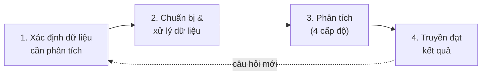

# Quy trình phân tích dữ liệu

> **abstract** Tóm tắt
> - **Phân tích dữ liệu (Data Analytics)** là công cụ **linh hoạt, trả lời nhanh** câu hỏi cụ thể khi thiếu thời gian và tài nguyên để chạy đủ chu trình KHDL.
> - Phân tích dữ liệu: *đã xảy ra gì, vì sao* (mô tả, chẩn đoán). KHDL: *sẽ xảy ra gì, nên làm gì*.
> - Quy trình **4 bước**: (1) Xác định dữ liệu cần phân tích → (2) Chuẩn bị & xử lý → (3) Phân tích theo 4 cấp độ → (4) Truyền đạt kết quả.
> - 4 cấp độ: **Mô tả → Chẩn đoán → Dự báo → Định hướng hành động**.
> - Truyền đạt ở mức cao nhất là **kể chuyện bằng dữ liệu (data storytelling)**.

## 1. Vì sao cần phân tích dữ liệu

Nguồn tr. 59, tr. 60.

- Khối lượng và tốc độ dữ liệu tăng chóng mặt; Excel, báo cáo thủ công không đủ.
- KHDL ra đời nhờ công nghệ mạnh (cloud, AI) và thuật toán tiên tiến.
- **Nhưng** không phải lúc nào cũng đủ thời gian, tài nguyên cho cả chu trình KHDL. Phân tích dữ liệu trả lời **nhanh**, phù hợp quyết định **ngắn hạn, dưới áp lực thời gian**.

## 2. Phân tích dữ liệu và khoa học dữ liệu

Nguồn tr. 61.

[](../../diagrams/01%20T%E1%BB%95ng%20quan/B%E1%BA%A3ng%20tr%E1%BB%B1c%20quan/C1%2007%20Quy%20tr%C3%ACnh%20ph%C3%A2n%20t%C3%ADch%20d%E1%BB%AF%20li%E1%BB%87u%20%E2%80%93%20b%E1%BA%A3ng%201.excalidraw.md)

> **note** Bảng dạng chữ
> | Tiêu chí | Phân tích dữ liệu | Khoa học dữ liệu |
> | --- | --- | --- |
> | Mục tiêu | Điều gì **đã** xảy ra? **Tại sao**? | Điều gì **sẽ** xảy ra? **Nên làm gì**? |
> | Phạm vi | Mô tả & chẩn đoán | Toàn chu trình: dữ liệu → mô hình → ứng dụng |
> | Công cụ | Excel, SQL, Tableau, Power BI | Python, R, Scikit-learn, Spark, AI tools |
> | Kỹ thuật | Thống kê mô tả, trực quan hóa, so sánh | Học máy, dữ liệu lớn, tự động hóa |
> | Đầu ra | Báo cáo, dashboard, chỉ số | Mô hình dự đoán, giải pháp thông minh |
> | Độ phức tạp | Thấp → trung bình | Trung bình → cao |
> | Nguồn lực | Linh hoạt, dễ triển khai | Đội ngũ đa kỹ năng + hạ tầng mạnh |
> | Ứng dụng | KPI, báo cáo thị trường, theo dõi tài chính | Dự đoán churn, cá nhân hóa, tối ưu chuỗi cung ứng |

> **warning** Dễ nhầm
> Trong bảng này, **R** thuộc cột KHDL; **SQL, Tableau, Power BI** thuộc cột phân tích. "Dự đoán churn" là ứng dụng của **KHDL**, không phải phân tích dữ liệu.

## 3. Quy trình 4 bước

Nguồn tr. 62–tr. 64.



[](../../diagrams/01%20T%E1%BB%95ng%20quan/B%E1%BA%A3ng%20tr%E1%BB%B1c%20quan/C1%2007%20Quy%20tr%C3%ACnh%20ph%C3%A2n%20t%C3%ADch%20d%E1%BB%AF%20li%E1%BB%87u%20%E2%80%93%20b%E1%BA%A3ng%202.excalidraw.md)

> **note** Bảng dạng chữ
> | Bước | Mô tả | Ví dụ TMĐT/nhà hàng |
> | --- | --- | --- |
> | 1. Xác định dữ liệu | Rõ câu hỏi; chọn loại dữ liệu; đánh giá tính sẵn có, nguồn gốc, độ tin cậy | "Khách nào mua nhiều nhất tháng 7?" → dữ liệu đơn hàng, khách hàng, sản phẩm |
> | 2. Chuẩn bị & xử lý | Bỏ trùng, xử lý thiếu, chuẩn hóa đơn vị, mã hóa biến phân loại | Khách không ghi địa chỉ → bổ sung/loại; ngày không đồng nhất → chuẩn hóa |
> | 3. Phân tích | Thống kê mô tả, biểu đồ cột/đường/tròn, phân nhóm, lọc top | Tổng doanh thu theo tuần; top 5 khách |
> | 4. Truyền đạt | Biểu đồ, bảng, dashboard, slide; rút ý nghĩa, đề xuất | Đề xuất khuyến mãi cho nhóm khách trung thành |

**Khi nào nên dùng phân tích dữ liệu** (tr. 64): cần **quyết định nhanh** (giá, ưu đãi, chiến dịch); **thiếu nguồn lực/thời gian**; dữ liệu **đơn giản, sẵn có** (Excel, SQL); **câu hỏi rõ, mục tiêu ngắn hạn** ("Tuần trước sản phẩm nào bán chạy nhất?").

## 4. Bước 1 – Xác định dữ liệu cần phân tích

Nguồn tr. 65–tr. 69.

**Mục tiêu → dữ liệu.** Hỏi trước, chọn dữ liệu sau.

[](../../diagrams/01%20T%E1%BB%95ng%20quan/B%E1%BA%A3ng%20tr%E1%BB%B1c%20quan/C1%2007%20Quy%20tr%C3%ACnh%20ph%C3%A2n%20t%C3%ADch%20d%E1%BB%AF%20li%E1%BB%87u%20%E2%80%93%20b%E1%BA%A3ng%203.excalidraw.md)

> **note** Bảng dạng chữ
> | Mục tiêu | Dữ liệu cần |
> | --- | --- |
> | Hành vi khách trên website | Hành vi: click, thời gian, lượt truy cập |
> | Dự đoán doanh thu tháng sau | Lịch sử bán hàng, xu hướng mùa vụ |
> | Phân khúc người dùng theo thói quen | Nhân khẩu học + hành vi mua sắm |

**Kế hoạch thu thập**: *thời điểm* (ngày, tuần, thời gian thực?); *khối lượng* (100, 1000 hay 1 triệu bản ghi?); *xử lý rủi ro* (thiếu, sai, mất thì sao?).

[](../../diagrams/01%20T%E1%BB%95ng%20quan/B%E1%BA%A3ng%20tr%E1%BB%B1c%20quan/C1%2007%20Quy%20tr%C3%ACnh%20ph%C3%A2n%20t%C3%ADch%20d%E1%BB%AF%20li%E1%BB%87u%20%E2%80%93%20b%E1%BA%A3ng%204.excalidraw.md)

> **note** Bảng dạng chữ
> | Loại nguồn | Gồm | Ví dụ |
> | --- | --- | --- |
> | **Sơ cấp** (tự thu thập) | Nội bộ, khảo sát, phỏng vấn | Khảo sát sinh viên, phỏng vấn khách, feedback |
> | **Thứ cấp** (có sẵn) | Thống kê chính thức, báo cáo ngành, tài liệu học thuật | GDP từ Tổng cục Thống kê, dân số từ UN |
> | **Bên thứ ba** | Mua từ nhà cung cấp, sàn dữ liệu | Nielsen, Google Trends, dữ liệu sàn TMĐT |

[](../../diagrams/01%20T%E1%BB%95ng%20quan/B%E1%BA%A3ng%20tr%E1%BB%B1c%20quan/C1%2007%20Quy%20tr%C3%ACnh%20ph%C3%A2n%20t%C3%ADch%20d%E1%BB%AF%20li%E1%BB%87u%20%E2%80%93%20b%E1%BA%A3ng%205.excalidraw.md)

> **note** Bảng dạng chữ
> | Công cụ thu thập | Công dụng |
> | --- | --- |
> | Google Forms / SurveyMonkey | Khảo sát nhanh qua email/zalo/web |
> | Google Analytics / Hotjar | Hành vi người dùng trên website |
> | Zapier / API / Webhook | Kéo dữ liệu Facebook Ads, CRM, Shopee về Google Sheets |
> | Python Scraping (BeautifulSoup) | Dữ liệu sản phẩm TMĐT khi **không có API** |
> | POS / CRM / ERP | Dữ liệu bán hàng, khách hàng từ hệ thống quản trị |

**Lưu ý**: chất lượng cao (**chính xác – đầy đủ – nhất quán – dễ truy cập**); tuân thủ **đạo đức & pháp luật** (không lấy dữ liệu cá nhân trái phép); đặt **checkpoint kiểm tra định kỳ** để tránh sai lệch tích lũy.

> **warning** Dễ nhầm
> Số liệu GDP do Tổng cục Thống kê công bố là **thứ cấp**, dù rất "chính thức". Tự khảo sát là **sơ cấp**. Mua từ Nielsen là **bên thứ ba**.

> **question** Tự kiểm tra: Công ty tự phỏng vấn 50 khách hàng. Nguồn loại gì?
> Sơ cấp.

## 5. Bước 2 – Chuẩn bị và xử lý dữ liệu

Nguồn tr. 70–tr. 75.

Dữ liệu thô thường **thiếu, sai định dạng, trùng lặp, không nhất quán** → phải làm sạch, chuẩn hóa, biến đổi theo mục tiêu. Bước này gồm 4 việc:


**Khai phá (Data Exploration)** — hiểu dữ liệu trước khi phân tích sâu (tr. 71):

[](../../diagrams/01%20T%E1%BB%95ng%20quan/B%E1%BA%A3ng%20tr%E1%BB%B1c%20quan/C1%2007%20Quy%20tr%C3%ACnh%20ph%C3%A2n%20t%C3%ADch%20d%E1%BB%AF%20li%E1%BB%87u%20%E2%80%93%20b%E1%BA%A3ng%206.excalidraw.md)

> **note** Bảng dạng chữ
> | Tác vụ | Công cụ hình |
> | --- | --- |
> | Kiểm tra phân phối | Histogram, boxplot, scatterplot |
> | Phát hiện ngoại lệ | Nhìn điểm bất thường, dị biệt |
> | Kiểm tra mối quan hệ | Correlation heatmap, scatter matrix |

Công cụ: Python (pandas, seaborn, matplotlib, pandas-profiling); R (dplyr, skimr); BI (Power BI, Tableau).

**Biến đổi (Data Transformation)** (tr. 72): *làm sạch* (missing value, chuẩn định dạng ngày, số, mã); *tái cấu trúc* (merge, pivot/unpivot); *làm giàu* (kết hợp CRM, API, dữ liệu vĩ mô GDP, lạm phát).

**Kiểm định (Data Validation)** (tr. 73): dữ liệu "đủ chuẩn" chưa? 5 tiêu chí **đầy đủ, chính xác, nhất quán, duy nhất, kịp thời** (bảng ở [02 · Chất lượng dữ liệu](02%20K%E1%BB%B9%20thu%E1%BA%ADt%20v%C3%A0%20ph%C3%A2n%20t%C3%ADch%20d%E1%BB%AF%20li%E1%BB%87u.md)).

**Công bố (Data Publishing)** (tr. 74): phát hành dữ liệu kèm **metadata** (mô tả biến: đơn vị, nguồn, ý nghĩa, kiểu) và **nhật ký xử lý** (các bước, logic, giả định) → minh bạch, kiểm chứng, tái sử dụng.

**Công cụ – Python là trung tâm** (tr. 75):

[](../../diagrams/01%20T%E1%BB%95ng%20quan/B%E1%BA%A3ng%20tr%E1%BB%B1c%20quan/C1%2007%20Quy%20tr%C3%ACnh%20ph%C3%A2n%20t%C3%ADch%20d%E1%BB%AF%20li%E1%BB%87u%20%E2%80%93%20b%E1%BA%A3ng%207.excalidraw.md)

> **note** Bảng dạng chữ
> | Công cụ | Mục đích |
> | --- | --- |
> | NumPy | Mảng số học hiệu suất cao: mô phỏng kinh tế, tính chỉ số |
> | pandas | Bảng: đọc CSV, Excel, SQL; groupby, merge, xử lý thiếu, chuỗi thời gian |
> | json/jsonlines | Dữ liệu bán cấu trúc từ API, web log, review |

Thay thế/bổ sung: Excel/Google Sheets (bảng nhỏ, thủ công); SQL (trực tiếp từ DB); R, Tableau, Power BI (thống kê, trực quan).

> **example** Kiểm định nhanh bằng pandas (đã chạy)
> ```python
> import pandas as pd
> df = pd.DataFrame({"ma": ["K1", "K2", "K2"], "tuoi": [25, None, 200]})
> print("Thiếu:", df["tuoi"].isna().sum())                    # đầy đủ
> print("Trùng:", df["ma"].duplicated().sum())                # duy nhất
> print("Ngoài 0–120:", ((df["tuoi"] < 0) | (df["tuoi"] > 120)).sum())  # chính xác
> ```
> ```text
> Thiếu: 1
> Trùng: 1
> Ngoài 0–120: 1
> ```

> **warning** Dễ nhầm
> **Metadata** mô tả *biến*; **nhật ký xử lý** ghi *các bước đã làm*. Merge, pivot là **tái cấu trúc**; thêm GDP từ API là **làm giàu**.

## 6. Bước 3 – Bốn cấp độ phân tích

Nguồn tr. 76–tr. 80.

[](../../diagrams/01%20T%E1%BB%95ng%20quan/B%E1%BA%A3ng%20tr%E1%BB%B1c%20quan/C1%2007%20Quy%20tr%C3%ACnh%20ph%C3%A2n%20t%C3%ADch%20d%E1%BB%AF%20li%E1%BB%87u%20%E2%80%93%20b%E1%BA%A3ng%208.excalidraw.md)

> **note** Bảng dạng chữ
> | Cấp độ | Câu hỏi | Mục tiêu | Kỹ thuật | Ví dụ slide |
> | --- | --- | --- | --- | --- |
> | **Mô tả** (Descriptive) | Điều gì **đã** xảy ra? | Tổng hợp thông tin lịch sử | Thống kê mô tả, trực quan hóa, **phân cụm** | Doanh thu TB theo tháng, dashboard KPI, tỉ lệ theo nhóm khách |
> | **Chẩn đoán** (Diagnostic) | **Tại sao**? | Tìm nguyên nhân, cơ chế sinh dữ liệu | **Kiểm định giả thuyết**, tương quan, hồi quy | **ANOVA** so doanh thu các chi nhánh; quan hệ chi phí sự kiện – doanh thu |
> | **Dự báo** (Predictive) | Điều gì **có thể** xảy ra? | Dự đoán tương lai từ lịch sử | Hồi quy, cây quyết định, random forest, boosting, neural networks | Doanh thu, nhu cầu, rủi ro tín dụng; doanh thu với ngân sách quảng cáo cố định |
> | **Định hướng hành động** (Prescriptive) | Chúng ta **nên làm gì**? | Tối ưu hành động, đề xuất quyết định | **Tối ưu hóa**, mô hình kịch bản, mô phỏng rủi ro | Phân bổ ngân sách marketing tối đa lợi nhuận; tối ưu lộ trình giao hàng |

[](../../diagrams/01%20T%E1%BB%95ng%20quan/C1%20B%E1%BB%91n%20c%E1%BA%A5p%20%C4%91%E1%BB%99%20ph%C3%A2n%20t%C3%ADch.excalidraw.md)

> **warning** Dễ nhầm
> - **Phân cụm** được slide đặt ở cấp **mô tả** (tóm tắt nhóm đã có), không phải dự báo.
> - **Hồi quy** có ở cả chẩn đoán (giải thích nguyên nhân) và dự báo (dự đoán giá trị). Nhìn **câu hỏi** để chọn: "vì sao" hay "sẽ bao nhiêu".
> - "Doanh thu sẽ là bao nhiêu với ngân sách X" là **dự báo**. "Nên chia ngân sách thế nào để lợi nhuận lớn nhất" là **định hướng hành động**.
> - So sánh trước/sau đơn giản chưa đủ kết luận nguyên nhân; có thể lẫn mùa vụ.

> **tip** Mẹo thi
> Gạch chân **từ để hỏi**: *bao nhiêu, đã* → mô tả; *tại sao, do đâu* → chẩn đoán; *sẽ, dự đoán, khả năng* → dự báo; *nên, tối ưu, phương án nào* → định hướng hành động.

> **question** Tự kiểm tra: "Kiểm định xem doanh thu ba chi nhánh có khác nhau thật không" là cấp nào?
> Chẩn đoán (kiểm định ANOVA, tr. 78).

## 7. Bước 4 – Truyền đạt kết quả

Nguồn tr. 81–tr. 85.

- **Data storytelling** là mức cao nhất, một kỹ năng quan trọng nhất của chuyên gia phân tích.
- **Đối tượng & mục tiêu**: ai nhận, họ quan tâm gì, tập trung thông tin có tác động quyết định.
- **Cấu trúc câu chuyện**: **Bối cảnh → Vấn đề → Dữ liệu → Phân tích → Khuyến nghị**. Minh bạch nguồn và phương pháp. Dùng slide, dashboard, report, infographic.
- **Trực quan hóa**: biến số liệu thành "nhìn được"; chọn đúng loại: bar, line, pie, scatter, geo map. "*A picture is worth a thousand words*".


| Ví dụ storytelling | Dữ liệu | Biểu đồ | Thông điệp |
| --- | --- | --- | --- |
| Y tế toàn cầu từ 1960 (Gapminder) (tr. 84) | 12.000 dòng × 10 cột | **Phân tán động**: tuổi thọ TB vs tử vong trẻ em/1000 trẻ, kích thước = dân số, màu = châu lục | Xu hướng cải thiện y tế toàn cầu |
| Covid-19 (tr. 85) | 420.000 dòng × 67 cột | Đường, dashboard, heatmap 2019–2023 | Diễn biến đại dịch theo thời gian |

> **question** Tự kiểm tra: Sắp xếp đúng: Khuyến nghị, Dữ liệu, Bối cảnh, Phân tích, Vấn đề.
> Bối cảnh → Vấn đề → Dữ liệu → Phân tích → Khuyến nghị.

Áp dụng ở F103 Cấp độ phân tích, F105 Chất lượng dữ liệu, F107 Đặt mục tiêu. Cần biết trước [02 Kỹ thuật dữ liệu](02%20K%E1%BB%B9%20thu%E1%BA%ADt%20v%C3%A0%20ph%C3%A2n%20t%C3%ADch%20d%E1%BB%AF%20li%E1%BB%87u.md).
