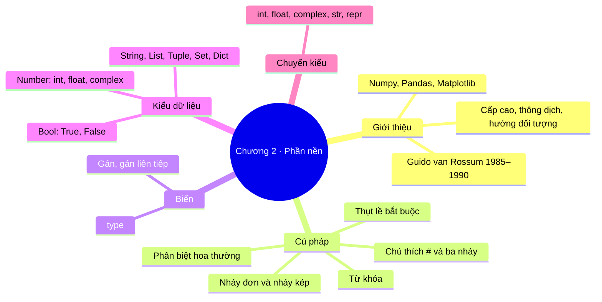

# Biến, kiểu dữ liệu và tham chiếu

> **abstract** Tóm tắt
> - Python là ngôn ngữ **cấp cao, thông dịch, tương tác, hướng đối tượng**.
> - Phân biệt chữ hoa/thường. Khối lệnh được đánh dấu bằng **thụt lề** (indent), không dùng ngoặc nhọn.
> - Biến là **tên** gắn với một giá trị. Kiểu do giá trị quyết định, xem bằng **`type()`**.
> - 7 nhóm kiểu chuẩn trong slide: Bool, Numbers, String, List, Tuple, Set, Dictionary.
> - Đổi kiểu bằng tên kiểu làm hàm: **`int()`**, **`float()`**, **`str()`**… Kết quả là **đối tượng mới**.



## 1. Lịch sử và đặc điểm Python

Nguồn tr. 4, tr. 5.


> **note** Bảng dạng chữ
> | Ý | Nội dung trong slide |
> | --- | --- |
> | Tác giả | **Guido van Rossum**, đề xuất giai đoạn 1985–1990 |
> | Tính chất | Cấp cao (high-level), tương tác (interactive), thông dịch (interpreted), hướng đối tượng (object-oriented) |
> | Nền tảng | Unix, Linux, Mac OS, Windows |
> | Vị thế | Top 5 ngôn ngữ phổ biến, nhiều thư viện: NumPy, Pandas, Matplotlib… |
> | Người dùng tiêu biểu | Wikipedia, Google, Yahoo!, CERN |

> **tip** Mẹo thi
> "Thông dịch" nghĩa là chạy từng lệnh qua trình thông dịch, không cần biên dịch cả chương trình thành tệp máy trước. Câu hỏi hay gài "Python là ngôn ngữ biên dịch cấp thấp" → **sai**.

## 2. Cú pháp cơ bản

### 2.1 Phân biệt hoa/thường và từ khóa

Nguồn tr. 6.

Python **phân biệt chữ hoa, chữ thường** (case-sensitive): *`name`*, `Name`, `NAME` là ba tên khác nhau. **Từ khóa** (keyword) là từ dành riêng có chức năng đặc biệt. Xem danh sách bằng:

```python
import keyword
print("Python keywords:", keyword.kwlist)
```

Từ khóa trong slide: `and, as, assert, break, class, continue, def, del, elif, else, except, exec, finally, for, from, global, if, import, in, is, lambda, not, or, pass, print, raise, return, try, while, with, yield`.

> **info** Mở rộng
> Bảng trong slide lấy từ Python 2. Ở Python 3, `print` và `exec` **không còn** là từ khóa (chúng là hàm), và có thêm `True`, `False`, `None`, `nonlocal`, `async`, `await`. Python 3.12 có 35 từ khóa (đã chạy **`len(keyword.kwlist)`** → 35).

### 2.2 Chú thích (comment)

Nguồn tr. 7.

- `#` chú thích **một dòng**: mọi thứ sau `#` bị bỏ qua.
- `'''…'''` hoặc `"""…"""` (ba nháy) dùng để viết chú thích **nhiều dòng**.

```python
"""
This is a comment
written in
more than just one line
"""
print("Hello, World!")   # Hello, World!
```

> **warning** Dễ nhầm
> Ba nháy thực chất tạo một **chuỗi** không gán cho biến nào, nên Python bỏ qua. Nếu gán `s = """..."""` thì đó là chuỗi nhiều dòng chứ không phải chú thích (xem [chuỗi nhiều dòng](05%20Ph%C6%B0%C6%A1ng%20th%E1%BB%A9c%20string.md)).

### 2.3 Dấu nháy đơn `'` và nháy kép `"`

Nguồn tr. 8.

```python
'''
print("We are in a comment")
print ("We are still in a comment")
'''
word = 'word'
sentence = "This is a sentence."
message = """This message will
... span several lines."""
print(word)
print(sentence)
print(message)
```

Kết quả:

```text
word
This is a sentence.
This message will
... span several lines.
```

Nháy đơn và nháy kép **tương đương**. Ba nháy cho phép chuỗi trải nhiều dòng. Hai lệnh `print` trong khối `'''…'''` đầu tiên **không chạy** vì nằm trong chú thích.

### 2.4 Thụt lề (indent)

Nguồn tr. 9.

- Thụt lề là **bắt buộc** để bao khối lệnh của hàm, lớp và luồng điều khiển (if, for, while).
- Số khoảng trắng tùy ý, nhưng **mọi lệnh trong cùng một khối phải thụt như nhau**. Mặc định dùng 4 khoảng trắng.

```python
if 5 > 2:
  print("Five is greater than two!")   # Đúng: có thụt lề

if 5 > 2:
print("Five is greater than two!")     # Sai: IndentationError
```


> **note** Bảng dạng chữ
> | Đoạn mã trong slide | Hợp lệ? | Lý do |
> | --- | --- | --- |
> | Khối 1 thụt 1 cách, khối 2 thụt 8 cách | Đúng | Mỗi khối thống nhất bên trong |
> | Cùng một khối, dòng 1 thụt 1 cách, dòng 2 thụt 8 cách | Sai | Hai lệnh cùng khối thụt khác nhau |

> **warning** Dễ nhầm
> "Số khoảng trắng phải đúng bằng 4" → **sai**. 4 chỉ là mặc định/khuyến nghị. Điều bắt buộc là **nhất quán trong một khối**.

## 3. Biến

### 3.1 Tên biến

Nguồn tr. 10.

Biến (variable) là **tên gọi đại diện cho một giá trị**, giống *`x`*, *`y`* trong toán học.

- Tên bắt đầu bằng **chữ cái hoặc dấu gạch dưới** `_`, sau đó có thể có chữ số.
- **Không** dùng từ khóa làm tên biến (`for`, `while`, `class`, `lambda`…).


> **note** Bảng dạng chữ
> | Tên | Hợp lệ? |
> | --- | --- |
> | `diem_1`, `_tam`, `Name` | Có |
> | `1_diem` | Không (bắt đầu bằng số) |
> | `class`, `for` | Không (từ khóa) |
> | `ho-ten` | Không (dấu `-` là phép trừ) |

### 3.2 Khai báo bằng phép gán

Nguồn tr. 11.

Python không có câu lệnh khai báo riêng. **Phép gán** vừa tạo vừa cập nhật biến. Một biến có thể lần lượt nhận nhiều loại giá trị.

```python
counter = 100      # Một số nguyên
miles   = 1000.0   # Một số thực
name    = "John"   # Một chuỗi
print(counter, type(counter))   # 100 <class 'int'>
print(miles, type(miles))       # 1000.0 <class 'float'>
print(name, type(name))         # John <class 'str'>
```

**Từng bước.** Python tính vế phải trước rồi gắn tên ở vế trái với kết quả.

```python
so_vo = 3
gia_moi_quyen = 12000
thanh_tien = so_vo * gia_moi_quyen
so_vo = so_vo + 1
print(so_vo, thanh_tien)  # 4 36000
```


> **note** Bảng dạng chữ
> | Dòng | Python làm gì | Trạng thái sau dòng |
> | --- | --- | --- |
> | 1 | Gắn tên với 3 | `so_vo = 3` |
> | 2 | Gắn tên khác với 12000 | `gia_moi_quyen = 12000` |
> | 3 | Đọc hai giá trị rồi nhân | `thanh_tien = 36000` |
> | 4 | Đọc giá trị cũ 3, cộng 1, gắn lại tên | `so_vo = 4`, `thanh_tien` **vẫn** 36000 |

Dùng tên chưa gán, ví dụ **`print(so_luong)`**, gây `NameError`.

### 3.3 Gán liên tiếp và gán nhiều biến

Nguồn tr. 12.

```python
a = b = c = 10                   # một giá trị cho nhiều biến
print(a, '\t', b, '\t', c)       # 10      10      10
x, y, z = 100, 12.4, 'NEU 2023'  # nhiều giá trị cho nhiều biến
print(x, '\t', y, '\t', z)       # 100     12.4    NEU 2023
```

> **example** Ví dụ: hoán đổi
> `a, b = b, a` tính tuple vế phải `(b, a)` trước, rồi mới gán. Không cần biến tạm.

> **warning** Dễ nhầm
> `x, y = 1, 2, 3` gây `ValueError` (số tên và số giá trị không khớp).

## 4. Tổng quan kiểu dữ liệu chuẩn

Nguồn tr. 39.

Dữ liệu trong bộ nhớ có nhiều loại (tuổi là số, địa chỉ là chữ và số). Kiểu dữ liệu quyết định **phép toán dùng được** và **cách lưu trữ**.

| Giá trị mẫu | Kiểu | Đổi được tại chỗ? | Chi tiết |
| --- | --- | --- | --- |
| `True`, `False` | bool | Không |  |
| `7`, `7.0`, `2+3j` | int, float, complex | Không |  |
| `"Lan"` | str | Không | [05 Phương thức string](05%20Ph%C6%B0%C6%A1ng%20th%E1%BB%A9c%20string.md) |
| `["Lan", 7]` | list | Có | [04 Phương thức list](04%20Ph%C6%B0%C6%A1ng%20th%E1%BB%A9c%20list.md) |
| `("Lan", 7)` | tuple | Không | [06 Phương thức dict set và tuple](06%20Ph%C6%B0%C6%A1ng%20th%E1%BB%A9c%20dict%20set%20v%C3%A0%20tuple.md) |
| `{7, 8}` | set | Có (thêm/xóa) | [06 Phương thức dict set và tuple](06%20Ph%C6%B0%C6%A1ng%20th%E1%BB%A9c%20dict%20set%20v%C3%A0%20tuple.md) |
| `{"Lan": 7}` | dict | Có | [06 Phương thức dict set và tuple](06%20Ph%C6%B0%C6%A1ng%20th%E1%BB%A9c%20dict%20set%20v%C3%A0%20tuple.md) |


## 5. Kiểu số và kiểu logic

### 5.1 Kiểu số (Number)

Nguồn tr. 40, tr. 41.

Đối tượng số được tạo khi gán giá trị. Có **3 loại**:

- `int`: số nguyên có dấu, có thể viết ở hệ **nhị phân** `0b`, **bát phân** `0o`, **thập lục phân** `0x`.
- `float`: số thực dấu phẩy động.
- **`complex`**: số phức. **`complex(a, b)`** tạo số có phần thực `a`, phần ảo *`b`*.

```python
n = 10;         print(n, type(n))   # 10 <class 'int'>
d = 0b10011;    print(d, type(d))   # 19 <class 'int'>   (hoặc 0B10011)
h = 0x12a;      print(h, type(h))   # 298 <class 'int'>  (hoặc 0X12a)
y = 0o17;       print(y, type(y))   # 15 <class 'int'>   (hoặc 0O17, hệ 8)
x = 0.5;        print(x, type(x))   # 0.5 <class 'float'>
c = 0.5 + 2j;   print(c, type(c))   # (0.5+2j) <class 'complex'>
z = complex(2, 3)
print(z)        # (2+3j)
print(type(z))  # <class 'complex'>
```

**Đổi hệ cơ số từng bước.** $0b10011 = 16 + 2 + 1 = 19$. $0x12a = 1\cdot 256 + 2\cdot 16 + 10 = 298$. $0o17 = 1\cdot 8 + 7 = 15$.

> **warning** Dễ nhầm
> - In một số viết ở hệ 2/8/16 vẫn ra **thập phân**, kiểu vẫn là `int` (không có kiểu "bin").
> - Phần ảo viết bằng `j`, không phải `i`.

### 5.2 Kiểu logic (bool)

Nguồn tr. 42, tr. 43.

Lưu hai giá trị `True` hoặc `False` (viết hoa chữ đầu). Kết hợp bằng `and`, `or`, `not`. Nhiều ngôn ngữ dùng 1/0 cho logic, còn Python có **kiểu riêng** `bool`.

```python
a = 2 > 1.5;  print(a)      # True
b = 2 == 3;   print(b)      # False
b = True;     print(b, type(b))     # True <class 'bool'>
c = (True and True) or (not False)
print(c)                                         # True
print(not ((True or True) or (True and False)))  # False
print(not True)                                  # False
```

> **info** Mở rộng
> `bool` là lớp con của `int`: `True + True == 2`. Khi xét điều kiện, `0`, `0.0`, `""`, `[]`, `()`, `{}`, **`set()`**, `None` được coi là **sai**; còn lại là đúng. **`bool("False")`** là `True` vì chuỗi khác rỗng.

## 6. Chuyển đổi kiểu dữ liệu

Nguồn tr. 138, tr. 139.

Dùng **tên kiểu làm tên hàm**. Hàm trả về **đối tượng mới** biểu diễn giá trị đã đổi, biến gốc giữ nguyên.


> **note** Bảng dạng chữ
> | Hàm | Ý nghĩa | Ví dụ → kết quả |
> | --- | --- | --- |
> | **`int(x[, base])`** | Đổi thành số nguyên; `base` là cơ số nếu *`x`* là chuỗi | **`int("101", 2)`** → 5; **`int(3.9)`** → 3 |
> | **`long(x[, base])`** | Số nguyên dài (chỉ có ở Python 2) | Python 3 dùng `int` cho mọi độ lớn |
> | **`float(x)`** | Đổi thành số thực | **`float("3.5")`** → 3.5 |
> | **`complex(real[, imag])`** | Tạo số phức | **`complex(2, 3)`** → `(2+3j)` |
> | **`str(x)`** | Chuỗi đại diện, dễ đọc | **`str(12)`** → `'12'` |
> | **`repr(x)`** | Chuỗi **biểu thức** (dạng viết lại được trong code) | **`repr("a\n")`** → `"'a\\n'"` |

> **warning** Dễ nhầm
> - **`int("3.5")`** → `ValueError`. Phải **`int(float("3.5"))`** → 3.
> - **`int(3.9)`** **cắt** phần thập phân (về 3), không làm tròn.
> - **`long()`** gây `NameError` trên Python 3.

## 7. Hai tên có thể cùng trỏ vào một đối tượng

Nguồn tr. 76, tr. 127.

Tên biến **trỏ tới** đối tượng. Gán tên thứ hai (`b = a`) chia sẻ cùng đối tượng. Gán lại một tên chỉ đổi tham chiếu của tên đó. Sửa tại chỗ (append, `a[0] = …`) làm thay đổi đối tượng mà mọi tên cùng thấy.


> **note** Bảng dạng chữ
> | Kiểu | Thay đổi tại chỗ? | Cách truy cập |
> | --- | --- | --- |
> | str, tuple | Không | Chỉ số và slice |
> | list | Có | Chỉ số và slice |
> | dict | Có | Khóa |
> | set | Có | Kiểm tra thành viên `in`, không có chỉ số |
> | int, float, bool | Không | Phép toán tạo giá trị mới |

**Ví dụ.** Với `a = [[1], [2]]`, `b = a` và `c = a[:]`, lệnh **`a.append([3])`** làm *`b`* có ba phần tử, *`c`* vẫn hai. Sau đó `a[0].append(9)` làm phần tử con đầu thành `[1, 9]` ở **cả ba** biến, vì bản sao nông vẫn chia sẻ phần tử con.

> **question** Tự kiểm tra
> 1. **`print(0x10, 0o10, 0b10)`** in gì? → `16 8 2`.
> 2. Tên `_2x` có hợp lệ không? → Có, bắt đầu bằng `_`.
> 3. `x, y, z = 100, 12.4, 'NEU 2023'` rồi **`type(y)`**? → `<class 'float'>`.
> 4. Hai dòng cùng một khối thụt 2 và 4 cách. Chuyện gì xảy ra? → `IndentationError`.
> 5. **`int("123", 16)`**? → $1\cdot256+2\cdot16+3 = 291$.
> 6. `a = [1]; b = a; b.append(2); print(a)`? → `[1, 2]`.

**Áp dụng ở** F201 Kiểu dữ liệu, literal và ép kiểu · F206 Theo dấu thay đổi của list và tham chiếu. Dễ nhầm với [view của NumPy](../03%20NumPy%20v%C3%A0%20Pandas/03%20Truy%20c%E1%BA%ADp%20v%C3%A0%20ph%C3%A9p%20to%C3%A1n%20NumPy.md).
