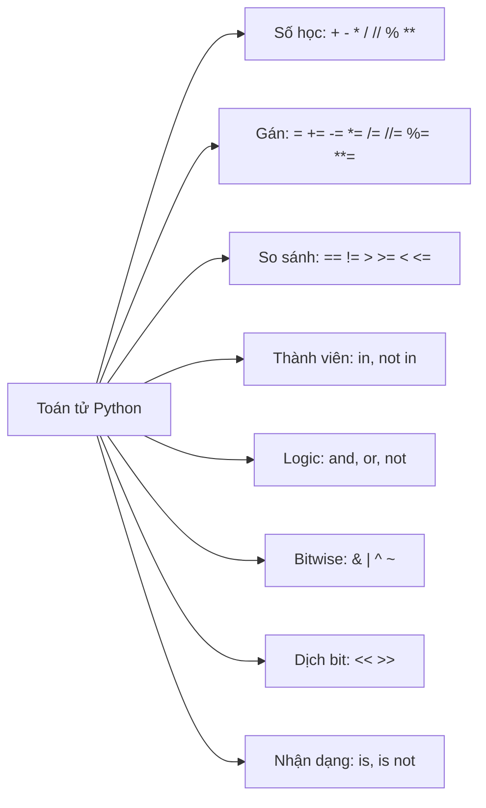
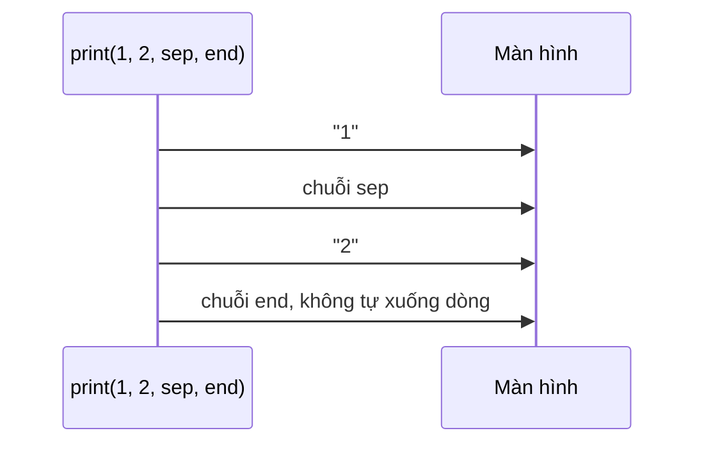

# Biểu thức và vào/ra

> **abstract** Tóm tắt
> - **Biểu thức** (expression): tổ hợp giá trị, biến, toán tử, lời gọi hàm, khi đánh giá (evaluate) cho **một giá trị duy nhất**.
> - 8 nhóm toán tử: số học, gán, so sánh, thành viên, logic, bitwise, dịch bit, nhận dạng.
> - **`print(*objects, sep=' ', end='\n', file=sys.stdout, flush=False)`**.
> - **`input()`** **luôn trả về `str`** → cần **`int()`**/**`float()`** nếu muốn tính toán.
> - Định dạng: **`str.format()`**, f-string `f"{bieu_thuc}"`, toán tử `%`.

## 1. Biểu thức và các nhóm toán tử

Nguồn tr. 13, tr. 14.

Trong `2 + 3`, `+` là **toán tử** (operator), còn 2 và 3 là **toán hạng** (operand). Một biểu thức có thể chứa toán hạng (giá trị, biến), toán tử và cả hàm.



## 2. Toán tử số học

Nguồn tr. 15.

Gồm `+`, `-`, `*`, `/`, `//` (chia lấy phần nguyên, chia sàn), `%` (lấy phần dư), `**` (lũy thừa).

```python
x = 3+2;      print(x)   # 5
y = 'a'+'b';  print(y)   # ab    · + với chuỗi là nối
z = 'a'*3;    print(z)   # aaa   · * chuỗi với số là lặp
print(7//2)              # 3     · chia sàn
print(7/2)               # 3.5   · chia thường luôn ra float
print(14%3)              # 2     · 14 = 3·4 + 2
print(7**2)              # 49
```

**Hình dung.** Chia 7 chiếc bánh cho 2 người: mỗi người được `7 // 2 = 3` chiếc nguyên, còn dư `7 % 2 = 1` chiếc. Luôn có:

$$a = b \cdot (a \,//\, b) + a \,\%\, b$$

> **warning** Dễ nhầm
> - `6 / 3` là `2.0` (float), không phải `2`.
> - `-7 // 2` là `-4` vì chia sàn làm tròn **xuống** ($-3{,}5 \to -4$). Khi đó `-7 % 2 = 1`.
> - `-2**2` là `-4` (lũy thừa trước dấu âm), `(-2)**2` là `4`.
> - `"7" + 3` → `TypeError`. Chia cho 0 → `ZeroDivisionError`.

## 3. Toán tử gán

Nguồn tr. 16.


> **note** Bảng dạng chữ
> | Toán tử | Viết tắt của |
> | --- | --- |
> | `v = a + b` | gán thường |
> | `v += a` | `v = v + a` |
> | `v -= a` | `v = v - a` |
> | `v *= a` | `v = v * a` |
> | `v /= a` | `v = v / a` |
> | `v //= a` | `v = v // a` |
> | `v %= a` | `v = v % a` |
> | `v **= a` | `v = v ** a` |

**Trace ví dụ của slide** với `a = 10`, `b = 5`:


> **note** Bảng dạng chữ
> | Lệnh | Tính | *`b`* sau lệnh | In ra |
> | --- | --- | --- | --- |
> | `b += a` | 5 + 10 | 15 | `15` |
> | `b -= a` | 15 − 10 | 5 | `5` |
> | `b *= a` | 5 · 10 | 50 | `50` |
> | `b /= a` | 50 / 10 | 5.0 | `5.0` |
> | `b %= a` | 5.0 % 10 | 5.0 | `5.0` |
> | `b **= a` | $5{,}0^{10}$ | 9765625.0 | `9765625.0` |

> **tip** Mẹo thi
> Sau một phép `/=` biến đã thành **float**, mọi kết quả sau đó đều có **`.0`**. Đây là bẫy hay gặp ở câu "in ra gì".

## 4. Toán tử so sánh

Nguồn tr. 17.

`==, !=, >, >=, <, <=` trả về giá trị logic `True` hoặc `False`.

```python
print(1 == 1, 1 == 2)   # True False
print(1 != 1, 1 != 2)   # False True
print(1 > 1, 1 > 2)     # False False
print(1 >= 1, 1 >= 2)   # True False
print(1 < 1, 1 < 2)     # False True
print(1 <= 1, 1 <= 2)   # True True
```

> **warning** Dễ nhầm
> `=` là **gán**, `==` là **so sánh**. Viết `if x = 5:` là lỗi cú pháp.

## 5. Toán tử logic

Nguồn tr. 18.


> **note** Bảng dạng chữ
> | Toán tử | Ý nghĩa | Ví dụ slide (a = 10, b = 20) |
> | --- | --- | --- |
> | `and` | Đúng khi **cả hai** vế đúng | `(a and b)` → đúng |
> | `or` | Đúng khi **ít nhất một** vế đúng | `(a or b)` → đúng |
> | `not` | Đảo trạng thái logic | **`not(a and b)`** → `False` |

```python
print(1==1 and -5<3)   # True
print(1==1 or -5<3)    # True
print(not 1==1)        # False
```

> **info** Mở rộng: and/or trả về toán hạng
> Slide ghi `(a and b) → True`, nhưng Python thực tế trả **một trong hai toán hạng**: `10 and 20` → `20`, `10 or 20` → `10` (đều được xét là đúng). Quy tắc: `and` trả vế đầu nếu nó sai, ngược lại trả vế sau; `or` trả vế đầu nếu nó đúng, ngược lại trả vế sau. Ví dụ `"" or "x"` → `'x'`, `10 and 0` → `0`. Đồng thời có **đoản mạch** (short-circuit): `x != 0 and 10/x > 1` với `x = 0` cho `False`, không lỗi chia 0.

**Thứ tự ưu tiên** (các toán tử đã học): ngoặc → `**` → dấu âm → `* / // %` → `+ -` → dịch bit → `&` → `^` → `|` → so sánh, `in`, `is` → `not` → `and` → `or`.

## 6. Toán tử nhận dạng is, is not

Nguồn tr. 19.

So sánh **vị trí bộ nhớ** (danh tính) của hai đối tượng: `is` đúng khi hai tên là **cùng một đối tượng**.

```python
x = ["apple", "banana"]
y = ["apple", "banana"]
z = x
print(x is not z)   # False · z chính là x
print(x is not y)   # True  · x, y khác đối tượng dù cùng nội dung
print(x != y)       # False · nội dung bằng nhau
```


> **note** Bảng dạng chữ
> | So sánh | `==` (giá trị) | `is` (danh tính) |
> | --- | --- | --- |
> | *`x`* và *`z`* | True | True |
> | *`x`* và *`y`* | True | **False** |

## 7. Toán tử bitwise và dịch bit

Nguồn tr. 20, tr. 21, tr. 22.

Làm việc trên từng **bit** của số nguyên. Với `a = 60 = 0011 1100`, `b = 13 = 0000 1101`:


> **note** Bảng dạng chữ
> | Phép | Quy tắc | Kết quả nhị phân | Thập phân |
> | --- | --- | --- | --- |
> | `a & b` (AND) | 1 nếu bit có ở **cả hai** | `0000 1100` | 12 |
> | `a \| b` (OR) | 1 nếu có ở **ít nhất một** | `0011 1101` | 61 |
> | `a ^ b` (XOR) | 1 nếu có ở **đúng một** | `0011 0001` | 49 |
> | `~a` (đảo bit) | Lật mọi bit, $\sim x = -x-1$ | `1100 0011` (bù 2) | −61 |
> | `a << 2` (dịch trái) | Dời trái 2 bit, thêm 0 bên phải | `1111 0000` | 240 |
> | `a >> 2` (dịch phải) | Dời phải 2 bit | `0000 1111` | 15 |

```python
a = 60; b = 13
print(bin(a), a)          # 0b111100 60
print(bin(b), b)          # 0b1101 13
print(bin(a & b), a & b)  # 0b1100 12
print(bin(a | b), a | b)  # 0b111101 61
print(bin(~a), ~a)        # -0b111101 -61
print(bin(a ^ b), a ^ b)  # 0b110001 49
```

**Dịch bit** tương đương nhân/chia cho lũy thừa của 2: $x \ll n = x \cdot 2^n$, $x \gg n = x \,//\, 2^n$.

```python
print(100, ':', bin(100))            # 100 : 0b1100100
print(100 << 1, ':', bin(100 << 1))  # 200 : 0b11001000
print(100 >> 1, ':', bin(100 >> 1))  # 50 : 0b110010
print(100 << 2, ':', bin(100 << 2))  # 400 : 0b110010000
print(100 >> 2, ':', bin(100 >> 2))  # 25 : 0b11001
```

> **warning** Dễ nhầm
> - `^` là **XOR**, không phải lũy thừa (`**`). `2 ^ 3` → 1.
> - `&` (bit) khác `and` (logic): `6 & 3` → 2, `6 and 3` → 3.
> - **`bin()`** trả về **chuỗi** có tiền tố `0b`.

## 8. Toán tử thành viên in, not in

Nguồn tr. 23.

Kiểm tra phần tử có nằm trong chuỗi, list, tuple, set (và **khóa** của dict).

```python
print('hello' in 'hello world')   # True  · chuỗi con
print('name' in 'hello world')    # False
a = 3
b = [1, 2, 3, 4, 5]
print(a in b)          # True
print(10 in b)         # False
print(10 not in b)     # True
```

## 9. Hàm print()

Nguồn tr. 25, tr. 26, tr. 27.

```text
print(*objects, sep=' ', end='\n', file=sys.stdout, flush=False)
```


> **note** Bảng dạng chữ
> | Tham số | Ý nghĩa | Mặc định |
> | --- | --- | --- |
> | `*objects` | Các đối tượng cần in (bao nhiêu cũng được) | — |
> | *`sep`* | Ký tự **phân cách** giữa các đối tượng | `' '` (khoảng trắng) |
> | *`end`* | Ký tự **kết thúc** nội dung | `'\n'` (xuống dòng) |
> | `file` | Nơi in ra | `sys.stdout` (màn hình) |
> | `flush` | Đẩy ra ngay lập tức | `False` |

```python
print(1, 2, 3, 4)                    # 1 2 3 4
print(1, 2, 3, 4, sep='*')           # 1*2*3*4
print(1, 2, 3, 4, sep='#', end='&')  # 1#2#3#4&   (không xuống dòng)
```



> **warning** Dễ nhầm
> *`sep`* chỉ chèn **giữa** các đối tượng, không chèn sau đối tượng cuối. `print` **trả về `None`**, nên `x = print(5)` in 5 và *`x`* là `None`.

### 9.1 Định dạng bằng `str.format()`

Nguồn tr. 28, tr. 29, tr. 30.

Cặp ngoặc nhọn `{}` là **chỗ trống** để chèn giá trị. Phương thức áp dụng cho mọi chuỗi.

```python
x = 5; y = 10
print('The value of x is {} and y is {}'.format(x, y))
# The value of x is 5 and y is 10

print('I love {0} and {1}'.format('bread', 'butter'))  # I love bread and butter
print('I love {1} and {0}'.format('bread', 'butter'))  # I love butter and bread

print('Hello {name}, {greeting}'.format(greeting='Good Morning', name='John'))
# Hello John, Good Morning
```


> **note** Bảng dạng chữ
> | Cách viết | Lấy giá trị nào |
> | --- | --- |
> | `{}` | Lần lượt theo thứ tự đối số |
> | `{0}`, `{1}` | Theo **chỉ số** vị trí đối số |
> | `{name}` | Theo **tên** đối số |

### 9.2 Ký tự đặc biệt (escape)

Nguồn tr. 31.

```python
print('Let\'s go!')     # Let's go!     · \' in dấu nháy đơn
print('New line \\n')   # New line \n   · \\ in một dấu gạch chéo
```

`\n` xuống dòng, `\t` tab, `\\` một dấu `\`, `\'` và `\"` là dấu nháy.

### 9.3 F-string

Nguồn tr. 32, tr. 33.

Thêm tiền tố `f` hoặc `F` trước dấu nháy, rồi chèn **biến hoặc biểu thức** trong `{}`.

```python
name = "Marry"; score = 90
print(f" Student {name} got {score} points")   #  Student Marry got 90 points
a, b = 5, 7
print(f"The sum of {a} and {b} is {a + b}")   # The sum of 5 and 7 is 12
```

> **info** Mở rộng
> Định dạng số: `f"{3.14159:.2f}"` → `'3.14'`. Toán tử `%` kiểu cũ: `"The value of x is %3.2f" % 12.3456789` → `'The value of x is 12.35'` (tr. 47).

## 10. Hàm input()

Nguồn tr. 34, tr. 35, tr. 36, tr. 37.

Cú pháp **`input([prompt])`**. `prompt` là chuỗi **lời nhắc** hiện ra (tùy chọn). Người dùng gõ giá trị và kết thúc bằng Enter.

```python
x = input("Mời bạn nhập giá trị gì đó:")
print("Bạn nhập: ", x)

print("Mời bạn nhập cái gì đó:")
s = input()
print("Bạn nhập:", s)
print("Kiểu dữ liệu:", type(s))   # Kiểu dữ liệu: <class 'str'>
```

**Mọi trường hợp đều là `str`**, dù gõ số. Muốn số phải ép kiểu:

```python
x = int(input())     # gõ 7   → 7, <class 'int'>
x = float(input())   # gõ 2.5 → 2.5, <class 'float'>
```


**Nhập bool.** **`bool(input())`** không dùng được (mọi chuỗi khác rỗng đều `True`). Slide tự viết hàm:

```python
def strtobool(s):
    return s.lower() in ("yes", "true", "t", "1")

print("Mời bạn nhập bool:")
x = strtobool(input())         # gõ: no
print("Bạn nhập:", x)          # Bạn nhập: False
print("Kiểu dữ liệu:", type(x))  # Kiểu dữ liệu: <class 'bool'>
```

> **warning** Dễ nhầm
> - `input() + 1` → `TypeError` (chuỗi cộng số).
> - **`int(input())`** với dữ liệu `3.5` → `ValueError`.
> - `input("5") * 2` với người dùng gõ `5` → `'55'`.

> **question** Tự kiểm tra
> 1. **`print(17 // 5, 17 % 5, 2 ** 10)`** → `3 2 1024`.
> 2. `b = 4; b /= 2; b **= 3; print(b)` → `8.0`.
> 3. **`print(5 & 3, 5 | 3, 5 ^ 3, ~5)`** → `1 7 6 -6`.
> 4. **`print(3 << 3)`** → `24`.
> 5. *`x=[1]; y=[1]; print(x == y, x is y)`* → `True False`.
> 6. **`print('a','b','c', sep='-', end='!')`** → `a-b-c!`.
> 7. `'{1}{0}{1}'.format('x','y')` → `'yxy'`.
> 8. Người dùng gõ `12`. **`type(input())`** là gì? → `<class 'str'>`.
> 9. **`print(0 or "" or None)`** in gì? → `None` (or trả vế cuối khi mọi vế sai).

**Áp dụng ở** F202 Toán tử số học – chia sàn, phần dư, lũy thừa · F203 Biểu thức so sánh và logic · F211 Vào-ra, input và lỗi khi chạy · F205 Phương thức chuỗi và định dạng.
