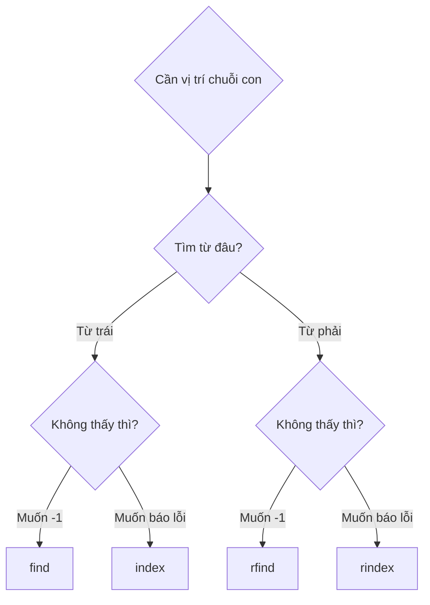

# Phương thức string

> **abstract** Tóm tắt
> - Chuỗi (string) là dãy ký tự trong nháy đơn, nháy kép hoặc ba nháy. Python **không có kiểu ký tự**: một ký tự là chuỗi dài 1.
> - Chỉ số bắt đầu từ **0** ở đầu và **−1** ở cuối. Slice `s[a:b]` lấy từ `a` đến **trước** *`b`*.
> - Chuỗi **bất biến** (immutable): mọi phương thức trả về **chuỗi mới** hoặc thông tin, chuỗi gốc không đổi.
> - Nhóm phương thức: đổi hoa/thường · căn lề · đếm/tìm · kiểm tra dạng `is…()` · tách/ghép · làm sạch · thay thế/cắt.

## 1. Khai báo chuỗi

Nguồn tr. 44, tr. 45.

```python
a = "Hello";      print(a)   # Hello
b = 'Hello NEU';  print(b)   # Hello NEU
c = """Lorem ipsum dolor sit amet,
consectetur adipiscing elit."""
print(c)                     # in đúng 2 dòng như khi gõ
d = '''Ba nháy đơn cũng tạo
chuỗi nhiều dòng.'''
```

Chuỗi là **mảng** các byte biểu diễn ký tự Unicode. `"a"` là chuỗi độ dài 1, không có kiểu `char` riêng.

## 2. Chỉ số, slice và toán tử chuỗi

Nguồn tr. 46, tr. 47, tr. 48.

[](../../diagrams/02%20Python/Ch%E1%BB%89%20s%E1%BB%91%20d%C6%B0%C6%A1ng%20v%C3%A0%20%C3%A2m%20c%E1%BB%A7a%20chu%E1%BB%97i.excalidraw.md)

[](../../diagrams/02%20Python/B%E1%BA%A3ng%20tr%E1%BB%B1c%20quan/C2%2005%20Ph%C6%B0%C6%A1ng%20th%E1%BB%A9c%20string%20%E2%80%93%20b%E1%BA%A3ng%201.excalidraw.md)

> **note** Bảng dạng chữ
> | Toán tử | Ý nghĩa | Ví dụ slide → kết quả |
> | --- | --- | --- |
> | `[]` | Lấy **một** ký tự | *`x="Python"; x[1]`* → `'y'` |
> | `[:]` | Lấy **dãy** ký tự | `x[1:3]` → `'yt'` |
> | `in` | Có chứa chuỗi con không | `"u" in x` → `False` |
> | `not in` | Không chứa | `"h" not in x` → `False` |
> | `%` | Định dạng chuỗi | `"The value of x is %3.2f" % 12.3456789` → `'The value of x is 12.35'` |
> | `+` | Nối chuỗi | `"KHMT" + "NEU"` → `'KHMTNEU'` |
> | `*` | Lặp chuỗi | `"KHMT NEU" * 2` → `'KHMT NEUKHMT NEU'` |

```python
str1 = 'Hello World!'
print(str1)          # Hello World!
print(str1[0])       # H
print(str1[2:5])     # llo          · chỉ số 2, 3, 4
print(str1[:5])      # Hello        · từ đầu đến trước 5
print(str1[2:])      # llo World!   · từ 2 đến hết
print(str1 * 2)      # Hello World!Hello World!
print(str1 + "TEST") # Hello World!TEST
```

**Giải thích từng bước `str1[2:5]`.** Đánh số `H0 e1 l2 l3 o4 ␣5`. Bắt đầu ở 2, dừng **trước** 5 → `l l o`.

> **warning** Dễ nhầm
> - Số ký tự của `s[a:b]` là `b − a`.
> - `s[10]` vượt giới hạn → `IndexError`, nhưng slice `s[2:100]` **không lỗi** (cắt tới hết).
> - `s[0] = 'h'` → `TypeError` vì chuỗi bất biến.

## 3. Đổi hoa/thường, căn giữa, đếm

Nguồn tr. 49, tr. 50.

[](../../diagrams/02%20Python/B%E1%BA%A3ng%20tr%E1%BB%B1c%20quan/C2%2005%20Ph%C6%B0%C6%A1ng%20th%E1%BB%A9c%20string%20%E2%80%93%20b%E1%BA%A3ng%202.excalidraw.md)

> **note** Bảng dạng chữ
> | Phương thức | Làm gì | Cú pháp |
> | --- | --- | --- |
> | **`capitalize()`** | Bản sao, chữ **đầu** viết hoa, phần còn lại viết thường | **`s.capitalize()`** |
> | **`swapcase()`** | Đảo hoa ↔ thường mọi ký tự | **`s.swapcase()`** |
> | **`lower()`** / **`upper()`** | Tất cả thường / tất cả hoa | **`s.lower()`** |
> | **`center(length, character)`** | Căn giữa, điền ký tự (mặc định khoảng trắng) | **`s.center(40, "*")`** |
> | **`count(value, start, end)`** | Số lần `value` xuất hiện trong vùng `[start, end)` | **`s.count("mt", 5, 20)`** |

```python
string = "khmt NEU 2022 Khmt"
print(string.capitalize())       # Khmt neu 2022 khmt
print(string.swapcase())         # KHMT neu 2022 kHMT
print(string.lower())            # khmt neu 2022 khmt
print(string.upper())            # KHMT NEU 2022 KHMT
print(string.center(40, "*"))    # ***********khmt NEU 2022 Khmt***********
print(string.count("mt"))        # 2
print(string.count("mt", 5, 20)) # 1   · chỉ còn "mt" ở cuối
```

> **warning** Dễ nhầm
> **`capitalize()`** **hạ** các chữ hoa khác: `"NEU"` trong chuỗi thành `"neu"`. Chuỗi dài 18, **`center(40)`** thêm 22 dấu `*`, chia đều 11 mỗi bên.

## 4. startswith, endswith, split, splitlines

Nguồn tr. 51, tr. 52.

[](../../diagrams/02%20Python/B%E1%BA%A3ng%20tr%E1%BB%B1c%20quan/C2%2005%20Ph%C6%B0%C6%A1ng%20th%E1%BB%A9c%20string%20%E2%80%93%20b%E1%BA%A3ng%203.excalidraw.md)

> **note** Bảng dạng chữ
> | Phương thức | Trả về | Tham số |
> | --- | --- | --- |
> | **`endswith(value, start, end)`** | True nếu kết thúc bằng `value` | `value` bắt buộc; *`start`*, *`end`* tùy chọn |
> | **`startswith(value, start, end)`** | True nếu bắt đầu bằng `value` | như trên |
> | **`split(separator, maxsplit)`** | **List** các phần | `separator` mặc định khoảng trắng; `maxsplit` mặc định −1 (tách hết) |
> | **`splitlines(keeplinebreaks)`** | List, mỗi dòng một phần tử | `True` giữ ký tự xuống dòng; mặc định `False` |

```python
str1 = "khmt NEU 2022 Khmt"
print(str1.endswith("mt"))           # True
print(str1.endswith("mt", 2, 10))    # False · xét "mt NEU 2" 
print(str1.startswith("kh"))         # True
print(str1.startswith("kh", 3, 12))  # False · xét str1[3:12] = "t NEU 202"

txt = "hello, my name is Peter, I am 26 years old"
print(txt.split(", "))  # ['hello', 'my name is Peter', 'I am 26 years old']
print(txt.split(","))   # ['hello', ' my name is Peter', ' I am 26 years old']
txt = "apple#banana#cherry#orange"
print(txt.split("#"))     # ['apple', 'banana', 'cherry', 'orange']
print(txt.split("#", 1))  # ['apple', 'banana#cherry#orange'] · chỉ tách 1 lần
txt = "Thank you for the music\nWelcome to the jungle"
print(txt.splitlines(True))
# ['Thank you for the music\n', 'Welcome to the jungle']
```

> **warning** Dễ nhầm
> - **`split(",")`** giữ **khoảng trắng đầu** của mỗi phần; **`split(", ")`** thì không.
> - **`split("#", 1)`** cho **2** phần (tách 1 lần → 2 mảnh).
> - `"a,,b".split(",")` → `['a', '', 'b']` (giữ ô rỗng), còn `" a   b ".split()` → `['a', 'b']`.

## 5. Tìm kiếm find, rfind, index, rindex, expandtabs

Nguồn tr. 53 → tr. 56.

[](../../diagrams/02%20Python/B%E1%BA%A3ng%20tr%E1%BB%B1c%20quan/C2%2005%20Ph%C6%B0%C6%A1ng%20th%E1%BB%A9c%20string%20%E2%80%93%20b%E1%BA%A3ng%204.excalidraw.md)

> **note** Bảng dạng chữ
> | Phương thức | Tìm | Không thấy |
> | --- | --- | --- |
> | **`find(value, start, end)`** | Lần xuất hiện **đầu** | trả **−1** |
> | **`rfind(value, start, end)`** | Lần xuất hiện **cuối** | trả **−1** |
> | **`index(value, start, end)`** | Giống **`find`** | **`ValueError`** |
> | **`rindex(value, start, end)`** | Giống **`rfind`** | **`ValueError`** |
> | **`expandtabs(tabsize)`** | Thay `\t` bằng khoảng trắng tới mốc tab | `tabsize` mặc định 8 |

```python
txt = "Hello, welcome to my world."
print(txt.index("e"))         # 1
print(txt.index("e", 5, 10))  # 8   · tìm trong chỉ số 5..9, vẫn trả chỉ số tính từ đầu chuỗi
print(txt.find("q"))          # -1
print(txt.rfind("e"))         # 13  · chữ e trong "welcome"
print(txt.rindex("e"))        # 13
print(txt.index("q"))         # ValueError: substring not found
```

```python
txt = "H\te\tl\tl\to"
print(txt.expandtabs())    # H       e       l       l       o   (tab = 8)
print(txt.expandtabs(2))   # H e l l o
print(txt.expandtabs(4))   # H   e   l   l   o
```



> **tip** Mẹo thi
> Kết quả `0` của **`find`** nghĩa là **tìm thấy ở đầu**, không phải "không thấy". Kiểm tra đúng là `s.find(x) != -1` hoặc `x in s`.

## 6. Kiểm tra dạng chuỗi is…()

Nguồn tr. 57, tr. 58, tr. 59.

[](../../diagrams/02%20Python/B%E1%BA%A3ng%20tr%E1%BB%B1c%20quan/C2%2005%20Ph%C6%B0%C6%A1ng%20th%E1%BB%A9c%20string%20%E2%80%93%20b%E1%BA%A3ng%205.excalidraw.md)

> **note** Bảng dạng chữ
> | Phương thức | True khi |
> | --- | --- |
> | **`isalnum()`** | Có ≥ 1 ký tự, tất cả là **chữ hoặc số** |
> | **`isalpha()`** | Có ≥ 1 ký tự, tất cả là **chữ cái** |
> | **`isdigit()`** | Chỉ chứa **chữ số** |
> | **`islower()`** | Mọi chữ cái đều thường |
> | **`isupper()`** | Mọi chữ cái đều hoa |
> | **`isnumeric()`** | Chuỗi Unicode chỉ chứa ký tự số |
> | **`isspace()`** | Chỉ chứa khoảng trắng (whitespace) |
> | **`istitle()`** | Dạng tiêu đề: chữ đầu **mỗi từ** viết hoa |
> | **`isprintable()`** | Mọi ký tự in được (`\n`, `\r` không in được) |

```python
print("Company12".isalnum())   # True
print("CompanyX".isalpha())    # True
print("50800".isdigit())       # True
print("hello world!".islower())   # True  · dấu cách, ! không tính
print("THIS IS NOW!".isupper())   # True
print("565543".isnumeric())    # True
print("     ".isspace())       # True
print("Hello, And Welcome To My World!".istitle())  # True
txt = "Hello!\nAre you #1?"
print(txt.isprintable())       # False · có \n
```

> **warning** Dễ nhầm
> `"Company 12".isalnum()` là `False` vì có **dấu cách**. `"-5".isdigit()` và `"3.5".isdigit()` là `False`. Chuỗi rỗng `""` cho `False` với mọi phép `is…` trên.

## 7. Ghép, căn lề, làm sạch

Nguồn tr. 60, tr. 61, tr. 62.

[](../../diagrams/02%20Python/B%E1%BA%A3ng%20tr%E1%BB%B1c%20quan/C2%2005%20Ph%C6%B0%C6%A1ng%20th%E1%BB%A9c%20string%20%E2%80%93%20b%E1%BA%A3ng%206.excalidraw.md)

> **note** Bảng dạng chữ
> | Phương thức | Làm gì |
> | --- | --- |
> | **`sep.join(iterable)`** | Nối mọi mục của iterable, chèn *`sep`* ở giữa |
> | **`ljust(length, character)`** | Căn **trái**, điền bên phải |
> | **`rjust(length, character)`** | Căn **phải**, điền bên trái |
> | **`lstrip(characters)`** | Xóa các ký tự thuộc tập `characters` ở **đầu** (mặc định khoảng trắng) |
> | **`rstrip(characters)`** | Xóa ở **cuối** |
> | **`strip(characters)`** | Xóa ở **cả hai đầu** |

```python
myDict = {"name": "John", "country": "Norway"}
print("TEST".join(myDict))      # nameTESTcountry · join dict lấy các KHÓA

txt = "banana"
print(txt.ljust(20), "is my favorite fruit.")  # banana               is my favorite fruit.
print(txt.ljust(20, "0"))       # banana00000000000000
print(txt.rjust(20), "is my favorite fruit.")  #               banana is my favorite fruit.
print(txt.rjust(20, "0"))       # 00000000000000banana
```

```python
txt = "     banana     "
print("of all fruits", txt.lstrip(), "is my favorite")  # khoảng trắng còn ở bên phải
print("of all fruits", txt.rstrip(), "is my favorite")  # khoảng trắng còn ở bên trái
print(",,,,,ssaaww.....banana".lstrip(",.asw"))          # banana
print("banana,,,,,ssqqqww.....".rstrip(",.qsw"))         # banana
print(",,,,,rrttgg.....banana....rrr".strip(",.grt"))    # banana
```

> **warning** Dễ nhầm
> Tham số của **`strip`** là **tập ký tự**, không phải chuỗi con. `",.asw"` nghĩa là "xóa mọi `,` `.` `a` *`s`* `w` ở đầu cho tới khi gặp ký tự khác". Ở ví dụ trên, việc xóa dừng khi gặp *`b`* nên `banana` còn nguyên. Nếu chuỗi là `"..apple"` thì **`lstrip(".a")`** → `'pple'`.

## 8. replace và partition

Nguồn tr. 63, tr. 64.

**`replace(oldvalue, newvalue, count)`** thay **tối đa `count`** lần (từ trái), bỏ trống thì thay hết.

```python
print("I like bananas".replace("bananas", "apples"))   # I like apples
txt = "one one was a race horse, two two was one too."
print(txt.replace("one", "three"))
# three three was a race horse, two two was three too.
print(txt.replace("one", "three", 2))
# three three was a race horse, two two was one too.
```

**`partition(value)`** tách tại lần xuất hiện **đầu tiên**, trả **tuple 3 phần**: (trước, chính nó, sau).

```python
txt = "I could eat bananas all day"
print(txt.partition("bananas"))  # ('I could eat ', 'bananas', ' all day')
print(txt.partition("apples"))   # ('I could eat bananas all day', '', '')
```

## 9. Hàm dùng với chuỗi len, chr, ord, int

Nguồn tr. 65, tr. 66.

```python
print(len("khmt NEU 2022"))  # 13
print(chr(65))               # A   · mã Unicode → ký tự
print(chr(0x41))             # A
print(ord('A'))              # 65  · ký tự → mã (ngược với chr)
```

**`int(value, base)`**: `value` là số hoặc chuỗi; `base` là hệ đếm (mặc định 10). Không có tham số → `0`.

```python
print(int(123))              # 123
print(int("123"))            # 123
print(int("123", 10))        # 123
print(int("123", 8))         # 83   = 1·64 + 2·8 + 3
print(int("123", 16))        # 291  = 1·256 + 2·16 + 3
print(int("01001101", 2))    # 77   = 64 + 8 + 4 + 1
```

## 10. Hai thủ thuật xóa ký tự và đảo chuỗi

Nguồn tr. 67.

```python
s = "hello"; pos = 1
s = s[:pos] + s[(pos+1):]    # 'hllo' · bỏ ký tự ở vị trí pos
print('hello world'[::-1])   # dlrow olleh · bước -1 đi ngược
```

Vì chuỗi bất biến nên phải **ghép lại thành chuỗi mới** rồi gán lại.

## 11. Trace tổng hợp

```python
raw = "  NEU,,Data Science "
parts = [piece.strip().lower() for piece in raw.split(",")]
label = " / ".join(parts)
position = label.find("python")
```

[](../../diagrams/02%20Python/B%E1%BA%A3ng%20tr%E1%BB%B1c%20quan/C2%2005%20Ph%C6%B0%C6%A1ng%20th%E1%BB%A9c%20string%20%E2%80%93%20b%E1%BA%A3ng%207.excalidraw.md)

> **note** Bảng dạng chữ
> | Bước | Giá trị |
> | --- | --- |
> | **`raw.split(",")`** | `['  NEU', '', 'Data Science ']` |
> | strip + lower | `['neu', '', 'data science']` |
> | join | `'neu /  / data science'` |
> | find không thấy | `-1` |

> **question** Tự kiểm tra
> 1. `"Python"[-2:]` → `'on'`.
> 2. `"banana".count("an")` → `2`.
> 3. `"banana".find("an", 2)` → `3`.
> 4. `"a-b-c".split("-", 1)` → `['a', 'b-c']`.
> 5. `"xxhixx".strip("x")` → `'hi'`.
> 6. `"-".join(["1","2","3"])` → `'1-2-3'`. Còn `"-".join([1,2])`? → `TypeError` (phần tử phải là chuỗi).
> 7. `"Hello World".istitle()` → `True`; `"Hello world".istitle()` → `False`.
> 8. `"abc".index("d")` → `ValueError`; `"abc".find("d")` → `-1`.
> 9. **`int("11", 2) + int("11")`** → `3 + 11 = 14`.
> 10. `"hi".center(6, "*")` → `'**hi**'`.

**Áp dụng ở** F204 Chỉ số và cắt lát chuỗi-list · F205 Phương thức chuỗi và định dạng.

Đối chiếu [tài liệu Python về phương thức chuỗi](https://docs.python.org/3/library/stdtypes.html#string-methods).
