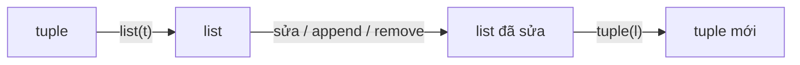
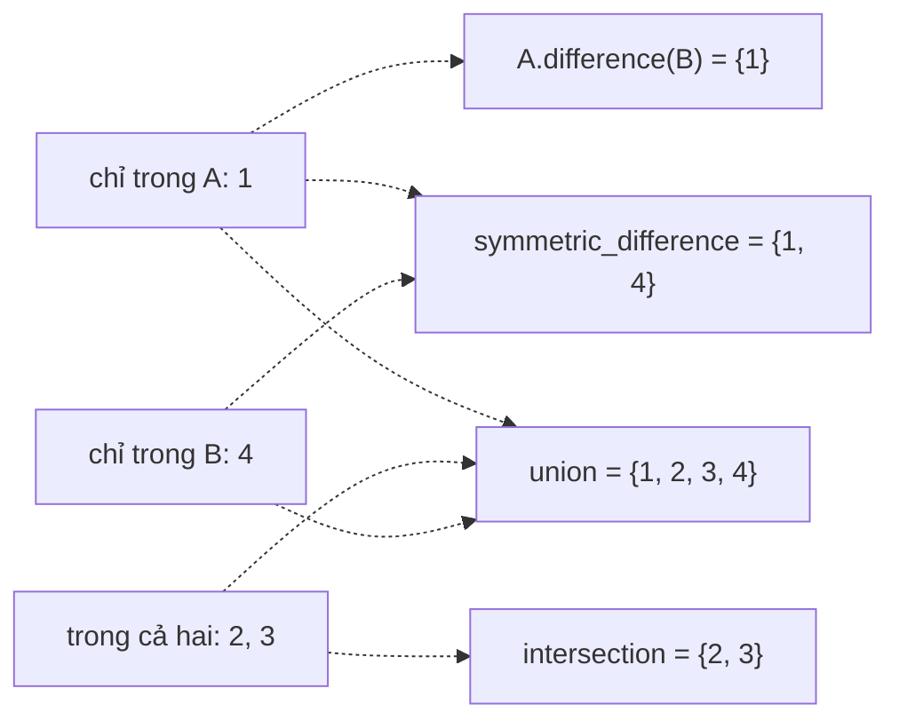
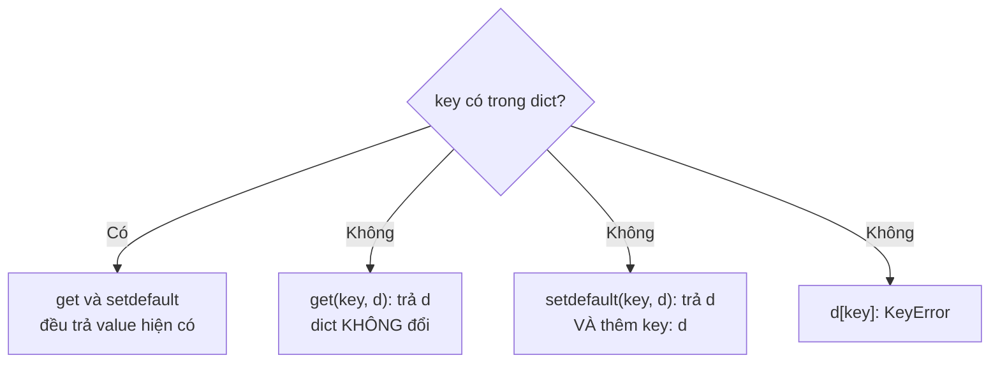

# Phương thức dict, set và tuple

> **abstract** Tóm tắt
> | | Tuple | Set | Dictionary |
> | --- | --- | --- | --- |
> | Ngoặc | `( )` | `{ }` | `{key: value}` |
> | Thứ tự, chỉ số | Có | **Không** | Truy cập bằng **khóa** |
> | Trùng lặp | Cho phép | **Không** | Khóa không trùng |
> | Sửa được | **Không** (list chỉ đọc) | Thêm/xóa được, không sửa item | Có |
> | Tạo bằng hàm | **`tuple()`** | **`set()`** | **`dict()`** |


## Tuple

### 1. Khái niệm

Nguồn tr. 89, tr. 90.

Tuple là kiểu dãy giống list: các giá trị cách nhau bởi dấu phẩy, đặt trong **ngoặc đơn**. Khác biệt chính:

- list trong `[]`, phần tử và kích thước **thay đổi được**;
- tuple trong `()`, **không cập nhật được** → coi như **list chỉ đọc**.

```python
tuple1 = ("apple", "banana", "cherry")
tuple4 = ("apple", "banana", "cherry", "apple", "cherry")
print(tuple4)    # ('apple', 'banana', 'cherry', 'apple', 'cherry') · cho phép trùng
tuple5 = ("abc", 34, True, 40, "male")   # nhiều kiểu khác nhau
thistuple = ("apple",)
print(type(thistuple))   # <class 'tuple'> · tuple một phần tử
thistuple = ("apple")
print(type(thistuple))   # <class 'str'>   · KHÔNG phải tuple
```

> **warning** Dễ nhầm
> Dấu phẩy tạo tuple, không phải ngoặc. `(50)` là số 50, `(50,)` là tuple. Tuple rỗng viết `()` (tr. 94).

### 2. Toán tử, hàm và truy cập

Nguồn tr. 91 → tr. 93.

`+` và `*` giống chuỗi nhưng kết quả là **tuple mới**. Có toán tử `in` và duyệt bằng `for`.

```python
t1 = (1, 2, 6, 'hello')
print(len(t1))                     # 4
print((1, 2, 3) + (4, 5, 6))       # (1, 2, 3, 4, 5, 6)
print(('Xin chào!',) * 4)          # ('Xin chào!', 'Xin chào!', 'Xin chào!', 'Xin chào!')
print(3 in (1, 2, 3))              # True
for x in (1, 2, 3):
    print(x)                       # 1, 2, 3 trên ba dòng
```

Truy cập bằng chỉ số trong `[]`: phần tử đầu là 0, chỉ số âm đếm từ cuối. Phạm vi `[start:end]`: bỏ *`start`* → từ đầu; bỏ *`end`* → tới cuối.

```python
thistuple = ("apple", "banana", "cherry", "orange", "kiwi", "melon", "mango")
print(thistuple[1])      # banana
print(thistuple[-1])     # mango
print(thistuple[2:5])    # ('cherry', 'orange', 'kiwi')
print(thistuple[:4])     # ('apple', 'banana', 'cherry', 'orange')
print(thistuple[3:])     # ('orange', 'kiwi', 'melon', 'mango')
print(thistuple[-4:-1])  # ('orange', 'kiwi', 'melon')
```

### 3. Không sửa được và cách lách

Nguồn tr. 94 → tr. 97.

```python
tuple1 = ('abcd', 786, 2.23, 'john', 70.2)
list1  = ['abcd', 786, 2.23, 'john', 70.2]
tuple1[2] = 1000   # Lỗi TypeError
list1[2]  = 1000   # Hợp lệ
```




> **note** Bảng dạng chữ
> | Muốn | Cách trong slide | Kết quả |
> | --- | --- | --- |
> | Đổi giá trị | `y = list(x); y[1] = "kiwi"; x = tuple(y)` | `('apple', 'kiwi', 'cherry')` |
> | Thêm item (cách 1) | `y = list(t); y.append("orange"); t = tuple(y)` | `('apple', 'banana', 'cherry', 'orange')` |
> | Thêm item (cách 2) | `y = ("orange",); t += y` | `('apple', 'banana', 'cherry', 'orange')` |
> | Xóa item | `y = list(t); y.remove("apple"); t = tuple(y)` | `('banana', 'cherry')` |
> | Xóa cả tuple | `del thistuple` | Gọi lại → `NameError` |

Tuple **không có** **`append()`**. `t += y` không sửa tuple cũ mà **tạo tuple mới** rồi gán lại tên.

### 4. Hàm với tuple

Nguồn tr. 98, tr. 99.

Tương tự list: **`len(tuple)`**, **`max(tuple)`**, **`min(tuple)`**, và **`tuple(seq)`** đổi list thành tuple.

```python
aList = [123, 'xyz', 'zara', 'abc']
aTuple = tuple(aList)
print("Elements of tuple:", aTuple)   # Elements of tuple: (123, 'xyz', 'zara', 'abc')
```

> **info** Mở rộng
> Tuple có 2 phương thức **`count(x)`** và **`index(x)`**. Tuple chứa list thì list con vẫn sửa được: `t = ([1],); t[0].append(2)` → `([1, 2],)`.

## Set

### 5. Khái niệm và khởi tạo

Nguồn tr. 100 → tr. 102.

Set là một collection **không thứ tự**, **không chỉ mục**, **không chứa phần tử trùng**, khai báo bằng `{}`. Thứ tự in ra **không đoán trước được**.

```python
set1 = {"apple", "banana", "cherry"}
set4 = {"abc", 34, True, 40, "male"}
print(type(set4))        # <class 'set'>
thisset = {"apple", "banana", "cherry", "apple"}
print(thisset)           # 3 phần tử, "apple" trùng bị bỏ; thứ tự in có thể khác mỗi lần chạy

tuple1 = (23, 10, 100, -1, "abc")
set1 = set(tuple1)                         # hàm set() từ tuple
set2 = set(("apple", "banana", "cherry"))  # chú ý hai lớp ngoặc tròn
```

> **warning** Dễ nhầm
> `{}` là **dict rỗng**. Set rỗng phải viết **`set()`**. In set rỗng ra **`set()`** (tr. 108).

### 6. Truy cập, thay đổi, thêm

Nguồn tr. 103 → tr. 105.

- **Không** truy cập bằng chỉ số (`s[0]` → `TypeError`). Dùng `for` hoặc `in`.
- Tạo xong **không sửa được item**, nhưng **thêm** được item mới.
- **`add(x)`**: thêm **một** item. **`update(iterable)`**: thêm **nhiều** item.

```python
setFruits = {"apple", "cherry", "banana"}
for x in setFruits:
    print(x)                        # 3 dòng, thứ tự tùy
print("banana" in {"apple", "banana", "cherry"})   # True

set1 = {"apple", "cherry", "banana"}
set1.add("kiwi")                    # 4 phần tử
set2 = {"apple", "cherry", "banana"}
set2.update(["orange", "mango", "grapes"])   # 6 phần tử
set3 = {"apple", "banana", "cherry"}
set4 = {"pineapple", "mango", "papaya"}
set3.update(set4)                   # 6 phần tử
```

### 7. Xóa item

Nguồn tr. 106 → tr. 108.


> **note** Bảng dạng chữ
> | Cách | Khi item không tồn tại | Trả về |
> | --- | --- | --- |
> | **`remove(x)`** | **Lỗi** `KeyError` | None |
> | **`discard(x)`** | **Không lỗi** | None |
> | **`pop()`** | Xóa **ngẫu nhiên** một item (vì không thứ tự) | Item bị xóa |
> | **`clear()`** | Làm rỗng set | None |

```python
set1 = {"apple", "banana", "cherry"}
set1.remove("banana");  print(set1)  # {'cherry', 'apple'} (thứ tự tùy)
set1.remove("orange")                # KeyError: 'orange'
set2 = {"apple", "banana", "cherry"}
set2.discard("banana")
set2.discard("orange")               # không lỗi, set giữ nguyên
thisset = {"apple", "banana", "cherry"}
x = thisset.pop()
print(x)        # một trong ba quả, mỗi lần chạy có thể khác
thisset.clear()
print(thisset)  # set()
```


### 8. Phép toán tập hợp

Nguồn tr. 109 → tr. 112.

Với $A = \{1, 2, 3\}$, $B = \{2, 3, 4\}$:

| Phương thức | Toán học | Kết quả | Trả set mới hay sửa tại chỗ? |
| --- | --- | --- | --- |
| **`A.union(B, …)`** | $A \cup B$ | `{1, 2, 3, 4}` | Mới |
| **`A.update(B)`** | $A \leftarrow A \cup B$ | A = `{1, 2, 3, 4}` | Tại chỗ |
| **`A.intersection(B, …)`** | $A \cap B$ | `{2, 3}` | Mới |
| **`A.intersection_update(B, …)`** | $A \leftarrow A \cap B$ | A = `{2, 3}` | Tại chỗ |
| **`A.difference(B)`** | $A \setminus B$ | `{1}` | Mới |
| **`A.difference_update(B)`** | $A \leftarrow A \setminus B$ | A = `{1}` | Tại chỗ |
| **`A.symmetric_difference(B)`** | $A \triangle B$ | `{1, 4}` | Mới |
| **`A.symmetric_difference_update(B)`** | $A \leftarrow A \triangle B$ | A = `{1, 4}` | Tại chỗ |
| **`A.isdisjoint(B)`** | $A \cap B = \varnothing$? | `False` | bool |
| **`A.issubset(B)`** | $A \subseteq B$? | `False` | bool |
| **`A.issuperset(B)`** | $A \supseteq B$? | `False` | bool |

Các phương thức còn lại trong bảng slide: **`add()`**, **`clear()`**, **`copy()`**, **`discard()`**, **`remove()`**, **`pop()`** (xem mục 6–7).



> **tip** Mẹo thi
> Tên có đuôi `_update` → **sửa set gốc**, trả `None`. Không có đuôi → **set mới**, set gốc giữ nguyên.

> **info** Mở rộng
> Toán tử tương đương: `A | B` (union), `A & B` (intersection), `A - B` (difference), `A ^ B` (symmetric_difference).

## Dictionary

### 9. Khái niệm và khai báo

Nguồn tr. 113 → tr. 116.

Dictionary hoạt động như **mảng kết hợp**, gồm các cặp **key–value**:

- **key**: hầu hết kiểu dữ liệu, thường là số hoặc chuỗi (phải hashable);
- **value**: bất kỳ.

Bao bởi `{}`, truy cập value bằng `[]` với key. Dict **không có hai item cùng khóa**: khai báo trùng thì **giá trị sau ghi đè**.

```python
thisdict = {
    "brand": "Ford",
    "model": "Mustang",
    "year": 1964
}
print(thisdict)            # {'brand': 'Ford', 'model': 'Mustang', 'year': 1964}
print(thisdict["brand"])   # Ford

thisdict = {"brand": "Ford", "model": "Mustang", "year": 1964, "year": 2020}
print(thisdict)            # {'brand': 'Ford', 'model': 'Mustang', 'year': 2020}

dictCar = dict(brand="Honda", model="Honda Civic", year=1972)
print(dictCar)             # {'brand': 'Honda', 'model': 'Honda Civic', 'year': 1972}
```

> **info** Mở rộng
> Slide nói dict "không có khái niệm thứ tự". Từ Python 3.7, dict **giữ thứ tự chèn** khi in và duyệt, nhưng vẫn không truy cập bằng chỉ số vị trí. **`popitem()`** dựa vào thứ tự chèn này.

### 10. Truy cập keys, values, items

Nguồn tr. 117 → tr. 119.

```python
dicta = {"brand": "Ford", "model": "Mustang", "year": 1964}
print(dicta.keys())    # dict_keys(['brand', 'model', 'year'])
print(dicta.values())  # dict_values(['Ford', 'Mustang', 1964])
print(dicta.items())   # dict_items([('brand', 'Ford'), ('model', 'Mustang'), ('year', 1964)])
```

Mỗi item là một **tuple (key, value)**. Duyệt dict bằng `for x in dict` lấy **khóa**.

### 11. Thay đổi và thêm item

Nguồn tr. 120 → tr. 123.

```python
dictb = {"brand": "Ford", "model": "Mustang", "year": 1964}
dictb["year"] = 2018            # đổi value qua key
print(dictb)   # {'brand': 'Ford', 'model': 'Mustang', 'year': 2018}
dictb.update({"year": 2020})    # cập nhật cả item bằng update()
print(dictb)   # {'brand': 'Ford', 'model': 'Mustang', 'year': 2020}
dictb["color"] = "red"          # key chưa có → THÊM item mới
print(dictb)   # {'brand': 'Ford', 'model': 'Mustang', 'year': 2020, 'color': 'red'}
```

> **tip** Mẹo thi
> Cú pháp `<tên từ điển>[Key] = values` vừa để **sửa** (key đã có) vừa để **thêm** (key chưa có).

### 12. Xóa item

Nguồn tr. 124 → tr. 126.


> **note** Bảng dạng chữ
> | Cách | Làm gì | Ví dụ → `dictb` sau đó |
> | --- | --- | --- |
> | **`pop(key)`** | Xóa item có key cụ thể, trả value | **`pop("model")`** → `{'brand': 'Ford', 'year': 1964}` |
> | **`popitem()`** | Xóa item **chèn vào cuối cùng** | → `{'brand': 'Ford', 'model': 'Mustang'}` |
> | **`clear()`** | Làm rỗng | → `{}` |
> | `del d[key]` | Xóa item theo key | `del dictb["model"]` → `{'brand': 'Ford', 'year': 1964}` |
> | `del d` | Xóa **toàn bộ** biến dict | **`print(dictb)`** → `NameError` |

### 13. Sao chép và dict lồng nhau

Nguồn tr. 127 → tr. 129.

Giống list: `dict2 = dict1` chỉ là **tham chiếu**.

```python
dictb = {"brand": "Ford", "model": "Mustang", "year": 1964}
dictc = dictb
dictb["year"] = 2020
print(dictc)   # {'brand': 'Ford', 'model': 'Mustang', 'year': 2020} · đổi theo
```

Bản sao thật: **`dictb.copy()`** hoặc **`dict(dictb)`**.

**Nested dictionary**: value là một dict khác. Có thể viết trực tiếp, hoặc tạo 3 dict con trước rồi gom lại.

```python
child1 = {"name": "Emil", "year": 2004}
child2 = {"name": "Tobias", "year": 2007}
child3 = {"name": "Linus", "year": 2011}
myfamily = {"child1": child1, "child2": child2, "child3": child3}
print(myfamily)
# {'child1': {'name': 'Emil', 'year': 2004}, 'child2': {'name': 'Tobias', 'year': 2007}, 'child3': {'name': 'Linus', 'year': 2011}}
print(myfamily["child2"]["name"])   # Tobias
```

### 14. Hàm với dict len, str, type, del, zip, sorted

Nguồn tr. 130 → tr. 132.


> **note** Bảng dạng chữ
> | Hàm | Ý nghĩa |
> | --- | --- |
> | **`len(dict)`** | Số item |
> | **`str(dict)`** | Chuỗi biểu diễn dict |
> | **`type(dict)`** | `<class 'dict'>` |
> | `del dict[x]` | Xóa khóa *`x`* |
> | **`dict(zip(l1, l2))`** | Ghép 2 list/tuple/set thành các cặp rồi tạo dict |
> | **`sorted(dict)`** | **List các key** đã sắp xếp |

```python
a = ["John", "Charles", "Mike"]
b = ["Jenny", "Christy", "Monica", "Vicky"]
print(dict(zip(a, b)))   # {'John': 'Jenny', 'Charles': 'Christy', 'Mike': 'Monica'}

dictb = {"brand": "Ford", "color": "White", "model": "Mustang", "year": 1964}
print(sorted(dictb))                 # ['brand', 'color', 'model', 'year']
print(sorted(dictb, reverse=True))   # ['year', 'model', 'color', 'brand']
```

> **warning** Dễ nhầm
> - **`zip`** dừng ở dãy **ngắn hơn**: `"Vicky"` bị bỏ.
> - Slide dùng **`zip`** với cả list, tuple và set. Với **set**, thứ tự ghép **không đảm bảo**.
> - **`sorted(dict)`** trả **list key**, không trả dict.

### 15. Phương thức của dict

Nguồn tr. 133 → tr. 137.


> **note** Bảng dạng chữ
> | Phương thức | Làm gì |
> | --- | --- |
> | **`clear()`** | Xóa mọi phần tử |
> | **`copy()`** | Trả bản sao |
> | **`dict.fromkeys(seq[, value])`** | Dict mới: key lấy từ `seq`, mọi key chung `value` (thiếu → `None`) |
> | **`get(key, default=None)`** | Value của key; thiếu key → `None` hoặc *`default`*. **Không thêm key** |
> | **`items()`**, **`keys()`**, **`values()`** | Các cặp / các key / các value |
> | **`setdefault(key, default=None)`** | Như **`get`**, nhưng nếu thiếu key thì **gán** `dict[key] = default` |
> | **`update(dict2)`** | Thêm/ghi đè các phần tử của `dict2` vào dict |

```python
x = ('key1', 'key2', 'key3')
print(dict.fromkeys(x, 0))   # {'key1': 0, 'key2': 0, 'key3': 0}
print(dict.fromkeys(x))      # {'key1': None, 'key2': None, 'key3': None}

car = {"brand": "Ford", "model": "Mustang", "year": 1964}
x = car.setdefault("model", "Bronco")   # key có sẵn → trả 'Mustang', không đổi
y = car.setdefault("color", "White")    # key thiếu → thêm 'color': 'White'
print(x)   # Mustang
print(y)   # White
```



> **question** Tự kiểm tra
> 1. **`type((5))`** và **`type((5,))`**? → `int` và `tuple`.
> 2. `t = (1, 2); t[0] = 9` → `TypeError`.
> 3. **`len({1, 1, 2, 2, 3})`** → `3`.
> 4. `s = {1, 2}; s.discard(5); s.remove(5)` → dòng cuối `KeyError`.
> 5. `{1, 2, 3}.difference({2})` → `{1, 3}`; còn `difference_update` trả gì? → `None`.
> 6. `{1, 2}.issubset({1, 2, 3})` → `True`.
> 7. `d = {"a": 1, "a": 2}; print(d)` → `{'a': 2}`.
> 8. `d = {}; d.get("x", 0); print(d)` → `{}`. Sau **`d.setdefault("x", 0)`** → `{'x': 0}`.
> 9. **`dict(zip("ab", [1, 2, 3]))`** → `{'a': 1, 'b': 2}`.
> 10. **`sorted({"b": 1, "a": 2})`** → `['a', 'b']`.
> 11. `d = {"x": 1}; e = d; e["y"] = 2; print(len(d))` → `2`.
> 12. `{"a": 1, "b": 2}.popitem()` → `('b', 2)`.

**Áp dụng ở** F207 Dict, set và tuple · F206 Theo dấu thay đổi của list và tham chiếu.
