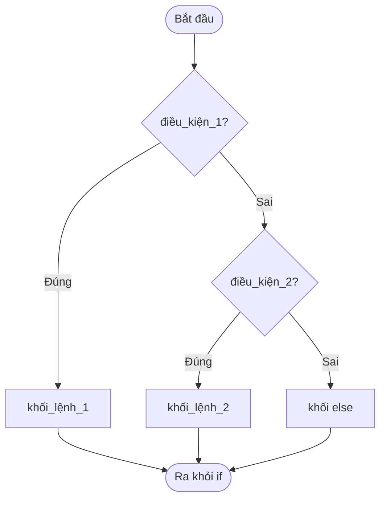
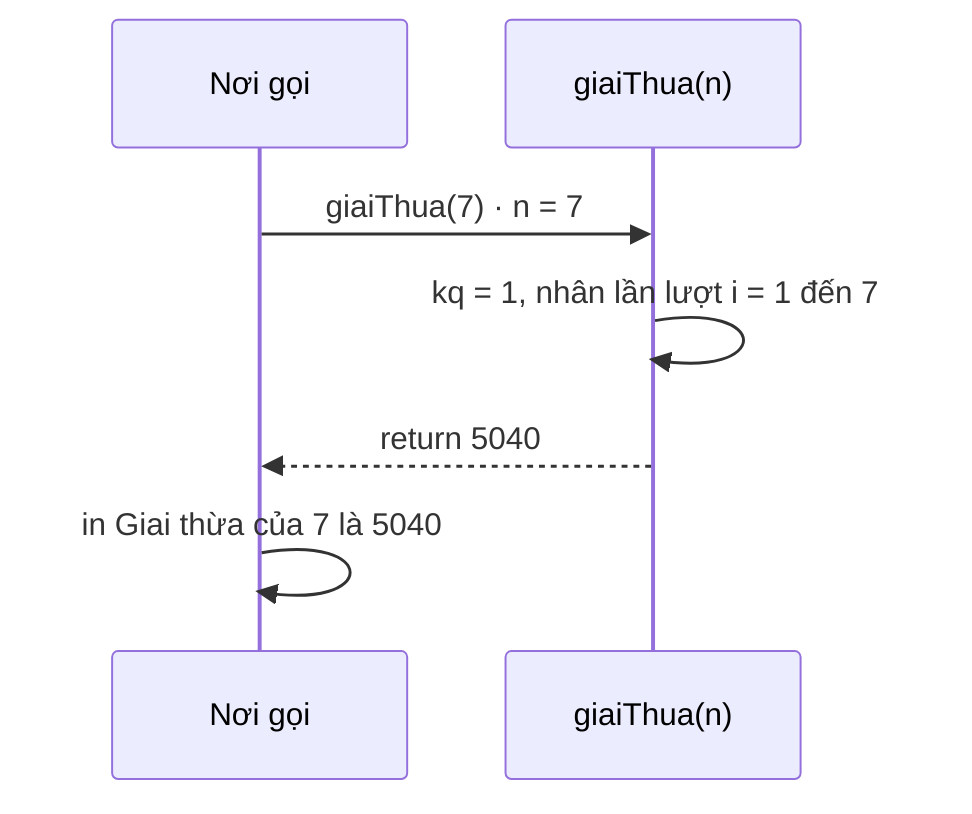

# Điều khiển và hàm

> **abstract** Tóm tắt
> - **if**: chạy khối lệnh của **nhánh đầu tiên** có điều kiện đúng. Có dạng rút gọn (short hand) một dòng.
> - **for**: vòng lặp **xác định** (biết trước số lần), duyệt **`range()`** hoặc một sequence (list, tuple, dict, set, string).
> - **while**: vòng lặp **không xác định**, kiểm tra điều kiện **trước** mỗi lượt.
> - `break` thoát vòng; `continue` sang lượt kế; `pass` giữ chỗ; `else` của vòng lặp chạy khi vòng kết thúc **không do break**.
> - Hàm: `def ten(tham_so): … return gia_tri`. Tham số có thể có **giá trị mặc định**, nhận **mọi kiểu**. `lambda arguments: expression` là hàm vô danh một biểu thức.

## 1. Cấu trúc if

Nguồn tr. 141 → tr. 147.

### 1.1 if không có else

```python
if điều_kiện:
    khối_lệnh
```

`khối_lệnh` chỉ chạy khi điều kiện **đúng**, sai thì bỏ qua. Điều kiện có thể đơn hoặc ghép bằng `and`, `or`, `not`.

```python
a = 33
b = 200
if b > a:
    print("b is greater than a")        # b is greater than a

a = 200; b = 33
if a > b: print("a is greater than b")  # short hand: một dòng
```

### 1.2 if – else

```python
if điều_kiện:
    khối_lệnh1
else:
    khối_lệnh2
```

```python
a = 33
b = 33
if b > a:
    print("b is greater than a")
else:
    print("b is less than a")    # In ra dòng này vì 33 > 33 là False

a = 2; b = 330
print("A") if a > b else print("B")   # B · short hand (biểu thức điều kiện)
```

> **warning** Dễ nhầm
> Ví dụ của slide in `"b is less than a"` dù **a bằng b**. Nhánh `else` bắt mọi trường hợp còn lại, kể cả bằng nhau. Câu thi hay hỏi đúng chỗ này.

### 1.3 Nhiều nhánh if – elif – else

```python
if điều_kiện_1:
    khối_lệnh_1
elif điều_kiện_2:
    khối_lệnh_2
...
elif điều_kiện_n:
    khối_lệnh_n
else:
    khối_lệnh
```

Nếu `điều_kiện_i` nào đúng thì `khối_lệnh_i` tương ứng được thực hiện, **tất cả các khối khác bị bỏ qua**.

```python
a = 200
b = 33
if b > a:
    print("b is greater than a")
elif a == b:
    print("a and b are equal")
else:
    print("a is greater than b")   # a is greater than b

a = 330; b = 330
print("A") if a > b else print("=") if a == b else print("B")   # =
```



### 1.4 if lồng nhau (nested if)

`if` nằm trong `if`. **`else` đi với `if` gần nó nhất nhưng phải cùng một khối lệnh** (cùng mức thụt lề).

```python
x = 41
if x > 10:
    print("Above ten,")
    if x > 20:
        print("and also above 20!")
    else:
        print("but not above 20.")
# Above ten,
# and also above 20!
```

> **example** Ví dụ: if độc lập khác elif
> Với `diem = 9`: viết `if diem >= 8: ...` rồi `if diem >= 5: ...` (hai if riêng) thì **cả hai** chạy. Viết `if … elif …` thì **chỉ nhánh đầu** chạy.

## 2. Vòng lặp for

Nguồn tr. 148 → tr. 159.

### 2.1 Cú pháp và range()

```python
for biến_chạy in range(n, m+1, step):
    # khối_lệnh
```

`biến_chạy` lần lượt nhận `n, n+step, n+2*step, …` (tới trước `m+1`). Không ghi *`step`* thì mặc định **1**.

**`range(start, end, step)`**: dãy số từ *`start`*, **dừng trước `end`**, bước *`step`*; mặc định *`start=0`*, *`step=1`*.


> **note** Bảng dạng chữ
> | Lời gọi | Dãy sinh ra |
> | --- | --- |
> | **`range(6)`** | 0, 1, 2, 3, 4, 5 |
> | **`range(2, 6)`** | 2, 3, 4, 5 |
> | **`range(2, 20, 3)`** | 2, 5, 8, 11, 14, 17 |
> | **`range(1, 101)`** | 1 … 100 (100 số) |
> | **`range(100, 0, -1)`** | 100, 99, …, 1 |
> | **`range(1, 101, 2)`** | 1, 3, 5, …, 99 |

```python
for i in range(1, 101):        # i nhận 1 đến 100
    print("Ngôn ngữ lập trình Python")   # in 100 lần
for i in range(100, 0, -1):    # in 100 → 1
    print(i)
for i in range(1, 101, 2):     # in 1, 3, 5, …, 99
    print(i)
```

Số phần tử của **`range(a, b, s)`** với $s > 0$: $\max\left(0, \left\lceil \frac{b-a}{s} \right\rceil\right)$. Ví dụ **`range(2, 20, 3)`**: $\lceil 18/3 \rceil = 6$.

### 2.2 Duyệt một sequence

Nguồn tr. 152.

```python
for x in ["apple", "banana", "cherry"]: print(x)   # apple banana cherry
for x in ("apple", "banana", "cherry"): print(x)   # tuple: như trên
for x in {"apple", "banana", "cherry"}: print(x)   # set: thứ tự tùy
for x in "banana": print(x)                        # b a n a n a (mỗi ký tự 1 dòng)
dictb = {"brand": "Ford", "color": "White", "model": "Mustang", "year": 1964}
for x in dictb: print(x)                           # brand color model year (các KHÓA)
```

### 2.3 break, continue, pass

Nguồn tr. 153 → tr. 155.

```python
fruits = ["apple", "banana", "cherry"]
for x in fruits:            # break SAU print
    print(x)
    if x == "banana":
        break
# apple, banana

for x in fruits:            # break TRƯỚC print
    if x == "banana":
        break
    print(x)
# apple

for x in fruits:            # continue: bỏ phần còn lại của lượt
    if x == "banana":
        continue
    print(x)
# apple, cherry

for x in [0, 1, 2]:
    pass                    # thân rỗng không được phép → đặt pass để không lỗi
```

> **warning** Dễ nhầm
> Vị trí `print` so với `break` quyết định phần tử `"banana"` có được in hay không. Luôn trace từng lượt.

### 2.4 else trong vòng for

Nguồn tr. 156.

Khối `else` chạy **khi vòng lặp kết thúc bình thường**, và **không chạy nếu vòng bị dừng bởi `break`**.

```python
for x in range(6):
    print(x)
else:
    print("Finally finished!")
# 0 1 2 3 4 5 Finally finished!

for x in range(6):
    if x == 3: break
    print(x)
else:
    print("Finally finished!")
# 0 1 2   (không in Finally finished!)
```


### 2.5 for lồng nhau

Nguồn tr. 157, tr. 158.

```python
for biến_chạy_1 in range(1, n+1):
    # khối_lệnh_1
    for biến_chạy_2 in range(1, m+1):
        # khối_lệnh_2
```

Vòng trong chạy **hết** cho **mỗi** lượt của vòng ngoài, tổng $n \times m$ lần.

```python
adj = ["red", "big", "tasty"]
fruits = ["apple", "banana", "cherry"]
for x in adj:
    for y in fruits:
        print(x, y)
# red apple, red banana, red cherry, big apple, …, tasty cherry (9 dòng)
```

### 2.6 List comprehension

Nguồn tr. 159.

Tạo list bằng **một dòng**, thay cho vòng `for` truyền thống. Mẫu: `[biểu_thức for x in nguồn if điều_kiện]`.

```python
even_list = [i for i in range(10) if i % 2 == 0]
print(even_list)      # [0, 2, 4, 6, 8]
square_list = [x**2 for x in range(5)]
print(square_list)    # [0, 1, 4, 9, 16]
string1 = "List Comprehension is a great technique in Python"
word1 = [word for word in string1.split() if len(word) > 4]
print(word1)          # ['Comprehension', 'great', 'technique', 'Python']
```

**Đọc theo thứ tự**: `for` (lấy từ đâu) → `if` (lọc) → biểu thức đầu (biến đổi). Viết lại thành vòng thường:

```python
even_list = []
for i in range(10):
    if i % 2 == 0:
        even_list.append(i)
```

## 3. Vòng lặp while

Nguồn tr. 160 → tr. 167.

### 3.1 Cú pháp

```python
while điều_kiện:
    khối_lệnh
```

Gọi là vòng **không xác định** vì thường không biết trước số lần lặp. Kiểm tra điều kiện **trước**: sai → thoát ngay (khối lệnh có thể chạy 0 lần); đúng → chạy khối lệnh rồi quay lên kiểm tra lại, cho đến khi điều kiện sai.

```python
i = 1
while i < 6:
    print(i)
    i += 1
# 1 2 3 4 5
```


> **note** Bảng dạng chữ
> | Lượt | i trước kiểm tra | `i < 6` | In | i sau `+= 1` |
> | --- | --- | --- | --- | --- |
> | 1 | 1 | True | 1 | 2 |
> | 2 | 2 | True | 2 | 3 |
> | … | … | … | … | … |
> | 5 | 5 | True | 5 | 6 |
> | — | 6 | **False** | thoát | — |

> **warning** Dễ nhầm
> Quên `i += 1` → điều kiện đúng mãi → **vòng lặp vô hạn**.

### 3.2 break, continue, else trong while

```python
i = 1
while i < 6:
    print(i)
    if i == 3:
        break          # dừng dù điều kiện while vẫn đúng
    i += 1
# 1 2 3

i = 0
while i < 6:
    i += 1
    if i == 3:
        continue       # bỏ print ở lượt i = 3
    print(i)
# 1 2 4 5 6

i = 1
while i < 6:
    print(i)
    i += 1
else:
    print("i is no longer less than 6")   # chạy 1 lần khi điều kiện SAI
# 1 2 3 4 5 i is no longer less than 6
```

> **tip** Mẹo thi
> Ví dụ `continue` tăng `i` **trước** khi kiểm tra, nên in tới **6** (không phải 5). Nếu đặt `i += 1` sau `continue` thì vòng sẽ kẹt mãi ở `i = 3`.

### 3.3 Ví dụ ứng dụng

**Kiểm soát giá trị nhập** (tr. 165): hỏi lại đến khi `0 < n < 100`.

```python
n = int(input("Mời nhập một số n (0<n<100): "))
while not (0 < n and n < 100):
    n = int(input("Mời nhập lại n (0<n<100): "))
# Nhập 200 → hỏi lại; 150 → hỏi lại; 50 → dừng
```

**Vòng `while True` + `break`** (tr. 166, tr. 167):

```python
while True:
    s = input('Nhap vao mot chuoi bat ky: ')
    if s == 'quit':
        break
    print('Do dai cua chuoi la: ', len(s))
print('Ket thuc!')
# ktqd neu → 8 ; cntt 2022 → 9 ; quit → Ket thuc!

while True:
    s = input('Nhap vao mot chuoi: ')
    if s == 'quit':
        break
    if len(s) < 3:
        print('Chuoi da nhap qua ngan')
        continue
    print('Chuoi da nhap hop le!')
# ktqd neu → hop le ; vn → qua ngan ; quit → dừng
```

## 4. Hàm

### 4.1 Định nghĩa và gọi hàm

Nguồn tr. 169 → tr. 172.

```python
def tên_hàm(danh_sách_tham_số):
    # thân hàm
    return giá_trị

tên_hàm(danh_sách_đối_số)   # gọi hàm
```

**Tham số** (parameter) là tên trong định nghĩa; **đối số** (argument) là giá trị truyền khi gọi.

```python
def my_function():
    print("Hello from a function")
my_function()                       # Hello from a function

def my_function(fname):
    print(fname + " Refsnes")
my_function("Emil")                 # Emil Refsnes
my_function("Tobias")               # Tobias Refsnes
my_function("Linus")                # Linus Refsnes

def my_function(fname, lname):
    print(fname + " " + lname)
my_function("Emil", "Refsnes")      # Emil Refsnes
my_function("Emil")
# TypeError: my_function() missing 1 required positional argument: 'lname'
```



### 4.2 Tham số mặc định và kiểu tham số

Nguồn tr. 173, tr. 174.

Gọi hàm **không có đối số** → dùng **giá trị mặc định**.

```python
def my_function(country="Norway"):
    print("I am from " + country)
my_function("Sweden")   # I am from Sweden
my_function("India")    # I am from India
my_function()           # I am from Norway
my_function("Brazil")   # I am from Brazil
```

Đối số có thể thuộc **bất kỳ kiểu nào** (string, number, list, dict…), và bên trong hàm vẫn giữ nguyên kiểu đó.

```python
def my_function(food):
    for x in food:
        print(x)
fruits = ["apple", "banana", "cherry"]
my_function(fruits)     # apple banana cherry
```

### 4.3 Ví dụ: tính giai thừa $S = n!$

Nguồn tr. 175.

$$n! = 1 \cdot 2 \cdot \ldots \cdot n, \qquad 7! = 5040$$

```python
def nhapN():
    return int(input("Nhập vào 1 số nguyên: "))

def giaiThua(n):
    kq = 1
    for i in range(1, n+1):
        kq = kq * i
    return kq

def main():
    n = nhapN()
    print("Giai thừa của", n, "là", giaiThua(n))

main()
# Nhập vào 1 số nguyên: 7
# Giai thừa của 7 là 5040
```

> **warning** Dễ nhầm
> - Hàm không có `return` (hoặc chỉ `print`) **trả về `None`**: `x = my_function()` → in ra chữ nhưng *`x`* là `None`.
> - `return` kết thúc hàm ngay, các lệnh sau không chạy.
> - Biến tạo trong hàm là **cục bộ**: `kq` không dùng được bên ngoài **`giaiThua`**.

### 4.4 Hàm lambda

Nguồn tr. 176, tr. 177.

Hàm **vô danh** (anonymous function): không có tên như hàm `def`, **chỉ chứa một biểu thức**, kết quả biểu thức là giá trị trả về. Dùng viết hàm ngắn gọn.

```python
lambda arguments: expression
```

```python
square = lambda x: x ** 2
print(square(5))            # 25
# tương đương:
def square(x):
    return x ** 2

sum_numbers = lambda a, b: a + b
print(sum_numbers(3, 7))    # 10
```


> **note** Bảng dạng chữ
> | | `def` | `lambda` |
> | --- | --- | --- |
> | Tên | Có | Không (gán vào biến nếu muốn) |
> | Thân | Nhiều lệnh | **Một biểu thức** |
> | `return` | Viết rõ | Ngầm định |

> **info** Mở rộng
> lambda hay dùng làm đối số: **`sorted(ds, key=lambda x: x[1])`**, **`list(map(lambda x: x*2, [1, 2]))`** → `[2, 4]`.

> **question** Tự kiểm tra
> 1. `x = 5` rồi `if x > 3: print("A")` / `elif x > 1: print("B")` / `else: print("C")` in gì? → `A` (chỉ nhánh đầu đúng).
> 2. **`list(range(3, 10, 3))`** → `[3, 6, 9]`.
> 3. **`len(range(0, 10, 4))`** → `3` (0, 4, 8).
> 4. `for i in range(5): if i == 2: continue; print(i)` in → `0 1 3 4`.
> 5. `for i in range(3): pass` rồi `else: print("ok")` → in `ok`.
> 6. `for i in range(3): if i == 1: break` + `else: print("ok")` → **không** in.
> 7. `i = 10; while i < 5: i += 1` → thân chạy **0** lần.
> 8. `[c for c in "abc" if c != "b"]` → `['a', 'c']`.
> 9. `def f(a, b=2): return a * b`; **`f(3)`** và **`f(3, 4)`** → `6` và `12`.
> 10. `def g(): print(1)`; `x = g()`; **`print(x)`** → in `1` rồi `None`.
> 11. `(lambda x, y: x - y)(10, 3)` → `7`.
> 12. Hai vòng `for` lồng, ngoài 3 lượt, trong 4 lượt → thân trong chạy `12` lần.

**Áp dụng ở** F208 Rẽ nhánh if-elif-else · F209 Trace vòng lặp, range và tích lũy · F210 Hàm, tham số, return và lambda · F213 List comprehension và biểu thức gọn.
