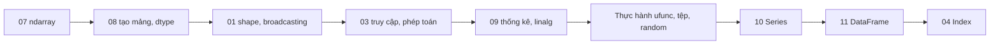

# Chương 03 · NumPy và Pandas

> **abstract** Trang vào chương
> NumPy tính trên **mảng** theo vị trí và trục. Pandas xử lý **bảng có nhãn** và căn theo nhãn. Đọc mỗi đoạn code bằng bốn câu hỏi: giá trị gì, kiểu gì, shape bao nhiêu, nhãn nào.

**Đầu ra.** Dự đoán được shape sau reshape/transpose/reduce, phát hiện broadcasting sai, đọc đúng kết quả fancy/boolean indexing, dự đoán nhãn sau căn chỉnh và chọn đúng *`loc`*/`iloc`/`at`/`iat`.

Cần biết trước [Python](../02%20Python/00%20M%E1%BB%A5c%20l%E1%BB%A5c.md).

## Thứ tự đọc

1. [07 Giới thiệu NumPy và ndarray](07%20Gi%E1%BB%9Bi%20thi%E1%BB%87u%20NumPy%20v%C3%A0%20ndarray.md) · tr. 4–16
2. [08 Hàm tạo mảng và dtype](08%20H%C3%A0m%20t%E1%BA%A1o%20m%E1%BA%A3ng%20v%C3%A0%20dtype.md) · tr. 17–31
3. [01 Shape axis và broadcasting](01%20Shape%20axis%20v%C3%A0%20broadcasting.md) · tr. 32–39, 52–56
4. [03 Truy cập và phép toán NumPy](03%20Truy%20c%E1%BA%ADp%20v%C3%A0%20ph%C3%A9p%20to%C3%A1n%20NumPy.md) · tr. 40–51
5. [09 Thống kê, tập hợp và đại số tuyến tính](09%20Th%E1%BB%91ng%20k%C3%AA%2C%20t%E1%BA%ADp%20h%E1%BB%A3p%20v%C3%A0%20%C4%91%E1%BA%A1i%20s%E1%BB%91%20tuy%E1%BA%BFn%20t%C3%ADnh.md) · tr. 57–68
6. [Thực hành NumPy ufunc tệp và ngẫu nhiên](Th%E1%BB%B1c%20h%C3%A0nh%20NumPy%20ufunc%20t%E1%BB%87p%20v%C3%A0%20ng%E1%BA%ABu%20nhi%C3%AAn.md) · tr. 69–84
7. [10 Giới thiệu Pandas và Series](10%20Gi%E1%BB%9Bi%20thi%E1%BB%87u%20Pandas%20v%C3%A0%20Series.md) · tr. 85–110
8. [11 DataFrame tạo, truy xuất và cập nhật](11%20DataFrame%20t%E1%BA%A1o%2C%20truy%20xu%E1%BA%A5t%20v%C3%A0%20c%E1%BA%ADp%20nh%E1%BA%ADt.md) · tr. 111–139
9. [04 Index và căn chỉnh Pandas](04%20Index%20v%C3%A0%20c%C4%83n%20ch%E1%BB%89nh%20Pandas.md) · tr. 140–145
10. Ôn: [05 Cú pháp nhanh](05%20C%C3%BA%20ph%C3%A1p%20nhanh.md) → [06 Tự kiểm tra](06%20T%E1%BB%B1%20ki%E1%BB%83m%20tra.md) → Thẻ nhớ chương 3

## Bản đồ chương

## Sơ đồ Excalidraw

- [02 Trục và shape.excalidraw](../../diagrams/03%20NumPy%20v%C3%A0%20Pandas/02%20Tr%E1%BB%A5c%20v%C3%A0%20shape.excalidraw.md) và [Đọc trục của ma trận.excalidraw](../../diagrams/03%20NumPy%20v%C3%A0%20Pandas/%C4%90%E1%BB%8Dc%20tr%E1%BB%A5c%20c%E1%BB%A7a%20ma%20tr%E1%BA%ADn.excalidraw.md): axis biến mất khi reduce.
- [Broadcasting từng bước.excalidraw](../../diagrams/03%20NumPy%20v%C3%A0%20Pandas/Broadcasting%20t%E1%BB%ABng%20b%C6%B0%E1%BB%9Bc.excalidraw.md): hai shape có cộng được không.
- [View hay copy.excalidraw](../../diagrams/03%20NumPy%20v%C3%A0%20Pandas/View%20hay%20copy.excalidraw.md): sửa kết quả có đổi mảng gốc không.
- [Căn chỉnh Series theo nhãn.excalidraw](../../diagrams/03%20NumPy%20v%C3%A0%20Pandas/C%C4%83n%20ch%E1%BB%89nh%20Series%20theo%20nh%C3%A3n.excalidraw.md): theo dấu `s1 + s2` theo nhãn.
- [Chọn loc hay iloc.excalidraw](../../diagrams/03%20NumPy%20v%C3%A0%20Pandas/Ch%E1%BB%8Dn%20loc%20hay%20iloc.excalidraw.md): chọn công cụ truy xuất DataFrame.

## Phủ slide

Mọi trang 1–146 của Lec3 đều nằm trong một dải dưới đây.

| Trang | Chủ đề | Note |
| --- | --- | --- |
| tr. 1–3 | Bìa, nội dung bài giảng | không có nội dung thi |
| tr. 4 | Dàn ý 3.1 NumPy | [07 · Giới thiệu NumPy và ndarray](07%20Gi%E1%BB%9Bi%20thi%E1%BB%87u%20NumPy%20v%C3%A0%20ndarray.md) |
| tr. 5–7 | NumPy là gì, tính năng, ứng dụng | [07 · NumPy là gì và dùng để làm gì](07%20Gi%E1%BB%9Bi%20thi%E1%BB%87u%20NumPy%20v%C3%A0%20ndarray.md) |
| tr. 8–9 | Import, tạo ndarray | [07 · Import và tạo ndarray đầu tiên](07%20Gi%E1%BB%9Bi%20thi%E1%BB%87u%20NumPy%20v%C3%A0%20ndarray.md) |
| tr. 10–12 | Chiều 0D–3D | [07 · Chiều của mảng: 0D, 1D, 2D, 3D](07%20Gi%E1%BB%9Bi%20thi%E1%BB%87u%20NumPy%20v%C3%A0%20ndarray.md) |
| tr. 13–14 | ndim, ndmin | [07 · Thuộc tính ndim và tham số ndmin](07%20Gi%E1%BB%9Bi%20thi%E1%BB%87u%20NumPy%20v%C3%A0%20ndarray.md) |
| tr. 15–16 | Quy ước axis | [07 · Quy ước axis: từ ngoặc ngoài vào trong](07%20Gi%E1%BB%9Bi%20thi%E1%BB%87u%20NumPy%20v%C3%A0%20ndarray.md) |
| tr. 17 | Bảng hàm tạo mảng | [08 · Bảng hàm tạo mảng](08%20H%C3%A0m%20t%E1%BA%A1o%20m%E1%BA%A3ng%20v%C3%A0%20dtype.md) |
| tr. 18–20, 24–25 | empty, zeros, ones, asarray, full | [08 · Tham số của empty, zeros, ones, full, asarray](08%20H%C3%A0m%20t%E1%BA%A1o%20m%E1%BA%A3ng%20v%C3%A0%20dtype.md) |
| tr. 21 | arange | [08 · arange: dãy theo bước nhảy](08%20H%C3%A0m%20t%E1%BA%A1o%20m%E1%BA%A3ng%20v%C3%A0%20dtype.md) |
| tr. 22–23 | linspace | [08 · linspace: dãy theo số phần tử](08%20H%C3%A0m%20t%E1%BA%A1o%20m%E1%BA%A3ng%20v%C3%A0%20dtype.md) |
| tr. 26 | Bảng kiểu dữ liệu | [08 · Bảng kiểu dữ liệu NumPy](08%20H%C3%A0m%20t%E1%BA%A1o%20m%E1%BA%A3ng%20v%C3%A0%20dtype.md) |
| tr. 27–29 | dtype, chỉ định dtype, ValueError | [08 · Kiểm tra và chỉ định dtype](08%20H%C3%A0m%20t%E1%BA%A1o%20m%E1%BA%A3ng%20v%C3%A0%20dtype.md) |
| tr. 30–31 | astype | [08 · Đổi kiểu bằng astype](08%20H%C3%A0m%20t%E1%BA%A1o%20m%E1%BA%A3ng%20v%C3%A0%20dtype.md) |
| tr. 32 | shape | [01 · Shape của mảng](01%20Shape%20axis%20v%C3%A0%20broadcasting.md) |
| tr. 33–36 | reshape, -1, làm phẳng | [01 · Reshape: đổi hình dạng, giữ số phần tử](01%20Shape%20axis%20v%C3%A0%20broadcasting.md) |
| tr. 37–39 | Chuyển vị, transpose, swapaxes | [01 · Chuyển vị và hoán đổi trục](01%20Shape%20axis%20v%C3%A0%20broadcasting.md) |
| tr. 40–41 | Index dương, âm | [03 · Chỉ số dương và âm](03%20Truy%20c%E1%BA%ADp%20v%C3%A0%20ph%C3%A9p%20to%C3%A1n%20NumPy.md) |
| tr. 42–44 | Slice | [03 · Lát cắt (slice)](03%20Truy%20c%E1%BA%ADp%20v%C3%A0%20ph%C3%A9p%20to%C3%A1n%20NumPy.md) |
| tr. 45–46 | Fancy indexing | [03 · Fancy indexing](03%20Truy%20c%E1%BA%ADp%20v%C3%A0%20ph%C3%A9p%20to%C3%A1n%20NumPy.md) |
| tr. 47 | Boolean indexing | [03 · Boolean indexing](03%20Truy%20c%E1%BA%ADp%20v%C3%A0%20ph%C3%A9p%20to%C3%A1n%20NumPy.md) |
| tr. 48 | Toán tử số học | [03 · Toán tử số học](03%20Truy%20c%E1%BA%ADp%20v%C3%A0%20ph%C3%A9p%20to%C3%A1n%20NumPy.md) |
| tr. 49 | Toán tử so sánh | [03 · Toán tử so sánh](03%20Truy%20c%E1%BA%ADp%20v%C3%A0%20ph%C3%A9p%20to%C3%A1n%20NumPy.md) |
| tr. 50 | add, subtract, dot… | [03 · Hàm toán học tương đương toán tử](03%20Truy%20c%E1%BA%ADp%20v%C3%A0%20ph%C3%A9p%20to%C3%A1n%20NumPy.md) |
| tr. 51 | min, max, sum theo axis | [03 · min, max, sum theo axis](03%20Truy%20c%E1%BA%ADp%20v%C3%A0%20ph%C3%A9p%20to%C3%A1n%20NumPy.md) |
| tr. 52–53 | Broadcasting: quy tắc | [01 · Broadcasting: quy tắc](01%20Shape%20axis%20v%C3%A0%20broadcasting.md) |
| tr. 54–56 | Broadcasting: ví dụ, lỗi | [01 · Broadcasting: ví dụ và ca lỗi](01%20Shape%20axis%20v%C3%A0%20broadcasting.md) |
| tr. 57 | Thống kê cả mảng | [09 · Thống kê trên cả mảng](09%20Th%E1%BB%91ng%20k%C3%AA%2C%20t%E1%BA%ADp%20h%E1%BB%A3p%20v%C3%A0%20%C4%91%E1%BA%A1i%20s%E1%BB%91%20tuy%E1%BA%BFn%20t%C3%ADnh.md) |
| tr. 58 | Thống kê theo axis | [09 · Thống kê theo axis](09%20Th%E1%BB%91ng%20k%C3%AA%2C%20t%E1%BA%ADp%20h%E1%BB%A3p%20v%C3%A0%20%C4%91%E1%BA%A1i%20s%E1%BB%91%20tuy%E1%BA%BFn%20t%C3%ADnh.md) |
| tr. 59 | cumsum, cumprod | [09 · Tích lũy cumsum và cumprod](09%20Th%E1%BB%91ng%20k%C3%AA%2C%20t%E1%BA%ADp%20h%E1%BB%A3p%20v%C3%A0%20%C4%91%E1%BA%A1i%20s%E1%BB%91%20tuy%E1%BA%BFn%20t%C3%ADnh.md) |
| tr. 60 | Bảng phương thức thống kê | [09 · Bảng phương thức thống kê](09%20Th%E1%BB%91ng%20k%C3%AA%2C%20t%E1%BA%ADp%20h%E1%BB%A3p%20v%C3%A0%20%C4%91%E1%BA%A1i%20s%E1%BB%91%20tuy%E1%BA%BFn%20t%C3%ADnh.md) |
| tr. 61–62 | Mảng logical: sum, any, all | [09 · Phương thức cho mảng logical](09%20Th%E1%BB%91ng%20k%C3%AA%2C%20t%E1%BA%ADp%20h%E1%BB%A3p%20v%C3%A0%20%C4%91%E1%BA%A1i%20s%E1%BB%91%20tuy%E1%BA%BFn%20t%C3%ADnh.md) |
| tr. 63–65 | Tập hợp | [09 · Phép toán tập hợp](09%20Th%E1%BB%91ng%20k%C3%AA%2C%20t%E1%BA%ADp%20h%E1%BB%A3p%20v%C3%A0%20%C4%91%E1%BA%A1i%20s%E1%BB%91%20tuy%E1%BA%BFn%20t%C3%ADnh.md) |
| tr. 66 | dot và @ | [09 · Nhân ma trận: dot và @](09%20Th%E1%BB%91ng%20k%C3%AA%2C%20t%E1%BA%ADp%20h%E1%BB%A3p%20v%C3%A0%20%C4%91%E1%BA%A1i%20s%E1%BB%91%20tuy%E1%BA%BFn%20t%C3%ADnh.md) |
| tr. 67–68 | numpy.linalg | [09 · numpy.linalg](09%20Th%E1%BB%91ng%20k%C3%AA%2C%20t%E1%BA%ADp%20h%E1%BB%A3p%20v%C3%A0%20%C4%91%E1%BA%A1i%20s%E1%BB%91%20tuy%E1%BA%BFn%20t%C3%ADnh.md) |
| tr. 69–70 | Ufunc, modf | [Thực hành · Ufunc một và hai đầu vào](Th%E1%BB%B1c%20h%C3%A0nh%20NumPy%20ufunc%20t%E1%BB%87p%20v%C3%A0%20ng%E1%BA%ABu%20nhi%C3%AAn.md) |
| tr. 71 | Unary ufunc | [Thực hành · Bảng unary ufunc](Th%E1%BB%B1c%20h%C3%A0nh%20NumPy%20ufunc%20t%E1%BB%87p%20v%C3%A0%20ng%E1%BA%ABu%20nhi%C3%AAn.md) |
| tr. 72 | Binary ufunc | [Thực hành · Bảng binary ufunc](Th%E1%BB%B1c%20h%C3%A0nh%20NumPy%20ufunc%20t%E1%BB%87p%20v%C3%A0%20ng%E1%BA%ABu%20nhi%C3%AAn.md) |
| tr. 73 | np.where | [Thực hành · Chọn từng phần tử với np.where](Th%E1%BB%B1c%20h%C3%A0nh%20NumPy%20ufunc%20t%E1%BB%87p%20v%C3%A0%20ng%E1%BA%ABu%20nhi%C3%AAn.md) |
| tr. 74–76 | Tệp nhị phân .npy/.npz | [Thực hành · Lưu và đọc tệp nhị phân](Th%E1%BB%B1c%20h%C3%A0nh%20NumPy%20ufunc%20t%E1%BB%87p%20v%C3%A0%20ng%E1%BA%ABu%20nhi%C3%AAn.md) |
| tr. 77 | Tệp văn bản | [Thực hành · Lưu và đọc tệp văn bản](Th%E1%BB%B1c%20h%C3%A0nh%20NumPy%20ufunc%20t%E1%BB%87p%20v%C3%A0%20ng%E1%BA%ABu%20nhi%C3%AAn.md) |
| tr. 78–80 | Giả ngẫu nhiên, seed, Generator | [Thực hành · Số giả ngẫu nhiên và seed](Th%E1%BB%B1c%20h%C3%A0nh%20NumPy%20ufunc%20t%E1%BB%87p%20v%C3%A0%20ng%E1%BA%ABu%20nhi%C3%AAn.md) |
| tr. 81 | Bảng hàm Generator | [Thực hành · Bảng hàm của Generator](Th%E1%BB%B1c%20h%C3%A0nh%20NumPy%20ufunc%20t%E1%BB%87p%20v%C3%A0%20ng%E1%BA%ABu%20nhi%C3%AAn.md) |
| tr. 82–84 | Sắp xếp, phân vị | [Thực hành · Sắp xếp và phân vị](Th%E1%BB%B1c%20h%C3%A0nh%20NumPy%20ufunc%20t%E1%BB%87p%20v%C3%A0%20ng%E1%BA%ABu%20nhi%C3%AAn.md) |
| tr. 85–86 | Dàn ý 3.2 Pandas | [10 · Giới thiệu Pandas và Series](10%20Gi%E1%BB%9Bi%20thi%E1%BB%87u%20Pandas%20v%C3%A0%20Series.md) |
| tr. 87–89 | Pandas là gì, quan hệ NumPy | [10 · Pandas là gì](10%20Gi%E1%BB%9Bi%20thi%E1%BB%87u%20Pandas%20v%C3%A0%20Series.md) |
| tr. 90–92 | Series, cú pháp tạo | [10 · Series là gì và cách tạo](10%20Gi%E1%BB%9Bi%20thi%E1%BB%87u%20Pandas%20v%C3%A0%20Series.md) |
| tr. 93–95 | Series từ dict, scalar | [10 · Tạo Series từ dict và scalar](10%20Gi%E1%BB%9Bi%20thi%E1%BB%87u%20Pandas%20v%C3%A0%20Series.md) |
| tr. 96–99 | Thuộc tính, head/tail, name | [10 · Thuộc tính và phương thức của Series](10%20Gi%E1%BB%9Bi%20thi%E1%BB%87u%20Pandas%20v%C3%A0%20Series.md) |
| tr. 100–105 | Truy xuất Series | [10 · Truy xuất phần tử của Series](10%20Gi%E1%BB%9Bi%20thi%E1%BB%87u%20Pandas%20v%C3%A0%20Series.md) |
| tr. 106–107 | Phép toán, isna | [10 · Phép toán, isna và Series như dict](10%20Gi%E1%BB%9Bi%20thi%E1%BB%87u%20Pandas%20v%C3%A0%20Series.md) |
| tr. 108 | Căn chỉnh theo nhãn | [10 · Căn chỉnh theo nhãn](10%20Gi%E1%BB%9Bi%20thi%E1%BB%87u%20Pandas%20v%C3%A0%20Series.md) |
| tr. 109–110 | axes, empty | [10 · Thuộc tính axes và empty](10%20Gi%E1%BB%9Bi%20thi%E1%BB%87u%20Pandas%20v%C3%A0%20Series.md) |
| tr. 111 | Hàm DataFrame() | [11 · Hàm tạo DataFrame và các tham số](11%20DataFrame%20t%E1%BA%A1o%2C%20truy%20xu%E1%BA%A5t%20v%C3%A0%20c%E1%BA%ADp%20nh%E1%BA%ADt.md) |
| tr. 112–115 | Tạo từ dict, list, ndarray, index | [11 · Tạo từ dict, list, mảng NumPy](11%20DataFrame%20t%E1%BA%A1o%2C%20truy%20xu%E1%BA%A5t%20v%C3%A0%20c%E1%BA%ADp%20nh%E1%BA%ADt.md) |
| tr. 116–118 | columns, dict lồng | [11 · Tham số columns và dict lồng nhau](11%20DataFrame%20t%E1%BA%A1o%2C%20truy%20xu%E1%BA%A5t%20v%C3%A0%20c%E1%BA%ADp%20nh%E1%BA%ADt.md) |
| tr. 119 | Bảng đầu vào hợp lệ | [11 · Bảng đầu vào hợp lệ](11%20DataFrame%20t%E1%BA%A1o%2C%20truy%20xu%E1%BA%A5t%20v%C3%A0%20c%E1%BA%ADp%20nh%E1%BA%ADt.md) |
| tr. 120 | head, tail | [11 · head và tail](11%20DataFrame%20t%E1%BA%A1o%2C%20truy%20xu%E1%BA%A5t%20v%C3%A0%20c%E1%BA%ADp%20nh%E1%BA%ADt.md) |
| tr. 121–125 | Truy xuất hàng | [11 · Truy xuất hàng](11%20DataFrame%20t%E1%BA%A1o%2C%20truy%20xu%E1%BA%A5t%20v%C3%A0%20c%E1%BA%ADp%20nh%E1%BA%ADt.md) |
| tr. 126–131 | Truy xuất cột | [11 · Truy xuất cột](11%20DataFrame%20t%E1%BA%A1o%2C%20truy%20xu%E1%BA%A5t%20v%C3%A0%20c%E1%BA%ADp%20nh%E1%BA%ADt.md) |
| tr. 132–136 | Cập nhật iloc, loc, at, iat | [11 · Cập nhật giá trị](11%20DataFrame%20t%E1%BA%A1o%2C%20truy%20xu%E1%BA%A5t%20v%C3%A0%20c%E1%BA%ADp%20nh%E1%BA%ADt.md) |
| tr. 137–139 | Gán cột list/ndarray/Series | [11 · Gán cột bằng list, ndarray hay Series](11%20DataFrame%20t%E1%BA%A1o%2C%20truy%20xu%E1%BA%A5t%20v%C3%A0%20c%E1%BA%ADp%20nh%E1%BA%ADt.md) |
| tr. 140–141 | Đối tượng Index | [04 · Đối tượng Index là gì](04%20Index%20v%C3%A0%20c%C4%83n%20ch%E1%BB%89nh%20Pandas.md) |
| tr. 142 | Index bất biến, phép tập hợp | [04 · Index bất biến](04%20Index%20v%C3%A0%20c%C4%83n%20ch%E1%BB%89nh%20Pandas.md) |
| tr. 143 | Index giống mảng | [04 · Index giống mảng](04%20Index%20v%C3%A0%20c%C4%83n%20ch%E1%BB%89nh%20Pandas.md) |
| tr. 144 | Index giống tập hợp | [04 · Index giống tập hợp](04%20Index%20v%C3%A0%20c%C4%83n%20ch%E1%BB%89nh%20Pandas.md) |
| tr. 145 | Bảng phương thức Index | [04 · Bảng phương thức và thuộc tính của Index](04%20Index%20v%C3%A0%20c%C4%83n%20ch%E1%BB%89nh%20Pandas.md) |
| tr. 146 | Cảm ơn | không có nội dung thi |

> **warning** Lỗi trong slide đã ghi chú trong note
> **`linspace(0, 5, 5, dtype=int32)`** ra `[0 1 2 3 5]` (tr. 23) · **`np.substract`** → **`np.subtract`** (tr. 50) · **`.sort`** sắp tại chỗ, **`np.sort`** mới trả bản sao (tr. 82) · **`np.DataFrame`** → **`pd.DataFrame`** (tr. 111) · **`tail(2)`** là 2 hàng (tr. 120) · **`np.in1d`** đã bỏ trong NumPy 2.x (tr. 65).

## Luyện tập theo họ

Sau phần tự kiểm tra, mở các họ bài của chương 3.

- F301 Tạo mảng NumPy và dtype
- F302 Dự đoán shape – reshape, chuyển vị, view và copy
- F303 Chỉ mục, lọc boolean và np.where
- F304 Phép toán theo phần tử, ufunc và broadcasting
- F305 Giảm theo trục và thống kê mảng
- F306 Đại số tuyến tính với NumPy
- F307 Số ngẫu nhiên, tệp NumPy và meshgrid
- F308 Series – nhãn, căn chỉnh và phép toán
- F309 Tạo DataFrame và đọc cấu trúc bảng
- F310 Chọn dòng-cột bằng loc, iloc và điều kiện
- F311 Đối tượng Index và reindex
- F312 Hàm tóm tắt, sắp xếp và apply trong Pandas

## Kiểm tra nhanh trước khi rời chương

Cộng hai Series cùng giá trị [2, 4] nhưng có nhãn lần lượt a,b và b,c. Đối chiếu với hai mảng NumPy.

> **check** Lập luận và ca biên
> Series cho a và c thiếu, b bằng 6 vì 4 + 2. NumPy cộng theo vị trí cho [4, 8]. Trước phép tính, ghi shape và ghi nhãn nếu đối tượng có index. Với reduce, ghi trục biến mất và hình dạng còn lại.
