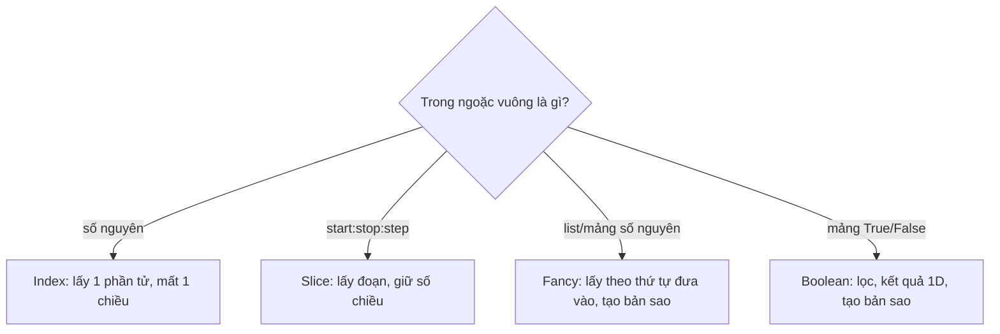

# Truy cập và phép toán NumPy

> **abstract** Tóm tắt
> Truy cập phần tử bằng **chỉ số** (index, đếm từ 0, âm thì đếm từ cuối), **lát cắt** `start:stop:step` (không lấy *`stop`*), **fancy indexing** (list chỉ số) và **boolean indexing** (mặt nạ True/False). Toán tử `+ - * / == <`… chạy **theo từng phần tử**. `min/max/sum` có thể tính trên cả mảng hoặc theo *`axis`*.



## Chỉ số dương và âm

Nguồn tr. 40, tr. 41.

Mảng 2D dùng `arr[hàng, cột]`, viết gộp hoặc viết lồng `arr[hàng][cột]` đều được.

```python
print(np.array([1, 2, 3, 4])[0])               # 1
arr = np.array([[1, 2, 3, 4, 5], [6, 7, 8, 9, 10]])
print('2nd element on 1st row: ', arr[0, 1])   # 2nd element on 1st row:  2
print('2nd element on 1st row: ', arr[0][1])   # như trên
arr3 = np.array([[[1, 2, 3], [4, 5, 6]], [[7, 8, 9], [10, 11, 12]]])
print(arr3[0, 1, 2], arr3[0][1][2])            # 6 6
print('Last element from 2nd dim: ', arr[1, -1])   # Last element from 2nd dim:  10
print(arr[1, -2])                              # 9
```

> **example** Đọc `arr3[0, 1, 2]` từng bước
> `[0]` → khối đầu `[[1,2,3],[4,5,6]]` → `[1]` → hàng `[4,5,6]` → `[2]` → **6**.

## Lát cắt (slice)

Nguồn tr. 42, tr. 43, tr. 44.

Cú pháp `array[start : stop : step]`:

- *`start`*: vị trí bắt đầu (**có** lấy), bỏ trống = 0.
- *`stop`*: vị trí kết thúc (**không** lấy), bỏ trống = hết mảng.
- *`step`*: bước nhảy, mặc định 1.

```python
arr = np.array([1, 2, 3, 4, 5, 6, 7])
print(arr[1:5])     # [2 3 4 5]
print(arr[4:])      # [5 6 7]
print(arr[:3])      # [1 2 3]
print(arr[-3:-1])   # [5 6]   từ vị trí thứ 3 tính từ cuối đến trước vị trí thứ 1 từ cuối
print(arr[1:5:2])   # [2 4]
print(arr[::2])     # [1 3 5 7]

arr = np.array([[1, 2, 3, 4, 5], [6, 7, 8, 9, 10]])
print(arr[1, 1:4])     # [7 8 9]      hàng 1, cột 1..3
print(arr[0:2, 2])     # [3 8]        hàng 0..1, cột 2
print(arr[0:2, 1:4])   # [[2 3 4]
                       #  [7 8 9]]
```

> **warning** Dễ nhầm
> `arr[0:2, 2]` cho mảng **1D** `[3 8]` vì cột dùng chỉ số đơn (mất một chiều). Muốn giữ dạng cột 2D, viết `arr[0:2, 2:3]` → `[[3] [8]]`.

## Fancy indexing

Nguồn tr. 45, tr. 46.

**Fancy indexing** (chỉ số nâng cao) là tạo chỉ số bằng mảng số nguyên. Kết quả theo **đúng thứ tự** chỉ số đưa vào.

```python
a = np.array([10, 30, 40, 5, -90, 'NEU', True])
print(repr(a4, 3, 0, 6))
# array(['-90', '5', '10', 'True'], dtype='<U21')
```

Vì có chuỗi `'NEU'`, **mọi** phần tử bị ép sang chuỗi Unicode (`<U21`). Số 10 thành chuỗi `'10'`, `True` thành `'True'`.

Với hai list chỉ số cho mảng 2D, NumPy **ghép cặp** từng vị trí, kết quả là mảng 1D:

```python
a = np.array([[1, 2, 3, 4], [5, 6, 7, 8], [9, 10, 11, 12]])
print(a[[1, 2, 0], [3, 2, 0]])   # [ 8 11  1]   cặp (1,3), (2,2), (0,0)
```

> **warning** Dễ nhầm
> `a[[1, 2, 0], [3, 2, 0]]` **không** lấy khối 3 × 3. Nó lấy đúng 3 ô theo từng cặp (hàng, cột).

## Boolean indexing

Nguồn tr. 47.

**Boolean indexing** lọc theo điều kiện logic. Mảng điều kiện (mặt nạ, mask) có cùng shape, giữ ô `True`. Kết quả **luôn là bản sao** dữ liệu.

```python
arr = np.array([35, 20, 30, 41, 50])
condition = arr % 2 != 0
print("Mảng điều kiện:", condition)   # Mảng điều kiện: [ True False False  True False]
print("Kết quả lọc:", arr[condition]) # Kết quả lọc: [35 41]
```

## View hay copy

[](../../diagrams/03%20NumPy%20v%C3%A0%20Pandas/View%20hay%20copy.excalidraw.md)

> **info** Mở rộng
> Slide chỉ nói boolean indexing tạo bản sao (tr. 47). Thêm: slice cơ bản tạo **view** (cùng vùng nhớ), sửa view thì mảng gốc đổi theo. Fancy indexing cũng tạo bản sao. Muốn tách hẳn, dùng **`.copy()`**.

```python
a = np.arange(4)          # [0 1 2 3]
part = a[1:3]; part[0] = 99
print(a)                  # [ 0 99  2  3]   slice là view
b = a0, 2; b[0] = -1
print(a)                  # [ 0 99  2  3]   fancy là copy, a không đổi
a[a > 2] = 0              # GÁN qua mặt nạ thì sửa thẳng a
print(a)                  # [0 0 2 0]
```

## Toán tử số học

Nguồn tr. 48.

Với `arr1 = [2, 1, 3, 4, 5]`, `arr2 = [1, 3, 4, 5, 6]`:

[](../../diagrams/03%20NumPy%20v%C3%A0%20Pandas/B%E1%BA%A3ng%20tr%E1%BB%B1c%20quan/C3%2003%20Truy%20c%E1%BA%ADp%20v%C3%A0%20ph%C3%A9p%20to%C3%A1n%20NumPy%20%E2%80%93%20b%E1%BA%A3ng%201.excalidraw.md)

> **note** Bảng dạng chữ
> | Phép | Ví dụ | Kết quả |
> | --- | --- | --- |
> | Số + mảng | `3 + arr2` hay `arr2 + 3` | `[4 6 7 8 9]` |
> | Mảng + mảng | `arr1 + arr2` | `[ 3 4 7 9 11]` |
> | Mảng − số | `arr2 - 3` | `[-2 0 1 2 3]` |
> | Số − mảng | `3 - arr2` | `[ 2 0 -1 -2 -3]` |
> | Mảng − mảng | `arr2 - arr1` / `arr1 - arr2` | `[-1 2 1 1 1]` / `[ 1 -2 -1 -1 -1]` |
> | Nhân | `arr2 * 3` / `arr1 * arr2` | `[ 3 9 12 15 18]` / `[ 2 3 12 20 30]` |
> | Chia | `arr2 / 3` | `[0.333 1. 1.333 1.667 2.]` |
> | Chia | `3 / arr2` | `[3. 1. 0.75 0.6 0.5]` |
> | Chia | `arr2 / arr1` | `[0.5 3. 1.333 1.25 1.2]` |
> | Chia | `arr1 / arr2` | `[2. 0.333 0.75 0.8 0.833]` |

> **tip** Mẹo thi
> `/` luôn trả **float**, kể cả `4 / 2` → `2.`. Phép trừ và chia **không giao hoán**: đổi chỗ thì đổi kết quả.

## Toán tử so sánh

Nguồn tr. 49.

[](../../diagrams/03%20NumPy%20v%C3%A0%20Pandas/B%E1%BA%A3ng%20tr%E1%BB%B1c%20quan/C3%2003%20Truy%20c%E1%BA%ADp%20v%C3%A0%20ph%C3%A9p%20to%C3%A1n%20NumPy%20%E2%80%93%20b%E1%BA%A3ng%202.excalidraw.md)

> **note** Bảng dạng chữ
> | Toán tử | `arr1 ? arr2` | Kết quả |
> | --- | --- | --- |
> | `==` | `arr1 == arr2` | `[False False False False False]` |
> | `!=` | `arr1 != arr2` | `[ True True True True True]` |
> | `<` | `arr1 < arr2` | `[False True True True True]` |
> | `>` | `arr1 > arr2` | `[ True False False False False]` |
> | `<=` | `arr1 <= arr2` | `[False True True True True]` |
> | `>=` | `arr1 >= arr2` | `[ True False False False False]` |
> | **`np.array_equal(x, y)`** | cả mảng giống hệt? | `False` (một giá trị) |

So hai mảng **khác độ dài** (4 và 5 phần tử) báo lỗi:

```python
np.array([2, 1, 3, 4]) > np.array([1, 3, 4, 5, 6])
# ValueError: operands could not be broadcast together with shapes (4,) (5,)
```

## Hàm toán học tương đương toán tử

Nguồn tr. 50.

[](../../diagrams/03%20NumPy%20v%C3%A0%20Pandas/B%E1%BA%A3ng%20tr%E1%BB%B1c%20quan/C3%2003%20Truy%20c%E1%BA%ADp%20v%C3%A0%20ph%C3%A9p%20to%C3%A1n%20NumPy%20%E2%80%93%20b%E1%BA%A3ng%203.excalidraw.md)

> **note** Bảng dạng chữ
> | Hàm | Tương đương |
> | --- | --- |
> | **`np.add(x, y)`** | `x + y` |
> | **`np.subtract(x, y)`** | `x - y` |
> | **`np.multiply(x, y)`** | `x * y` |
> | **`np.divide(x, y)`** | `x / y` |
> | **`np.sqrt(x)`** | căn bậc 2 từng phần tử |
> | **`np.dot(x, y)`** | phương thức **`x.dot(y)`** |

```python
x = np.array([2, 1, 3, 4, 5]); y = np.array([1, 3, 4, 5, 6])
print(np.add(x, y))        # [ 3  4  7  9 11]
print(np.subtract(x, y))   # [ 1 -2 -1 -1 -1]
print(np.multiply(x, y))   # [ 2  3 12 20 30]
print(np.divide(x, y))     # [2.         0.33333333 0.75       0.8        0.83333333]

x = np.array([[1, 2, 3], [3, 1, 2]]); y = np.array([[1, 5, 6], [7, 8, 1]])
print(np.dot(x, y.T))      # [[29 26]
                           #  [20 31]]    (2,3) @ (3,2) -> (2,2)
```

> **warning** Slide gõ sai tên hàm
> Slide ghi **`np.substract`**. Tên đúng là **`np.subtract`** (không có chữ s thứ hai). **`np.substract`** gây `AttributeError`.

## min, max, sum theo axis

Nguồn tr. 51.

Gọi dạng phương thức **`x.min()`** hoặc hàm **`np.min(x)`** như nhau.

```python
x = np.array([[1, 6, 5], [3, 10, 2]])
print(x.min(), x.min(axis=0), x.min(axis=1))   # 1 [1 6 2] [1 2]
print(x.max(), x.max(axis=0), x.max(axis=1))   # 10 [ 3 10  5] [ 6 10]
print(x.sum(), x.sum(axis=0), x.sum(axis=1))   # 27 [ 4 16  7] [12 15]
```

[](../../diagrams/03%20NumPy%20v%C3%A0%20Pandas/B%E1%BA%A3ng%20tr%E1%BB%B1c%20quan/C3%2003%20Truy%20c%E1%BA%ADp%20v%C3%A0%20ph%C3%A9p%20to%C3%A1n%20NumPy%20%E2%80%93%20b%E1%BA%A3ng%204.excalidraw.md)

> **note** Bảng dạng chữ
> | Gọi | Gộp theo | Shape `(2, 3)` thành | Đọc là |
> | --- | --- | --- | --- |
> | không axis | mọi ô | một số | cả mảng |
> | *`axis=0`* | dọc các hàng | `(3,)` | một kết quả **mỗi cột** |
> | *`axis=1`* | ngang trong hàng | `(2,)` | một kết quả **mỗi hàng** |

> **question** Tự kiểm tra
> 1. `a = np.arange(10)`. `a[-4:-1]`? → `[6 7 8]`.
> 2. `a[::-3]`? → `[9 6 3 0]`.
> 3. `m = np.arange(1, 10).reshape(3, 3)`. `m[[0, 2], [2, 0]]`? → `[3 7]`.
> 4. `m[m % 2 == 0]`? → `[2 4 6 8]`.
> 5. **`np.array([1, 2]) / np.array([2, 2])`**? → `[0.5 1. ]`.
> 6. **`m.sum(axis=0)`**? → `[12 15 18]`.

Áp dụng ở F303 Chỉ mục, lọc boolean và np.where, F304 Phép toán theo phần tử, ufunc và broadcasting, F305 Giảm theo trục và thống kê mảng. Học tiếp [09 Thống kê, tập hợp và đại số tuyến tính](09%20Th%E1%BB%91ng%20k%C3%AA%2C%20t%E1%BA%ADp%20h%E1%BB%A3p%20v%C3%A0%20%C4%91%E1%BA%A1i%20s%E1%BB%91%20tuy%E1%BA%BFn%20t%C3%ADnh.md).
