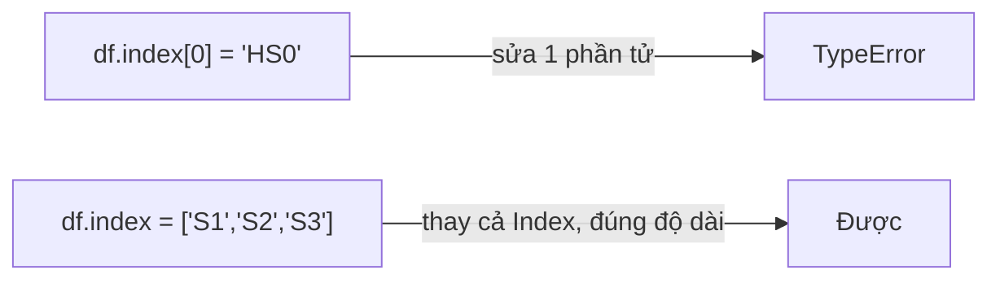

# Index và căn chỉnh Pandas

> **abstract** Tóm tắt
> **Index** là đối tượng lõi quản lý nhãn của trục (hàng và cột) trong Series, DataFrame. Index **bất biến** (immutable): không sửa từng phần tử, chỉ thay cả Index. Index vừa **giống mảng** (truy cập chỉ số, cắt lát, cho phép trùng nhãn) vừa **giống tập hợp** (**`union`**, **`intersection`**, **`difference`**, **`isin`**). Mọi phép toán Pandas giữa hai đối tượng đều **căn theo nhãn**.

## Đối tượng Index là gì

Nguồn tr. 140, tr. 141.

Index dùng để gán nhãn cho **hàng** (row labels) và **cột** (column labels). Khi truyền list, mảng hay chuỗi nhãn vào Series/DataFrame, Pandas ngầm chuyển chúng thành Index.

```python
s = pd.Series([10, 20, 30], index=["a", "b", "c"])
print("Index:", s.index)        # Index: Index(['a', 'b', 'c'], dtype='object')

data = {"Toán": [8, 9, 7], "Văn": [6, 7, 8]}
df = pd.DataFrame(data, index=["HS1", "HS2", "HS3"])
print("Index:", df.index)       # Index(['HS1', 'HS2', 'HS3'], dtype='object')
print("Columns:", df.columns)   # Index(['Toán', 'Văn'], dtype='object')
```

> **tip** Mẹo thi
> **`df.columns`** **cũng là một Index**. Cả nhãn hàng lẫn nhãn cột đều dùng chung kiểu đối tượng này.

## Index bất biến

Nguồn tr. 142.

```python
df.index[0] = "HS0"
# TypeError: Index does not support mutable operations
df.index = ["S1", "S2", "S3"]   # thay CẢ index thì được
print(df)
#     Toán  Văn
# S1     8    6
# S2     9    7
# S3     7    8
```



> **warning** Dễ nhầm
> Lỗi khi sửa một phần tử Index là **TypeError**, không phải ValueError. Thay cả Index phải **đúng số hàng**, nếu không sẽ báo ValueError (Mở rộng).

## Index giống mảng

Nguồn tr. 143.

Truy cập bằng chỉ số, cắt lát được, và **có thể chứa nhãn trùng**.

```python
idx = pd.Index([10, 20, 30, 40])
print(idx[0])      # 10
print(idx[1:3])    # Index([20, 30], dtype='int64')

s = pd.Series([10, 20, 30, 40, 50], index=["a", "b", "b", "c", "a"])
print(s["a"])      # trả TẤT CẢ các dòng có nhãn 'a'
# a    10
# a    50
# dtype: int64
print(s.index.is_unique)   # False
```

> **warning** Dễ nhầm
> Với nhãn trùng, `s["a"]` trả về **Series** (2 phần tử) chứ không phải một số. Với nhãn duy nhất, `s["c"]` trả số `40`.

## Index giống tập hợp

Nguồn tr. 142, tr. 144.

```python
idx1 = pd.Index([1, 2, 3, 4]); idx2 = pd.Index([3, 4, 5, 6])
print("Union:", idx1.union(idx2))                # Index([1, 2, 3, 4, 5, 6])
print("Intersection:", idx1.intersection(idx2))  # Index([3, 4])
print("Difference:", idx1.difference(idx2))      # Index([1, 2])
print("Kiểm tra phần tử:", idx1.isin([2, 5]))    # [False  True False False]
```

Với `[1, 2, 3]` và `[3, 4, 5]` (tr. 142): hợp `[1, 2, 3, 4, 5]`, giao `[3]`, hiệu `[1, 2]`.

## Bảng phương thức và thuộc tính của Index

Nguồn tr. 145.

| Tên | Mô tả | `i = Index(['a','b','c'])` (đã chạy) |
| --- | --- | --- |
| *`append`* | Nối Index khác, tạo Index **mới** | **`i.append(Index(['d']))`** → `['a','b','c','d']` |
| **`difference`** | Hiệu tập hợp | |
| **`intersection`** | Giao | |
| **`union`** | Hợp | |
| **`isin`** | Mảng bool: mỗi giá trị có trong tập truyền vào? | |
| `delete` | Xóa phần tử ở **vị trí** i | **`i.delete(0)`** → `['b','c']` |
| *`drop`* | Xóa các **giá trị** truyền vào | **`i.drop('b')`** → `['a','c']` |
| **`insert`** | Chèn phần tử ở vị trí i | **`i.insert(1, 'x')`** → `['a','x','b','c']` |
| `is_monotonic_increasing` | Mỗi phần tử ≥ phần tử trước | `True` |
| `is_monotonic_decreasing` | Mỗi phần tử ≤ phần tử trước | `False` |
| `is_unique` | Không có nhãn trùng | `True` |
| **`unique`** | Mảng nhãn duy nhất | **`Index([1,1,2]).unique()`** → `[1, 2]` |
| *`name`* | Tên của Index | |
| *`values`* | Index dưới dạng ndarray | `['a' 'b' 'c']` |

> **warning** Dễ nhầm
> `delete` dùng **vị trí**, *`drop`* dùng **giá trị**. Mọi phương thức trên đều trả **Index mới**, Index cũ không đổi (vì bất biến).

## Ôn lại: căn chỉnh theo nhãn ở mọi nơi

Nguồn tr. 108, tr. 137.

| Hỏi gì? | Viết gì? | Kiểm tra |
| --- | --- | --- |
| Giá trị có nhãn An | `s.loc["An"]` | Nhãn có tồn tại không (thiếu → KeyError) |
| Giá trị đứng thứ hai | `s.iloc[1]` | Đếm từ 0 |
| Cột điểm dạng một dãy | `df["diem"]` | Series |
| Bảng chỉ có cột điểm | `df"diem"` | DataFrame |
| Hàng đạt từ 8 trở lên | `df.loc[df["diem"] >= 8]` | Mặt nạ True/False từng hàng |

```python
s = pd.Series([10, 20], index=["a", "b"])
t = pd.Series([1, 2], index=["b", "c"])
print(s + t)
# a     NaN
# b    21.0
# c     NaN
```

Cùng giá trị nhưng dùng NumPy: **`np.array([10, 20]) + np.array([1, 2])`** → `[11 22]` (theo **vị trí**). Pandas cho b = 21 (theo **nhãn**).

> **info** Mở rộng
> **`s.reindex(["a", "b", "z"])`** đưa Series về đúng danh sách nhãn yêu cầu; nhãn mới *`z`* nhận NaN. **`s.add(t, fill_value=0)`** coi nhãn thiếu là 0, cho `a 10.0, b 21.0, c 2.0`.

> **question** Tự kiểm tra
> 1. **`pd.Index([1, 2, 3]).union(pd.Index([2, 5]))`**? → **`Index([1, 2, 3, 5])`**.
> 2. **`pd.Index(['x', 'y', 'z']).drop('y')`**? → **`Index(['x', 'z'])`**.
> 3. **`pd.Index(['x', 'y', 'z']).delete(0)`**? → **`Index(['y', 'z'])`**.
> 4. `pd.Index([3, 2, 1]).is_monotonic_decreasing`? → `True`.
> 5. Lệnh `df.columns[0] = "A"` gây lỗi gì? → TypeError (Index bất biến).
> 6. Series index `['a','b','a']`, giá trị `[1, 2, 3]`. `s['a']`? → Series `a 1`, `a 3`.

Áp dụng ở F311 Đối tượng Index và reindex, F308 Series – nhãn, căn chỉnh và phép toán. Dễ nhầm với [vị trí của ndarray](03%20Truy%20c%E1%BA%ADp%20v%C3%A0%20ph%C3%A9p%20to%C3%A1n%20NumPy.md).
