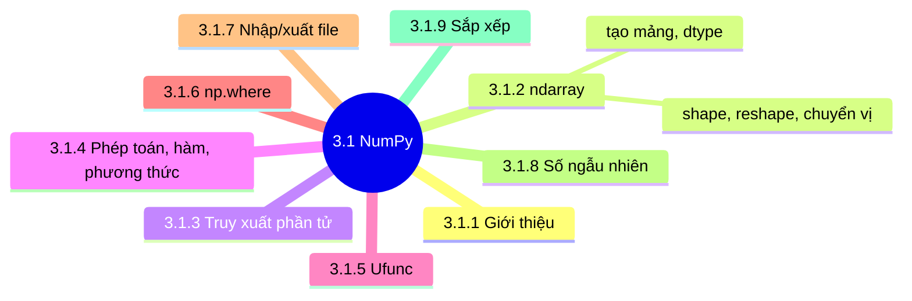
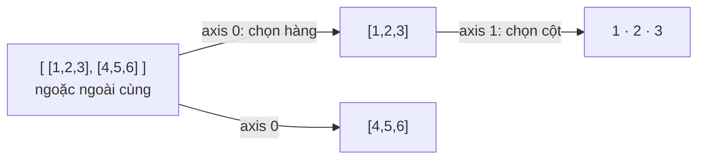

# Giới thiệu NumPy và ndarray

> **abstract** Tóm tắt
> NumPy (Numerical Python) là thư viện nền tảng để tính toán số trong Python. Đối tượng trung tâm là **ndarray**, mảng N chiều. Mỗi cặp ngoặc vuông `[]` là một mức lồng nhau, và **axis** được đánh số 0, 1, 2… từ ngoặc ngoài cùng vào trong.



Dàn ý phần NumPy ở tr. 4. Slide có thêm mục 3.1.9 Sắp xếp ở tr. 82, không nằm trong dàn ý.

## NumPy là gì và dùng để làm gì

Nguồn tr. 5, tr. 6, tr. 7.

- **Tên gọi**: NumPy là viết tắt của *Numerical Python*.
- **Vai trò**: thư viện nền tảng cho tính toán số. SciPy và Pandas dùng cấu trúc mảng của NumPy làm nền.

[](../../diagrams/03%20NumPy%20v%C3%A0%20Pandas/B%E1%BA%A3ng%20tr%E1%BB%B1c%20quan/C3%2007%20Gi%E1%BB%9Bi%20thi%E1%BB%87u%20NumPy%20v%C3%A0%20ndarray%20%E2%80%93%20b%E1%BA%A3ng%201.excalidraw.md)

> **note** Bảng dạng chữ
> | Tính năng chính (tr. 6) | Ý nghĩa dễ hiểu |
> | --- | --- |
> | `ndarray` | Mảng N chiều hiệu quả, hỗ trợ **vector hóa** (vectorization, tính cả mảng một lần) và **lan truyền** (broadcasting) |
> | Hàm chuẩn trên cả mảng | Tính trên toàn mảng hoặc từng phần tử, **không cần viết vòng lặp** |
> | Đọc/ghi dữ liệu mảng | Có cả tệp ánh xạ bộ nhớ (memory-mapped files) |
> | Công cụ toán | Đại số tuyến tính, biến đổi Fourier, sinh số ngẫu nhiên |

[](../../diagrams/03%20NumPy%20v%C3%A0%20Pandas/B%E1%BA%A3ng%20tr%E1%BB%B1c%20quan/C3%2007%20Gi%E1%BB%9Bi%20thi%E1%BB%87u%20NumPy%20v%C3%A0%20ndarray%20%E2%80%93%20b%E1%BA%A3ng%202.excalidraw.md)

> **note** Bảng dạng chữ
> | Ứng dụng điển hình (tr. 7) | Ví dụ |
> | --- | --- |
> | Chuẩn bị dữ liệu | Làm sạch, chuẩn hóa, định hình lại, sắp xếp, lọc mảng |
> | Phân tích, mô hình hóa | Phép toán, thống kê, hàm tổng hợp trên cả tập hoặc tập con |
> | Mô phỏng | Tạo dữ liệu ngẫu nhiên theo phân phối đã biết |
> | Thuật toán số khác | Xử lý tín hiệu, lọc, tính toán hiệu năng cao |

> **tip** Mẹo thi
> Câu hỏi "NumPy viết tắt của gì?" → *Numerical Python*. "Đối tượng cốt lõi?" → `ndarray`. "Ba công cụ toán?" → đại số tuyến tính, Fourier, số ngẫu nhiên.

## Import và tạo ndarray đầu tiên

Nguồn tr. 8, tr. 9.

Hai cách import đều chạy. Quy ước phổ biến là đặt bí danh `np`. Hàm **`array()`** biến list thành ndarray.

```python
import numpy as np            # hoặc: import numpy  rồi gọi numpy.array(...)
arr = np.array([1, 2, 3, 4, 5])
print(arr)        # [1 2 3 4 5]
print(type(arr))  # <class 'numpy.ndarray'>
```

> **warning** Dễ nhầm
> Khi in, ndarray **không có dấu phẩy** giữa phần tử: `[1 2 3 4 5]`. List Python in ra `[1, 2, 3, 4, 5]`. Đề thi hay dùng điểm này để hỏi "kết quả in ra là gì".

## Chiều của mảng: 0D, 1D, 2D, 3D

Nguồn tr. 10, tr. 11, tr. 12.

**Chiều** (dimension) là một mức độ sâu của mảng. **Mảng lồng nhau** (nested arrays) là mảng mà phần tử lại là một mảng khác.

| Loại | Phần tử là | Ví dụ | **`shape`** in ra |
| --- | --- | --- | --- |
| 0D, số vô hướng (scalar) | một giá trị | **`np.array(42)`** | `()` |
| 1D | các mảng 0D | **`np.array([1, 2, 3, 4, 5])`** | `(5,)` |
| 2D, biểu diễn ma trận | các mảng 1D | **`np.array([[1, 2, 3], [4, 5, 6]])`** | `(2, 3)` |
| 3D | các mảng 2D | **`np.array([[[1,2,3],[4,5,6]], [[1,2,3],[4,5,6]]])`** | `(2, 2, 3)` |

> **example** Ví dụ: đếm chiều bằng số ngoặc mở đầu
> `[[[1, 2, 3], ...` mở đầu bằng 3 dấu `[` liên tiếp → 3 chiều. Shape đọc từ ngoài vào: ngoài cùng có 2 khối, mỗi khối 2 hàng, mỗi hàng 3 số → `(2, 2, 3)`.

## Thuộc tính ndim và tham số ndmin

Nguồn tr. 13, tr. 14.

`ndim` trả về **một số nguyên** là số chiều.

```python
a = np.array(42); b = np.array([1, 2, 3, 4, 5])
c = np.array([[1, 2, 3], [4, 5, 6]])
d = np.array([[[1, 2, 3], [4, 5, 6]], [[1, 2, 3], [4, 5, 6]]])
print(a.ndim, b.ndim, c.ndim, d.ndim)   # 0 1 2 3
```

Một mảng có thể có bất kỳ số chiều nào. Đối số *`ndmin`* ép số chiều **tối thiểu** khi tạo mảng. NumPy thêm các trục độ dài 1 ở phía trước.

```python
arr = np.array([1, 2, 3, 4], ndmin=5)
print(arr)                    # [[[1 2 3 4]]]
print('number of dimensions :', arr.ndim)   # number of dimensions : 5
print(arr.shape)              # (1, 1, 1, 1, 4)   <- tự chạy kiểm chứng
print(arr[0])                 # [[1 2 3 4]]
print(arr[0][0][0][0])        # [1 2 3 4]
print(arr[0][0][0][0][2])     # 3
```

Mỗi lần lấy `[0]` bóc đi một lớp ngoặc, nên số ngoặc giảm dần 5 → 4 → … → 1.

## Quy ước axis: từ ngoặc ngoài vào trong

Nguồn tr. 15, tr. 16.

Với `arr = np.array([[1, 2, 3], [4, 5, 6]])`, có **3 mảng**:

1. Mảng lớn nhất `[[1,2,3],[4,5,6]]` gồm hai phần tử là hai hàng → ứng với **axis = 0** (đi dọc theo các hàng).
2. Hai mảng `[1,2,3]` và `[4,5,6]` → ứng với **axis = 1** (đi dọc trong một hàng, tức theo cột).



Hình ở tr. 16: mảng 1D shape `(4,)` chỉ có axis 0; mảng 2D shape `(2, 3)` có axis 0 dọc và axis 1 ngang; mảng 3D shape `(4, 3, 2)` có thêm axis 2 theo chiều sâu.

[](../../diagrams/03%20NumPy%20v%C3%A0%20Pandas/%C4%90%E1%BB%8Dc%20tr%E1%BB%A5c%20c%E1%BB%A7a%20ma%20tr%E1%BA%ADn.excalidraw.md)

> **warning** Dễ nhầm
> Slide tr. 15 có lỗi gõ `[[1, -2, 3], [4, 5, 6]]`. Mảng đúng là `[[1, 2, 3], [4, 5, 6]]`. Số axis luôn bằng `ndim`; axis lớn nhất là `ndim − 1`.

> **question** Tự kiểm tra
> 1. **`np.array([[1], [2], [3]])`** có ndim và shape gì? → `2` và `(3, 1)`.
> 2. `np.array(7).shape` in gì? → `()` (tuple rỗng).
> 3. `np.array([5, 6], ndmin=3).shape`? → `(1, 1, 2)`.
> 4. Trong mảng 2D, axis nào đi theo hàng (từ hàng này sang hàng khác)? → axis 0.

Áp dụng ở F301 Tạo mảng NumPy và dtype và F302 Dự đoán shape – reshape, chuyển vị, view và copy. Học tiếp [08 Hàm tạo mảng và dtype](08%20H%C3%A0m%20t%E1%BA%A1o%20m%E1%BA%A3ng%20v%C3%A0%20dtype.md).
