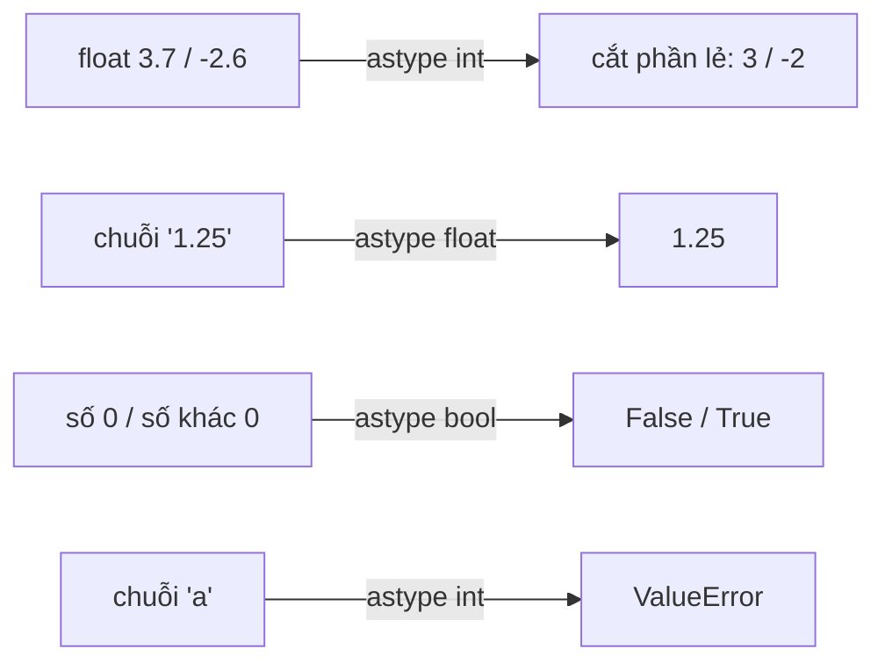

# Hàm tạo mảng và dtype

> **abstract** Tóm tắt
> Ngoài **`np.array`**, NumPy có cả họ hàm tạo mảng sẵn giá trị: **`zeros`**, **`ones`**, **`empty`**, **`full`**, `eye`, **`arange`**, **`linspace`**, **`asarray`**. Mỗi mảng có một **dtype** (kiểu dữ liệu chung cho mọi phần tử). Đổi kiểu bằng **`astype`**; số thực → số nguyên thì **cắt bỏ** phần thập phân.

## Bảng hàm tạo mảng

Nguồn tr. 17.

| Hàm | Tạo ra gì | Ví dụ (đã chạy) |
| --- | --- | --- |
| **`array`** | Chuyển dữ liệu vào thành ndarray (luôn sao chép) | **`np.array([1, 2])`** → `[1 2]` |
| **`asarray`** | Như **`array`** nhưng **không sao chép** nếu đầu vào đã là ndarray | `np.asarray(x) is x` → `True` |
| **`arange`** | Như `range` nhưng trả ndarray | **`np.arange(5)`** → `[0 1 2 3 4]` |
| **`ones`**, `ones_like` | Toàn số 1 | **`np.ones((2, 3))`** |
| **`zeros`**, `zeros_like` | Toàn số 0 | **`np.zeros_like(a)`** cùng shape, dtype với `a` |
| **`empty`**, `empty_like` | Mảng mới **không điền giá trị** (rác trong bộ nhớ) | **`np.empty((2, 2))`** |
| **`full`**, `full_like` | Toàn một "giá trị điền" | **`np.full((2, 3), 7)`** |
| `eye`, `identity` | Ma trận đơn vị vuông N × N | **`np.eye(2)`** → `[[1. 0.] [0. 1.]]` |
| **`linspace`** | Cho **số lượng** giá trị cách đều thay vì bước | **`np.linspace(0, 1, 3)`** → `[0. 0.5 1.]` |

> **tip** Mẹo thi
> Hậu tố `_like` = "giống shape và dtype của mảng mẫu". **`arange`** cho **bước** (step), **`linspace`** cho **số phần tử** (num).

## Tham số của empty, zeros, ones, full, asarray

Nguồn tr. 18, tr. 19, tr. 20, tr. 24, tr. 25.

```python
np.empty(shape, dtype=float, order='C')   # zeros(), ones() có cùng tham số
np.full(shape, fill_value, dtype=None, order='C')
np.asarray(a, dtype=None, order=None)
```


> **note** Bảng dạng chữ
> | Tham số | Ý nghĩa |
> | --- | --- |
> | **`shape`** | Một số nguyên (mảng 1D) hoặc tuple (nhiều chiều): `3`, `(2, 3)`, `(1, 2, 3)` |
> | *`dtype`* | Kiểu phần tử. `empty/zeros/ones` mặc định **float**. **`full`** suy ra từ *`fill_value`*. **`asarray`** giữ kiểu đầu vào |
> | *`order`* | Thứ tự lưu trong bộ nhớ: `'C'` theo hàng (row-major, mặc định), `'F'` theo cột (column-major) |
> | *`fill_value`* | Giá trị điền vào mọi ô của **`full`** |
> | `a` | Đầu vào của **`asarray`**: list, tuple, list lồng nhau, đối tượng "array-like" |

```python
print(np.zeros(3))            # [0. 0. 0.]   <- float vì dtype mặc định
print(np.full((2, 3), 7))     # [[7 7 7]
                              #  [7 7 7]]
```

> **warning** Dễ nhầm
> **`np.empty`** **không** cho số 0. Nó lấy giá trị đang có sẵn trong bộ nhớ, nên kết quả trông như ngẫu nhiên.

## arange: dãy theo bước nhảy

Nguồn tr. 21.

**`np.arange([start,] stop, [step,] dtype=None)`**. *`start`* mặc định 0, *`step`* mặc định 1, **`stop` không được lấy**, *`dtype`* suy ra từ đầu vào.

```python
print(np.arange(5, dtype=np.float32))  # [0. 1. 2. 3. 4.]
print(np.arange(5))                    # [0 1 2 3 4]
print(np.arange(0, 1, 0.1))            # [0.  0.1 0.2 0.3 0.4 0.5 0.6 0.7 0.8 0.9]
```

## linspace: dãy theo số phần tử

Nguồn tr. 22, tr. 23.

**`np.linspace(start, stop, num=50, endpoint=True, retstep=False, dtype=None, axis=0)`**


> **note** Bảng dạng chữ
> | Tham số | Ý nghĩa |
> | --- | --- |
> | `num` | Số phần tử, mặc định **50** |
> | *`endpoint`* | `True` (mặc định): **có** lấy *`stop`*. `False`: bỏ *`stop`* |
> | *`retstep`* | `True`: trả về cặp `(mảng, bước)` |
> | *`dtype`* | Mặc định float |
> | *`axis`* | Trục lưu dải số (ít dùng) |

Bước nhảy: $\text{step} = \dfrac{\text{stop} - \text{start}}{\text{num} - 1}$ nếu *`endpoint=True`*, và $\dfrac{\text{stop} - \text{start}}{\text{num}}$ nếu *`endpoint=False`*.

```python
print(np.linspace(0, 10, 5, endpoint=False))   # [0. 2. 4. 6. 8.]   bước 10/5 = 2
a2, step = np.linspace(0, 10, 5, retstep=True)
print("Mảng:", a2)          # Mảng: [ 0.   2.5  5.   7.5 10. ]   bước 10/4 = 2.5
print("Bước nhảy:", step)   # Bước nhảy: 2.5
print(np.linspace(0, 5, 5, dtype=np.int32))    # [0 1 2 3 5]  <- chạy thật
```

> **warning** Slide ghi sai một kết quả
> Slide tr. 23 ghi **`np.linspace(0, 5, 5, dtype=np.int32)`** → `[0 1 2 3 4]`. Chạy thật (NumPy 2.5) ra `[0 1 2 3 5]`. Lý do: các giá trị thực là `0, 1.25, 2.5, 3.75, 5`; ép sang int cắt phần lẻ thành `0, 1, 2, 3, 5`. Khi thi, tính theo cách này.

## Bảng kiểu dữ liệu NumPy

Nguồn tr. 26.

| Kiểu | Mã kiểu | Mô tả |
| --- | --- | --- |
| `int8`, `uint8` | `i1`, `u1` | Nguyên 8 bit có dấu / không dấu |
| `int16`, `uint16` | `i2`, `u2` | Nguyên 16 bit |
| `int32`, `uint32` | `i4`, `u4` | Nguyên 32 bit |
| `int64`, `uint64` | `i8`, `u8` | Nguyên 64 bit |
| `float16` | `f2` | Thực nửa độ chính xác |
| `float32` | `f4` hoặc `f` | Thực đơn độ chính xác |
| `float64` | `f8` hoặc `d` | Thực độ chính xác kép |
| `complex64`, `complex128` | `c8`, `c16` | Số phức |
| `bool` | `?` | True/False |
| `object` | `O` | Đối tượng Python |
| `string_` | `S` | Chuỗi ASCII độ dài cố định |
| `unicode_` | `U` | Chuỗi Unicode độ dài cố định |

> **tip** Mẹo thi
> Con số trong mã kiểu là **số byte**: `i4` = 4 byte = 32 bit, `f8` = 8 byte = 64 bit. Nhân 8 để ra số bit trong tên.

## Kiểm tra và chỉ định dtype

Nguồn tr. 27, tr. 28, tr. 29.

```python
print(np.array([1, 2, 3, 4]).dtype)                  # int64 (Windows có thể in int32)
print(np.array(['apple', 'banana', 'cherry']).dtype) # <U6   chuỗi Unicode dài tối đa 6
print(np.array([3-2j, 2+1j]).dtype)                  # complex128

arr1 = np.array([1, 2, 3, 4], dtype='S')
print(arr1, arr1.dtype)        # [b'1' b'2' b'3' b'4'] |S1
arr2 = np.array([1, 2, 3, 4], dtype='i4')
print(arr2, arr2.dtype)        # [1 2 3 4] int32
```

Nếu dtype yêu cầu không ép được, NumPy báo **ValueError** (lỗi khi đối số có giá trị không phù hợp):

```python
np.array(['a', '2', '3'], dtype='i')
# ValueError: invalid literal for int() with base 10: 'a'
```

> **warning** Dễ nhầm
> Slide tr. 27 in `int32` cho mảng số nguyên; máy Linux/macOS in `int64`. Đề thi lấy theo slide thường chấp nhận "kiểu số nguyên". `<U6` nghĩa là Unicode, 6 = độ dài chuỗi **dài nhất** (`banana`, `cherry`).

## Đổi kiểu bằng astype

Nguồn tr. 30, tr. 31.

**`astype`** (ép kiểu, cast) trả về **mảng mới** với dtype mới.

```python
a = np.array([3.7, -1.2, -2.6, 0.5, 12.9, 10.1])
print(a.astype(np.int32))      # [ 3 -1 -2  0 12 10]   cắt về phía 0, không làm tròn
s = np.array(["1.25", "-9.6", "42"])
print(s.astype(float))         # [ 1.25 -9.6  42.  ]   chuỗi số -> float64

x = np.array([1.1, 2.1, 3.1])
print(x.astype(int), x.astype(int).dtype)   # [1 2 3] int64 (slide: int32)
print(x.astype('i'))                        # [1 2 3]  'i' = int32
print(np.array([1, 0, 3]).astype(bool))     # [ True False  True]  khác 0 là True
```



> **warning** Dễ nhầm
> `-2.6` thành `-2`, **không** phải `-3`. **`astype(int)`** cắt về phía 0 (giống **`int()`** của Python), khác **`np.floor`** (−3) và **`np.rint`** (−3).

> **question** Tự kiểm tra
> 1. **`np.arange(2, 11, 3)`**? → `[2 5 8]`.
> 2. **`np.linspace(0, 1, 5)`**? → `[0. 0.25 0.5 0.75 1.]`.
> 3. `np.ones(3).dtype`? → `float64`.
> 4. Mã `f8` ứng với kiểu nào? → `float64`.
> 5. **`np.array([9.99, -0.5]).astype(int)`**? → `[9 0]`.
> 6. Hàm nào không sao chép nếu đầu vào đã là ndarray? → **`np.asarray`**.

Áp dụng ở F301 Tạo mảng NumPy và dtype. Học tiếp [01 Shape axis và broadcasting](01%20Shape%20axis%20v%C3%A0%20broadcasting.md).
