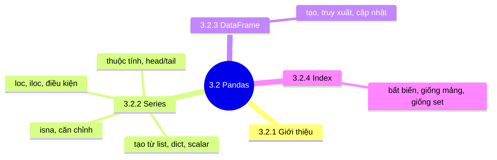

# Giới thiệu Pandas và Series

> **abstract** Tóm tắt
> Pandas có hai cấu trúc cốt lõi: **Series** (dãy 1 chiều **có nhãn**) và **DataFrame** (bảng 2 chiều có nhãn hàng, nhãn cột). Một Series = **giá trị** + **index** (nhãn). Truy cập theo vị trí bằng `iloc`, theo nhãn bằng *`loc`*. Phép toán giữa hai Series **căn theo nhãn**, nhãn chỉ có ở một bên cho `NaN`.



Dàn ý ở tr. 85, tr. 86. Slide đánh số lặp: DataFrame cũng ghi "3.2.2", Index ghi "3.2.3".

## Pandas là gì

Nguồn tr. 87, tr. 88, tr. 89.

- Công cụ không thể thiếu của nhà phân tích dữ liệu khi dùng Python. Cung cấp **cấu trúc dữ liệu hiệu suất cao, dễ dùng** và **công cụ phân tích dữ liệu dạng bảng**.
- Tên gọi đến từ **"panel data"** (thuật ngữ kinh tế lượng: dữ liệu bảng nhiều chiều có cấu trúc) và **"Python data analysis"**.
- Hai cấu trúc cốt lõi: **Series** (1 chiều có nhãn) và **DataFrame** (2 chiều, hàng và cột có nhãn). Không hợp với mọi thao tác chuyên sâu, nhưng thường là lựa chọn hiệu quả, trực quan.

[](../../diagrams/03%20NumPy%20v%C3%A0%20Pandas/B%E1%BA%A3ng%20tr%E1%BB%B1c%20quan/C3%2010%20Gi%E1%BB%9Bi%20thi%E1%BB%87u%20Pandas%20v%C3%A0%20Series%20%E2%80%93%20b%E1%BA%A3ng%201.excalidraw.md)

> **note** Bảng dạng chữ
> | | NumPy | Pandas |
> | --- | --- | --- |
> | Dữ liệu phù hợp | Mảng số **đồng nhất** (một dtype) | Bảng **không đồng nhất** (mỗi cột một kiểu) |
> | Truy cập | Theo vị trí | Theo vị trí **và nhãn** |
> | Phép toán hai đối tượng | Khớp theo vị trí, broadcasting | **Căn theo nhãn** |
> | Vai trò thực hành | Đưa vào scikit-learn huấn luyện mô hình | Xử lý trước dữ liệu |

Pandas kế thừa ý tưởng lập trình mảng của NumPy. Hai thư viện dùng cùng nhau: xử lý với pandas, rồi chuyển sang NumPy để huấn luyện mô hình. Quy ước: `import pandas as pd`.

## Series là gì và cách tạo

Nguồn tr. 90, tr. 91, tr. 92.

**Series** là đối tượng giống mảng 1D, gồm tập giá trị (data) và mảng nhãn gọi là **chỉ số** (index), giúp truy cập và định danh từng giá trị.

**`pd.Series(data=None, index=None, dtype=None, name=None, copy=False)`**

[](../../diagrams/03%20NumPy%20v%C3%A0%20Pandas/B%E1%BA%A3ng%20tr%E1%BB%B1c%20quan/C3%2010%20Gi%E1%BB%9Bi%20thi%E1%BB%87u%20Pandas%20v%C3%A0%20Series%20%E2%80%93%20b%E1%BA%A3ng%202.excalidraw.md)

> **note** Bảng dạng chữ
> | Tham số | Ý nghĩa |
> | --- | --- |
> | *`data`* | list, mảng NumPy, dict, scalar… |
> | *`index`* | Nhãn cho từng phần tử, mặc định `0, 1, 2, …` |
> | *`dtype`* | Kiểu dữ liệu |
> | *`name`* | Tên Series |
> | *`copy`* | `True` thì sao chép dữ liệu đầu vào |

```python
import pandas as pd
print(pd.Series([10, 20, 30, 40]))
# 0    10
# 1    20
# 2    30
# 3    40
# dtype: int64
print(pd.Series([10, 20, 30], index=['a', 'b', 'c']))
# a    10
# b    20
# c    30
# dtype: int64
```

Cột trái là index, cột phải là giá trị, dòng cuối là dtype.

## Tạo Series từ dict và scalar

Nguồn tr. 93, tr. 94, tr. 95.

Từ **dict**: khóa thành index theo thứ tự khóa.

```python
data = {'apple': 15, 'banana': 10, 'orange': 8}
print(pd.Series(data))
# apple     15
# banana    10
# orange     8
print(pd.Series(data, index=['banana', 'apple', 'orange']))   # đổi thứ tự
# banana    10
# apple     15
# orange     8
calories = {"day1": 420, "day2": 380, "day3": 390}
print(pd.Series(calories, index=["day1", "day2"]))            # chỉ chọn một số khóa
# day1    420
# day2    380
print(pd.Series(5, index=['x', 'y', 'z']))                    # scalar lặp cho mọi nhãn
# x    5
# y    5
# z    5
```

> **warning** Dễ nhầm
> Nếu *`index`* chứa nhãn **không có** trong dict, giá trị là `NaN` và dtype đổi sang **float64** (xem mục isna bên dưới).

## Thuộc tính và phương thức của Series

Nguồn tr. 96, tr. 97, tr. 98, tr. 99.

[](../../diagrams/03%20NumPy%20v%C3%A0%20Pandas/B%E1%BA%A3ng%20tr%E1%BB%B1c%20quan/C3%2010%20Gi%E1%BB%9Bi%20thi%E1%BB%87u%20Pandas%20v%C3%A0%20Series%20%E2%80%93%20b%E1%BA%A3ng%203.excalidraw.md)

> **note** Bảng dạng chữ
> | Thuộc tính / phương thức | Mô tả |
> | --- | --- |
> | **`s.index`** | Chỉ số |
> | **`s.array`** | Dữ liệu nội tại dạng **ExtensionArray** |
> | **`s.values`** | Giá trị dạng **mảng NumPy** |
> | **`s.dtype`** | Kiểu phần tử |
> | **`s.name`**, **`s.size`** | Tên / số phần tử |
> | **`s.head(n)`**, **`s.tail(n)`** | n phần tử đầu / cuối, **mặc định 5** |
> | **`s.mean()`**, **`s.sum()`**, **`s.max()`**, **`s.min()`** | Trung bình, tổng, lớn nhất, nhỏ nhất |
> | **`s.isnull()`** | True nếu phần tử là NaN |
> | **`s.dropna()`** | Bỏ các giá trị NaN |

```python
s = pd.Series([4, 7, -5, 3])
print(s.array)    # <NumpyExtensionArray> [4, 7, -5, 3] Length: 4, dtype: int64
print(s.index)    # RangeIndex(start=0, stop=4, step=1)
print(s.values)   # [ 4  7 -5  3]

s = pd.Series([10, 20, 30], index=['a', 'b', 'c'], name='series1')
print(s.name, s.size, s.min(), s.max(), s.sum())   # series1 3 10 30 60

s = pd.Series([100, 20, 30, -50, 80], index=['a', 'b', 'c', 'd', 'e'])
print(s.head(3).to_dict())   # {'a': 100, 'b': 20, 'c': 30}
print(s.tail(3).to_dict())   # {'c': 30, 'd': -50, 'e': 80}
```

Cả Series và index của nó đều có thuộc tính *`name`*, gán lại được:

```python
s = pd.Series([10, 20, 30], index=['a', 'b', 'c'], name='series1')
s.name = 'series2'
s.index.name = 'score'
print(s)
# score
# a    10
# b    20
# c    30
# Name: series2, dtype: int64
print(s.index)   # Index(['a', 'b', 'c'], dtype='object', name='score')
```

> **info** Mở rộng
> Slide in **`s.array`** kiểu `PandasArray`; Pandas 2.x đổi tên thành `NumpyExtensionArray`. Ý nghĩa như nhau.

## Truy xuất phần tử của Series

Nguồn tr. 100, tr. 101, tr. 102, tr. 103, tr. 104, tr. 105.

| Cách | Cú pháp | Ghi chú |
| --- | --- | --- |
| Theo vị trí | `s.iloc[i]` | Như ndarray |
| Theo nhãn | `s.loc[label]` | |
| Trực tiếp | `s[label]` | Có thể nhầm nếu index là số |
| Nhiều phần tử | `slabels` | Truyền list nhãn |
| Có điều kiện | `s[điều_kiện]` | Ví dụ `s[s > 10]` |

```python
s = pd.Series([100, 20, 30, -50, 80], index=['a', 'b', 'c', 'd', 'e'])
print(s[:3].tolist(), s[3:].tolist())   # [100, 20, 30] [-50, 80]   cắt theo vị trí
print(s[-3:].tolist())                  # [30, -50, 80]
print(s[::-1].index.tolist())           # ['e', 'd', 'c', 'b', 'a']

s = pd.Series([10, 20, 30, 40], index=['a', 'b', 'c', 'd'])
print(s.iloc[0])                   # 10
print(s.iloc[1:3].to_dict())       # {'b': 20, 'c': 30}      vị trí 1, 2 (không lấy 3)
print(s.loc['a'])                  # 10
print(s.loc'd', 'b'.to_dict()) # {'d': 40, 'b': 20}      giữ thứ tự đưa vào
print(s['b'])                      # 20
print(s'c', 'a'.to_dict())     # {'c': 30, 'a': 10}
print(s.loc[s.index > 'b'].to_dict())  # {'c': 30, 'd': 40}  mặt nạ trên nhãn
print(s[s >= 30].to_dict())            # {'c': 30, 'd': 40}  mặt nạ trên giá trị
```

> **warning** Dễ nhầm
> Cắt theo **nhãn** `s.loc['a':'c']` **có lấy** `'c'` → 3 phần tử. Cắt theo **vị trí** `s.iloc[0:2]` **không lấy** vị trí 2 → 2 phần tử. (Mở rộng, đã chạy thử.)

## Phép toán, isna và Series như dict

Nguồn tr. 106, tr. 107.

Series dùng được phép toán và hàm kiểu NumPy, **giữ nguyên nhãn**:

```python
s = pd.Series([4, 7, -5, 3], index=["d", "b", "a", "c"])
print(s[s > 0].to_dict())    # {'d': 4, 'b': 7, 'c': 3}
print((s * 2).to_dict())     # {'d': 8, 'b': 14, 'a': -10, 'c': 6}
print(np.exp(s).round(3).to_dict())  # {'d': 54.598, 'b': 1096.633, 'a': 0.007, 'c': 20.086}
print("b" in s, "e" in s)    # True False     'in' kiểm tra NHÃN, như dict
```

> **warning** Dễ nhầm
> `7 in s` → `False` dù 7 là một giá trị. `in` chỉ xét index. Muốn xét giá trị: `7 in s.values`.

**`isna`**/**`notna`** phát hiện dữ liệu thiếu:

```python
d = {"An": 35000, "Bình": 71000, "Huy": 16000, "Ánh": 5000}
s = pd.Series(d, index=['An', 'Bình', 'Thủy', 'Huy'])
print(s)
# An      35000.0
# Bình    71000.0
# Thủy        NaN      <- không có trong dict
# Huy     16000.0      ('Ánh' bị bỏ vì không có trong index)
print(pd.isna(s).tolist())    # [False, False, True, False]
print(pd.notna(s).tolist())   # [True, True, False, True]
print(s.isna().tolist())      # giống pd.isna(s)
```

## Căn chỉnh theo nhãn

Nguồn tr. 108.

Phép toán số học giữa hai Series **tự động căn chỉnh theo index**: khớp nhãn giống nhau, nhãn chỉ có ở một bên cho `NaN`. Kết quả có **hợp** các nhãn, đã sắp xếp.

```python
d = {"An": 100, "Bình": 730, "Huy": 160, "Ánh": 50}
s1 = pd.Series(d)                                         # An, Bình, Huy, Ánh
s2 = pd.Series(d, index=['Hồng', 'Bình', 'Thủy', 'Huy'])  # NaN, 730, NaN, 160
print(s1 + s2)
# An         NaN    chỉ có ở s1
# Bình    1460.0    730 + 730
# Huy      320.0    160 + 160
# Hồng       NaN    s2 có nhưng là NaN
# Thủy       NaN
# Ánh        NaN    chỉ có ở s1
# dtype: float64
```

[](../../diagrams/03%20NumPy%20v%C3%A0%20Pandas/C%C4%83n%20ch%E1%BB%89nh%20Series%20theo%20nh%C3%A3n.excalidraw.md)

> **tip** Mẹo thi
> Đếm số NaN của `s1 + s2`: lấy hợp nhãn, trừ đi các nhãn có giá trị hợp lệ ở **cả hai** bên. Ở đây 6 nhãn, 2 nhãn hợp lệ → 4 NaN.

## Thuộc tính axes và empty

Nguồn tr. 109, tr. 110.

```python
s = pd.Series(np.random.randn(4))
print(s.axes)     # [RangeIndex(start=0, stop=4, step=1)]   danh sách nhãn trục
print(s.empty)    # False
print(pd.Series(dtype=float).empty)   # True   Series rỗng
```

> **warning** Slide ghi chưa chính xác
> Slide nói *`axes`* "trả các giá trị từ 0 đến 5". Với 4 phần tử, **`RangeIndex(start=0, stop=4)`** nghĩa là nhãn 0, 1, 2, 3 (*`stop`* không lấy).

> **question** Tự kiểm tra
> 1. **`pd.Series({'a': 1, 'b': 2}, index=['b', 'c'])`**? → `b 2.0`, `c NaN`, dtype float64.
> 2. `s = pd.Series([5, 6, 7], index=[2, 0, 1])`. `s.iloc[0]` và `s.loc[0]`? → `5` và `6`.
> 3. **`pd.Series([1, 2], index=['x', 'y']) + pd.Series([10, 20], index=['y', 'z'])`**? → `x NaN`, `y 12.0`, `z NaN`.
> 4. **`s.head()`** không truyền n lấy mấy phần tử? → 5.
> 5. **`s.values`** trả kiểu gì? → mảng NumPy `ndarray`.
> 6. `'a' in pd.Series([1], index=['a'])`? → `True`.

Áp dụng ở F308 Series – nhãn, căn chỉnh và phép toán. Học tiếp [11 DataFrame tạo, truy xuất và cập nhật](11%20DataFrame%20t%E1%BA%A1o%2C%20truy%20xu%E1%BA%A5t%20v%C3%A0%20c%E1%BA%ADp%20nh%E1%BA%ADt.md).
