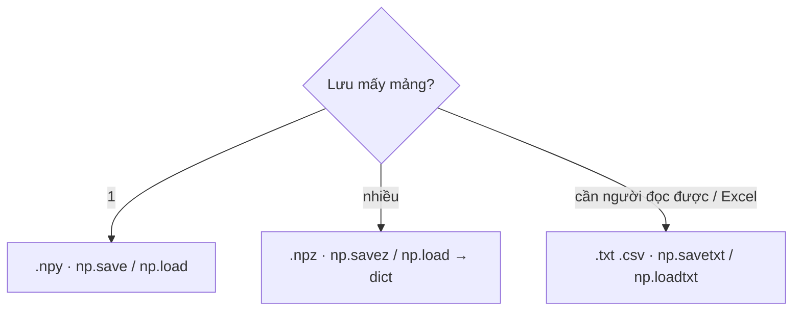
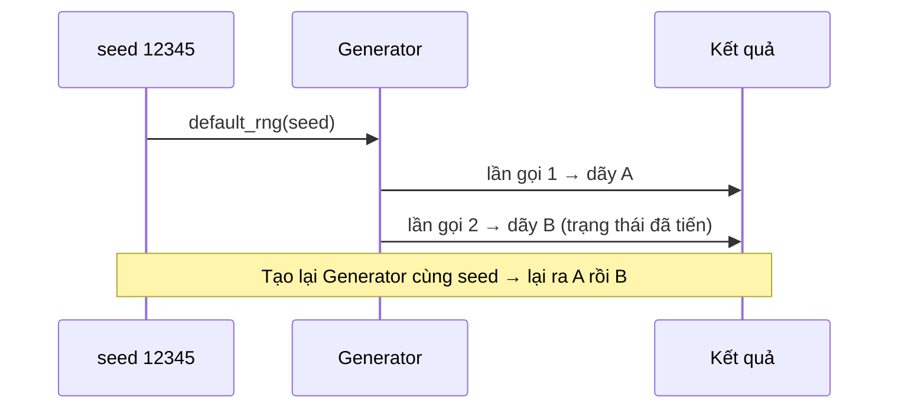

# Thực hành NumPy ufunc, tệp và ngẫu nhiên

> **abstract** Tóm tắt
> **Ufunc** (universal function) tính từng phần tử: loại một đầu vào (unary) và hai đầu vào (binary). **`np.where(cond, x, y)`** là bản vector hóa của `x if cond else y`. Lưu mảng: nhị phân **`.npy`**/**`.npz`** (khuyến khích) hoặc văn bản **`.txt`**/**`.csv`**. Số ngẫu nhiên trong máy là **giả ngẫu nhiên**, tái tạo được bằng **seed**. **`a.sort()`** sắp tại chỗ, **`np.sort(a)`** trả bản sao.

Dùng `import numpy as np` ở đầu mỗi đoạn.

## Ufunc một và hai đầu vào

Nguồn tr. 69, tr. 70.

**Unary ufunc** tính trên từng phần tử của **một** mảng. **Binary ufunc** nhận **hai** mảng, trả một mảng.

```python
a = np.arange(10)
print(np.sqrt(a).round(3))   # [0.    1.    1.414 1.732 2.    2.236 2.449 2.646 2.828 3.   ]
print(np.exp(a[:4]).round(3))# [ 1.     2.718  7.389 20.086]

x = np.array([1.5, -2.0, 0.3]); y = np.array([0.2, -1.0, 0.9])
print(np.maximum(x, y))      # [ 1.5 -1.   0.9]   lớn hơn tại từng vị trí
```

Slide dùng **`np.random.standard_normal(6)`** để tạo x, y nên số in ra thay đổi mỗi lần chạy.

Một ufunc có thể trả **nhiều mảng**. **`np.modf`** trả phần thập phân và phần nguyên:

```python
a = np.array([2.75, -3.5])
phan_le, phan_nguyen = np.modf(a)
print(phan_le.tolist())      # [0.75, -0.5]
print(phan_nguyen.tolist())  # [2.0, -3.0]
```

> **warning** Dễ nhầm
> Với số âm, **`modf`** tách **về phía 0**: −3.5 → phần nguyên −3, phần lẻ −0.5. Trong khi **`np.floor(-3.5)`** → −4.

## Bảng unary ufunc

Nguồn tr. 71.

| Hàm | Mô tả | Ví dụ (đã chạy) |
| --- | --- | --- |
| `abs`, `fabs` | Giá trị tuyệt đối | **`np.fabs(-3)`** → `3.0` (luôn float) |
| **`sqrt`** | Căn bậc hai, như `arr ** 0.5` | **`np.sqrt(9)`** → `3.0` |
| **`square`** | Bình phương, như `arr ** 2` | |
| **`exp`** | $e^x$ | **`np.exp(1)`** → `2.718…` |
| `log`, `log10`, `log2` | Logarit tự nhiên, cơ số 10, cơ số 2 | |
| `log1p` | $\log(1 + x)$ | **`np.log1p(0)`** → `0.0` |
| `sign` | Dấu: 1 dương, 0, −1 âm | `[-2, 0, 3]` → `[-1 0 1]` |
| `ceil`, `floor` | Làm tròn lên (trần), xuống (sàn) | **`ceil(-1.5)`** → `-1.0`, **`floor(-1.5)`** → `-2.0` |
| `rint` | Làm tròn đến số nguyên gần nhất | `[1.5, 2.5, 2.6]` → `[2. 2. 3.]` |
| **`modf`** | Phần phân số và phần nguyên | |
| `isnan`, `isfinite`, `isinf` | Trả mảng boolean | **`isnan([1, nan])`** → `[False True]` |
| `cos`, `sin`, `tan`… | Lượng giác | |

> **info** Mở rộng
> `rint` làm tròn kiểu "về số chẵn gần nhất" khi đúng nửa: 1.5 → 2, **2.5 → 2**. Đây là lý do kết quả không phải `[2. 3. 3.]`.

## Bảng binary ufunc

Nguồn tr. 72.

[](../../diagrams/03%20NumPy%20v%C3%A0%20Pandas/B%E1%BA%A3ng%20tr%E1%BB%B1c%20quan/C3%20Th%E1%BB%B1c%20h%C3%A0nh%20NumPy%20ufunc%20t%E1%BB%87p%20v%C3%A0%20ng%E1%BA%ABu%20nhi%C3%AAn%20%E2%80%93%20b%E1%BA%A3ng%201.excalidraw.md)

> **note** Bảng dạng chữ
> | Hàm | Mô tả |
> | --- | --- |
> | **`add`**, **`subtract`**, **`multiply`**, **`divide`** | Số học cơ bản |
> | `power` | Lũy thừa: **`np.power(2, 3)`** → `8` |
> | **`maximum`**, `minimum` | Lớn/nhỏ nhất **theo từng phần tử** |
> | `mod` | Phần dư: **`np.mod(7, 3)`** → `1` |
> | `greater`, `less`, `equal`… | So sánh, trả mảng boolean |
> | `logical_and`, `logical_or`, `logical_xor` | Phép logic từng phần tử |

> **warning** Dễ nhầm
> **`np.maximum(x, y)`** so **hai mảng** từng vị trí. **`np.max(x)`** tìm **một** giá trị lớn nhất trong một mảng.

## Chọn từng phần tử với np.where

Nguồn tr. 73.

**`numpy.where(condition, x, y)`** là bản vector hóa của `x if condition else y`.

- `condition`: mảng Boolean.
- *`x`*: giá trị lấy khi True.
- *`y`*: giá trị lấy khi False.

```python
arr = np.array([100, 20, 13, 40, 5])
print(np.where(arr > 25, 1, -1))     # [ 1 -1 -1  1 -1]

diem = np.array([4, 5, 8])
print(np.where(diem >= 5, "Đạt", "Ôn thêm").tolist())   # ['Ôn thêm', 'Đạt', 'Đạt']
print(np.where(diem >= 5, diem, 0))  # [0 5 8]   giữ giá trị gốc hoặc thay 0
```

> **warning** Dễ nhầm
> **`np.where`** **giữ nguyên số phần tử** (3 vào, 3 ra). `diem[diem >= 5]` **lọc bớt** còn `[5 8]`. Hai nhánh x, y được tính hết trước khi chọn, không có đoản mạch như `if`.

## Lưu và đọc tệp nhị phân

Nguồn tr. 74, tr. 75, tr. 76.

Có hai cách: **nhị phân** (**`.npy`**, **`.npz`**) và **văn bản** (**`.csv`**, **`.txt`**). Nhị phân được khuyến khích vì giữ nguyên cấu trúc (shape, dtype) và nhanh.

```python
a = np.arange(10)
np.save("my_array.npy", a)       # thiếu đuôi .npy thì tự thêm
b = np.load("my_array.npy")
print(b)                         # [0 1 2 3 4 5 6 7 8 9]

arr1 = np.array([1, 2, 3]); arr2 = np.array([4, 5, 6])
np.savez('multiple_arrays.npz', array_1=arr1, array_2=arr2)   # nhiều mảng, đặt tên
loaded = np.load('multiple_arrays.npz')
print(type(loaded))              # <class 'numpy.lib.npyio.NpzFile'>  (giống dict)
print(loaded['array_1'])         # [1 2 3]
print(loaded['array_2'])         # [4 5 6]
```

## Lưu và đọc tệp văn bản

Nguồn tr. 77.

```python
a = np.array([[1, 2, 3], [4, 5, 6], [7, 8, 9]])
np.savetxt('data.txt', a, delimiter=',', fmt='%d')   # chọn dấu phân cách và định dạng
loaded_data = np.loadtxt('data.txt', delimiter=',')  # hoặc np.genfromtxt
print(loaded_data)
# [[1. 2. 3.]
#  [4. 5. 6.]
#  [7. 8. 9.]]    <- đọc lại thành float mặc định
```

[](../../diagrams/03%20NumPy%20v%C3%A0%20Pandas/B%E1%BA%A3ng%20tr%E1%BB%B1c%20quan/C3%20Th%E1%BB%B1c%20h%C3%A0nh%20NumPy%20ufunc%20t%E1%BB%87p%20v%C3%A0%20ng%E1%BA%ABu%20nhi%C3%AAn%20%E2%80%93%20b%E1%BA%A3ng%202.excalidraw.md)

> **note** Bảng dạng chữ
> | Đích lưu | Ghi | Đọc | Giữ dtype? |
> | --- | --- | --- | --- |
> | Một mảng nhị phân | **`np.save(path, a)`** → **`.npy`** | **`np.load(path)`** | Có |
> | Nhiều mảng có tên | **`np.savez(path, ten=a, ...)`** → **`.npz`** | `np.load(path)["ten"]` | Có |
> | Bảng số dạng chữ | **`np.savetxt(path, a, delimiter=",", fmt="%d")`** | **`np.loadtxt`** / **`np.genfromtxt`** | Không, đọc thành float |



> **example** Ví dụ chạy được trong thư mục tạm (đã kiểm chứng)
> ```python
> from pathlib import Path
> from tempfile import TemporaryDirectory
> a = np.array([[10, 20], [30, 40]], dtype=np.int64)
> with TemporaryDirectory() as d:
>     g = Path(d)
>     np.save(g / "mang.npy", a)
>     np.savez(g / "bo.npz", du_lieu=a, tong_hang=a.sum(axis=1))
>     with np.load(g / "bo.npz") as bo:
>         print(bo["tong_hang"].tolist())   # [30, 70]
>     np.savetxt(g / "mang.csv", a, delimiter=",", fmt="%d")
>     print(np.loadtxt(g / "mang.csv", delimiter=",").dtype)   # float64
> ```

## Số giả ngẫu nhiên và seed

Nguồn tr. 78, tr. 79, tr. 80.

- Ngẫu nhiên **không** có nghĩa là mỗi lần một số khác. Nó nghĩa là **không dự đoán được một cách logic**.
- Máy tính chạy theo chương trình chính xác. Số tạo bằng thuật toán thì về nguyên tắc dự đoán được → gọi là **giả ngẫu nhiên** (pseudo random).
- **Ngẫu nhiên thật** (true random) cần lấy dữ liệu từ nguồn bên ngoài: gõ phím, di chuột, dữ liệu mạng…
- Chỉ cần ngẫu nhiên thật khi liên quan **bảo mật** (khóa mã hóa) hoặc ứng dụng dựa trên ngẫu nhiên (digital roulette). Bài học dùng giả ngẫu nhiên.

Mô-đun `numpy.random` bổ sung cho `random` của Python: tạo **cả mảng** mẫu từ nhiều phân phối, nhanh hơn nhiều. Slide đo 1 000 000 mẫu chuẩn: vòng lặp `normalvariate` của Python chậm hơn hẳn **`np.random.standard_normal(N)`**. Các số là giả ngẫu nhiên vì sinh bởi thuật toán xác định dựa trên **mầm** (seed).

Để tái tạo tốt hơn, dùng một **Generator** tạo bằng **`np.random.default_rng`**:

```python
rng = np.random.default_rng(seed=12345)
print(rng.standard_normal((2, 3)))
# [[-1.42382504  1.26372846 -0.87066174]
#  [-0.25917323 -0.07534331 -0.74088465]]   <- cùng seed, chạy lại vẫn ra đúng số này

rng_a = np.random.default_rng(42); rng_b = np.random.default_rng(42)
print(np.array_equal(rng_a.integers(1, 7, size=5), rng_b.integers(1, 7, size=5)))  # True
```



## Bảng hàm của Generator

Nguồn tr. 81.

| Hàm | Mô tả |
| --- | --- |
| `permutation` | Trả **hoán vị mới** của một chuỗi |
| `shuffle` | Hoán vị **tại chỗ** (sửa chuỗi gốc) |
| **`uniform`** | Phân phối đều |
| **`integers`** | Số nguyên ngẫu nhiên trong một khoảng (**`integers(1, 7)`** → 1…6) |
| **`standard_normal`** | Chuẩn, trung bình 0, độ lệch chuẩn 1 |
| `binomial` | Nhị thức |
| `normal` | Chuẩn (Gaussian) với trung bình, độ lệch chuẩn tùy chọn |
| `beta` | Beta |
| `chisquare` | Chi bình phương |
| `gamma` | Gamma |
| `poisson` | Poisson |

> **tip** Mẹo thi
> `permutation` ↔ `shuffle` giống **`sorted`** ↔ `list.sort`: một cái trả bản mới, một cái sửa tại chỗ.

## Sắp xếp và phân vị

Nguồn tr. 82, tr. 83, tr. 84.

Phương thức **`a.sort()`** sắp **tại chỗ** và trả `None`. Hàm **`np.sort(a)`** trả một **bản sao** đã sắp.

```python
a = np.array([[10, 2, 13], [4, 15, 6]])
a2 = a.copy(); a2.sort(axis=0)   # sắp trong từng cột
print(a2)        # [[ 4  2  6]
                 #  [10 15 13]]
a2 = a.copy(); a2.sort(axis=1)   # sắp trong từng hàng
print(a2)        # [[ 2 10 13]
                 #  [ 4  6 15]]
print(np.array([3, 1, 2]).sort())   # None
```

> **warning** Slide tr. 82 tự mâu thuẫn
> Slide viết "phương thức **`.sort`** trả về một bản sao". Đúng ra: **`np.sort(a)`** (hàm) trả bản sao; **`a.sort()`** (phương thức) sửa tại chỗ, trả `None`.

**Phân vị** (quantile) nhanh: sắp xếp rồi lấy phần tử ở hạng tương ứng.

```python
a = np.random.standard_normal(1000)
a.sort()
print(a[int(0.05 * len(a))])   # phân vị 5% ≈ -1.6 (slide in -1.6016…, mỗi lần chạy khác)
```

**`int(0.05 * 1000)`** = 50 → phần tử thứ 51 sau khi sắp.

> **info** Mở rộng
> **`np.quantile(x, q)`** mặc định **nội suy** nên có thể khác cách lấy phần tử trên. Ví dụ **`np.quantile([10, 20, 30, 40], 0.25)`** → `17.5` (vị trí $0.25 \times 3 = 0.75$, nằm giữa 10 và 20).

> **question** Tự kiểm tra
> 1. **`np.where(np.array([2, 9, 4]) > 4, 0, 1)`**? → `[1 0 1]`.
> 2. **`np.modf(np.array([1.25]))`**? → `(array([0.25]), array([1.]))`.
> 3. Lưu 3 mảng có tên vào một tệp dùng hàm nào, đuôi gì? → **`np.savez`**, **`.npz`**.
> 4. **`np.loadtxt`** đọc tệp số nguyên trả dtype gì nếu không chỉ định? → `float64`.
> 5. Hàm nào trộn mảng tại chỗ? → `shuffle`.
> 6. `a = np.array([3, 1, 2]); b = a.sort()`. b là gì? → `None`; a thành `[1 2 3]`.

Áp dụng ở F303 Chỉ mục, lọc boolean và np.where, F304 Phép toán theo phần tử, ufunc và broadcasting, F307 Số ngẫu nhiên, tệp NumPy và meshgrid. Học tiếp [10 Giới thiệu Pandas và Series](10%20Gi%E1%BB%9Bi%20thi%E1%BB%87u%20Pandas%20v%C3%A0%20Series.md).
