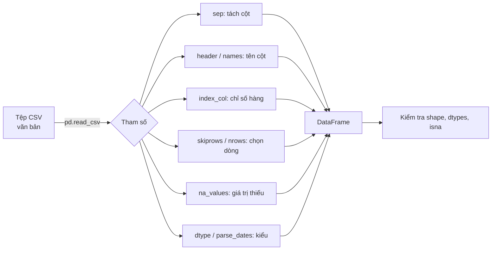

# CSV và schema

> **abstract** Tóm tắt
> - **CSV** (Comma-Separated Values) là tệp **văn bản thuần** chứa một bảng: mỗi dòng là một bản ghi, các trường cách nhau bằng dấu phân cách.
> - **`pd.read_csv(...)`** đọc CSV thành **DataFrame**. Các tham số quyết định: tách cột thế nào (*`sep`*), dòng nào là tên cột (*`header`*, *`names`*), cột nào là index (*`index_col`*), bỏ dòng nào (*`skiprows`*, *`nrows`*), coi giá trị nào là thiếu (*`na_values`*), kiểu của cột (*`dtype`*, *`parse_dates`*).
> - Tệp lớn: *`nrows`* đọc vài dòng đầu, *`chunksize`* đọc từng phần qua đối tượng `TextFileReader`.
> - Phần ghi CSV (**`to_csv`**) ở [Ghi CSV với to_csv](Ghi%20CSV%20v%E1%BB%9Bi%20to_csv.md).




## 1. CSV khác Excel thế nào

Nguồn tr. 7, tr. 8.


> **note** Bảng dạng chữ
> | Tiêu chí | Tệp CSV | Tệp Excel |
> | --- | --- | --- |
> | Định dạng | Văn bản thuần túy (text) | Nhị phân (**`.xls`**) hoặc XML nén ZIP (**`.xlsx`**, bên trong có nhiều tệp XML) |
> | Mở bằng | Notepad, Excel, Google Sheets, Pandas… | Excel, Google Sheets, LibreOffice… |
> | Cấu trúc | **Một** bảng dữ liệu đơn giản | **Nhiều sheet**, mỗi sheet là một bảng riêng |
> | Phân cách | Dấu phẩy `,` hoặc ký tự tùy chọn (`;`, `\t`) | Không có ký tự phân cách, cấu trúc tệp tự quản lý |

**Thuật ngữ.** Dòng (row) = bản ghi (record). Cột (column/field) = trường. Dấu phân cách (delimiter) ngăn các trường trong một dòng.

> **example** Ví dụ tệp `ex1.csv` (tr. 9)
> ```text
> Mã SV,Họ tên,Điểm,Ngày sinh
> CQ2025001,Phạm Khánh An,88,3/4/2006
> CQ2025002,Hồ Thị Kim Anh,40,2/5/2004
> ```
> Dòng đầu là tên cột. Mỗi dòng sau là một sinh viên. **`pd.read_csv("data/ex1.csv")`** cho DataFrame 4 cột, index mặc định 0, 1, 2… (tr. 15).

> **warning** Dễ nhầm
> "CSV giống Excel" chỉ đúng về **hình thức bảng**. CSV không lưu định dạng ô, công thức, nhiều sheet hay kiểu dữ liệu. Câu thi hay hỏi: "CSV là tệp nhị phân nén?" → **Sai**, CSV là văn bản thuần.

## 2. Cú pháp và bảng tham số read_csv

Nguồn tr. 10, tr. 11.

```python
pd.read_csv(filepath_or_buffer, sep=',', delimiter=None, header='infer', names=None,
            index_col=None, usecols=None, dtype=None, engine=..., skiprows=None,
            nrows=None, na_values=None, parse_dates=False, encoding=None,
            skip_blank_lines=True, ...)
```

| Tham số | Ý nghĩa | Ví dụ |
| --- | --- | --- |
| `filepath_or_buffer` | Đường dẫn tệp CSV hoặc URL | `"data.csv"` |
| *`sep`* | Ký tự phân tách (mặc định `,`) | *`sep=";"`* |
| *`header`* | Dòng làm tên cột (0 = dòng đầu). `None` = tệp không có dòng tên cột | *`header=0`* |
| *`names`* | Danh sách tên cột khi tệp không có header | *`names=["A","B","C"]`* |
| *`index_col`* | Cột dùng làm chỉ số (index) | *`index_col="MSSV"`* |
| *`usecols`* | Chỉ đọc một số cột | *`usecols=["A","B"]`* |
| *`dtype`* | Kiểu dữ liệu từng cột | *`dtype={"A": int, "B": float}`* |
| *`skiprows`* | Bỏ qua dòng đầu (số) hoặc các dòng cụ thể (danh sách) | *`skiprows=2`* |
| *`nrows`* | Chỉ đọc một số dòng | *`nrows=100`* |
| *`na_values`* | Giá trị coi là NaN | *`na_values=["?", "NA"]`* |
| *`encoding`* | Bảng mã ký tự, thường `utf-8` hoặc `latin1` | *`encoding="utf-8"`* |

> **info** Mở rộng
> *`delimiter`* là tên gọi khác của *`sep`*. Slide in *`engine='python'`* trong cú pháp, nhưng bảng ở tr. 13 ghi đúng: mặc định là `"c"`.

### Tham số khác

Nguồn tr. 12, tr. 13.

| Tham số | Tác dụng | Mặc định |
| --- | --- | --- |
| *`keep_default_na`* | Có dùng danh sách giá trị NA mặc định (`NA`, `NaN`, `NULL`, ô rỗng…) không | `True` |
| *`comment`* | Ký tự bắt đầu chú thích, phần sau ký tự đó ở cuối dòng bị bỏ | `None` |
| *`parse_dates`* | `True`: thử phân tích **mọi** cột thành datetime. Danh sách: chỉ các cột đó. Phần tử là tuple/list: **ghép** nhiều cột thành một ngày (ngày, giờ tách 2 cột) | `False` |
| `keep_date_col` | Khi ghép cột để tạo ngày, có giữ lại các cột gốc không | `False` |
| *`converters`* | Dict cột → hàm, ví dụ `{"foo": f}` áp `f` lên mọi giá trị cột `foo` | `None` |
| *`dayfirst`* | Ngày mơ hồ đọc theo kiểu quốc tế: `7/6/2012` → 7 tháng 6 | `False` |
| `date_parser` | Hàm tự viết để phân tích ngày | `None` |
| *`nrows`* | Số dòng đọc từ đầu tệp (không tính tiêu đề) | `None` |
| *`iterator`* | Trả `TextFileReader` để đọc từng phần, dùng được với `with` | `False` |
| *`chunksize`* | Kích thước mỗi phần khi lặp | `None` |
| `skip_footer` (nay là `skipfooter`) | Số dòng bỏ qua ở **cuối** tệp | `0` |
| `verbose` | In thông tin phân tích: thời gian từng giai đoạn, bộ nhớ | `False` |
| *`encoding`* | Mã hóa văn bản, `None` nghĩa là `"utf-8"` | `None` |
| `squeeze` | Nếu chỉ có một cột thì trả Series | `False` |
| *`thousands`* | Dấu phân tách hàng nghìn (`","` hoặc `"."`) | `None` |
| *`decimal`* | Dấu thập phân (`"."` hoặc `","`) | `"."` |
| *`engine`* | Bộ phân tích: `"c"` (mặc định, nhanh), `"pyarrow"` (mới, có thể nhanh hơn nhiều), `"python"` (chậm hơn nhưng hỗ trợ thêm tính năng) | `"c"` |

> **info** Mở rộng · Phiên bản pandas mới
> Pandas 2.x đã bỏ `squeeze=` trong **`read_csv`**. Thay bằng **`pd.read_csv(...).squeeze("columns")`**. `date_parser` và `keep_date_col` cũng bị khuyến cáo bỏ. `skipfooter` chỉ chạy với *`engine="python"`*. Đề thi theo slide vẫn có thể hỏi tên cũ.

> **example** Ví dụ gộp nhiều tham số (đã chạy với pandas 2.3)
> ```python
> from io import StringIO
> import pandas as pd
> t = ("# xuất từ phần mềm kế toán\n"
>      "id;ngay;tien;diem\n"
>      "001;07/06/2012;1.234.567;8,5\n"
>      "002;31/12/2024;2.000;7,25\n"
>      "Tổng;;;\n")
> d = pd.read_csv(StringIO(t), sep=";", comment="#", dtype={"id": str},
>                 thousands=".", decimal=",", parse_dates=["ngay"], dayfirst=True,
>                 skipfooter=1, engine="python")
> print(d)
> #     id       ngay     tien  diem
> # 0  001 2012-06-07  1234567  8.50
> # 1  002 2024-12-31     2000  7.25
> ```
> Từng bước: *`comment="#"`* bỏ dòng chú thích → *`sep=";"`* tách 4 cột → *`skipfooter=1`* bỏ dòng "Tổng" → *`thousands="."`* biến `1.234.567` thành 1234567 → *`decimal=","`* biến `8,5` thành 8.5 → *`dayfirst=True`* hiểu `07/06/2012` là 7 tháng 6 → *`dtype={"id": str}`* giữ `001`.

## 3. Các ví dụ cơ bản

Nguồn tr. 14.

```python
import pandas as pd
df = pd.read_csv("sinhvien.csv")                      # Đọc CSV cơ bản
df = pd.read_csv("sinhvien.csv", sep=";")             # Phân cách ";"
df = pd.read_csv("sinhvien.csv", index_col="MSSV")    # Cột MSSV làm index
df = pd.read_csv("sinhvien.csv", nrows=100)           # Chỉ 100 dòng đầu
df = pd.read_csv("sinhvien.csv", encoding="utf-8")    # Bảng mã UTF-8
```

**UTF-8** = Unicode Transformation Format – 8 bit, bảng mã đọc đúng tiếng Việt có dấu.

## 4. header, names, index_col

### header=None

Nguồn tr. 16.

Mặc định dòng đầu là tên cột. Tệp `ex2.csv` không có dòng tên cột, dòng đầu đã là dữ liệu. Đọc mặc định sẽ "nuốt" sinh viên đầu tiên làm tên cột.

```python
from io import StringIO
import pandas as pd
ex2 = "Phạm Khánh An,88,66A\nHồ Thị Kim Anh,40,66B\nNguyễn Thu Anh,92,65D\n"
print(pd.read_csv(StringIO(ex2)).columns.tolist())
# ['Phạm Khánh An', '88', '66A']      ← sai: dữ liệu thành tên cột
print(pd.read_csv(StringIO(ex2), header=None))
#                 0   1    2
# 0   Phạm Khánh An  88  66A
# 1  Hồ Thị Kim Anh  40  66B
# 2  Nguyễn Thu Anh  92  65D
```

### names

Nguồn tr. 17.

```python
names = ['Họ tên', 'Điểm', 'Lớp']
print(pd.read_csv(StringIO(ex2), names=names))
#            Họ tên  Điểm  Lớp
# 0   Phạm Khánh An    88  66A
# 1  Hồ Thị Kim Anh    40  66B
# 2  Nguyễn Thu Anh    92  65D
```

Truyền *`names`* thì pandas tự hiểu *`header=None`*. Muốn **thay** tên cột của tệp đã có dòng tiêu đề, dùng *`header=0, names=[...]`*.

### index_col một cột

Nguồn tr. 18.

```python
df2 = pd.read_csv(StringIO(ex2), names=names, index_col=["Họ tên"])
print(df2)
#                 Điểm  Lớp
# Họ tên
# Phạm Khánh An     88  66A
# Hồ Thị Kim Anh    40  66B
# Nguyễn Thu Anh    92  65D
```

### index_col nhiều cột → chỉ số phân cấp

Nguồn tr. 19.

```python
ex3 = "key1,key2,value1,value2\none,a,1,2\none,b,3,4\ntwo,a,9,10\ntwo,b,11,12\n"
df3 = pd.read_csv(StringIO(ex3), index_col=["key1", "key2"])
print(df3)
#            value1  value2
# key1 key2
# one  a          1       2
#      b          3       4
# two  a          9      10
#      b         11      12
print(df3.loc["two"])     # lấy cả nhóm "two" ở mức ngoài
```

Kết quả là **MultiIndex** (xem thêm [MultiIndex](../06%20Gh%C3%A9p%20v%C3%A0%20bi%E1%BA%BFn%20%C4%91%E1%BB%95i/01%20MultiIndex.md)).

### Nhắc lại vai trò của index

Nguồn tr. 20–22.


> **note** Bảng dạng chữ
> | Lợi ích | Giải thích | Ví dụ |
> | --- | --- | --- |
> | Xác định vị trí, truy cập nhanh | Index là "nhãn" của hàng, lấy hàng không cần duyệt cả bảng | Index là ngày → `df.loc["2024-08-31"]` |
> | Sắp xếp và lọc | Sắp theo thời gian, ID, tên; cắt lát theo khoảng | Từ dòng 10 đến 20, từ ngày A đến ngày B |
> | Kết hợp dữ liệu | Khi join/merge, index đóng vai trò khóa | Bảng sinh viên và bảng điểm cùng `student_id` |
> | Dữ liệu có ý nghĩa, dễ đọc | Thay số thứ tự 0, 1, 2… bằng mã khách hàng, tên sản phẩm, ngày | *`index_col="MSSV"`* |

> **warning** Dễ nhầm · ba tham số hay bị trộn
> | Tham số | Trả lời câu hỏi | Sai thường gặp |
> | --- | --- | --- |
> | *`header=None`* | Tệp **có** dòng tên cột không? | Nghĩ là "xóa tên cột" |
> | *`names=[...]`* | Tên cột **là gì**? | Quên rằng nếu tệp có header mà không đặt *`header=0`*, dòng tiêu đề cũ bị đọc thành dữ liệu |
> | `index_col=` | Cột nào thành **nhãn hàng**? | Nghĩ là "chọn cột để đọc" (đó là *`usecols`*) |

## 5. Dấu phân tách khác dấu phẩy – sep

Nguồn tr. 23.

Tệp `ex3.txt` tách bằng số lượng khoảng trắng không đều → dùng biểu thức chính quy *`sep=r"\s+"`* (hoặc `"\\s+"`): "một hoặc nhiều khoảng trắng".

```python
ex3t = ("            A         B         C\n"
        "aaa -0.264438 -1.026059 -0.619500\n"
        "bbb  0.927272  0.302904 -0.032399\n")
df4 = pd.read_csv(StringIO(ex3t), sep=r"\s+")
print(df4)
#             A         B         C
# aaa -0.264438 -1.026059 -0.619500
# bbb  0.927272  0.302904 -0.032399
print(df4.index.tolist())   # ['aaa', 'bbb']
```

> **tip** Mẹo thi · Dòng tên cột thiếu một giá trị
> Dòng tiêu đề có 3 tên (A, B, C) nhưng mỗi dòng dữ liệu có 4 giá trị → **`read_csv`** **suy luận cột đầu tiên là index**. Vì vậy `aaa`, `bbb` thành nhãn hàng, không phải một cột.

## 6. Bỏ dòng – skiprows

Nguồn tr. 24.

```python
ex4 = ("# hey!\n"
       "a,b,c,d,message\n"
       "# just wanted to make things more difficult for you\n"
       "# who reads CSV files with computers, anyway?\n"
       "1,2,3,4,hello\n5,6,7,8,world\n9,10,11,12,foo\n")
print(pd.read_csv(StringIO(ex4), skiprows=[0, 2, 3]))
#    a   b   c   d message
# 0  1   2   3   4   hello
# 1  5   6   7   8   world
# 2  9  10  11  12     foo
```

*`skiprows=[0, 2, 3]`* đếm theo **số dòng của tệp** (bắt đầu từ 0), tính cả dòng tiêu đề. *`skiprows=2`* (một số) bỏ **2 dòng đầu**.

> **warning** Dễ nhầm
> *`skiprows=2`* ≠ *`skiprows=[2]`*. Số nguyên: bỏ n dòng đầu. Danh sách: bỏ đúng các dòng có chỉ số đó.

## 7. Giá trị thiếu

### Sentinel mặc định

Nguồn tr. 25.

Pandas tự coi một tập **giá trị canh gác (sentinel)** là thiếu: `NA`, `NaN`, `NULL`, ô rỗng… Ví dụ `ex5.csv` (bảng điểm, có ô trống) đọc bằng **`pd.read_csv("data/ex5.csv", encoding="latin-1")`**: ô trống hiện thành `NaN`.

> **info** Mở rộng
> *`encoding="latin-1"`* không báo lỗi với mọi chuỗi byte nhưng sẽ **hiện sai dấu tiếng Việt** nếu tệp thật sự là UTF-8. Slide dùng latin-1 vì tệp ex5 không có dấu (`Ho va ten`, `Diem_Toan`…).

### Thống kê dữ liệu thiếu

Nguồn tr. 26.

```python
raw = "ten,toan,van,ghi_chu\nAn,88,85,\nBinh,92,,dac biet\nChi,51,73,\nDung,91,90,\n"
df5 = pd.read_csv(StringIO(raw))
missing_counts = df5.isna().sum()                    # số ô thiếu mỗi cột
missing_pct = (df5.isna().mean() * 100).round(1)      # tỉ lệ % thiếu
summary = pd.DataFrame({"Số lượng": missing_counts, "Tỉ lệ %": missing_pct})
print(summary)
#          Số lượng  Tỉ lệ %
# ten             0      0.0
# toan            0      0.0
# van             1     25.0
# ghi_chu         3     75.0
```

Công thức: $\text{tỉ lệ thiếu} = \dfrac{\text{số ô NaN của cột}}{\text{số hàng}}\times 100\%$. **`isna().mean()`** cho đúng tỉ lệ này vì `True` = 1, `False` = 0. Slide: cột `Ghi_chu` thiếu 9/10 → 90.0%.

### na_values dạng danh sách

Nguồn tr. 27.

```python
ex6 = "something,a,b,c,d,message\none,1,?,3,4,--\ntwo,5,6,?,8,world\nthree,9,10,11,12,foo\n"
print(pd.read_csv(StringIO(ex6), na_values=["?", "--"]))
#   something  a     b     c   d message
# 0       one  1   NaN   3.0   4     NaN
# 1       two  5   6.0   NaN   8   world
# 2     three  9  10.0  11.0  12     foo
```

Cột *`b`*, *`c`* chuyển sang `float` vì NaN là số thực.

### na_values dạng dict + keep_default_na=False

Nguồn tr. 28.

Mỗi hệ thống có quy ước riêng cho "không quan sát được". Dict cho phép quy ước **theo từng cột**.

```python
ex6b = "something,a,b,c,d,message\none,1,2,3,4,NA\ntwo,5,6,,8,world\nthree,9,10,11,12,foo\n"
vals = {"message": ["foo", "NA"], "something": ["two", "three"]}
r = pd.read_csv(StringIO(ex6b), na_values=vals, keep_default_na=False)
print(r)
#   something  a   b   c   d message
# 0       one  1   2   3   4     NaN
# 1       NaN  5   6       8   world
# 2       NaN  9  10  11  12     NaN
print(repr(r.loc[1, "c"]))   # ''  ← ô rỗng KHÔNG thành NaN
```

> **warning** Dễ nhầm · `keep_default_na=False`
> Tắt danh sách mặc định → ô rỗng ở cột *`c`* giữ là chuỗi rỗng `''`, không còn NaN. Chỉ các giá trị **liệt kê trong `na_values`** mới thành NaN. Dùng khi chuỗi `"NA"` là dữ liệu hợp lệ (ví dụ mã vùng Namibia).

## 8. Tệp lớn – nrows, chunksize, get_chunk

### Tạo tệp lớn và nrows

Nguồn tr. 29, tr. 30.

Slide tạo `ex7.csv` 10 000 dòng (cột `one`…`four` ngẫu nhiên, cột *`key`* là chữ A–Z) bằng **`np.random.randn`** và **`to_csv(..., index=False)`**. Sau đó **`pd.read_csv("data/ex7.csv", nrows=5)`** chỉ đọc **5 dòng** → DataFrame 5 hàng × 5 cột, không đọc toàn bộ tệp.

### chunksize → TextFileReader

Nguồn tr. 31, tr. 32.

```python
import numpy as np
rng = np.random.default_rng(0)
big = pd.DataFrame({"one": rng.standard_normal(10000),
                    "key": rng.choice(list("ABCDEFGHIJKLMNOPQRSTUVWXYZ"), 10000)})
txt = big.to_csv(index=False)

reader = pd.read_csv(StringIO(txt), chunksize=1000)
print(type(reader))   # <class 'pandas.io.parsers.readers.TextFileReader'>

res = pd.Series([], dtype="int64")
so_phan = 0
for x in reader:                         # mỗi x là DataFrame 1000 dòng
    so_phan += 1
    res = res.add(x["key"].value_counts(), fill_value=0)
res = res.sort_values(ascending=False)
print(so_phan, res.sum(), res.dtype)     # 10 10000.0 float64

r2 = pd.read_csv(StringIO(txt), iterator=True)
print(r2.get_chunk(3).shape, r2.get_chunk(7).shape)   # (3, 2) (7, 2)
```

Theo dấu: 10 000 dòng / 1000 = **10 phần**. Mỗi vòng cộng dồn số lần xuất hiện mỗi chữ. *`fill_value=0`* để chữ chưa có trong `res` được cộng từ 0 thay vì ra NaN. Kết quả `float64` (như slide `418.0`, `415.0`…) vì **`add`** với *`fill_value`* trên Series rỗng sinh số thực. **`get_chunk(n)`** lấy phần có **kích thước tùy ý**.

> **tip** Mẹo thi
> - *`nrows=5`* → trả **DataFrame**. *`chunksize=1000`* → trả **TextFileReader** (không phải DataFrame), phải lặp.
> - Câu hỏi "đọc tệp quá lớn so với RAM" → *`chunksize`*.

## 9. Schema và kiểm tra sau khi đọc

**Schema** = danh sách cột, kiểu, khóa, quy ước thiếu. Đọc xong luôn kiểm tra **`shape`**, `dtypes`, **`isna().sum()`**, khóa có trùng không.

```python
raw = 'id;diem;ghi_chu\n001;8;"đạt; đã xem"\n002;;"chưa chấm"\n'
df = pd.read_csv(StringIO(raw), sep=";", dtype={"id": "string"})
print(df.shape)                   # (2, 3)
print(df["id"].tolist())          # ['001', '002']
print(df["diem"].isna().sum())    # 1
print(df.loc[0, "ghi_chu"])       # đạt; đã xem
```

Cặp nháy kép bao `"đạt; đã xem"` nên dấu `;` bên trong không tách cột.

> **warning** Bẫy số 0 đầu
> `pd.read_csv(StringIO("id,v\n001,1\n")).loc[0, "id"]` → `1` (số). Với *`dtype={"id": str}`* → `'001'`. Mã sinh viên, mã bưu chính, số điện thoại phải đọc là chuỗi.

## Tự kiểm tra

> **question** 1. Tệp không có dòng tên cột, muốn đặt tên `A, B, C`. Viết lệnh.
> **`pd.read_csv(path, header=None, names=["A","B","C"])`** (chỉ `names=` cũng đủ, vì *`names`* ngầm hiểu *`header=None`*).

> **question** 2. Tiêu đề có 3 tên, dòng dữ liệu có 4 giá trị. Kết quả?
> Cột đầu tiên được dùng làm index của DataFrame.

> **question** 3. `skiprows=[0,2,3]` trên tệp ex4 bỏ những dòng nào?
> Dòng 0 (`# hey!`), dòng 2 và 3 (hai dòng chú thích). Dòng 1 `a,b,c,d,message` thành tiêu đề.

> **question** 4. `na_values={"message":["foo"]}` có biến `foo` ở cột khác thành NaN không?
> Không. Dict chỉ áp cho cột được nêu.

> **question** 5. `pd.read_csv(path, chunksize=500)` trả kiểu gì? Có bao nhiêu phần nếu tệp có 1200 dòng dữ liệu?
> `TextFileReader`. 3 phần: 500, 500, 200.

> **question** 6. Đọc `7/6/2012` thành 7 tháng 6 cần tham số nào?
> *`parse_dates=[cột]`* cùng *`dayfirst=True`*. Không có *`dayfirst`* thì hiểu là 6 tháng 7.

> **question** 7. Số `1.234,5` (kiểu châu Âu) đọc thành 1234.5 cần gì?
> *`thousands=".", decimal=","`*.

**Áp dụng ở.** F401 Đọc CSV với read_csv · bài mẫu CSV tham số và kiểm tra kiểu · sau đó [Thiếu và trùng](../05%20L%C3%A0m%20s%E1%BA%A1ch/01%20Thi%E1%BA%BFu%20v%C3%A0%20tr%C3%B9ng.md) và [Merge concat và combine_first](../06%20Gh%C3%A9p%20v%C3%A0%20bi%E1%BA%BFn%20%C4%91%E1%BB%95i/03%20Merge%20concat%20v%C3%A0%20combine_first.md).

Tiếp theo: [Ghi CSV với to_csv](Ghi%20CSV%20v%E1%BB%9Bi%20to_csv.md) · Mục lục chương 4
