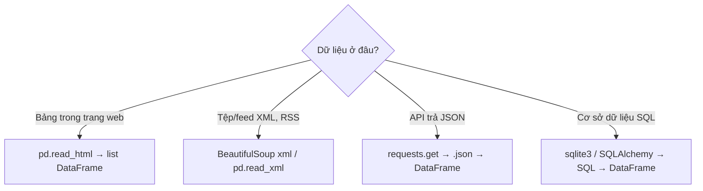
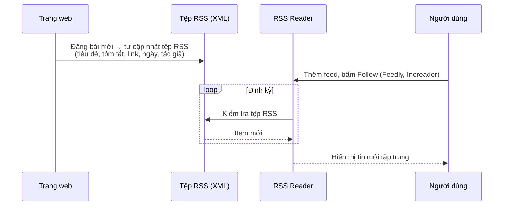
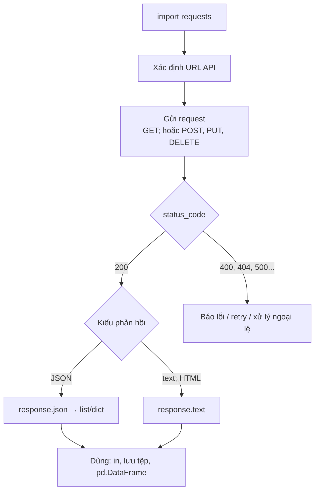
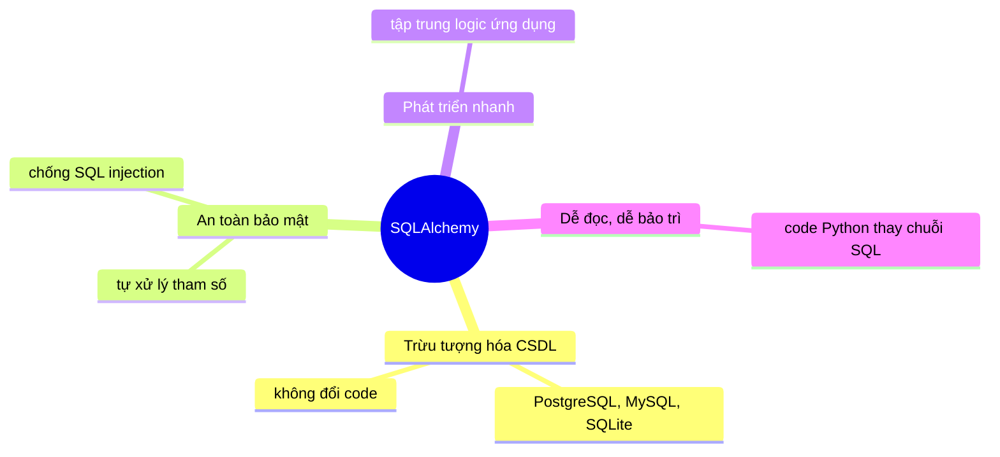

# Web API XML và SQLite

> **abstract** Tóm tắt
> - **Web (HTML)**: **`pd.read_html(...)`** đọc **mọi thẻ `<table>`** → trả **list** DataFrame. Ngược lại **`df.to_html()`**.
> - **XML / RSS**: dữ liệu dạng cây thẻ tự đặt. Slide dùng `requests` + **`BeautifulSoup(res.content, 'xml')`**, lặp **`find_all('item')`**.
> - **API web**: **`requests.get(url)`** → kiểm tra `status_code == 200` → **`response.json()`** → **`pd.DataFrame`**.
> - **CSDL**: `sqlite3` (có sẵn, một tệp) hoặc **SQLAlchemy** (nhiều DBMS, Core + ORM). Quy trình: kết nối → tạo bảng → chèn → truy vấn → đóng.



## Phần A · Thu thập dữ liệu web (4.2)

### 1. pd.read_html

Nguồn tr. 69, tr. 70.

Đọc **tất cả** bảng HTML `<table>` từ chuỗi HTML, tệp HTML hoặc URL → **danh sách DataFrame**.

```python
pd.read_html(io, match='.+', flavor=None, header=None, index_col=None,
             skiprows=None, attrs=None, parse_dates=False, thousands=',',
             encoding=None, decimal='.', converters=None, na_values=None,
             keep_default_na=True, displayed_only=True)
```

| Tham số | Mặc định | Ý nghĩa |
| --- | --- | --- |
| `io` | bắt buộc | URL, tệp HTML hoặc chuỗi HTML |
| *`match`* | `'.+'` | Regex/chuỗi: chỉ lấy bảng **chứa văn bản khớp** |
| *`flavor`* | None | Engine phân tích: `"bs4"` (BeautifulSoup4), `"lxml"` (thường dùng) |
| *`header`* | None | Dòng làm tên cột, vd `0` |
| *`index_col`* | None | Cột làm index |
| *`attrs`* | None | Lọc bảng theo thuộc tính HTML, vd `{"id": "table1"}` |
| *`skiprows`* | None | Bỏ dòng đầu của bảng |
| *`parse_dates`* | False | Tự phân tích ngày |
| *`thousands`* | `','` | Dấu hàng nghìn |
| *`decimal`* | `'.'` | Dấu thập phân |
| *`displayed_only`* | True | Chỉ lấy phần đang hiển thị, phần ẩn bằng CSS bị bỏ |

> **example** VD1 · Đọc bảng từ chuỗi HTML (tr. 71, đã chạy)
> ```python
> from io import StringIO
> html = """
> <table border="1" id="sinhvien">
>   <tr><th>MSSV</th><th>Họ tên</th><th>Điểm</th></tr>
>   <tr><td>1</td><td>An</td><td>8.5</td></tr>
>   <tr><td>2</td><td>Bình</td><td>9.0</td></tr>
>   <tr><td>3</td><td>Chi</td><td>7.5</td></tr>
> </table>
> <table border="1" id="TT">
>   <tr><th>STT</th><th>Họ tên</th><th>Lớp</th></tr>
>   <tr><td>1</td><td>An</td><td>CNTT66A</td></tr>
>   <tr><td>2</td><td>Bình</td><td>CNTT66B</td></tr>
>   <tr><td>3</td><td>Chi</td><td>KHMT66</td></tr>
> </table>"""
> tables = pd.read_html(StringIO(html))
> print("Số lượng bảng tìm thấy:", len(tables))   # 2
> print(tables[1])                                  # bảng thứ hai (chỉ số 1)
> #    STT Họ tên      Lớp
> # 0    1     An  CNTT66A
> # 1    2   Bình  CNTT66B
> # 2    3    Chi   KHMT66
> print(len(pd.read_html(StringIO(html), attrs={"id": "sinhvien"})))  # 1
> print(pd.read_html(StringIO(html), match="Lớp")[0].columns.tolist()) # ['STT', 'Họ tên', 'Lớp']
> ```
> Thẻ: `<table>` bảng, `<tr>` hàng, `<th>` ô tiêu đề, `<td>` ô dữ liệu.

> **warning** Dễ nhầm
> **`pd.read_html`** **luôn trả list**, kể cả khi chỉ có 1 bảng → phải `tables[0]`. Không có bảng nào → lỗi `ValueError: No tables found`.

### 2. Đọc bảng từ URL

Nguồn tr. 72–78.

- **VD2** (tr. 72): **`pd.read_html(url)`** với danh sách ngân hàng đổ vỡ của FDIC, lấy `tables[0]`, **`df.head()`**.
- **VD3, VD4** (tr. 73, tr. 74): Wikipedia chặn request "trơn" → dùng **`requests.get(url, headers=headers)`** với **User-Agent** giả trình duyệt, **`response.raise_for_status()`** để báo lỗi HTTP, rồi **`pd.read_html(response.text)`**. Bảng huy chương Olympic là `tables[1]`.

```python
headers = {"User-Agent": "Mozilla/5.0 (Windows NT 10.0; Win64; x64) ... Chrome/115.0 Safari/537.36"}
response = requests.get(url, headers=headers)   # lấy HTML
response.raise_for_status()                     # mã 4xx/5xx → ném lỗi
tables = pd.read_html(response.text)
df = tables[1]
```

- **Cột hai tầng** (tr. 75, tr. 76): bảng có 163 hàng × 16 cột, tiêu đề 2 mức (`Summer Olympic Games`, `Winter...`, `Combined total`) nhưng mức 2 là `Unnamed: 2_level_1`… → đặt lại mức 2:

```python
new_level_1 = ['Team (IOC code)',
               'No.', 'Gold', 'Silver', 'Bronze', 'Total',   # Summer
               'No.', 'Gold', 'Silver', 'Bronze', 'Total',   # Winter
               'No.', 'Gold', 'Silver', 'Bronze', 'Total']   # Combined
df.columns = pd.MultiIndex.from_tuples(
    [(level0, new1) for (level0, _), new1 in zip(df.columns, new_level_1)])
```

Giữ mức 0 cũ, thay mức 1 bằng tên mới nhờ **`zip`**.

- **Phân tích** (tr. 77, tr. 78): so tổng HCV mùa hè của top 5 với phần còn lại, vẽ **pie chart**.

```python
df1 = df[df[('Team', 'Team (IOC code)')] != 'Totals']          # bỏ dòng tổng
df_gold = pd.DataFrame({'Country': df1[('Team', 'Team (IOC code)')],
                        'Gold': pd.to_numeric(df1[('Summer Olympic Games', 'Gold')],
                                              errors='coerce')}).dropna()
top5 = df_gold.sort_values('Gold', ascending=False).head(5)
others_sum = df_gold['Gold'].sum() - top5['Gold'].sum()
plt.pie(top5['Gold'].tolist() + [others_sum],
        labels=top5['Country'].tolist() + ['Others'], autopct='%1.1f%%', startangle=140)
plt.axis('equal')   # giữ hình tròn
```

> **tip** Mẹo thi
> - Truy cập cột MultiIndex bằng **tuple** `('Summer Olympic Games', 'Gold')`.
> - **`pd.to_numeric(..., errors='coerce')`**: giá trị không đổi được thành số → NaN, rồi **`dropna()`**.
> - Bỏ dòng `Totals` trước khi tính, nếu không tổng bị nhân đôi.

### 3. to_html

Nguồn tr. 80.

```python
DataFrame.to_html(buf=None, columns=None, col_space=None, header=True, index=True,
                  na_rep='NaN', formatters=None, float_format=None, sparsify=None,
                  index_names=True, justify=None, max_rows=None, max_cols=None,
                  show_dimensions=False, decimal='.', bold_rows=True, classes=None,
                  escape=True, notebook=False, border=None, table_id=None,
                  render_links=False)
```

Ghi DataFrame thành chuỗi `<table class="dataframe">…`. Chú ý: ở **`to_html`**, *`na_rep`* mặc định là `'NaN'` (khác **`to_csv`** là rỗng).

### 4. XML và RSS

Nguồn tr. 79, tr. 81–86.

**XML** (Extensible Markup Language): ngôn ngữ đánh dấu lưu và truyền dữ liệu theo **cấu trúc cây**, dùng **thẻ tự đặt**:

```xml
<product>
  <name>Máy tính xách tay</name>
  <price>15000000</price>
  <available>true</available>
</product>
```

**RSS Feed** (Really Simple Syndication): tệp XML cung cấp nội dung **cập nhật tự động** (blog, tin tức, podcast) — như "kênh đăng ký" nhận bài mới mà không cần vào từng trang. Thẻ chuẩn: `<rss>` → `<channel>` (title, link, description, language, lastBuildDate) → nhiều `<item>` (title, link, description, pubDate, guid, có thể `enclosure` kèm tệp mp3/ảnh/video). Ví dụ: `https://cafef.vn/index.rss`, `https://thanhnien.vn/rss.html`.



Nguồn cơ chế tr. 83, cách đăng ký tr. 84, cấu trúc tr. 85, ví dụ thật tr. 86.

### 5. Đọc RSS thành DataFrame

Nguồn tr. 87–89.

Code slide (cần `bs4`, `lxml`):

```python
import requests
from bs4 import BeautifulSoup
res = requests.get("https://cafef.vn/thi-truong-chung-khoan.rss")
soup = BeautifulSoup(res.content, 'xml')         # phân tích dạng XML
data = []
for item in soup.find_all('item'):               # mỗi bài viết
    title = item.find('title').text if item.find('title') else ''
    link = item.find('link').text if item.find('link') else ''
    pubDate = item.find('pubDate').text if item.find('pubDate') else ''
    description = item.find('description').text if item.find('description') else ''
    data.append({'title': title, 'link': link, 'pubDate': pubDate, 'description': description})
df = pd.DataFrame(data)
```

`if item.find(...) else ''` phòng item thiếu thẻ → tránh lỗi **`.text`** trên `None`.

Lọc tin về "báo cáo tài chính" (không phân biệt hoa thường):

```python
df_hvn = df[df['title'].str.contains('báo cáo tài chính', case=False, na=False) |
            df['description'].str.contains('báo cáo tài chính', case=False, na=False)]
```

> **example** Phiên bản chạy được không cần mạng (ElementTree, đã chạy)
> ```python
> from xml.etree import ElementTree as ET
> rss = """<rss version="2.0"><channel><title>Blog ABC</title>
> <item><title>Bài viết 1: Hướng dẫn học C</title><link>https://example.com/bai-viet-1</link>
>   <description>Báo cáo tài chính quý 3</description></item>
> <item><title>Bài viết 2: Kiến thức mạng cơ bản</title><link>https://example.com/bai-viet-2</link>
>   <description>Tóm tắt ngắn</description></item></channel></rss>"""
> root = ET.fromstring(rss)
> data = [{"title": it.findtext("title", ""), "description": it.findtext("description", "")}
>         for it in root.iter("item")]
> d = pd.DataFrame(data)
> m = d["title"].str.contains("báo cáo tài chính", case=False, na=False) | \
>     d["description"].str.contains("báo cáo tài chính", case=False, na=False)
> print(d[m]["title"].tolist())     # ['Bài viết 1: Hướng dẫn học C']
> ```
> *`case=False`* khớp cả "Báo cáo". *`na=False`* coi ô thiếu là không khớp. Có thể dùng gọn **`pd.read_xml(StringIO(rss), xpath=".//item")`** (mở rộng).

> **warning** Dễ nhầm
> **`BeautifulSoup(..., 'xml')`** cho XML/RSS; `'html.parser'` cho HTML. `|` là **hoặc** giữa hai mask, phải có ngoặc khi kết hợp phép so sánh.

## Phần B · API web (4.4)

### 6. Khái niệm

Nguồn tr. 98.

**API** (Application Programming Interface) web: giao diện cho các ứng dụng/thiết bị **giao tiếp qua internet**, thường bằng HTTP/HTTPS. Là cầu nối: gửi **request**, nhận **response** chứa dữ liệu (thường JSON hoặc XML). Thư viện phổ biến: `requests` (`pip install requests`).

### 7. Quy trình chung

Nguồn tr. 99.




> **note** Bảng dạng chữ
> | Mã | Nghĩa |
> | --- | --- |
> | 200 | Thành công |
> | 400 | Yêu cầu sai |
> | 404 | Không tìm thấy |
> | 500 | Lỗi máy chủ |

### 8. Ví dụ tỉnh thành Việt Nam

Nguồn tr. 100–102.

```python
import requests
url = "https://provinces.open-api.vn/api/?depth=1"   # danh sách tỉnh thành
response = requests.get(url)                       # gửi HTTP GET
if response.status_code == 200:                    # kiểm tra trạng thái
    data = response.json()                         # JSON → Python
    print(type(data))                              # <class 'list'>
    for province in data:
        print(f"- {province['name']}")             # truy xuất tên tỉnh
else:
    print("Không thể lấy dữ liệu. Mã lỗi:", response.status_code)

provinces = pd.DataFrame(response.json())          # 63 hàng × 6 cột:
# name, code, division_type, codename, phone_code, districts
```

Kết quả slide: 63 tỉnh, cột `districts` là `[]` vì *`depth=1`* chỉ lấy cấp tỉnh.

> **warning** Dễ nhầm
> - **`response.json()`** là **phương thức** (có ngoặc); `response.text`, `response.status_code` là **thuộc tính**.
> - **`.text`** trả `str`; **`.json()`** trả dict/list; **`.content`** trả `bytes`.
> - Mã 200 không bảo đảm payload là JSON: nếu là HTML thì **`.json()`** báo lỗi giải mã.
> - Slide tr. 102 viết **`resp.json()`**: chỉ là tên biến khác của `response`.

## Phần C · Cơ sở dữ liệu (4.5)

### 9. Hai cách tương tác

Nguồn tr. 104.


> **note** Bảng dạng chữ
> | | `sqlite3` | SQLAlchemy |
> | --- | --- | --- |
> | Cài đặt | **Có sẵn** trong Python | `pip install SQLAlchemy` |
> | Phạm vi | SQLite nhẹ, lưu **một tệp** (hoặc bộ nhớ) | Nhiều DBMS: SQLite, MySQL, PostgreSQL… không cần đổi nhiều code |
> | Phù hợp | Ứng dụng nhỏ, thử nghiệm | Ứng dụng phức tạp, nhiều loại CSDL |

### 10. Quy trình 5 bước với sqlite3

Nguồn tr. 105.

Kết nối (**`sqlite3.connect`**) → Tạo bảng → Chèn dữ liệu → Truy vấn (vào DataFrame) → Đóng kết nối.


Ví dụ (tr. 106): CSDL `mydata.sqlite`, bảng `test` gồm `a VARCHAR(20)`, `b VARCHAR(20)`, `c REAL` (số thực), `d INTEGER` (số nguyên).

> **example** Toàn bộ quy trình (đã chạy, dùng `:memory:` thay tệp)
> ```python
> import sqlite3, pandas as pd
> con = sqlite3.connect("mydata.sqlite")   # tr. 107: tạo tệp nếu chưa có
>
> query = "CREATE TABLE test (a VARCHAR(20), b VARCHAR(20), c REAL, d INTEGER);"
> try:
>     con.execute(query)     # tr. 108: thực thi lệnh tạo bảng
>     con.commit()           # lưu thay đổi
> except sqlite3.OperationalError as e:
>     print(f"Lỗi khi tạo bảng (có thể bảng đã tồn tại): {e}")
>     # chạy lần 2 → "table test already exists"
>
> data_sql = [("Atlanta", "Georgia", 1.25, 6),
>             ("Tallahassee", "Florida", 2.6, 3),
>             ("Sacramento", "California", 1.7, 5)]
> stmt = "INSERT INTO test VALUES(?, ?, ?, ?)"    # tr. 110: ? là placeholder
> try:
>     con.executemany(stmt, data_sql)              # chèn nhiều hàng một lần
>     con.commit()
> except sqlite3.IntegrityError as e:              # trùng khóa, vi phạm ràng buộc
>     print(f"Lỗi khi chèn dữ liệu: {e}")
>
> cursor = con.execute("SELECT * FROM test")      # tr. 112
> rows = cursor.fetchall()                         # list tuple, mỗi tuple 1 hàng
> print(rows[0])                                   # ('Atlanta', 'Georgia', 1.25, 6)
> print(cursor.description[0])                     # ('a', None, None, None, None, None, None)
> df_sqlite = pd.DataFrame(rows, columns=[x[0] for x in cursor.description])
> print(df_sqlite)
> #              a           b     c  d
> # 0      Atlanta     Georgia  1.25  6
> # 1  Tallahassee     Florida  2.60  3
> # 2   Sacramento  California  1.70  5
> con.close()                                      # tr. 114: giải phóng tài nguyên
> ```

Giải thích theo slide (tr. 109, tr. 111, tr. 113):


> **note** Bảng dạng chữ
> | Lệnh | Vai trò |
> | --- | --- |
> | **`sqlite3.connect("mydata.sqlite")`** | Tạo hoặc kết nối tệp CSDL; chưa có thì tạo mới |
> | `CREATE TABLE` | Định nghĩa bảng 4 cột và kiểu |
> | **`con.execute(query)`** | Thực thi một câu SQL |
> | **`con.commit()`** | **Lưu** thay đổi (sau CREATE/INSERT/UPDATE/DELETE) |
> | `OperationalError` | Bắt lỗi khi bảng đã tồn tại → chương trình không dừng |
> | **`executemany(stmt, data_sql)`** | Chèn nhiều hàng, mỗi `?` nhận một giá trị của tuple |
> | `IntegrityError` | Trùng khóa chính, vi phạm ràng buộc |
> | **`cursor.fetchall()`** | Lấy hết kết quả: **list các tuple** |
> | **`cursor.description`** | Thông tin cột; phần tử `[0]` của mỗi mục là **tên cột** |
> | **`con.close()`** | Đóng kết nối |

**Xóa tệp CSDL khi cần** (tr. 115):

```python
import os
if os.path.exists("mydata.sqlite"):
    os.remove("mydata.sqlite")
```

> **info** Mở rộng · cách ngắn hơn
> **`pd.read_sql("SELECT a, c FROM test WHERE d >= 5", con)`** trả thẳng DataFrame (Atlanta 1.25, Sacramento 1.70). Gọi **`cursor.fetchall()`** lần hai trả `[]` vì con trỏ đã cạn. Sau **`con.close()`**, **`con.execute(...)`** → `ProgrammingError: Cannot operate on a closed database`.

> **warning** Dễ nhầm
> - Quên **`commit()`** → dữ liệu chèn không được lưu vào tệp.
> - Placeholder của sqlite3 là `?`, không ghép chuỗi bằng f-string (dễ bị SQL injection).
> - **`execute`** 1 câu; **`executemany`** 1 câu × nhiều bộ tham số.

### 11. SQLAlchemy

Nguồn tr. 116–118.

Bộ công cụ SQL **mã nguồn mở** và **ORM** (Object-Relational Mapper) cho Python: thao tác CSDL bằng **lớp và đối tượng Python** thay vì viết SQL trực tiếp.


> **note** Bảng dạng chữ
> | SQL thuần | ORM SQLAlchemy |
> | --- | --- |
> | `SELECT * FROM users WHERE id = 1` | **`session.query(User).get(1)`** |

**Lợi ích** (tr. 117):



**Hai thành phần** (tr. 118):


> **note** Bảng dạng chữ
> | Thành phần | Cấp | Vai trò |
> | --- | --- | --- |
> | **Core** | Thấp | Lớp trừu tượng cho câu lệnh SQL; xây câu SQL bằng Python linh hoạt |
> | **ORM** | Cao | Ánh xạ **đối tượng Python ↔ bảng**; code trực quan, dễ hiểu |

Ví dụ chạy được: [Thực hành SQLAlchemy](Th%E1%BB%B1c%20h%C3%A0nh%20Excel%20nhi%E1%BB%81u%20sheet%20v%C3%A0%20SQLAlchemy.md).

## Tự kiểm tra

> **question** 1. `pd.read_html(html)` với trang có 3 bảng trả gì? Lấy bảng thứ hai thế nào?
> List 3 DataFrame; `tables[1]`.

> **question** 2. Chỉ lấy bảng có `id="kq"`?
> **`pd.read_html(src, attrs={"id": "kq"})`**.

> **question** 3. Vì sao thêm `headers={"User-Agent": ...}` khi lấy Wikipedia?
> Giả lập trình duyệt để máy chủ không chặn request tự động.

> **question** 4. Thứ tự đúng: commit, connect, executemany, close, fetchall?
> connect → execute CREATE → commit → executemany → commit → execute SELECT → fetchall → close.

> **question** 5. Lấy danh sách tên cột sau `cursor = con.execute("SELECT * FROM test")`?
> `[x[0] for x in cursor.description]`.

> **question** 6. Thành phần SQLAlchemy nào ánh xạ lớp Python sang bảng?
> ORM. Core là lớp thấp hơn để dựng câu SQL.

> **question** 7. `requests.get(url).status_code` bằng 404 nghĩa là gì?
> Không tìm thấy tài nguyên. Chỉ 200 là thành công.

**Áp dụng ở.** F405 Lấy dữ liệu web – HTML, XML và API · F406 SQLite và truy vấn SQL · F407 Đường dẫn và quản lý tệp · bài mẫu Đọc nhiều bảng HTML, SQLite truy vấn và giao dịch.

Trước: [02 JSON và Excel](02%20JSON%20v%C3%A0%20Excel.md) · Tiếp: [04 Công thức và cú pháp](04%20C%C3%B4ng%20th%E1%BB%A9c%20v%C3%A0%20c%C3%BA%20ph%C3%A1p.md) · Mục lục chương 4
