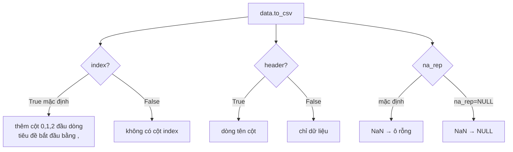

# Ghi CSV với to_csv

> **abstract** Tóm tắt
> **`DataFrame.to_csv(...)`** ghi DataFrame thành văn bản CSV. **Mặc định ghi cả index và header**, phân cách bằng `,`, giá trị thiếu thành ô rỗng. Đổi bằng *`index=False`*, *`header=False`*, `sep=`, `na_rep=`, `columns=`. Nếu *`path_or_buf=None`* thì **trả về chuỗi** thay vì ghi tệp.

Nguồn tr. 34–39.

## 1. Cú pháp và tham số

Nguồn tr. 34.

```python
DataFrame.to_csv(path_or_buf=None, sep=',', index=True, encoding=None, ...)
```

[](../../diagrams/04%20Nh%E1%BA%ADp%20v%C3%A0%20l%C6%B0u%20tr%E1%BB%AF/B%E1%BA%A3ng%20tr%E1%BB%B1c%20quan/C4%20Ghi%20CSV%20v%E1%BB%9Bi%20to_csv%20%E2%80%93%20b%E1%BA%A3ng%201.excalidraw.md)

> **note** Bảng dạng chữ
> | Tham số | Mô tả | Mặc định |
> | --- | --- | --- |
> | *`path_or_buf`* | Đường dẫn tệp (vd `"output.csv"`). `None` → hàm **trả chuỗi CSV** | `None` |
> | *`sep`* | Ký tự phân cách, có thể đổi `";"`, `"\t"`, `"\|"` | `","` |
> | *`index`* | Có ghi cột index không | `True` |
> | *`columns`* | Danh sách cột cần ghi | tất cả |
> | *`header`* | Có ghi tên cột không | `True` |
> | *`encoding`* | Bộ mã (UTF-8, cp1252…) | UTF-8 |
> | *`na_rep`* | Chuỗi thay cho NaN | `""` (rỗng) |
> | `quoting` | Kiểm soát việc thêm nháy `"..."` quanh chuỗi | tối thiểu |
> | `line_terminator` (nay là `lineterminator`) | Ký tự kết thúc dòng | `\n` |

## 2. Các biến thể thường dùng

Nguồn tr. 35.

```python
data = {"MSSV": [1, 2, 3], "Họ tên": ["An", "Bình", "Chi"], "Điểm": [8.5, 7.0, 9.0]}
df = pd.DataFrame(data)
df.to_csv("sv.csv")                                    # cơ bản (có index)
df.to_csv("sv_no_index.csv", index=False)              # không ghi index
df.to_csv("sv_sep.csv", sep=";", index=False)          # phân cách ";"
df.to_csv("sv_utf8.csv", index=False, encoding="utf-8")# UTF-8
df.to_csv("sv_na.csv", index=False, na_rep="N/A")      # NaN → "N/A"
df.to_csv("sv_mssv.csv", columns=["MSSV", "Điểm"], index=False)  # chỉ 2 cột
```

## 3. Theo dấu đầu ra trên bảng data

Nguồn tr. 36–39.

Bảng mẫu (giống slide):

| | something | a | b | c | d | message |
| --- | --- | --- | --- | --- | --- | --- |
| 0 | one | 1 | 2 | 3.0 | 4 | NaN |
| 1 | two | 5 | 6 | NaN | 8 | world |
| 2 | three | 9 | 10 | 11.0 | 12 | foo |

Kết quả dưới đây đã chạy thật (pandas 2.3):

> **example** `data.to_csv("data/out.csv")` — mặc định (tr. 36)
> ```text
> ,something,a,b,c,d,message
> 0,one,1,2,3.0,4,
> 1,two,5,6,,8,world
> 2,three,9,10,11.0,12,foo
> ```
> Dòng tiêu đề **bắt đầu bằng dấu phẩy** vì có cột index không tên. NaN thành ô rỗng. Slide đọc lại tệp bằng `with open("data/out.csv", "r") as f: print(f.read())` (tương đương `!cat` trong Jupyter).

> **example** `sep="|"` (tr. 37)
> ```text
> |something|a|b|c|d|message
> 0|one|1|2|3.0|4|
> 1|two|5|6||8|world
> 2|three|9|10|11.0|12|foo
> ```

> **example** `na_rep="NULL"` (tr. 38)
> ```text
> ,something,a,b,c,d,message
> 0,one,1,2,3.0,4,NULL
> 1,two,5,6,NULL,8,world
> 2,three,9,10,11.0,12,foo
> ```

> **example** `data.to_csv(sys.stdout, index=False, header=False)` (tr. 39)
> ```text
> one,1,2,3.0,4,
> two,5,6,,8,world
> three,9,10,11.0,12,foo
> ```
> `sys.stdout` = in thẳng ra màn hình thay vì ghi tệp. Không còn dòng tên cột và cột index.



> **warning** Dễ nhầm
> - Ghi với index mặc định rồi **`read_csv`** lại → xuất hiện cột `Unnamed: 0`. Tránh bằng *`index=False`* khi ghi, hoặc *`index_col=0`* khi đọc.
> - CSV **không lưu dtype**: mã `"001"` ghi ra vẫn là `001`, nhưng đọc lại không có `dtype=` sẽ thành số 1.
> - **`to_csv()`** không có đường dẫn **trả về `str`**, không ghi tệp.

## 4. Vòng đọc – ghi

```python
from io import StringIO
original = pd.DataFrame({"id": ["001", "002"], "diem": [8, 7]})
text = original.to_csv(index=False)
again = pd.read_csv(StringIO(text), dtype={"id": "string"})
print(text.splitlines())     # ['id,diem', '001,8', '002,7']
print(again["id"].tolist())  # ['001', '002']
```

> **info** Mở rộng
> Định dạng nhị phân (`to_pickle`, `to_parquet`, `to_feather`) giữ dtype tốt hơn CSV. Một số câu ở họ F402 hỏi điều này.

## Tự kiểm tra

> **question** 1. Dòng đầu tệp ghi ra là `,name,age`. Vì sao có dấu phẩy đầu?
> Vì *`index=True`* mặc định: cột index không có tên nên ô tiêu đề đầu rỗng.

> **question** 2. Ghi NaN thành chữ `N/A`?
> **`df.to_csv(path, na_rep="N/A")`**.

> **question** 3. In CSV ra màn hình, không index, không tiêu đề?
> **`df.to_csv(sys.stdout, index=False, header=False)`**.

> **question** 4. `s = df.to_csv()` thì `type(s)` là gì?
> `str`.

**Áp dụng ở.** F402 Ghi tệp – to_csv, to_excel.

Trước: [01 CSV và schema](01%20CSV%20v%C3%A0%20schema.md) · Tiếp: [02 JSON và Excel](02%20JSON%20v%C3%A0%20Excel.md) · [Mục lục chương 4](00%20M%E1%BB%A5c%20l%E1%BB%A5c.md)
