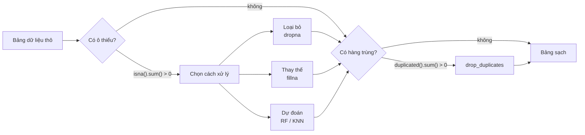

# Thiếu và trùng

> **abstract** Tóm tắt
> - **Dữ liệu thiếu** (missing data): ô trống hoặc mang `NA`, `NaN`, `NULL`, `""`. Ba dạng: **MCAR**, **MAR**, **MNAR**.
> - Pandas biểu diễn thiếu bằng `NaN` (số), `None` (object), `NaT` (thời gian).
> - Phát hiện: **`isna()/isnull()`**, **`notna()/notnull()`**, **`isna().sum()`**, **`isna().any()`**, **`isna().sum().sum()`**.
> - Ba cách xử lý: **Loại bỏ** (*`dropna`*), **Thay thế** (**`fillna`**), **Dự đoán** (mô hình, xem [Thực hành thêm - Điền dữ liệu bằng mô hình](Th%E1%BB%B1c%20h%C3%A0nh%20th%C3%AAm%20-%20%C4%90i%E1%BB%81n%20d%E1%BB%AF%20li%E1%BB%87u%20b%E1%BA%B1ng%20m%C3%B4%20h%C3%ACnh.md)).
> - **Dữ liệu trùng** (duplicate data): phát hiện bằng **`duplicated()`**, xử lý bằng **`drop_duplicates(subset, keep, inplace, ignore_index)`**.

Nguồn: tr. 4 (dàn ý 5.1) · tr. 70 (dàn ý 5.2).



---

## 5.1.1 Các dạng thiếu dữ liệu

tr. 5 · tr. 6 · tr. 7

**Thuật ngữ.** Khi thu thập và lưu trữ, không phải giá trị nào cũng được ghi đủ. Ô có thể trống hoặc mang ký hiệu đặc biệt `NA`, `NaN`, `NULL`, chuỗi rỗng `""`. Đó là **dữ liệu thiếu** (missing data).

[](../../diagrams/05%20L%C3%A0m%20s%E1%BA%A1ch/B%E1%BA%A3ng%20tr%E1%BB%B1c%20quan/C5%2001%20Thi%E1%BA%BFu%20v%C3%A0%20tr%C3%B9ng%20%E2%80%93%20b%E1%BA%A3ng%201.excalidraw.md)

> **note** Bảng dạng chữ
> | Dạng | Tên đầy đủ | Xác suất thiếu phụ thuộc vào | Ví dụ trong slide |
> | --- | --- | --- | --- |
> | **MCAR** | Missing Completely At Random, thiếu hoàn toàn ngẫu nhiên | Không phụ thuộc gì | Lỗi hệ thống làm mất ngẫu nhiên vài dòng, không liên quan đặc tính khách hàng |
> | **MAR** | Missing At Random, thiếu ngẫu nhiên | **Biến khác** đã quan sát | Khách trẻ tuổi hay bỏ trống thu nhập. Thiếu phụ thuộc "tuổi", không phụ thuộc trực tiếp "thu nhập" |
> | **MNAR** | Missing Not At Random, thiếu không ngẫu nhiên | **Chính biến bị thiếu** | Người thu nhập rất cao hoặc rất thấp không khai thu nhập |

> **tip** Mẹo thi: hỏi "thiếu vì cái gì?"
> - Vì không gì cả (lỗi ngẫu nhiên) → MCAR.
> - Vì **một cột khác** (tuổi, chi nhánh) → MAR.
> - Vì **giá trị của chính cột đó** (thu nhập cao nên giấu thu nhập) → MNAR.

**Biểu diễn trong pandas** (tr. 7):

[](../../diagrams/05%20L%C3%A0m%20s%E1%BA%A1ch/B%E1%BA%A3ng%20tr%E1%BB%B1c%20quan/C5%2001%20Thi%E1%BA%BFu%20v%C3%A0%20tr%C3%B9ng%20%E2%80%93%20b%E1%BA%A3ng%202.excalidraw.md)

> **note** Bảng dạng chữ
> | Ký hiệu | Dùng cho | Ghi chú |
> | --- | --- | --- |
> | `NaN` (Not a Number) | Dữ liệu số | Kiểu `float`, nên cột số nguyên có NaN sẽ thành `float64` |
> | `None` | Dữ liệu đối tượng (object) | Trong cột số, `None` tự đổi thành `NaN` |
> | `NaT` (Not a Time) | Dữ liệu thời gian | Xuất hiện trong cột `datetime64` |

> **warning** Dễ nhầm
> - Số `0` **không** phải là thiếu. Chuỗi `"-"` hay `"N/A"` chỉ là thiếu khi bạn khai báo (ví dụ *`na_values`* lúc đọc tệp).
> - Cột `Tuổi = [25, None, 30, 28, None]` có dtype `float64`, không phải `int64`.

> **question** Tự kiểm tra: khách hàng có thu nhập rất cao không khai thu nhập. Dạng thiếu nào?
> **MNAR**: khả năng thiếu phụ thuộc chính giá trị thu nhập (biến bị thiếu).

## 5.1.2 Nguyên nhân gây ra dữ liệu thiếu

tr. 8

[](../../diagrams/05%20L%C3%A0m%20s%E1%BA%A1ch/B%E1%BA%A3ng%20tr%E1%BB%B1c%20quan/C5%2001%20Thi%E1%BA%BFu%20v%C3%A0%20tr%C3%B9ng%20%E2%80%93%20b%E1%BA%A3ng%203.excalidraw.md)

> **note** Bảng dạng chữ
> | Nguyên nhân | Ví dụ |
> | --- | --- |
> | Lỗi thu thập dữ liệu | Thiết bị ghi nhận bị lỗi, mạng gián đoạn |
> | Người dùng không cung cấp | Bỏ qua câu hỏi survey, không điền thông tin cá nhân |
> | Dữ liệu không tồn tại | Thông tin chưa sinh ra tại thời điểm thu thập |
> | Lỗi xử lý dữ liệu | Lỗi trong nhập liệu, chuyển đổi định dạng |

> **example** Ví dụ "không tồn tại"
> Cột "Ngày tốt nghiệp" của sinh viên năm nhất trống vì sự kiện chưa xảy ra. Không nên điền máy móc bằng mean.

## 5.1.3 Tác động của dữ liệu thiếu

tr. 9 · tr. 10

1. **Giảm kích thước mẫu**: xóa hàng thiếu làm giảm số quan sát.
2. **Thiên lệch (bias) kết quả**: nếu thiếu không ngẫu nhiên, kết luận bị lệch. Ví dụ người thu nhập cao không khai → thu nhập trung bình tính ra **thấp hơn thực tế**.
3. **Giảm hiệu quả phân tích**: nhiều thuật toán học máy không nhận giá trị thiếu (báo lỗi hoặc phải bỏ dữ liệu). Tiền xử lý (preprocessing) phức tạp và tốn thời gian hơn.

**Bảng mẫu `df_missing` dùng xuyên suốt 5.1** (tr. 10, lặp lại ở tr. 12, 19):

```python
import pandas as pd
import numpy as np
data_missing = {
    'Tên': ['An', 'Bình', 'Chi', 'Dũng', 'Eva'],
    'Tuổi': [25, None, 30, 28, None],
    'Lương': [15000000, 18000000, None, 22000000, 16000000],
    'Phòng ban': ['IT', 'Marketing', None, 'IT', 'Marketing']}
df_missing = pd.DataFrame(data_missing)
print(df_missing)
```

```text
    Tên  Tuổi       Lương  Phòng ban
0    An  25.0  15000000.0         IT
1  Bình   NaN  18000000.0  Marketing
2   Chi  30.0         NaN       None
3  Dũng  28.0  22000000.0         IT
4   Eva   NaN  16000000.0  Marketing
```

Nhìn nhanh: Tuổi thiếu 2 (Bình, Eva), Lương thiếu 1 (Chi), Phòng ban thiếu 1 (Chi). Chỉ **An** và **Dũng** đầy đủ.

## 5.1.4 Các phương thức phát hiện dữ liệu thiếu

tr. 11 – tr. 16

[](../../diagrams/05%20L%C3%A0m%20s%E1%BA%A1ch/B%E1%BA%A3ng%20tr%E1%BB%B1c%20quan/C5%2001%20Thi%E1%BA%BFu%20v%C3%A0%20tr%C3%B9ng%20%E2%80%93%20b%E1%BA%A3ng%204.excalidraw.md)

> **note** Bảng dạng chữ
> | Phương thức | Mô tả | Trả về |
> | --- | --- | --- |
> | **`isna()`** / **`isnull()`** | Kiểm tra từng phần tử **có thiếu** không | Boolean DataFrame/Series |
> | **`notna()`** / **`notnull()`** | Kiểm tra từng phần tử **có dữ liệu** không | Boolean DataFrame/Series |
> | **`isna().sum()`** | Đếm số thiếu **theo cột** | Series số lượng |
> | **`isna().any()`** | Cột nào có thiếu | Boolean Series |
> | **`isna().sum().sum()`** | Tổng số ô thiếu cả bảng | Một số nguyên |

```python
print(df_missing.isna())               # tr. 13
print(df_missing.isna().sum())         # tr. 14
print(df_missing.isna().any())         # tr. 15
print(df_missing.isna().sum().sum())   # tr. 16
```

```text
     Tên   Tuổi  Lương  Phòng ban
0  False  False  False      False
1  False   True  False      False
2  False  False   True       True
3  False  False  False      False
4  False   True  False      False

Tên          0
Tuổi         2
Lương        1
Phòng ban    1
dtype: int64

Tên          False
Tuổi          True
Lương         True
Phòng ban     True
dtype: bool

4
```

**Giải thích từng bước.** **`isna()`** tạo "mặt nạ" True/False cùng hình dạng bảng. `True` được tính là 1 khi cộng. Nên **`.sum()`** cộng theo cột (mặc định *`axis=0`*), **`.sum().sum()`** cộng tiếp ra tổng 2+1+1 = 4. **`.any()`** hỏi "cột có ít nhất một True không".

> **warning** Dễ nhầm
> - **`isna()`** và **`isnull()`** **giống hệt nhau** (bí danh). Tương tự **`notna()`** = **`notnull()`**.
> - **`df.isna().sum(axis=1)`** đếm theo **hàng**: `[0, 1, 2, 0, 1]`.
> - Không dùng `x == np.nan` để kiểm tra, vì `NaN != NaN`.

> **info** Mở rộng: tỷ lệ thiếu
> `df.isna().mean() * 100` cho phần trăm thiếu từng cột. Slide dùng `df.isnull().sum() / len(df) * 100` (tr. 35), cho cùng kết quả.

> **question** Tự kiểm tra: `df_missing.notna().sum()` cho gì?
> Số ô **có dữ liệu** theo cột: Tên 5, Tuổi 3, Lương 4, Phòng ban 4.

## 5.1.5 Các phương pháp xử lý dữ liệu thiếu

tr. 17

Ba cách chính:

[](../../diagrams/05%20L%C3%A0m%20s%E1%BA%A1ch/B%E1%BA%A3ng%20tr%E1%BB%B1c%20quan/C5%2001%20Thi%E1%BA%BFu%20v%C3%A0%20tr%C3%B9ng%20%E2%80%93%20b%E1%BA%A3ng%205.excalidraw.md)

> **note** Bảng dạng chữ
> | Cách | Ý tưởng |
> | --- | --- |
> | **Loại bỏ** (Deletion) | Xóa hàng/cột có thiếu |
> | **Thay thế** (Imputation) | Điền giá trị phù hợp vào chỗ thiếu |
> | **Dự đoán** (Prediction) | Dùng thuật toán dự đoán giá trị thiếu |

Chọn phương pháp:

- Tỷ lệ thiếu nhỏ (**< 5%**): có thể loại bỏ.
- Thiếu ngẫu nhiên: thay bằng mean/median/mode.
- Thiếu có pattern: phân tích nguyên nhân, xử lý cẩn thận.
- Dữ liệu quan trọng: dùng kỹ thuật dự đoán phức tạp hơn.

[](../../diagrams/05%20L%C3%A0m%20s%E1%BA%A1ch/C%C3%A2y%20ch%E1%BB%8Dn%20c%C3%A1ch%20x%E1%BB%AD%20l%C3%BD%20thi%E1%BA%BFu.excalidraw.md)

### Phương pháp 1: Loại bỏ bằng dropna

tr. 18 – tr. 23

```python
df.dropna(axis=0, how='any', thresh=None, subset=None, inplace=False)
```

[](../../diagrams/05%20L%C3%A0m%20s%E1%BA%A1ch/B%E1%BA%A3ng%20tr%E1%BB%B1c%20quan/C5%2001%20Thi%E1%BA%BFu%20v%C3%A0%20tr%C3%B9ng%20%E2%80%93%20b%E1%BA%A3ng%206.excalidraw.md)

> **note** Bảng dạng chữ
> | Tham số | Giá trị | Ý nghĩa |
> | --- | --- | --- |
> | *`axis`* | `0` (mặc định) / `1` | 0: bỏ **hàng**, 1: bỏ **cột** |
> | *`how`* | `'any'` (mặc định) / `'all'` | `'any'`: có ít nhất 1 NaN thì bỏ. `'all'`: chỉ bỏ khi toàn bộ là NaN |
> | *`subset`* | list | Chỉ xét thiếu trong các cột được chỉ định |
> | *`thresh`* | int | Số giá trị **không null tối thiểu** để được giữ |
> | *`inplace`* | `False` (mặc định) | `False`: trả bảng mới, bảng gốc không đổi |

Bốn ví dụ trên `df_missing`:

```python
df_drop_any = df_missing.dropna()                              # tr. 20
df_drop_all = df_missing.dropna(how='all')                     # tr. 21
df_drop_cols = df_missing.dropna(axis=1)                       # tr. 22
df_drop_subset = df_missing.dropna(subset=["Tuổi", "Phòng ban"])  # tr. 23
print(len(df_drop_any), len(df_drop_all), len(df_drop_cols.columns))
print(df_drop_subset.index.tolist())
```

```text
2 5 1
[0, 3]
```

[](../../diagrams/05%20L%C3%A0m%20s%E1%BA%A1ch/B%E1%BA%A3ng%20tr%E1%BB%B1c%20quan/C5%2001%20Thi%E1%BA%BFu%20v%C3%A0%20tr%C3%B9ng%20%E2%80%93%20b%E1%BA%A3ng%207.excalidraw.md)

> **note** Bảng dạng chữ
> | Lệnh | Còn lại | Vì sao |
> | --- | --- | --- |
> | **`dropna()`** | Hàng 0 (An), 3 (Dũng), **2 hàng** | Chỉ hai hàng không có NaN nào |
> | **`dropna(how='all')`** | Đủ **5 hàng** | Không hàng nào thiếu toàn bộ (cột Tên luôn có) |
> | **`dropna(axis=1)`** | Chỉ cột **Tên**, **1 cột** | Ba cột còn lại đều có ít nhất 1 NaN |
> | **`dropna(subset=["Tuổi","Phòng ban"])`** | Hàng 0, 3 | Bình, Eva thiếu Tuổi. Chi thiếu Phòng ban |
> | **`dropna(thresh=3)`** (Mở rộng) | Hàng 0, 1, 3, 4 | Chi chỉ có 2 ô có dữ liệu (Tên, Tuổi) nên bị bỏ |

[](../../diagrams/05%20L%C3%A0m%20s%E1%BA%A1ch/Theo%20d%E1%BA%A5u%20dropna%20tr%C3%AAn%20df_missing.excalidraw.md)

> **warning** Dễ nhầm
> - **`dropna()`** **không sửa bảng gốc** nếu không gán lại hoặc không đặt *`inplace=True`*.
> - *`thresh`* đếm ô **có dữ liệu**, không đếm ô thiếu.
> - Index giữ nguyên số cũ (0, 3), không đánh lại từ 0.

> **question** Tự kiểm tra: `df_missing.dropna(subset=["Lương"])` còn mấy hàng?
> 4 hàng. Chỉ Chi thiếu Lương.

### Phương pháp 2: Thay thế bằng fillna

tr. 24

[](../../diagrams/05%20L%C3%A0m%20s%E1%BA%A1ch/B%E1%BA%A3ng%20tr%E1%BB%B1c%20quan/C5%2001%20Thi%E1%BA%BFu%20v%C3%A0%20tr%C3%B9ng%20%E2%80%93%20b%E1%BA%A3ng%208.excalidraw.md)

> **note** Bảng dạng chữ
> | Chiến lược | Ứng dụng | Ví dụ |
> | --- | --- | --- |
> | Giá trị cố định | Thay bằng một giá trị nhất định | **`fillna(0)`**, **`fillna('Unknown')`** |
> | Trung bình (mean) | Dữ liệu số, phân phối chuẩn | **`fillna(df['col'].mean())`** |
> | Trung vị (median) | Dữ liệu số, **có outliers** | **`fillna(df['col'].median())`** |
> | Phổ biến nhất (mode) | Dữ liệu **phân loại** | **`fillna(df['col'].mode()[0])`** |
> | Forward fill | Chuỗi thời gian | **`fillna(method='ffill')`** |
> | Backward fill | Chuỗi thời gian | **`fillna(method='bfill')`** |

**Giá trị cố định theo từng cột** (tr. 25): truyền dict.

```python
df_fill_fixed = df_missing.fillna({'Tuổi': 0, 'Lương': 0, 'Phòng ban': 'Chưa xác định'})
```

```text
    Tên  Tuổi       Lương      Phòng ban
0    An  25.0  15000000.0             IT
1  Bình   0.0  18000000.0      Marketing
2   Chi  30.0         0.0  Chưa xác định
3  Dũng  28.0  22000000.0             IT
4   Eva   0.0  16000000.0      Marketing
```

**Mean** (tr. 26), **median** (tr. 27), **mode** (tr. 28):

```python
df_fill_mean = df_missing.copy()
df_fill_mean['Tuổi'] = df_fill_mean['Tuổi'].fillna(df_fill_mean['Tuổi'].mean())
df_fill_mean['Lương'] = df_fill_mean['Lương'].fillna(df_fill_mean['Lương'].mean())
print(f"Tuổi trung bình: {df_missing['Tuổi'].mean():.1f}")
print(f"Lương trung bình: {df_missing['Lương'].mean():,.0f}")
print(df_missing['Tuổi'].median(), df_missing['Lương'].median())
print(df_missing['Phòng ban'].mode()[0])
```

```text
Tuổi trung bình: 27.7
Lương trung bình: 17,750,000
28.0 17000000.0
IT
```

[](../../diagrams/05%20L%C3%A0m%20s%E1%BA%A1ch/B%E1%BA%A3ng%20tr%E1%BB%B1c%20quan/C5%2001%20Thi%E1%BA%BFu%20v%C3%A0%20tr%C3%B9ng%20%E2%80%93%20b%E1%BA%A3ng%209.excalidraw.md)

> **note** Bảng dạng chữ
> | Cách điền | Ô Bình/Eva (Tuổi) | Ô Chi (Lương) | Ô Chi (Phòng ban) |
> | --- | --- | --- | --- |
> | Mean | 27.666667 = (25+30+28)/3 | 17,750,000 = 71M/4 | (không điền) |
> | Median | 28.0 (giữa 25, 28, 30) | 17,000,000 (giữa 16M, 18M) | (không điền) |
> | Mode | (không điền) | (không điền) | `IT` |

> **warning** Dễ nhầm: `mode()[0]`
> **`mode()`** trả về **Series** (có thể nhiều giá trị khi hòa). Ở đây IT và Marketing cùng xuất hiện 2 lần, **`mode()`** trả `['IT', 'Marketing']` theo thứ tự sắp xếp, `[0]` lấy `IT`. Quên `[0]` sẽ điền theo căn chỉnh index, không phải một giá trị.
>
> Mean/median/mode **bỏ qua NaN** khi tính. Mean bị outlier kéo, median thì không (nên slide ghi median "bền vững với outliers").

**Forward fill / Backward fill** (tr. 29 · tr. 30): bảng điểm `ex5.csv` (10 học sinh, cột Diem_Toan, Diem_Van, Diem_Anh, Diem_Ly, Ghi_chu).

```python
df_ffill = df.fillna(method="ffill")   # lấy giá trị NGAY TRƯỚC (phía trên)
df_bfill = df.fillna(method="bfill")   # lấy giá trị NGAY SAU (phía dưới)
```

[](../../diagrams/05%20L%C3%A0m%20s%E1%BA%A1ch/B%E1%BA%A3ng%20tr%E1%BB%B1c%20quan/C5%2001%20Thi%E1%BA%BFu%20v%C3%A0%20tr%C3%B9ng%20%E2%80%93%20b%E1%BA%A3ng%2010.excalidraw.md)

> **note** Bảng dạng chữ
> | Ô thiếu | Giá trị trên | Giá trị dưới | ffill | bfill |
> | --- | --- | --- | --- | --- |
> | Chi · Diem_Anh | Bình 98 | Dung 56 | 98 | 56 |
> | Hanh · Diem_Van | Ha 99 | Khanh 69 | 99 | 69 |
> | Lan · Diem_Ly | Khanh 88 | Minh 67 | 88 | 67 |
> | An · Ghi_chu | (không có) | Bình "Ko co gi dac biet" | NaN (không có gì phía trên) | "Ko co gi dac biet" |
> | Chi…Ngoc · Ghi_chu | Bình "Ko co…" | (không có) | "Ko co gi dac biet" | NaN |

> **warning** Dễ nhầm
> - ffill **không điền được ô đầu tiên**, bfill **không điền được ô cuối cùng** nếu chúng thiếu.
> - ffill lan cả chuỗi: một ghi chú ở hàng 1 bị chép xuống tận hàng 9. Với cột văn bản như "Ghi_chu", điều này thường vô nghĩa.

> **info** Mở rộng: cú pháp mới
> Từ pandas 2.1, **`fillna(method=...)`** bị cảnh báo lỗi thời. Viết tương đương: **`df.ffill()`**, **`df.bfill()`**.

> **question** Tự kiểm tra: Series `[NaN, 5, NaN, 9]`. ffill và bfill cho gì?
> ffill: `[NaN, 5, 5, 9]`. bfill: `[5, 5, 9, 9]`.

### Phương pháp 3: Dự đoán bằng mô hình

tr. 31 – tr. 66. Xem đầy đủ trong [Thực hành thêm - Điền dữ liệu bằng mô hình](Th%E1%BB%B1c%20h%C3%A0nh%20th%C3%AAm%20-%20%C4%90i%E1%BB%81n%20d%E1%BB%AF%20li%E1%BB%87u%20b%E1%BA%B1ng%20m%C3%B4%20h%C3%ACnh.md) (Random Forest, KNN Imputation, LabelEncoder, **`zip`**, **`iterrows`**, **`enumerate`**).

### So sánh và hướng dẫn lựa chọn

tr. 67 · tr. 68

[](../../diagrams/05%20L%C3%A0m%20s%E1%BA%A1ch/B%E1%BA%A3ng%20tr%E1%BB%B1c%20quan/C5%2001%20Thi%E1%BA%BFu%20v%C3%A0%20tr%C3%B9ng%20%E2%80%93%20b%E1%BA%A3ng%2011.excalidraw.md)

> **note** Bảng dạng chữ
> | Phương pháp | Độ phức tạp | Thời gian | Độ chính xác | Phù hợp với |
> | --- | --- | --- | --- | --- |
> | Mean/Median | Thấp | Nhanh | Thấp | Dữ liệu đơn giản, thiếu ngẫu nhiên |
> | Mode | Thấp | Nhanh | Thấp | Categorical ít category |
> | Forward/Backward Fill | Thấp | Nhanh | Trung bình | Time series |
> | Random Forest | Cao | Chậm | Cao | Dữ liệu có quan hệ phức tạp |
> | KNN Imputation | Trung bình | Trung bình | Cao | Dữ liệu có local patterns |

[](../../diagrams/05%20L%C3%A0m%20s%E1%BA%A1ch/B%E1%BA%A3ng%20tr%E1%BB%B1c%20quan/C5%2001%20Thi%E1%BA%BFu%20v%C3%A0%20tr%C3%B9ng%20%E2%80%93%20b%E1%BA%A3ng%2012.excalidraw.md)

> **note** Bảng dạng chữ
> | Loại dữ liệu | Tình huống | Phương pháp |
> | --- | --- | --- |
> | Số (Numerical) | < 5% thiếu | Mean/Median |
> | | 5–20% thiếu + có correlation | KNN hoặc Random Forest |
> | | > 20% thiếu | Cân nhắc bỏ cột hoặc thu thập thêm |
> | Phân loại (Categorical) | < 10% thiếu | Mode |
> | | > 10% thiếu + có relationship | Random Forest Classification |
> | | High cardinality | Tạo category "Unknown" |
> | Thời gian (Time Series) | Dữ liệu ổn định (giá cổ phiếu) | Forward fill |
> | | Dữ liệu có xu hướng (trend) | Backward fill |
> | | Dữ liệu trơn (smooth) | Interpolation (nội suy) |

> **tip** Mẹo thi: các ngưỡng số
> **5%** (số, bỏ hoặc mean/median) · **5–20%** (KNN/RF) · **>20%** (bỏ cột) · **10%** (ngưỡng categorical: mode hay RF).

> **info** Mở rộng: nội suy
> **`s.interpolate()`** điền theo đường thẳng giữa hai lân cận. `[100, NaN, 140]` → `[100, 120, 140]`.

---

## 5.2.1 Hiểu về dữ liệu trùng lặp

tr. 71 · tr. 72 · tr. 73

**Thuật ngữ.** **Dữ liệu trùng lặp** (duplicate data) là các hàng giống hệt nhau trên **tất cả** hoặc **một số cột** nhất định.

[](../../diagrams/05%20L%C3%A0m%20s%E1%BA%A1ch/B%E1%BA%A3ng%20tr%E1%BB%B1c%20quan/C5%2001%20Thi%E1%BA%BFu%20v%C3%A0%20tr%C3%B9ng%20%E2%80%93%20b%E1%BA%A3ng%2013.excalidraw.md)

> **note** Bảng dạng chữ
> | Nguyên nhân | Ví dụ |
> | --- | --- |
> | Lỗi nhập liệu | Nhập cùng thông tin nhiều lần |
> | Lỗi hệ thống | Ghi một sự kiện nhiều lần |
> | Gộp dữ liệu | Kết hợp nhiều nguồn chồng chéo |
> | Lỗi thu thập | Cảm biến ghi lặp |

[](../../diagrams/05%20L%C3%A0m%20s%E1%BA%A1ch/B%E1%BA%A3ng%20tr%E1%BB%B1c%20quan/C5%2001%20Thi%E1%BA%BFu%20v%C3%A0%20tr%C3%B9ng%20%E2%80%93%20b%E1%BA%A3ng%2014.excalidraw.md)

> **note** Bảng dạng chữ
> | Tác động | Giải thích |
> | --- | --- |
> | Thiên lệch phân tích | Một quan sát tính nhiều lần, méo kết quả |
> | Giảm hiệu quả tính toán | Dữ liệu thừa làm chậm thuật toán |
> | Tăng kích thước dữ liệu | Lãng phí bộ nhớ, lưu trữ |
> | Ảnh hưởng mô hình | Học máy có thể học sai từ dữ liệu lặp |

```python
duplicate_data = pd.DataFrame({
    'name': ['Alice', 'Bob', 'Charlie', 'Alice'],
    'age': [25, 30, 35, 25],
    'city': ['New York', 'Los Angeles', 'Chicago', 'New York']})
```

Hàng 3 giống hệt hàng 0 trên cả ba cột.

## 5.2.2 Phát hiện dữ liệu trùng lặp

tr. 74 · tr. 75 · tr. 76

[](../../diagrams/05%20L%C3%A0m%20s%E1%BA%A1ch/B%E1%BA%A3ng%20tr%E1%BB%B1c%20quan/C5%2001%20Thi%E1%BA%BFu%20v%C3%A0%20tr%C3%B9ng%20%E2%80%93%20b%E1%BA%A3ng%2015.excalidraw.md)

> **note** Bảng dạng chữ
> | Phương thức | Mô tả | Trả về |
> | --- | --- | --- |
> | **`duplicated()`** | Kiểm tra từng hàng có bị trùng (với hàng **trước đó**) không | Boolean Series |

```python
print(duplicate_data.duplicated())
print(duplicate_data[duplicate_data.duplicated()])
print(f"Tổng số duplicate: {duplicate_data.duplicated().sum()}")
```

```text
0    False
1    False
2    False
3     True
dtype: bool
    name  age      city
3  Alice   25  New York
Tổng số duplicate: 1
```

> **warning** Dễ nhầm
> **`duplicated()`** mặc định *`keep='first'`*: lần xuất hiện **đầu tiên** là False, các lần **sau** là True. Vì vậy **`sum()`** đếm số hàng **thừa** (1), không phải số hàng thuộc nhóm trùng (2).

## 5.2.3 Xử lý dữ liệu trùng lặp

tr. 77 · tr. 78 · tr. 79

```python
DataFrame.drop_duplicates(subset=None, keep='first', inplace=False, ignore_index=False)
```

[](../../diagrams/05%20L%C3%A0m%20s%E1%BA%A1ch/B%E1%BA%A3ng%20tr%E1%BB%B1c%20quan/C5%2001%20Thi%E1%BA%BFu%20v%C3%A0%20tr%C3%B9ng%20%E2%80%93%20b%E1%BA%A3ng%2016.excalidraw.md)

> **note** Bảng dạng chữ
> | Tham số | Mặc định | Ý nghĩa |
> | --- | --- | --- |
> | *`subset`* | `None` | Cột dùng để so trùng. `None` → xét **tất cả** cột |
> | *`keep`* | `'first'` | `'first'`: giữ bản đầu. `'last'`: giữ bản cuối. `False`: **bỏ hết** các bản trùng |
> | *`inplace`* | `False` | `True`: sửa trực tiếp bảng gốc. `False`: trả bảng mới |
> | *`ignore_index`* | `False` | `True`: đánh lại index 0, 1, 2… |

```python
print(duplicate_data.drop_duplicates())                  # giữ hàng 0, 1, 2
print(duplicate_data.duplicated(keep='last').tolist())   # Mở rộng
print(duplicate_data.duplicated(keep=False).tolist())
print(duplicate_data.drop_duplicates(keep=False).index.tolist())
```

```text
      name  age         city
0    Alice   25     New York
1      Bob   30  Los Angeles
2  Charlie   35      Chicago
[True, False, False, False]
[True, False, False, True]
[1, 2]
```

[](../../diagrams/05%20L%C3%A0m%20s%E1%BA%A1ch/B%E1%BA%A3ng%20tr%E1%BB%B1c%20quan/C5%2001%20Thi%E1%BA%BFu%20v%C3%A0%20tr%C3%B9ng%20%E2%80%93%20b%E1%BA%A3ng%2017.excalidraw.md)

> **note** Bảng dạng chữ
> | *`keep`* | Cờ **`duplicated`** | Hàng còn sau **`drop_duplicates`** |
> | --- | --- | --- |
> | `'first'` | `[F, F, F, T]` | 0, 1, 2 |
> | `'last'` | `[T, F, F, F]` | 1, 2, 3 |
> | `False` | `[T, F, F, T]` | 1, 2 (mất cả hai Alice) |

[](../../diagrams/05%20L%C3%A0m%20s%E1%BA%A1ch/Theo%20d%E1%BA%A5u%20h%C3%A0ng%20thi%E1%BA%BFu%20v%C3%A0%20tr%C3%B9ng.excalidraw.md)

> **example** Ví dụ dùng `subset` (Mở rộng)
> Bảng đơn hàng có hai dòng cùng `order_id` nhưng khác sản phẩm. Nếu *`subset=['order_id']`*, một dòng hợp lệ bị xóa. Khóa đúng là `['order_id', 'product_id']`. Với *`keep='last'`* để giữ bản mới nhất, sắp xếp theo thời gian trước.

> **question** Tự kiểm tra: `drop_duplicates(keep=False)` trên `[A, B, A, C, A]` còn gì?
> Chỉ `B` và `C`. Mọi phần tử thuộc nhóm trùng đều bị bỏ.

> **question** Tự kiểm tra: index sau `drop_duplicates()` là gì nếu không đặt `ignore_index`?
> Giữ index cũ, ví dụ `[0, 1, 2]` hay `[1, 2, 3]` với *`keep='last'`*. *`ignore_index=True`* mới đánh lại từ 0.

---

## Áp dụng ở

- F501 Nguyên nhân và cách tiếp cận dữ liệu thiếu
- F502 Phát hiện và đếm giá trị thiếu
- F503 Loại bỏ dòng/cột thiếu bằng dropna
- F504 Điền giá trị thiếu
- F505 Dữ liệu trùng: phát hiện và giữ dòng

Cần biết trước [CSV và schema](../04%20Nh%E1%BA%ADp%20v%C3%A0%20l%C6%B0u%20tr%E1%BB%AF/01%20CSV%20v%C3%A0%20schema.md). Ôn nhanh bằng Thẻ nhớ chương 5.

[Mục lục chương 5](00%20M%E1%BB%A5c%20l%E1%BB%A5c.md) · Tiếp: [Thực hành thêm - Điền dữ liệu bằng mô hình](Th%E1%BB%B1c%20h%C3%A0nh%20th%C3%AAm%20-%20%C4%90i%E1%BB%81n%20d%E1%BB%AF%20li%E1%BB%87u%20b%E1%BA%B1ng%20m%C3%B4%20h%C3%ACnh.md)
