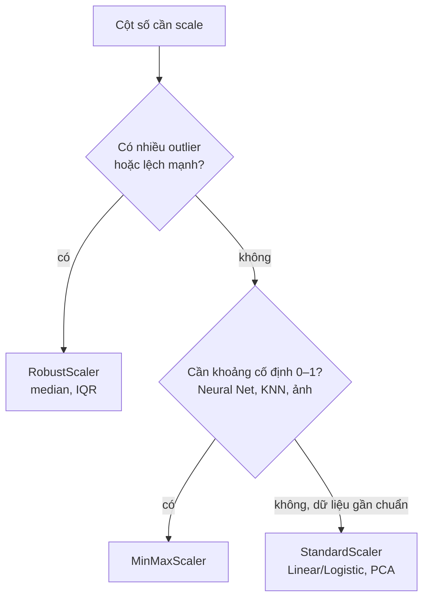

# Chuẩn hóa dữ liệu

> **abstract** Tóm tắt
> - **Biến đổi dữ liệu** (data transformation): chuyển dữ liệu từ định dạng này sang định dạng khác.
> - Ba scaler trong slide: **MinMaxScaler** $\frac{x-\min}{\max-\min}$ về $[0,1]$ · **StandardScaler** $\frac{x-\mu}{\sigma}$ về mean 0, std 1 · **RobustScaler** $\frac{x-\text{median}}{IQR}$, bền với outlier.
> - Cần scale khi các biến **khác đơn vị**, **chênh phạm vi lớn**, hoặc dùng thuật toán **nhạy thang đo** (KNN, SVM, Neural Networks).

Nguồn dàn ý: tr. 81.

## 5.3.1 Tổng quan về biến đổi dữ liệu

tr. 82 · tr. 83 · tr. 84

**Mục đích** biến đổi dữ liệu:


> **note** Bảng dạng chữ
> | Mục đích | Ý nghĩa |
> | --- | --- |
> | Cải thiện chất lượng dữ liệu | Dữ liệu phù hợp hơn để phân tích |
> | Chuẩn hóa thang đo | Đưa các biến về cùng thang |
> | Giảm nhiễu | Loại bỏ biến không mong muốn |
> | Tạo biến mới | Kết hợp/biến đổi biến cũ thành thông tin mới |

**Các kỹ thuật phổ biến:**

| Kỹ thuật | Tiếng Việt | Kết quả |
| --- | --- | --- |
| Normalization | Chuẩn hóa | Về khoảng $[0, 1]$ |
| Standardization | Tiêu chuẩn hóa | Mean = 0, std = 1 |
| Scaling | Điều chỉnh thang đo | Thang phù hợp |
| Encoding | Mã hóa | Categorical → số (xem [5.5](04%20Chu%E1%BB%97i%20v%C3%A0%20m%C3%A3%20h%C3%B3a%20ph%C3%A2n%20lo%E1%BA%A1i.md)) |

**Khi nào cần biến đổi:**

- Biến **khác đơn vị** (VND, USD, kg, cm).
- Phạm vi **chênh lệch lớn** (1–10 so với 1000–10000).
- Thuật toán **nhạy thang đo**: KNN, SVM, Neural Networks.
- Cải thiện hiệu suất mô hình ML.

> **example** Vì sao KNN cần scale
> Khoảng cách giữa hai người: chênh lương 4.000.000 đồng và chênh tuổi 10 năm. Bình phương lên, phần lương ($1{,}6\cdot10^{13}$) nuốt hẳn phần tuổi (100). KNN gần như chỉ nhìn lương. Xem lại Demo 3 trong [KNN Imputation](Th%E1%BB%B1c%20h%C3%A0nh%20th%C3%AAm%20-%20%C4%90i%E1%BB%81n%20d%E1%BB%AF%20li%E1%BB%87u%20b%E1%BA%B1ng%20m%C3%B4%20h%C3%ACnh.md).



## 5.3.2 Min-Max Normalization

tr. 85 · tr. 86 · tr. 87

$$X_{norm} = \frac{X - X_{min}}{X_{max} - X_{min}}$$

**Đặc điểm:** đưa về $[0, 1]$ · bảo toàn phân phối gốc · **nhạy với outliers** · phù hợp khi biết giới hạn trên/dưới.

```python
from sklearn.preprocessing import MinMaxScaler, StandardScaler
import pandas as pd
data_transform = {
    'Lương': [15000000, 25000000, 30000000, 18000000, 22000000],
    'Tuổi': [25, 35, 40, 28, 32],
    'Kinh nghiệm': [2, 8, 12, 3, 6]}
df_transform = pd.DataFrame(data_transform)
scaler = MinMaxScaler()
norm_data_scaled = df_transform.copy()
norm_data_scaled'Lương', 'Tuổi', 'Kinh nghiệm' = scaler.fit_transform(
    df_transform'Lương', 'Tuổi', 'Kinh nghiệm')
print(norm_data_scaled)
```

```text
      Lương      Tuổi  Kinh nghiệm
0  0.000000  0.000000          0.0
1  0.666667  0.666667          0.6
2  1.000000  1.000000          1.0
3  0.200000  0.200000          0.1
4  0.466667  0.466667          0.4
```

**Tính tay hàng 1:** Lương $(25-15)/(30-15) = 10/15 = 0{,}667$. Kinh nghiệm $(8-2)/(12-2) = 0{,}6$. Giá trị nhỏ nhất thành 0, lớn nhất thành 1.

> **warning** Dễ nhầm
> - Lương và Tuổi ra **cùng** kết quả vì hai cột tỷ lệ tuyến tính với nhau (thứ tự và khoảng cách tương đối giống). Đừng nghĩ là lỗi.
> - Khi fit trên train rồi transform test, giá trị test có thể **ra ngoài [0, 1]**: train $[10, 30]$, test 35 → $1{,}25$.

> **question** Tự kiểm tra: dữ liệu [2, 4, 10]. Min-Max của 4?
> $(4-2)/(10-2) = 0{,}25$.

## 5.3.3 Standard Scaler (Z-score)

tr. 88 – tr. 92

$$Z = \frac{X - \mu}{\sigma}$$

$X$: giá trị gốc · $\mu$: trung bình (mean) · $\sigma$: độ lệch chuẩn (standard deviation).

**Đặc điểm chính:**

1. Đưa về phân phối **mean = 0, std = 1** (mục tiêu chính).
2. **Ít** bị outlier ảnh hưởng **hơn Min-Max** (vì dùng mean và std, không dùng min/max).
3. **Bảo toàn hình dạng** phân phối gốc, chỉ đổi thang.
4. Hợp với thuật toán giả định phân phối chuẩn: **Linear Regression**, **Logistic Regression**.

```python
scaler_std = StandardScaler()
df_standard = df_transform.copy()
df_standard'Lương', 'Tuổi', 'Kinh nghiệm' = scaler_std.fit_transform(
    df_transform'Lương', 'Tuổi', 'Kinh nghiệm')
print(df_standard)
print(df_standard.describe().round(4))
print(df_standard.mean().round(4).values, df_standard.std().round(4).values)
```

```text
      Lương      Tuổi  Kinh nghiệm
0 -1.332427 -1.332427    -1.166667
1  0.571040  0.571040     0.500000
2  1.522774  1.522774     1.611111
3 -0.761387 -0.761387    -0.888889
4  0.000000  0.000000    -0.055556
        Lương    Tuổi  Kinh nghiệm
count  5.0000  5.0000       5.0000
mean   0.0000 -0.0000      -0.0000
std    1.1180  1.1180       1.1180
...
[ 0. -0. -0.] [1.118 1.118 1.118]
```

**Tính tay Lương hàng 0:** $\mu = 22$ triệu. $\sigma = \sqrt{(49+9+64+16+0)/5} = \sqrt{27{,}6} \approx 5{,}254$ triệu. $Z = (15-22)/5{,}254 \approx -1{,}332$. Dũng (22 triệu) đúng bằng mean nên $Z = 0$.

> **warning** Dễ nhầm: vì sao std in ra 1.118 chứ không phải 1?
> **`StandardScaler`** chia cho $\sigma$ **tổng thể** (mẫu số $n$). Còn **`DataFrame.std()`** mặc định là std **mẫu** (mẫu số $n-1$, *`ddof=1`*). Với $n=5$: $\sqrt{5/4} = 1{,}118$. Slide ghi "std ≈ 1" là theo nghĩa này.

> **question** Tự kiểm tra: $\mu=20$, $\sigma=5$. Z-score của 30 và 10?
> $2$ và $-2$.

## 5.3.4 Robust Scaler

tr. 93 · tr. 94

$$X_{robust} = \frac{X - X_{median}}{IQR}, \qquad IQR = Q_3 - Q_1$$

$X_{median}$: trung vị · $IQR$ (Interquartile Range): khoảng giữa tứ phân vị thứ 1 và thứ 3.

**Đặc điểm:** rất bền vững (robust) trước outlier · dùng **median thay mean**, **IQR thay std** · không bị méo bởi ngoại lai · phù hợp khi nhiều outlier.

**Khi nào dùng:** nhiều outlier · **không muốn loại bỏ outlier** nhưng vẫn cần chuẩn hóa · dữ liệu **không** theo phân phối chuẩn.

### So sánh ba scaler

tr. 95


> **note** Bảng dạng chữ
> | Tiêu chí | StandardScaler | MinMaxScaler | RobustScaler |
> | --- | --- | --- | --- |
> | Công thức | $(x-\mu)/\sigma$ | $(x-\min)/(\max-\min)$ | $(x-\text{median})/IQR$ |
> | Phân phối sau | Mean 0, Var 1 | Về $[0,1]$ (hoặc range tùy chọn) | Dựa trên median, IQR |
> | Ảnh hưởng outlier | Rất nhạy | Rất nhạy | **Ít nhạy** |
> | Dùng tốt nhất | Dữ liệu gần chuẩn | Cần $[0,1]$ (Deep Learning, distance-based) | Có outlier hoặc lệch |
> | Ví dụ | Logistic Regression, PCA | Neural Networks, KNN, SVM | Decision Tree với dữ liệu skewed, dữ liệu thực tế nhiều ngoại lai |

> **tip** Mẹo thi
> Thấy chữ "**outlier**" hoặc "**median, IQR**" → RobustScaler. Thấy "**[0, 1]**" → MinMax. Thấy "**mean 0, std 1**" hoặc "**z-score**" → Standard.

### Ví dụ có outlier 200 triệu

tr. 96 – tr. 101

```python
from sklearn.preprocessing import MinMaxScaler, StandardScaler, RobustScaler
df_outliers = pd.DataFrame({
    'Lương': [15000000, 25000000, 30000000, 18000000, 22000000, 200000000],
    'Tuổi': [25, 35, 40, 28, 32, 22],
    'Kinh nghiệm': [2, 8, 12, 3, 6, 1]})
print(df_outliers.describe())
cols = ['Lương', 'Tuổi', 'Kinh nghiệm']
for sc in [MinMaxScaler(), StandardScaler(), RobustScaler()]:
    print(pd.DataFrame(sc.fit_transform(df_outliers[cols]), columns=cols).round(4))
```

**`describe()`** cho cột Lương (tr. 97): mean ≈ 51,67 triệu (bị kéo lên) · std ≈ 72,86 triệu · min 15 · 25% **19** · 50% **23,5** · 75% **28,75** · max 200 triệu. Mean > gấp đôi median là dấu hiệu lệch phải do outlier.


> **note** Bảng dạng chữ
> | Hàng (Lương) | MinMax | Standard | Robust |
> | --- | --- | --- | --- |
> | 15M | 0.0000 | −0.5513 | −0.8718 |
> | 25M | 0.0541 | −0.4009 | 0.1538 |
> | 30M | 0.0811 | −0.3258 | 0.6667 |
> | 18M | 0.0162 | −0.5062 | −0.5641 |
> | 22M | 0.0378 | −0.4460 | −0.1538 |
> | **200M** | **1.0000** | **2.2302** | **18.1026** |

- **MinMax** (tr. 98): bị ảnh hưởng mạnh. Lương bình thường bị **nén sát 0** (0–0,08), 200 triệu thành 1.
- **Standard** (tr. 99): bị ảnh hưởng một phần. Mean và std bị kéo lệch, lương bình thường **dồn quanh −0,3 đến −0,55** (slide mô tả "khoảng −0,5 đến −0,7"), 200 triệu là số dương lớn.
- **Robust** (tr. 100): lương 15–30 triệu **trải đều quanh 0** (−0,87 đến 0,67), 200 triệu nằm **xa hẳn** (18,1), vẫn tách biệt.

**Tính tay Robust:** median = 23,5 triệu, IQR = 28,75 − 19 = 9,75 triệu. Lương 15 triệu: $(15-23{,}5)/9{,}75 = -0{,}872$. Lương 200 triệu: $(200-23{,}5)/9{,}75 = 18{,}10$.


**Biểu đồ boxplot** (tr. 101): với MinMax và Standard, hộp lương bình thường **bẹp sát 0**, outlier chiếm ưu thế. Với Robust, hộp **rộng ra**, outlier vẫn tách xa.

> **warning** Dễ nhầm
> - RobustScaler **không xóa** outlier. 200 triệu vẫn là 18,1. Nó chỉ làm cho các điểm **bình thường** không bị nén.
> - Cả ba scaler **không đổi thứ tự** các giá trị trong cột.
> - Fit trên train, chỉ **`transform`** trên test. Fit trên toàn bộ dữ liệu trước khi chia là **rò rỉ dữ liệu** (Mở rộng).

> **question** Tự kiểm tra: median 13, $Q_1=11$, $Q_3=19$. Robust của 15?
> $(15-13)/(19-11) = 0{,}25$.

> **question** Tự kiểm tra: scaler nào làm lương bình thường "nén sát 0" mạnh nhất khi có outlier lớn?
> MinMaxScaler, vì mẫu số $\max-\min$ bị outlier làm phình to.

## Áp dụng ở

- F507 Chuẩn hóa thang đo: Min-Max, Standard, Robust
- F506 Ngoại lai: IQR, z-score và thống kê mô tả
- Bài mẫu: Scale theo thống kê đã học
- Tác động của thang đo lên khoảng cách trong Chương 8.

> **info** Mở rộng: ngoại lai theo IQR và z-score (dạng câu F506)
> Ngưỡng IQR: dưới $Q_1 - 1{,}5\cdot IQR$, trên $Q_3 + 1{,}5\cdot IQR$. Với Lương ở trên: $28{,}75 + 1{,}5\cdot 9{,}75 = 43{,}375$ triệu, nên 200 triệu là ngoại lai. Theo z-score, thường coi $|z| > 3$ là ngoại lai.

Mục lục chương 5 · Trước: [Thực hành thêm - Điền dữ liệu bằng mô hình](Th%E1%BB%B1c%20h%C3%A0nh%20th%C3%AAm%20-%20%C4%90i%E1%BB%81n%20d%E1%BB%AF%20li%E1%BB%87u%20b%E1%BA%B1ng%20m%C3%B4%20h%C3%ACnh.md) · Tiếp: [04 Chuỗi và mã hóa phân loại](04%20Chu%E1%BB%97i%20v%C3%A0%20m%C3%A3%20h%C3%B3a%20ph%C3%A2n%20lo%E1%BA%A1i.md)
