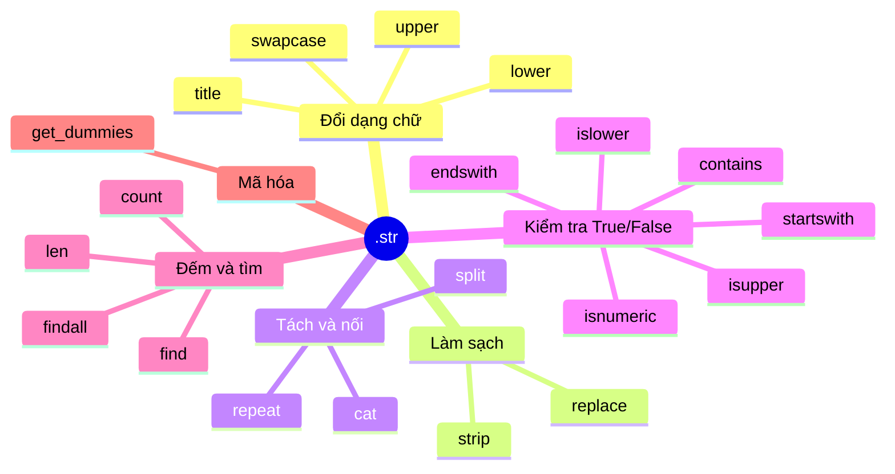

# Chuỗi và mã hóa phân loại

> **abstract** Tóm tắt
> - **5.4 Chuỗi**: accessor **`.str`** áp phương thức chuỗi lên cả Series (**`lower`**, **`upper`**, *`title`*, **`strip`**, **`split`**, `cat`, **`replace`**, **`contains`**, **`startswith`**, **`endswith`**, `len`, **`count`**, **`find`**, `findall`, *`repeat`*, **`swapcase`**, **`islower`**, **`isupper`**, **`isnumeric`**, **`get_dummies`**). Đổi kiểu bằng **`astype`**, **`pd.to_datetime`**.
> - **Regex**: `\d \w \s + * ? [] ^ $`, dùng với `.str.contains / extract / replace(regex=True) / findall`.
> - **5.5 Phân loại**: Nominal (không thứ tự) và Ordinal (có thứ tự). Kiểu `category`, **`pd.Categorical(values, categories, ordered)`**.
> - **Label Encoding** → một cột số nguyên. **One-Hot Encoding** → mỗi category một cột 0/1 (**`pd.get_dummies`**, **`OneHotEncoder(drop='first')`**).

Nguồn dàn ý: tr. 103 (5.4) · tr. 128 (5.5).

---

## 5.4.1 Tầm quan trọng của xử lý chuỗi

tr. 104

Dữ liệu chuỗi (string data) chiếm phần lớn dữ liệu thực tế: **tên người, địa chỉ** (thông tin cá nhân) · **mô tả sản phẩm** (thương mại điện tử) · **bình luận, đánh giá** (phân tích sentiment) · **danh mục, nhãn** (dữ liệu phân loại).

## 5.4.2 Các vấn đề thường gặp

tr. 105


> **note** Bảng dạng chữ
> | Vấn đề | Ví dụ | Cách xử lý gợi ý |
> | --- | --- | --- |
> | Không nhất quán định dạng | `"iPhone"`, `"iphone"`, `"IPHONE"` | `.str.lower()` |
> | Khoảng trắng thừa | `" Apple "`, `"Apple "` | `.str.strip()` |
> | Ký tự đặc biệt | `"email@domain.com"`, `"phone: +84-123-456-789"` | `.str.replace`, regex |
> | Viết tắt khác nhau | `"Dr."`, `"Doctor"`, `"BS"` | **`.replace({...})`** / `map` |
> | Lỗi chính tả | `"Compnay"` thay vì `"Company"` | Từ điển sửa lỗi |

## 5.4.3 Các phương thức cơ bản xử lý chuỗi

tr. 106

**Accessor `.str`** áp phương thức chuỗi cho **cả Series** một lần, thay vì lặp từng phần tử:

```python
# Thủ công
for i in range(len(df)):
    df.loc[i, 'column'] = df.loc[i, 'column'].upper()
# Dùng .str accessor
df['column'] = df['column'].str.upper()
```

### Chuyển đổi kiểu dữ liệu

tr. 107 · tr. 108

```python
sample_data = pd.DataFrame({
    'id': ['1', '2', '3', '4', '5'],
    'score': ['85.5', '90.0', '78.5', '92.0', '88.5'],
    'date': ['2023-01-01', '2023-01-02', '2023-01-03', '2023-01-04', '2023-01-05'],
    'category': ['A', 'B', 'A', 'C', 'B']})
print(sample_data.dtypes)
sample_data['id'] = sample_data['id'].astype('int64')
sample_data['score'] = sample_data['score'].astype('float64')
sample_data['date'] = pd.to_datetime(sample_data['date'])
sample_data['category'] = sample_data['category'].astype('category')
print(sample_data.dtypes)
```


> **note** Bảng dạng chữ
> | Cột | Trước | Sau | Lệnh |
> | --- | --- | --- | --- |
> | id | object | int64 | **`astype('int64')`** |
> | score | object | float64 | **`astype('float64')`** |
> | date | object | datetime64[ns] | **`pd.to_datetime(...)`** |
> | category | object | category | **`astype('category')`** |

> **warning** Dễ nhầm
> Ban đầu **mọi cột là `object`** vì toàn chuỗi (kể cả `'85.5'`). **`astype`** báo lỗi nếu có giá trị không đổi được. **`pd.to_numeric(s, errors='coerce')`** biến giá trị lạ thành NaN (Mở rộng).

### Bảng phương thức `.str`

tr. 109 · tr. 110

| Phương thức | Mô tả | Trả về |
| --- | --- | --- |
| `.str.lower()` / `.str.upper()` | Chữ thường / chữ hoa | Chuỗi |
| `.str.title()` | Viết hoa chữ cái đầu mỗi từ | Chuỗi |
| `.str.swapcase()` | Đổi hoa ↔ thường | Chuỗi |
| `.str.strip()` | Bỏ khoảng trắng đầu/cuối | Chuỗi |
| `.str.replace(a, b)` | Thay chuỗi con a bằng b | Chuỗi |
| `.str.split()` | Tách chuỗi | List |
| `.str.cat(sep=...)` | Nối mọi phần tử thành **một** chuỗi | Một chuỗi |
| `.str.repeat(n)` | Lặp mỗi phần tử n lần | Chuỗi |
| `.str.contains(pattern)` | Có chứa chuỗi con không | Boolean |
| `.str.startswith()` / `.str.endswith()` | Bắt đầu / kết thúc bằng | Boolean |
| `.str.islower()` / `.str.isupper()` | Mọi ký tự chữ đều thường / hoa | Boolean |
| `.str.isnumeric()` | Mọi ký tự là số | Boolean |
| `.str.len()` | Độ dài | Số |
| `.str.count(p)` | Số lần xuất hiện của p | Số |
| `.str.find(pattern)` | Vị trí **đầu tiên** của pattern, `-1` nếu không có | Số |
| `.str.findall(pattern)` | Danh sách **mọi** lần xuất hiện | List |
| `.str.get_dummies()` | Mã hóa one-hot từ chuỗi | DataFrame |



### Ví dụ có kết quả

tr. 111: `s = ['Tom', 'William Rick', 'John', 'Alber@t', NaN, '1234', 'SteveSmith']`

```text
lower  ['tom', 'william rick', 'john', 'alber@t', nan, '1234', 'stevesmith']
upper  ['TOM', 'WILLIAM RICK', 'JOHN', 'ALBER@T', nan, '1234', 'STEVESMITH']
len    [3.0, 12.0, 4.0, 7.0, nan, 4.0, 10.0]
```

NaN đi qua **`.str`** vẫn là NaN. Vì có NaN nên **`len()`** ra **float**.

tr. 112 – tr. 118: `s = ['Tom ', '   William Rick', 'John ', 'Alber@t']` (chú ý khoảng trắng).

| Lệnh | Kết quả | Giải thích |
| --- | --- | --- |
| **`s.str.split(' ')`** (với `' William Rick'`) | `[['Tom', ''], ['', 'William', 'Rick'], ['John'], ['Alber@t']]` | Dấu cách ở đầu/cuối sinh chuỗi rỗng `''` |
| **`s.str.cat(sep='_')`** | `'Tom _ William Rick_John_Alber@t'` | Một chuỗi duy nhất |
| **`s.str.get_dummies()`** | 4 cột `' William Rick'`, `'Alber@t'`, `'John'`, `'Tom '`, mỗi hàng một số 1 | Mỗi giá trị khác nhau thành một cột |
| **`s.str.contains(' ')`** | `[True, True, True, False]` | Ba chuỗi đầu có dấu cách |
| **`s.str.replace('@', '$')`** | `'Alber$t'` ở hàng cuối | |
| **`s.str.repeat(2)`** | `'Tom Tom '`, …, `'Alber@tAlber@t'` | Nối liền, không thêm dấu cách |
| **`s.str.count('m')`** | `[1, 1, 0, 0]` | Phân biệt hoa thường: `'Tom'` có m, `'William'` có m |
| **`s.str.startswith('T')`** | `[True, False, False, False]` | `'   William'` bắt đầu bằng dấu cách |
| **`s.str.endswith('t')`** | `[False, False, False, True]` | `'Tom '` kết thúc bằng dấu cách |
| **`s.str.find('e')`** | `[-1, -1, -1, 3]` | `'Alber@t'`: A0 l1 b2 **e3** |
| **`s.str.findall('e')`** | `[[], [], [], ['e']]` | `[]` = không có pattern |
| **`s.str.swapcase()`** | `['tOM ', '   wILLIAM rICK', 'jOHN ', 'aLBER@T']` | |
| **`s.str.islower()`** | `[False, False, False, False]` | Đều có chữ hoa |
| **`s.str.isupper()`** | `[False, False, False, False]` | Đều có chữ thường |
| `['12', ...].str.isnumeric()` | `[True, False, False, False]` | Chỉ `'12'` toàn chữ số |

> **warning** Dễ nhầm
> - **`find`** trả **vị trí** (bắt đầu từ 0, không thấy là **−1**). `findall` trả **danh sách**. **`contains`** trả **True/False**. **`count`** trả **số lần**.
> - **`strip()`** chỉ bỏ khoảng trắng **hai đầu**, không bỏ khoảng trắng giữa từ.
> - `cat` gộp **cả Series** thành một chuỗi, khác **`split`** (tách từng phần tử).

> **question** Tự kiểm tra: `pd.Series(['data science']).str.title()` cho gì?
> `'Data Science'`.

> **question** Tự kiểm tra: `pd.Series(['banana']).str.find('n')` và `.str.count('n')`?
> **`find`** = 2 (vị trí đầu tiên). **`count`** = 2 (hai chữ n). Trùng số nhưng khác nghĩa.

## 5.4.4 Regular Expressions

tr. 119 · tr. 120

**Regex** là ngôn ngữ **pattern matching** để tìm và thao tác chuỗi.


> **note** Bảng dạng chữ
> | Pattern | Mô tả | Ví dụ |
> | --- | --- | --- |
> | `\d` | Chữ số 0–9 | `"abc123"` → tìm thấy `"123"` |
> | `\w` | Ký tự từ (a-z, A-Z, 0-9, `_`) | `"hello_123"` → tìm thấy tất cả |
> | `\s` | Khoảng trắng | `"a b c"` → 2 dấu cách |
> | `+` | 1 hoặc nhiều lần | `\d+` → `"123"` |
> | `*` | 0 hoặc nhiều lần | `\d*` → có thể không có số |
> | `?` | 0 hoặc 1 lần | `\d?` → tối đa 1 số |
> | `[]` | Nhóm ký tự | `[0-9]` tương đương `\d` |
> | `^` | Bắt đầu chuỗi | `^Hello` |
> | `$` | Kết thúc chuỗi | `world$` |

**Dùng với `.str`:** `.str.contains(pattern)` kiểm tra · `.str.extract(pattern)` trích **nhóm** `( )` · `.str.replace(pattern, repl, regex=True)` thay thế · `.str.findall(pattern)` tìm tất cả.

> **info** Mở rộng: `{m,n}` và `( )`
> `\d{2,4}` nghĩa là 2 đến 4 chữ số. Cặp ngoặc `( )` đánh dấu phần mà **`extract`** lấy ra. `(?: )` là nhóm **không bắt** (chỉ để gom, không trích).

### Ví dụ thực tế: số điện thoại, email, URL

tr. 121 – tr. 126

```python
df_regex = pd.DataFrame({'text': [
    'Liên hệ: 0123-456-789 hoặc email: john@gmail.com',
    'SDT: +84 98 765 4321, địa chỉ: 123 Lê Lợi, Q1, TP.HCM',
    'Phone: (024) 3825-7863, email: info@company.vn',
    'Mobile: 0987654321, website: https://example.com',
    'Hotline: 1900-1234, fax: (028) 3829-5678']})
phone_pattern = r'(\+?\d{1,3}[\s-]?\d{2,4}[\s-]?\d{2,4}[\s-]?\d{0,4}|\(\d{2,4}\)\s?\d{3,4}[-\s]?\d{3,4})'
email_pattern = r'([a-zA-Z0-9._%+-]+@[a-zA-Z0-9.-]+\.[a-zA-Z]{2,})'
url_pattern = r'((?:https?://|www\.)[^\s,;)\]]+)'
df_regex['phone'] = df_regex['text'].str.extract(phone_pattern, expand=False)
df_regex['email'] = df_regex['text'].str.extract(email_pattern, expand=False)
df_regex['has_url'] = df_regex['text'].str.contains(url_pattern, regex=True)
df_regex['url'] = df_regex['text'].str.extract(url_pattern, expand=False)
```


> **note** Bảng dạng chữ
> | Hàng | phone | email | has_url | url |
> | --- | --- | --- | --- | --- |
> | 0 | `0123-456-789` | `john@gmail.com` | False | NaN |
> | 1 | `+84 98 765 4321` | NaN | False | NaN |
> | 2 | `(024) 3825-7863` | `info@company.vn` | False | NaN |
> | 3 | `0987654321` | NaN | True | `https://example.com` |
> | 4 | `1900-1234` | NaN | False | NaN |

- **`extract`** chỉ lấy **lần khớp đầu tiên**. Hàng 4 có cả fax `(028) 3829-5678` nhưng chỉ lấy `1900-1234`.
- *`expand=False`* với một nhóm → trả **Series**. Không khớp → **NaN**.
- Email pattern: phần tên `[a-zA-Z0-9._%+-]+`, ký tự `@`, tên miền, dấu chấm `\.`, đuôi ≥ 2 chữ cái.

**Chuẩn hóa số điện thoại** (tr. 126):

```python
def clean_phone(text):
    if pd.isna(text):
        return ''
    digits = ''.join(ch for ch in str(text) if ch.isdigit() or ch == '+')  # giữ số và +
    if digits.startswith("+84"):
        return "+84" + digits[3:]
    if digits.startswith("84"):        # thiếu dấu +
        return "+84" + digits[2:]
    if digits.startswith("0"):         # đầu số 0
        return "+84" + digits[1:]
    if digits.startswith("1900") or digits.startswith("1800"):  # tổng đài
        return digits
    return digits if digits else None
df_regex['phone_clean'] = df_regex['phone'].apply(clean_phone)
```

```text
['+84123456789', '+84987654321', '+842438257863', '+84987654321', '19001234']
```

> **warning** Dễ nhầm
> - **`.apply(hàm)`** gọi hàm cho **từng phần tử**.
> - Dấu `.` trong regex khớp **mọi ký tự**. Muốn tìm dấu chấm thật: `\.` hoặc *`regex=False`*.
> - `0123-456-789` và `0987654321` đều bắt đầu bằng 0 nên đổi thành `+84…`.

> **question** Tự kiểm tra: `re.findall(r'\d+', 'abc123 x45')`?
> `['123', '45']`.

---

## 5.5.1 Hiểu về dữ liệu phân loại

tr. 129

**Dữ liệu phân loại** (categorical data) có **số giá trị hữu hạn**, biểu diễn bằng nhãn hoặc tên.


> **note** Bảng dạng chữ
> | Loại | Đặc điểm | Ví dụ |
> | --- | --- | --- |
> | **Nominal** (danh nghĩa) | **Không** thứ tự | Giới tính (Nam, Nữ, Khác) · Màu (Đỏ, Xanh, Vàng) · Quốc gia |
> | **Ordinal** (thứ tự) | **Có** thứ tự ý nghĩa | Học vị Cử nhân < Thạc sĩ < Tiến sĩ · Đánh giá Kém < TB < Tốt < Xuất sắc · Size S < M < L < XL |

> **tip** Mẹo thi
> Hỏi: "sắp xếp các nhãn có ý nghĩa không?" Có → Ordinal. Không → Nominal. Mã bưu chính, số áo cầu thủ là **số nhưng vẫn Nominal**.

## 5.5.2 Xử lý dữ liệu phân loại trong Pandas

tr. 130 – tr. 133

**Kiểu `category`** có ích vì:

- **Memory efficient**: tiết kiệm bộ nhớ khi nhiều giá trị lặp.
- **Performance**: tăng tốc **`groupby`**, **`merge`**.
- **Validation**: kiểm soát giá trị hợp lệ.

**Khi nào dùng:** cột có **ít giá trị duy nhất** so với số hàng · nhiều giá trị lặp lại · muốn kiểm soát giá trị · cần tối ưu bộ nhớ, hiệu suất.

> **warning** Dễ nhầm
> Slide ghi "Nhiều giá trị lặp lại (high cardinality)". Thực ra **high cardinality** nghĩa là **nhiều giá trị khác nhau**. Kiểu `category` hợp với **low cardinality** (ít giá trị khác nhau, lặp nhiều). Trong đề, chọn ý "ít giá trị duy nhất, lặp lại nhiều".

**`pd.Categorical(values, categories=None, ordered=False)`**


> **note** Bảng dạng chữ
> | Tham số | Ý nghĩa |
> | --- | --- |
> | *`values`* | Dữ liệu đầu vào (list, Series, mảng NumPy…) |
> | *`categories`* | Danh sách giá trị hợp lệ |
> | *`ordered`* | `True` nếu có thứ tự logic (ordinal) |


> **note** Bảng dạng chữ
> | Thuộc tính / phương thức | Ý nghĩa |
> | --- | --- |
> | **`.categories`** | Danh sách category |
> | **`.ordered`** | Có thứ tự hay không |
> | **`.codes`** | Mã số của từng giá trị |
> | **`.as_ordered()`** / **`.as_unordered()`** | Đặt *`ordered=True`* / `False` |
> | **`.rename_categories()`** | Đổi tên category |
> | **`.add_categories()`** | Thêm category mới |
> | **`.remove_unused_categories()`** | Xóa category không còn xuất hiện |

```python
xep_loai = ['Khá', 'Giỏi', 'Kém', 'Trung bình', 'Xuất sắc']
xep_loai_cat = pd.Categorical(
    xep_loai,
    categories=['Kém', 'Trung bình', 'Khá', 'Giỏi', 'Xuất sắc'],
    ordered=True)
print(xep_loai_cat)
print(type(xep_loai_cat))
print("Mã hóa:", xep_loai_cat.codes)
print("Thấp nhất:", xep_loai_cat.min())
print("Cao nhất:", xep_loai_cat.max())
```

```text
['Khá', 'Giỏi', 'Kém', 'Trung bình', 'Xuất sắc']
Categories (5, object): ['Kém' < 'Trung bình' < 'Khá' < 'Giỏi' < 'Xuất sắc']
<class 'pandas.core.arrays.categorical.Categorical'>
Mã hóa: [2 3 0 1 4]
Thấp nhất: Kém
Cao nhất: Xuất sắc
```

**Giải thích:** `codes` là **vị trí trong `categories`**, không phải vị trí trong dữ liệu. 'Khá' ở vị trí 2 nên mã 2. **`min()`**, **`max()`** chỉ chạy khi *`ordered=True`*.

> **question** Tự kiểm tra: `pd.Categorical(['b', 'a', 'b']).codes`?
> `[1, 0, 1]`. Không khai *`categories`* thì pandas tự sắp `['a', 'b']`, *`ordered=False`*.

## 5.5.3 Label Encoding

tr. 134 – tr. 138

**Label Encoding** chuyển dữ liệu phân loại thành **số nguyên tuần tự**. Ví dụ slide: Team A, A, B, B, B, B, C, C → 0, 0, 1, 1, 1, 1, 2, 2 (cột Points giữ nguyên).


> **note** Bảng dạng chữ
> | Ưu điểm | Nhược điểm |
> | --- | --- |
> | Đơn giản, dễ hiểu | **Tạo thứ tự giả**: Apple < Banana < Cherry (sai) |
> | Tiết kiệm bộ nhớ: **1 cột** | Không hợp **nominal**: thuật toán hiểu sai quan hệ |
> | Hợp **ordinal**: bảo toàn thứ tự | **Bias**: số lớn bị coi là "quan trọng" hơn |

**Khi nào dùng:** dữ liệu **ordinal** · thuật toán **dạng cây** (Decision Tree, Random Forest), ít bị ảnh hưởng bởi thứ tự · **biến mục tiêu** (target) trong bài phân loại.

```python
from sklearn.preprocessing import LabelEncoder
data_categorical = {
    'Tên': ['An', 'Bình', 'Chi', 'Dũng', 'Eva'],
    'Phòng ban': ['IT', 'Marketing', 'IT', 'HR', 'Marketing'],
    'Trình độ': ['Cử nhân', 'Thạc sĩ', 'Cử nhân', 'Tiến sĩ', 'Thạc sĩ'],
    'Thành phố': ['Hà Nội', 'TP.HCM', 'Hà Nội', 'Đà Nẵng', 'TP.HCM']}
df_categorical = pd.DataFrame(data_categorical)
label_encoder = LabelEncoder()
for col in ['Phòng ban', 'Trình độ', 'Thành phố']:
    df_categorical[col] = label_encoder.fit_transform(df_categorical[col])
    print(f"{col}: {label_encoder.classes_}")
print(df_categorical)
```

```text
Phòng ban: ['HR' 'IT' 'Marketing']
Trình độ: ['Cử nhân' 'Thạc sĩ' 'Tiến sĩ']
Thành phố: ['Hà Nội' 'TP.HCM' 'Đà Nẵng']
    Tên  Phòng ban  Trình độ  Thành phố
0    An          1         0          0
1  Bình          2         1          1
2   Chi          1         0          0
3  Dũng          0         2          2
4   Eva          2         1          1
```

> **warning** Dễ nhầm: thứ tự mã do bảng chữ cái quyết định
> **`LabelEncoder`** sắp `classes_` theo thứ tự **Unicode**. 'Đ' đứng **sau** 'T' nên Đà Nẵng = 2, TP.HCM = 1. Trình độ ra Cử nhân 0 < Thạc sĩ 1 < Tiến sĩ 2 là **trùng may mắn** với thứ tự thật. Muốn thứ tự chắc chắn, dùng `pd.Categorical(..., ordered=True).codes` hoặc **`map({...})`**.
>
> Một `label_encoder` dùng lại trong vòng lặp: sau mỗi **`fit_transform`**, `classes_` bị ghi đè bằng cột mới.

## 5.5.4 One-Hot Encoding

tr. 139 – tr. 145

**One-Hot Encoding** tạo **cột nhị phân** cho mỗi category. Ví dụ slide: Team → `Team_A`, `Team_B`, `Team_C`. Hàng Team A có `1, 0, 0`.


> **note** Bảng dạng chữ
> | Ưu điểm | Nhược điểm |
> | --- | --- |
> | Không tạo thứ tự giả, các category bình đẳng | **Curse of dimensionality**: tăng số features mạnh |
> | Hợp **nominal**: Apple ≠ Banana ≠ Cherry | **Sparse matrix**: nhiều số 0, tốn bộ nhớ |
> | Chạy tốt với hầu hết thuật toán ML | **Multicollinearity**: các cột tương quan với nhau |
> | Tránh bias | |

**Khi nào dùng:** **nominal** · ít category (**< 10–15** giá trị) · thuật toán **tuyến tính** (Linear/Logistic Regression, SVM) · **Neural Networks**.


### Cách 1: `pd.get_dummies()`

tr. 142 · tr. 143

```python
df_onehot_pandas = pd.get_dummies(df_categorical,
                                  columns=['Phòng ban', 'Trình độ', 'Thành phố'],
                                  prefix=['PB', 'TD', 'TP'])
print(df_onehot_pandas.columns.tolist())
print(len(df_categorical.columns), len(df_onehot_pandas.columns))
```

```text
['Tên', 'PB_HR', 'PB_IT', 'PB_Marketing', 'TD_Cử nhân', 'TD_Thạc sĩ', 'TD_Tiến sĩ', 'TP_Hà Nội', 'TP_TP.HCM', 'TP_Đà Nẵng']
4 10
```

(`df_categorical` ở đây là bảng **gốc**, chưa label encode.) Số cột: 1 (Tên) + 3 + 3 + 3 = **10**. Giá trị in ra là `True/False` (pandas ≥ 2.0). Thêm *`dtype=int`* để ra 0/1.

### Cách 2: `sklearn.OneHotEncoder`

tr. 144 · tr. 145

```python
from sklearn.preprocessing import OneHotEncoder
encoder = OneHotEncoder(sparse_output=False, drop='first')  # tránh multicollinearity
categorical_cols = ['Phòng ban', 'Trình độ', 'Thành phố']
encoded_data = encoder.fit_transform(df_categorical[categorical_cols])
feature_names = encoder.get_feature_names_out(categorical_cols)
df_onehot_sklearn = pd.DataFrame(encoded_data, columns=feature_names)
df_onehot_sklearn = pd.concat([df_categorical'Tên', df_onehot_sklearn], axis=1)
print(df_onehot_sklearn)
```

```text
    Tên  Phòng ban_IT  Phòng ban_Marketing  Trình độ_Thạc sĩ  Trình độ_Tiến sĩ  Thành phố_TP.HCM  Thành phố_Đà Nẵng
0    An           1.0                  0.0               0.0               0.0               0.0                0.0
1  Bình           0.0                  1.0               1.0               0.0               1.0                0.0
2   Chi           1.0                  0.0               0.0               0.0               0.0                0.0
3  Dũng           0.0                  0.0               0.0               1.0               0.0                1.0
4   Eva           0.0                  1.0               1.0               0.0               1.0                0.0
```

- *`sparse_output=False`*: trả mảng đặc (dense) thay vì ma trận thưa.
- *`drop='first'`*: bỏ category **đầu tiên** của mỗi cột (HR, Cử nhân, Hà Nội) → 1 + 2 + 2 + 2 = **7** cột. Hàng toàn 0 trong nhóm PB nghĩa là HR.
- **`get_feature_names_out`** sinh tên `cột_giá trị`.

**Đa cộng tuyến** (multicollinearity): trong hồi quy tuyến tính, các biến độc lập có quan hệ tuyến tính mạnh với nhau. Ví dụ giá nhà theo **diện tích** và **số phòng ngủ**: nhà rộng thường nhiều phòng. Với one-hot đủ k cột, cột cuối luôn = 1 − tổng các cột kia, nên bỏ một cột (*`drop='first'`* hoặc **`pd.get_dummies(..., drop_first=True)`**).


> **note** Bảng dạng chữ
> | | **`pd.get_dummies`** | **`OneHotEncoder`** |
> | --- | --- | --- |
> | Thư viện | pandas | sklearn |
> | Đầu ra | DataFrame (giữ cột khác) | Mảng NumPy, cần tự ghép tên |
> | Bỏ cột đầu | *`drop_first=True`* | *`drop='first'`* |
> | Nhớ category để dùng cho test | Không | Có (fit/transform) |

> **question** Tự kiểm tra: cột Màu có 4 giá trị. One-hot đủ và `drop='first'` tạo mấy cột?
> 4 cột và 3 cột.

> **question** Tự kiểm tra: cột "Size" S, M, L, XL cho Linear Regression. Label hay One-hot?
> Size là **ordinal**, nên mã thứ tự có ý nghĩa (S=0 < M=1 < L=2 < XL=3), khai báo thứ tự tường minh. Cột "Thành phố" (nominal) thì one-hot.

## Áp dụng ở

- F509 Làm sạch chuỗi và biểu thức chính quy
- F510 Kiểu dữ liệu cột và chuyển đổi
- F508 Mã hóa biến phân loại
- F512 Phân loại biến và kiểu dữ liệu thống kê
- Bài mẫu: Danh mục và mã hóa giá trị thiếu
- Chuẩn hóa chuỗi khóa trước khi [merge](../06%20Gh%C3%A9p%20v%C3%A0%20bi%E1%BA%BFn%20%C4%91%E1%BB%95i/03%20Merge%20concat%20v%C3%A0%20combine_first.md).

Mục lục chương 5 · Trước: [03 Chuẩn hóa dữ liệu](03%20Chu%E1%BA%A9n%20h%C3%B3a%20d%E1%BB%AF%20li%E1%BB%87u.md) · Tiếp: [05 Công thức và cú pháp](05%20C%C3%B4ng%20th%E1%BB%A9c%20v%C3%A0%20c%C3%BA%20ph%C3%A1p.md)
