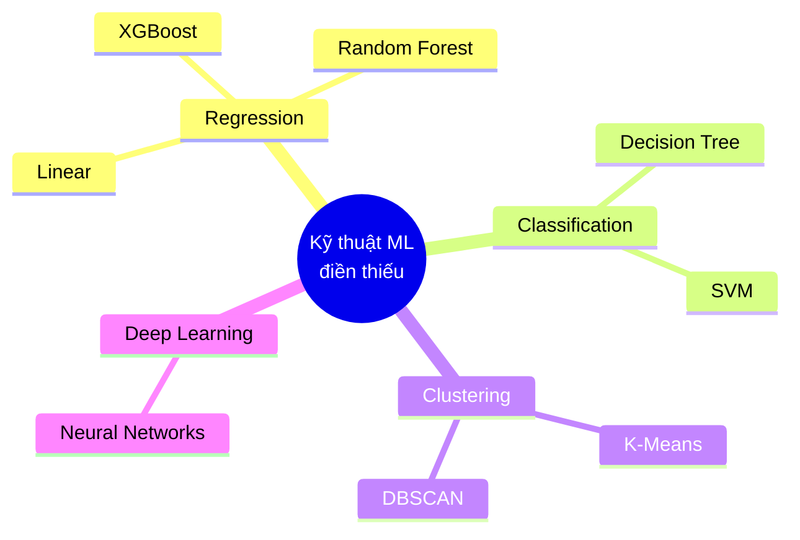
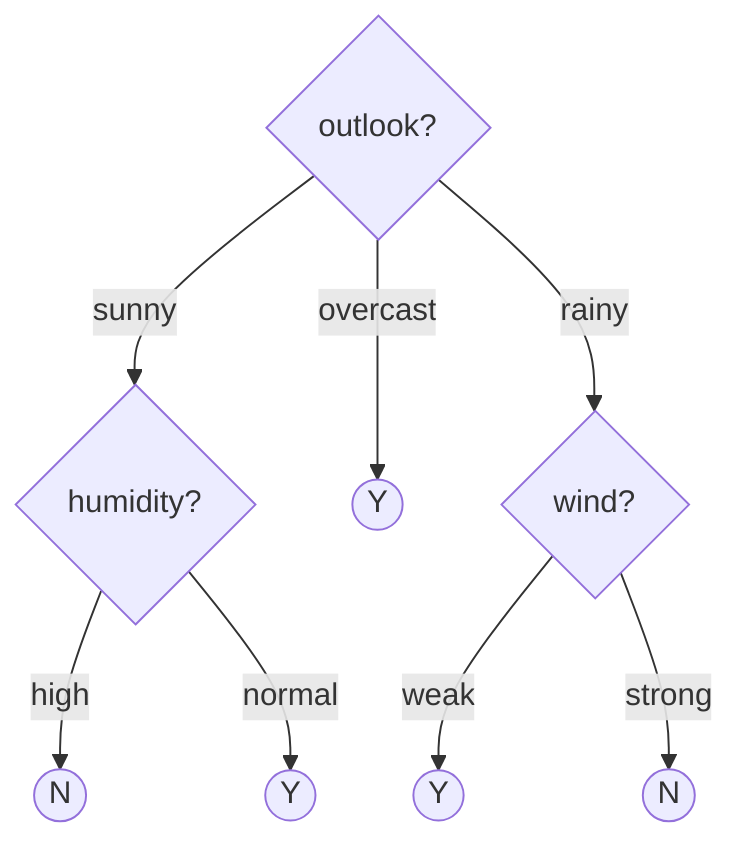
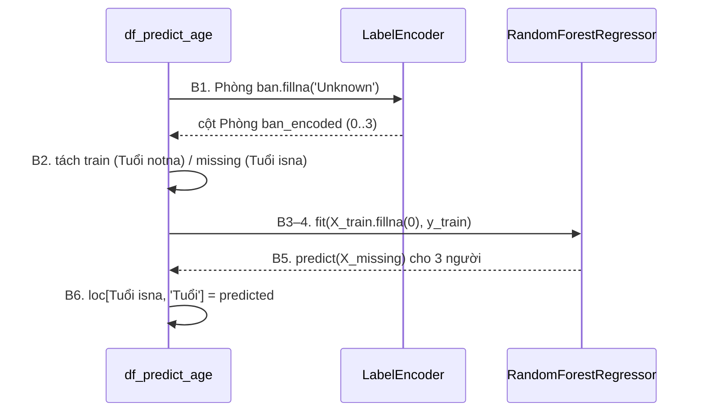

# Thực hành thêm · Điền dữ liệu bằng mô hình

> **abstract** Tóm tắt
> - **Phương pháp 3** của xử lý thiếu: dùng mô hình dự đoán để ước lượng ô thiếu.
> - Hồi quy cho biến **số**, phân loại cho biến **phân loại**, phân tích thống kê cho biến số.
> - Demo slide: **Random Forest Regressor** điền Tuổi (Demo 1) và Lương (Demo 2), **KNNImputer** điền tất cả cùng lúc (Demo 3).
> - Công cụ phụ: **`LabelEncoder`**, **`zip`**, **`iterrows`**, **`enumerate`**, `feature_importances_`.

Đọc trước [5.1.5 Các phương pháp xử lý](01%20Thi%E1%BA%BFu%20v%C3%A0%20tr%C3%B9ng.md).

## Khi nào dùng mô hình dự đoán

tr. 31 · tr. 32 · tr. 33


> **note** Bảng dạng chữ
> | Chiến lược | Ứng dụng | Ví dụ |
> | --- | --- | --- |
> | Hồi quy | Dữ liệu số | Hồi quy tuyến tính dự đoán giá trị |
> | Phân loại | Dữ liệu phân loại | Cây quyết định phân loại giá trị |
> | Phân tích thống kê | Dữ liệu số | Dùng thống kê dự đoán giá trị |


> **note** Bảng dạng chữ
> | Ưu điểm | Nhược điểm |
> | --- | --- |
> | Chính xác hơn mean/median/mode | Phức tạp, cần hiểu ML |
> | Tận dụng quan hệ giữa các biến | Tốn thời gian training |
> | Linh hoạt với nhiều loại dữ liệu | Có thể overfitting nếu không cẩn thận |

**Khi nào dùng ML cho missing values:**

- Dữ liệu có quan hệ phức tạp (các biến **correlation cao**).
- Thiếu **không ngẫu nhiên** (có pattern).
- Dữ liệu **quan trọng**, không muốn mất thông tin do xóa.
- Yêu cầu **độ chính xác cao**.



> **tip** Mẹo thi
> Clustering = **nhóm quan sát tương tự** (K-Means, DBSCAN). Regression = dự đoán **số**. Classification = dự đoán **nhãn**.

## Bảng mẫu df_advanced

tr. 34 · tr. 35

```python
from sklearn.ensemble import RandomForestRegressor, RandomForestClassifier
from sklearn.preprocessing import LabelEncoder
from sklearn.impute import KNNImputer
import pandas as pd
import numpy as np
data_advanced = {
    'Tên': ['An', 'Bình', 'Chi', 'Dũng', 'Eva', 'Phong', 'Giang', 'Hoa'],
    'Tuổi': [25, None, 30, 28, None, 35, None, 32],
    'Lương': [15000000, 18000000, None, 22000000, 16000000, None, 25000000, None],
    'Phòng ban': ['IT', 'Marketing', None, 'IT', 'Marketing', 'IT', 'HR', 'HR'],
    'Kinh nghiệm': [2, 5, 7, 3, 1, 10, 8, 6]}
df_advanced = pd.DataFrame(data_advanced)
missing_percent = (df_advanced.isnull().sum() / len(df_advanced)) * 100
print(missing_percent[missing_percent > 0])
```

```text
Tuổi         37.5
Lương        37.5
Phòng ban    12.5
dtype: float64
```

Giải thích: Tuổi thiếu 3/8 = 37,5%. Lương thiếu 3/8. Phòng ban thiếu 1/8 = 12,5%. `missing_percent > 0` lọc bỏ Tên và Kinh nghiệm (0%).

## Random Forest là gì

tr. 36 – tr. 39

**Random Forest** là thuật toán **ensemble learning** kết hợp nhiều **Decision Tree**:


> **note** Bảng dạng chữ
> | Thành phần | Ý nghĩa |
> | --- | --- |
> | Ensemble | Kết hợp nhiều mô hình yếu thành một mô hình mạnh |
> | Bootstrap Aggregating | Mỗi cây train trên một **tập con ngẫu nhiên của dữ liệu** |
> | Feature Randomness | Mỗi lần tách chỉ xét **tập con ngẫu nhiên của features** |
> | Voting | Kết quả = **trung bình** các cây (regression) hoặc **vote đa số** (classification) |

**Ví dụ cây quyết định** (tr. 37): dự đoán có chơi (Y) hay không (N).



**Ưu điểm** (tr. 38): Robust (ít overfitting nhờ lấy trung bình nhiều cây) · Xử lý được missing values khi training · Cho **Feature Importance** · Học được quan hệ **phi tuyến**.

**Tham số quan trọng** (tr. 39):


> **note** Bảng dạng chữ
> | Tham số | Ý nghĩa |
> | --- | --- |
> | *`n_estimators`* | Số cây (**mặc định 100**). Tăng thường chính xác hơn nhưng chậm hơn |
> | *`max_depth`* | Độ sâu tối đa của cây |
> | `min_samples_split` | Số mẫu tối thiểu để tách một nút, giúp cây không quá sâu |
> | *`random_state`* | Seed cho tính khả tái lập (reproducible) |

> **warning** Dễ nhầm
> Slide ghi `min_samples_split` là "số mẫu tối thiểu ở mỗi lá". Chính xác thì đó là số mẫu tối thiểu **để được tách** một nút. Số mẫu tối thiểu ở lá là `min_samples_leaf` (Mở rộng). Đi thi chọn theo ý "kiểm soát phân chia, ngăn cây quá sâu".

## Demo 1: Dự đoán Tuổi

tr. 40 – tr. 51. Dùng Lương, Phòng ban, Kinh nghiệm để dự đoán Tuổi.



### Bước 1: Mã hóa Phòng ban bằng LabelEncoder

tr. 41 – tr. 45

```python
df_predict_age = df_advanced.copy()
le_dept = LabelEncoder()
df_predict_age['Phòng ban_encoded'] = le_dept.fit_transform(
    df_predict_age['Phòng ban'].fillna('Unknown'))
dept_mapping = dict(zip(le_dept.classes_, le_dept.transform(le_dept.classes_)))
print(dept_mapping)
```

```text
{'HR': 0, 'IT': 1, 'Marketing': 2, 'Unknown': 3}
```

- **`LabelEncoder()`** (sklearn.preprocessing) biến **chuỗi** thành **số nguyên** 0, 1, 2…
- **`.fillna('Unknown')`**: LabelEncoder **không xử lý được NaN**, nên điền tạm `'Unknown'`.
- **`fit_transform`**: **fit** học các giá trị duy nhất, **transform** đổi mỗi giá trị thành số.
- `classes_` là danh sách nhãn **đã sắp xếp theo bảng chữ cái**, vị trí trong danh sách chính là mã.

**Hàm `zip()`** (tr. 45): ghép nhiều iterable theo vị trí, trả **iterator của tuple**, dừng khi iterable **ngắn nhất** hết phần tử.

```python
a = [1, 2, 3]; b = ['A', 'B', 'C']
print(list(zip(a, b)))
print(dict(zip(a, b)))
```

```text
[(1, 'A'), (2, 'B'), (3, 'C')]
{1: 'A', 2: 'B', 3: 'C'}
```

### Bước 2–3: Tách train/missing, chọn features

tr. 46 · tr. 47

```python
train_data = df_predict_age[df_predict_age['Tuổi'].notna()]
missing_data = df_predict_age[df_predict_age['Tuổi'].isna()]
features = ['Lương', 'Phòng ban_encoded', 'Kinh nghiệm']
X_train = train_data[features].fillna(0)   # fillna tạm cho feature thiếu
y_train = train_data['Tuổi']
print(len(train_data), len(missing_data)); print(X_train); print(y_train.values)
```

```text
5 3
        Lương  Phòng ban_encoded  Kinh nghiệm
0  15000000.0                  1            2
2         0.0                  3            7
3  22000000.0                  1            3
5         0.0                  1           10
7         0.0                  0            6
[25. 30. 28. 35. 32.]
```

- **Train** = 5 hàng có Tuổi (An, Chi, Dũng, Phong, Hoa). **Cần dự đoán** = 3 hàng (Bình, Eva, Giang).
- Chi, Phong, Hoa thiếu Lương nên bị điền tạm **0**.

> **warning** Dễ nhầm
> **`fillna(0)`** cho Lương là **mẹo tạm** để mô hình chạy được, không phải lương thật bằng 0. Nó làm mô hình hiểu sai. Cách tốt hơn: điền median trước hoặc dùng mô hình xử lý được NaN.

### Bước 4–5: Train và dự đoán

tr. 48 – tr. 50

```python
model_age = RandomForestRegressor(n_estimators=10, random_state=42, max_depth=3)
model_age.fit(X_train, y_train)
X_missing = missing_data[features].fillna(0)
predicted_ages = model_age.predict(X_missing)
for i, (idx, row) in enumerate(missing_data.iterrows()):
    print(f"   {row['Tên']}: {predicted_ages[i]:.1f} tuổi")
```

```text
   Bình: 28.9 tuổi
   Eva: 26.2 tuổi
   Giang: 29.3 tuổi
```

**`iterrows()`** trả iterator gồm cặp `(index, row)`: *`index`* là **nhãn hàng**, *`row`* là **Series** của hàng đó.

```python
df = pd.DataFrame({"A": [1, 2], "B": [3, 4]}, index=["x", "y"])
for idx, row in df.iterrows():
    print(idx, "→", row.to_dict())
```

```text
x → {'A': 1, 'B': 3}
y → {'A': 2, 'B': 4}
```

**`enumerate(...)`** bọc ngoài để có thêm **số thứ tự vòng** `i`. Unpack `for i, (idx, row) in enumerate(df.iterrows())`: `i` là số vòng (0, 1, 2…), `idx` là index, *`row`* là nội dung hàng.

```python
missing_data = pd.DataFrame({"Tên": ["An", "Bình", "Chi"], "Tuổi": [23, None, 19]})
for i, (idx, row) in enumerate(missing_data.iterrows()):
    print(f"Vòng {i} → index={idx}, row={row.to_dict()}")
```

```text
Vòng 0 → index=0, row={'Tên': 'An', 'Tuổi': 23.0}
Vòng 1 → index=1, row={'Tên': 'Bình', 'Tuổi': nan}
Vòng 2 → index=2, row={'Tên': 'Chi', 'Tuổi': 19.0}
```

> **warning** Dễ nhầm: `i` khác `idx`
> Trong Demo 1, `missing_data` có index `[1, 4, 6]`, nhưng `predicted_ages` là mảng NumPy đánh số `[0, 1, 2]`. Vì vậy phải dùng `predicted_ages[i]` (số vòng), **không** dùng `predicted_ages[idx]` (sẽ lỗi IndexError với idx = 4, 6).

### Bước 6: Ghi kết quả vào bảng

tr. 51

```python
df_predict_age.loc[df_predict_age['Tuổi'].isna(), 'Tuổi'] = predicted_ages
```

```text
     Tên  Tuổi       Lương  Phòng ban  Kinh nghiệm
0     An  25.0  15000000.0         IT            2
1   Bình  28.9  18000000.0  Marketing            5
2    Chi  30.0         NaN       None            7
3   Dũng  28.0  22000000.0         IT            3
4    Eva  26.2  16000000.0  Marketing            1
5  Phong  35.0         NaN         IT           10
6  Giang  29.3  25000000.0         HR            8
7    Hoa  32.0         NaN         HR            6
```

Mặt nạ **`isna()`** chọn đúng 3 hàng theo thứ tự 1, 4, 6, trùng thứ tự với `predicted_ages`. Lương **vẫn thiếu** vì Demo 1 chỉ điền Tuổi.

## Demo 2: Dự đoán Lương và Feature Importance

tr. 52 – tr. 57. Dùng Tuổi, Phòng ban, Kinh nghiệm dự đoán Lương, trên **dữ liệu gốc** (Tuổi chưa được điền).

```python
df_predict_salary = df_advanced.copy()
df_predict_salary['Phòng ban_encoded'] = le_dept.fit_transform(
    df_predict_salary['Phòng ban'].fillna('Unknown'))
train_salary = df_predict_salary[df_predict_salary['Lương'].notna()]
missing_salary = df_predict_salary[df_predict_salary['Lương'].isna()]
salary_features = ['Tuổi', 'Phòng ban_encoded', 'Kinh nghiệm']
X_train_salary = train_salary[salary_features].fillna(0)
y_train_salary = train_salary['Lương']
print(pd.concat([X_train_salary, y_train_salary], axis=1))
model_salary = RandomForestRegressor(n_estimators=10, random_state=42, max_depth=3)
model_salary.fit(X_train_salary, y_train_salary)
for feature, imp in zip(salary_features, model_salary.feature_importances_):
    print(f"   {feature}: {imp:.3f}")
predicted_salaries = model_salary.predict(missing_salary[salary_features].fillna(0))
for i, (idx, row) in enumerate(missing_salary.iterrows()):
    print(f"   {row['Tên']}: {predicted_salaries[i]:,.0f} VND")
df_predict_salary.loc[df_predict_salary['Lương'].isna(), 'Lương'] = predicted_salaries
```

```text
   Tuổi  Phòng ban_encoded  Kinh nghiệm       Lương
0  25.0                  1            2  15000000.0
1   0.0                  2            5  18000000.0
3  28.0                  1            3  22000000.0
4   0.0                  2            1  16000000.0
6   0.0                  0            8  25000000.0
   Tuổi: 0.140
   Phòng ban_encoded: 0.380
   Kinh nghiệm: 0.480
   Chi: 20,300,000 VND
   Phong: 23,100,000 VND
   Hoa: 21,800,000 VND
```

- Train: 5 hàng có Lương. Cần dự đoán: Chi, Phong, Hoa.
- **`pd.concat([X, y], axis=1)`** ghép **theo cột** để xem features cạnh target.
- **`feature_importances_`**: mức đóng góp của từng feature, **tổng = 1** (0,140 + 0,380 + 0,480). Kinh nghiệm quan trọng nhất.

> **question** Tự kiểm tra: vì sao Demo 2 phải `fit_transform` lại LabelEncoder?
> Vì dùng bản sao mới của `df_advanced`, chưa có cột `Phòng ban_encoded`. Mỗi bảng cần cột mã hóa riêng.

## KNN Imputation

tr. 58 · tr. 59

KNN Imputation dùng **K-Nearest Neighbors**:

1. **Tìm K láng giềng gần nhất** theo khoảng cách Euclidean trong không gian features.
2. **Tính giá trị**: trung bình K láng giềng (số) hoặc mode (phân loại).
3. **Điền** giá trị đó vào ô thiếu.

$$d(x_i, x_j) = \sqrt{\sum_{k=1}^{n} (x_{ik} - x_{jk})^2}$$

> **example** Tính tay
> $x_1=(1, 10)$, $x_2=(4, 14)$: $d=\sqrt{(1-4)^2+(10-14)^2}=\sqrt{9+16}=5$.

## Demo 3: KNNImputer điền tất cả cùng lúc

tr. 60 – tr. 66

```python
df_knn = df_advanced.copy()
df_knn['Phòng ban_encoded'] = le_dept.fit_transform(df_knn['Phòng ban'].fillna('Unknown'))
numerical_cols = ['Tuổi', 'Lương', 'Kinh nghiệm', 'Phòng ban_encoded']
df_numerical = df_knn[numerical_cols].copy()
knn_imputer = KNNImputer(n_neighbors=2, weights='uniform')
df_knn_filled = knn_imputer.fit_transform(df_numerical)   # trả mảng NumPy
df_knn_result = df_knn.copy()
df_knn_result['Tuổi'] = df_knn_filled[:, 0]
df_knn_result['Lương'] = df_knn_filled[:, 1]
df_knn_result['Kinh nghiệm'] = df_knn_filled[:, 2]
result_display = df_knn_result'Tên', 'Tuổi', 'Lương', 'Phòng ban', 'Kinh nghiệm'.copy()
result_display['Tuổi'] = result_display['Tuổi'].round(1)
result_display['Lương'] = result_display['Lương'].round(0)
print(result_display)
print(f"Trước: {df_knn[numerical_cols[:-1]].isnull().sum().sum()} missing values")
print(f"Sau: {pd.DataFrame(df_knn_filled[:, :-1]).isnull().sum().sum()} missing values")
```

```text
     Tên  Tuổi       Lương  Phòng ban  Kinh nghiệm
0     An  25.0  15000000.0         IT          2.0
1   Bình  31.0  18000000.0  Marketing          5.0
2    Chi  30.0  21500000.0       None          7.0
3   Dũng  28.0  22000000.0         IT          3.0
4    Eva  31.0  16000000.0  Marketing          1.0
5  Phong  35.0  21500000.0         IT         10.0
6  Giang  33.5  25000000.0         HR          8.0
7    Hoa  32.0  21500000.0         HR          6.0
Trước: 6 missing values
Sau: 0 missing values
```

- Chỉ dùng **cột số** (Phòng ban đã mã hóa). **`isnull()`** trên `df_numerical` cho **missing pattern** (tr. 63): 3 True ở Tuổi, 3 True ở Lương.
- *`n_neighbors=2`*, *`weights='uniform'`*: lấy trung bình **đều** của 2 láng giềng.
- **`fit_transform`** trả **mảng NumPy**, nên phải gán lại từng cột bằng `[:, 0]`, `[:, 1]`, `[:, 2]`.
- `numerical_cols[:-1]` bỏ cột cuối (Phòng ban_encoded): trước 3 + 3 = **6** ô thiếu, sau **0**.
- Phòng ban của Chi **vẫn None** vì chỉ cột mã hóa được dùng, cột chữ gốc không được gán lại.

> **info** Mở rộng: vì sao Bình được 31?
> Sklearn dùng khoảng cách **nan_euclidean**: chỉ tính trên tọa độ cả hai hàng đều có, rồi phóng theo tỷ lệ. Lương (hàng chục triệu) lấn át các cột khác. Chi và Hoa không có Lương nên khoảng cách tới Bình chỉ tính trên Kinh nghiệm và mã phòng (≈ 3,2), gần nhất. Tuổi Bình = (30 + 32)/2 = **31**. Bài học: **scale dữ liệu trước KNN** (xem [03 Chuẩn hóa dữ liệu](03%20Chu%E1%BA%A9n%20h%C3%B3a%20d%E1%BB%AF%20li%E1%BB%87u.md)).


> **question** Tự kiểm tra: với `n_neighbors=2`, hai láng giềng có Lương 18M và 25M. Ô Lương được điền bao nhiêu?
> (18 + 25)/2 = **21,5 triệu**. Đó là giá trị của Chi, Phong, Hoa ở trên.

## So sánh nhanh ba demo


> **note** Bảng dạng chữ
> | | Demo 1 (RF Tuổi) | Demo 2 (RF Lương) | Demo 3 (KNN) |
> | --- | --- | --- | --- |
> | Công cụ | **`RandomForestRegressor`** | **`RandomForestRegressor`** | **`KNNImputer`** |
> | Cột điền | Tuổi | Lương | Mọi cột số cùng lúc |
> | Xử lý feature thiếu | **`fillna(0)`** tạm | **`fillna(0)`** tạm | Bỏ qua tọa độ thiếu khi đo khoảng cách |
> | Kết quả Bình (Tuổi) | 28.9 | (không điền) | 31.0 |

## Mở rộng: pipeline an toàn

> **info** Mở rộng
> Ngoài slide. Fit mã hóa và mô hình trên **cùng** các hàng có đích, dùng one-hot cho phòng ban (tránh thứ tự giả), gán kết quả theo **nhãn index**.

```python
import pandas as pd
from sklearn.compose import ColumnTransformer
from sklearn.ensemble import RandomForestRegressor
from sklearn.pipeline import make_pipeline
from sklearn.preprocessing import OneHotEncoder

employees = pd.DataFrame(
    {"phong": ["Kế toán", "Kỹ thuật", "Kỹ thuật", "Kế toán", "Hỗ trợ"],
     "kinh_nghiem": [1, 3, 7, 9, 5],
     "tuoi": [22.0, None, 32.0, 37.0, None]},
    index=[101, 208, 310, 412, 503])
features = ["phong", "kinh_nghiem"]
observed = employees["tuoi"].notna()
training = employees.loc[observed, features]
need_fill = employees.loc[~observed, features]
preprocess = ColumnTransformer(
    [("dept", OneHotEncoder(handle_unknown="ignore"), ["phong"])], remainder="passthrough")
model = make_pipeline(preprocess, RandomForestRegressor(n_estimators=20, random_state=17))
model.fit(training, employees.loc[observed, "tuoi"])
predicted = pd.Series(model.predict(need_fill), index=need_fill.index)
result = employees.copy()
result.loc[predicted.index, "tuoi"] = predicted
assert training.index.tolist() == [101, 310, 412]
assert need_fill.index.tolist() == [208, 503]
assert result["tuoi"].notna().all()
```

> **warning** Nếu bảng sẽ dùng để đánh giá mô hình khác
> Chia train/test trước. Fit bộ điền trên train rồi áp cho test. Lưu cột cờ thiếu nếu sự vắng mặt có thể mang thông tin.

## Áp dụng ở

- F513 Kỹ thuật học máy hỗ trợ làm sạch
- F504 Điền giá trị thiếu
- Mô hình Random Forest, KNN học kỹ ở Chương 8.

Mục lục chương 5 · Trước: [01 Thiếu và trùng](01%20Thi%E1%BA%BFu%20v%C3%A0%20tr%C3%B9ng.md) · Tiếp: [03 Chuẩn hóa dữ liệu](03%20Chu%E1%BA%A9n%20h%C3%B3a%20d%E1%BB%AF%20li%E1%BB%87u.md)
