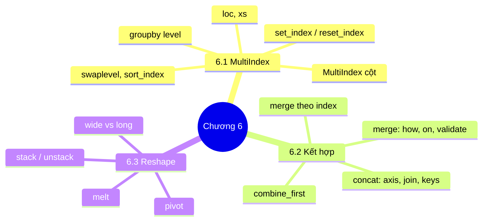

# Chương 6 · Sắp xếp và biến đổi dữ liệu

Slide gốc Lec 6 (105 trang): **6.1** chỉ số phân cấp, **6.2** kết hợp các tập dữ liệu, **6.3** tổ chức và cấu trúc lại dữ liệu.

## Thứ tự đọc

1. [01 MultiIndex](01%20MultiIndex.md) — nền tảng: cấp nhãn, *`loc`*, `xs`, **`swaplevel`**, **`groupby(level=)`**.
2. [03 Merge concat và combine_first](03%20Merge%20concat%20v%C3%A0%20combine_first.md) — ghép bảng theo khóa, theo trục, lấp NaN.
3. [04 Melt pivot stack và unstack](04%20Melt%20pivot%20stack%20v%C3%A0%20unstack.md) — đổi wide ↔ long.
4. [05 Công thức và cú pháp](05%20C%C3%B4ng%20th%E1%BB%A9c%20v%C3%A0%20c%C3%BA%20ph%C3%A1p.md) — bảng tra nhanh trước khi làm đề.
5. Thẻ nhớ chương 6 — 79 thẻ Spaced Repetition (tag `#flashcards/chuong-6`).
6. [06 Tự kiểm tra](06%20T%E1%BB%B1%20ki%E1%BB%83m%20tra.md) → rồi sang các họ bài bên dưới.
7. Đọc thêm: [Thực hành thêm - Ghép theo index và tổng hợp doanh số](Th%E1%BB%B1c%20h%C3%A0nh%20th%C3%AAm%20-%20Gh%C3%A9p%20theo%20index%20v%C3%A0%20t%E1%BB%95ng%20h%E1%BB%A3p%20doanh%20s%E1%BB%91.md).

## Bản đồ chương

## Sơ đồ Excalidraw

| Sơ đồ | Trả lời câu hỏi |
| --- | --- |
| [Chọn hàm ghép hay đổi dạng](../../diagrams/06%20Gh%C3%A9p%20v%C3%A0%20bi%E1%BA%BFn%20%C4%91%E1%BB%95i/Ch%E1%BB%8Dn%20h%C3%A0m%20gh%C3%A9p%20hay%20%C4%91%E1%BB%95i%20d%E1%BA%A1ng.excalidraw.md) | Gặp đề, dùng merge, concat, combine_first hay melt/pivot? |
| [Đếm hàng khi merge nhiều–nhiều](../../diagrams/06%20Gh%C3%A9p%20v%C3%A0%20bi%E1%BA%BFn%20%C4%91%E1%BB%95i/%C4%90%E1%BA%BFm%20h%C3%A0ng%20khi%20merge%20nhi%E1%BB%81u%E2%80%93nhi%E1%BB%81u.excalidraw.md) | Merge ra bao nhiêu hàng khi khóa lặp? |
| [Concat căn theo nhãn](../../diagrams/06%20Gh%C3%A9p%20v%C3%A0%20bi%E1%BA%BFn%20%C4%91%E1%BB%95i/Concat%20c%C4%83n%20theo%20nh%C3%A3n.excalidraw.md) | concat(axis=1) đặt giá trị vào hàng nào? |
| [Stack và unstack theo dấu cấp](../../diagrams/06%20Gh%C3%A9p%20v%C3%A0%20bi%E1%BA%BFn%20%C4%91%E1%BB%95i/Stack%20v%C3%A0%20unstack%20theo%20d%E1%BA%A5u%20c%E1%BA%A5p.excalidraw.md) | Cấp nhãn đi đâu sau stack/unstack? |
| [02 Quy trình](../../diagrams/06%20Gh%C3%A9p%20v%C3%A0%20bi%E1%BA%BFn%20%C4%91%E1%BB%95i/02%20Ch%C6%B0%C6%A1ng%206%20-%20Quy%20tr%C3%ACnh.excalidraw.md) | Quy trình kiểm tra khóa khi ghép (sơ đồ cũ) |

## Phủ slide

| Trang | Chủ đề | Note |
| --- | --- | --- |
| 1–3 | Bìa, mục lục bài giảng | không có nội dung thi |
| 4–5 | Mục lục 6.1 | không có nội dung thi |
| 6–19 | 6.1.1 Giới thiệu MultiIndex, **`set_index`**, **`reset_index`**, bảng phương thức | [01 MultiIndex](01%20MultiIndex.md) |
| 20 | Mục lục 6.1 | không có nội dung thi |
| 21–23 | 6.1.2 `xs`, *`loc`*, tốc độ | [01 MultiIndex](01%20MultiIndex.md) |
| 24 | Mục lục 6.1 | không có nội dung thi |
| 25–27 | 6.1.3 **`swaplevel`** | [01 MultiIndex](01%20MultiIndex.md) |
| 28 | Mục lục 6.1 | không có nội dung thi |
| 29–30 | 6.1.4 **`sort_index`** | [01 MultiIndex](01%20MultiIndex.md) |
| 31 | Mục lục 6.1 | không có nội dung thi |
| 32–36 | 6.1.5 **`groupby`**, thống kê theo cấp | [01 MultiIndex](01%20MultiIndex.md) |
| 37 | Mục lục 6.1 | không có nội dung thi |
| 38–43 | 6.1.6 (slide ghi 6.1.7) MultiIndex cho cột, **`unstack`**, **`stack`**, **`slice(None)`** | [01 MultiIndex](01%20MultiIndex.md) |
| 44 | Chuyển phần 6.2 | không có nội dung thi |
| 45–46 | 6.2 Tổng quan merge, concat, combine_first | [03 Merge concat và combine_first](03%20Merge%20concat%20v%C3%A0%20combine_first.md) (Tóm tắt) |
| 47–48 | Mục lục 6.2 | không có nội dung thi |
| 49–57 | 6.2.1 **`pd.merge`**: cú pháp, *`how`*, tham số, inner, nhiều–nhiều | [03 Merge concat và combine_first](03%20Merge%20concat%20v%C3%A0%20combine_first.md) |
| 58 | Mục lục 6.2 | không có nội dung thi |
| 59–65 | 6.2.2 Merge theo index, tốc độ | [03 Merge concat và combine_first](03%20Merge%20concat%20v%C3%A0%20combine_first.md) |
| 66 | Mục lục 6.2 | không có nội dung thi |
| 67–77 | 6.2.3 **`pd.concat`** theo dòng và theo cột | [03 Merge concat và combine_first](03%20Merge%20concat%20v%C3%A0%20combine_first.md) |
| 78 | Mục lục 6.2 | không có nội dung thi |
| 79–82 | 6.2.4 **`combine_first`** | [03 Merge concat và combine_first](03%20Merge%20concat%20v%C3%A0%20combine_first.md) |
| 83–84 | Chuyển phần 6.3, mục lục 6.3 | không có nội dung thi |
| 85–86 | 6.3 Reshaping, wide vs long | [04 Melt pivot stack và unstack](04%20Melt%20pivot%20stack%20v%C3%A0%20unstack.md) |
| 87 | Mục lục 6.3 | không có nội dung thi |
| 88–92 | 6.3.1 **`melt`** | [04 Melt pivot stack và unstack](04%20Melt%20pivot%20stack%20v%C3%A0%20unstack.md) |
| 93 | Mục lục 6.3 | không có nội dung thi |
| 94–98 | 6.3.2 **`pivot`** | [04 Melt pivot stack và unstack](04%20Melt%20pivot%20stack%20v%C3%A0%20unstack.md) |
| 99 | Mục lục 6.3 | không có nội dung thi |
| 100–104 | 6.3.3 **`stack`**, **`unstack`** với MultiIndex | [04 Melt pivot stack và unstack](04%20Melt%20pivot%20stack%20v%C3%A0%20unstack.md) |
| 105 | Trang kết | không có nội dung thi |

## Họ bài của chương

| Họ | Ôn trước |
| --- | --- |
| F601 Ghép bảng theo khóa và kiểm soát số hàng | [merge](03%20Merge%20concat%20v%C3%A0%20combine_first.md) |
| F602 Nối theo trục – concat và combine_first | [concat](03%20Merge%20concat%20v%C3%A0%20combine_first.md) |
| F603 MultiIndex – chọn, đổi cấp và sắp xếp | [01 MultiIndex](01%20MultiIndex.md) |
| F604 Stack và unstack | [stack/unstack](04%20Melt%20pivot%20stack%20v%C3%A0%20unstack.md) |
| F605 Đổi wide và long | [melt](04%20Melt%20pivot%20stack%20v%C3%A0%20unstack.md), [pivot](04%20Melt%20pivot%20stack%20v%C3%A0%20unstack.md) |
| F606 Gom nhóm – groupby, agg và transform | [groupby](01%20MultiIndex.md) |

Tổng hợp theo cụm: các họ bài của chương 6.

## Chuẩn đầu ra

- Tạo, truy xuất (*`loc`*, `xs`, **`slice(None)`**), đổi cấp, sắp xếp và gom nhóm theo cấp MultiIndex.
- Đếm số dòng của từng kiểu join khi khóa trùng; chọn *`validate`* đúng quan hệ.
- Dự đoán kết quả **`concat`** theo nhãn và **`combine_first`** theo thứ tự ưu tiên.
- Đổi wide ↔ long, phát hiện cặp khóa không duy nhất trước khi **`pivot`**.

## Liên hệ

Cần biết trước [Thiếu và trùng](../05%20L%C3%A0m%20s%E1%BA%A1ch/01%20Thi%E1%BA%BFu%20v%C3%A0%20tr%C3%B9ng.md). Bảng long và bảng tổng hợp dùng tiếp ở [Trực quan hóa](../07%20Tr%E1%BB%B1c%20quan%20h%C3%B3a/00%20M%E1%BB%A5c%20l%E1%BB%A5c.md).

> **check** Phân tích chuyên sâu: A,A,B ghép A,A,C
> Inner 4, left 5, outer 6. Kiểm tra quan hệ khóa bằng *`validate`* khi đã biết kỳ vọng. **`pivot`** cần cặp hàng–cột duy nhất; `pivot_table` gộp bằng phép tổng hợp có chủ đích. Tính lại tổng sau ghép để bắt lỗi nhân hàng.
