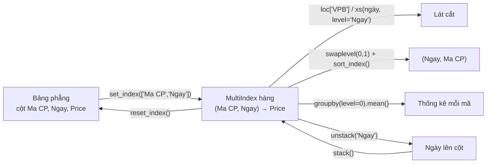

# MultiIndex · Chỉ số phân cấp

> **abstract** Tóm tắt
> - **MultiIndex** (chỉ số phân cấp, *hierarchical indexing*) đặt **nhiều cấp nhãn** trên một trục. Bảng vẫn 2D nhưng chứa được dữ liệu nhiều chiều.
> - Tạo bằng **`set_index([...])`**, trả về bằng **`reset_index()`**.
> - Lấy dữ liệu: *`loc`* theo **cấp ngoài**, **`xs(..., level=...)`** theo **cấp bất kỳ**.
> - **`swaplevel`** đổi thứ tự cấp nhưng **không sắp hàng**. Muốn sắp thì gọi thêm **`sort_index`**.
> - Thống kê theo cấp: **`groupby(level=...)`**.
> - Chuyển cấp giữa hàng và cột: **`unstack`** (hàng → cột), **`stack`** (cột → hàng).



---

## 1. Giới thiệu chỉ số phân cấp

Nguồn tr. 6 – tr. 8.

### Thuật ngữ


> **note** Bảng dạng chữ
> | Thuật ngữ | Nghĩa | Ví dụ |
> | --- | --- | --- |
> | **Index** (chỉ mục) | Nhãn gọi tên hàng (hoặc cột) | `0, 1, 2` hoặc `'VPB'` |
> | **MultiIndex** | Index có nhiều cấp trên **một trục** (hàng hoặc cột) của Series/DataFrame | `('VPB', '2025-08-14')` |
> | **Level** (cấp) | Một tầng của MultiIndex. Cấp 0 là **ngoài cùng** (outer), cấp 1 là kế tiếp (inner) | cấp 0 = Năm, cấp 1 = Tháng |
> | **Label** (nhãn) | Giá trị cụ thể trong một cấp | `2024`, `'Q1'` |

- Ví dụ doanh số tr. 7: thay vì một cột "Năm", đặt các cấp **Năm → Quý → Tháng** ngay trên cùng một trục.
- **Tại sao cần MultiIndex?** tr. 8 Dữ liệu doanh thu nhiều cửa hàng, nhiều năm:
  - Cách thường: một cột "Năm", một cột "Cửa hàng". Bảng dài, khó nhìn.
  - Dùng MultiIndex: gộp "Năm" và "Cửa hàng" thành các cấp của hàng. Dữ liệu được "nén" lại, truy xuất nhanh theo nhóm.

### Ví dụ mở đầu: giá cổ phiếu

Nguồn tr. 9, tr. 10.

```python
import pandas as pd
import numpy as np

stock_prices = pd.DataFrame({
    'Ma CP': ['VPB', 'VPB', 'TCB', 'TCB', 'VNM', 'VNM'],
    'Ngay': ['2025-08-14','2025-08-15','2025-08-14','2025-08-15','2025-08-14','2025-08-15'],
    'Price': [31.2, 32.5, 35.1, 34.0, 60.5, 61.3]
})
print(stock_prices.index)
print(stock_prices.columns)
# Lọc boolean (boolean indexing)
print(stock_prices[stock_prices['Ma CP'] == 'VPB'])
print(stock_prices[stock_prices['Ngay'] == '2025-08-14'])
```

```text
RangeIndex(start=0, stop=6, step=1)
Index(['Ma CP', 'Ngay', 'Price'], dtype='object')
  Ma CP        Ngay  Price
0   VPB  2025-08-14   31.2
1   VPB  2025-08-15   32.5
  Ma CP        Ngay  Price
0   VPB  2025-08-14   31.2
2   TCB  2025-08-14   35.1
4   VNM  2025-08-14   60.5
```

Lọc boolean phải quét cả cột. Slide nhận xét: với chỉ số phân cấp, kết quả **tương tự nhưng dễ và nhanh hơn nhiều**.

### Tạo MultiIndex bằng `set_index()`

Nguồn tr. 11, tr. 12.

```python
DataFrame.set_index(keys, drop=True, append=False, inplace=False, verify_integrity=False)
```


> **note** Bảng dạng chữ
> | Tham số | Mặc định | `True` nghĩa là | `False` nghĩa là |
> | --- | --- | --- | --- |
> | *`keys`* | — | Tên cột hoặc **list** tên cột đưa làm index | — |
> | *`drop`* | `True` | **Xóa** cột khỏi dữ liệu sau khi làm index | Giữ cột trong dữ liệu |
> | *`append`* | `False` | **Thêm** vào index hiện có → tạo MultiIndex | Thay thế index hiện tại |
> | *`inplace`* | `False` | Sửa trực tiếp DataFrame gốc (trả `None`) | Trả DataFrame mới |
> | *`verify_integrity`* | `False` | Index trùng thì **báo lỗi** | Cho phép trùng |

```python
stock_prices = stock_prices.set_index(keys=['Ma CP', 'Ngay'])
print(stock_prices)
print(stock_prices.index)
```

```text
                  Price
Ma CP Ngay
VPB   2025-08-14   31.2
      2025-08-15   32.5
TCB   2025-08-14   35.1
      2025-08-15   34.0
VNM   2025-08-14   60.5
      2025-08-15   61.3
MultiIndex([('VPB', '2025-08-14'),
            ('VPB', '2025-08-15'),
            ...
           names=['Ma CP', 'Ngay'])
```

Nguồn tr. 13, tr. 14. Mỗi nhãn hàng giờ là một **tuple**. Nhãn cấp ngoài lặp lại được in **một lần** (ô trống bên dưới nghĩa là "giống hàng trên").

### Ví dụ 4 cấp: doanh thu theo Region, Channel, Year, Quarter

Nguồn tr. 15 – tr. 18.

```python
data = {
    'Region': ['North','North','North','North','South','South','South','South'],
    'Channel': ['Online','Online','Store','Store','Online','Online','Store','Store'],
    'Year': [2024,2024,2024,2024,2025,2025,2025,2025],
    'Quarter': ['Q1','Q2','Q1','Q2','Q1','Q2','Q1','Q2'],
    'Revenue': [100,130,120,140,90,95,110,115]
}
df = pd.DataFrame(data)
df1 = df.set_index(['Region', 'Channel', 'Year', 'Quarter'])
print(df1)
```

```text
                             Revenue
Region Channel Year Quarter
North  Online  2024 Q1           100
                    Q2           130
       Store   2024 Q1           120
                    Q2           140
South  Online  2025 Q1            90
                    Q2            95
       Store   2025 Q1           110
                    Q2           115
```

- **`df.set_index([...], drop=False)`** tr. 17: 4 cột vừa làm index **vẫn còn** trong dữ liệu. Kết quả có 5 cột dữ liệu: Region, Channel, Year, Quarter, Revenue.
- **`df1.reset_index()`** tr. 18: đưa các cấp trở lại thành cột, index thành `0, 1, …, 7`. Ta được lại đúng `df` ban đầu.

### Bảng phương thức hay dùng với MultiIndex

Nguồn tr. 19.


> **note** Bảng dạng chữ
> | Thao tác | Mô tả | Hình dạng |
> | --- | --- | --- |
> | **`df.set_index()`** | Chuyển một hoặc nhiều cột thành định danh hàng | — |
> | **`df.stack()`** | "Xoay" tiêu đề cột **xuống** thành cấp mới của index hàng | Gầy, cao lên → **long** |
> | **`df.unstack()`** | "Xoay" một cấp index hàng **lên** thành tiêu đề cột | Béo, thấp lại → **wide** |
> | **`df.swaplevel()`** | Hoán đổi vị trí các cấp (ví dụ Quý lên trước Năm) | — |
> | **`df.reset_index()`** | Đưa index về cột thường, thay bằng dãy `0, 1, 2, …` | — |

> **warning** Dễ nhầm
> - **`set_index`** mặc định **xóa** cột (*`drop=True`*). Sau đó `df['Ma CP']` báo `KeyError`.
> - *`append=True`* khác với truyền list: list tạo MultiIndex từ các cột; *`append=True`* **giữ index cũ** rồi thêm cột mới làm cấp trong.
> - *`inplace=True`* trả `None`. Viết `df = df.set_index(..., inplace=True)` sẽ làm `df` thành `None`.

> **question** Tự kiểm tra
> 1. `df` có 8 hàng, 5 cột. **`df.set_index(['Region','Channel'])`** có shape bao nhiêu? → `(8, 3)`.
> 2. Cùng lệnh nhưng *`drop=False`*? → `(8, 5)`.
> 3. Cấp 0 của `df1` tên gì? → `Region` (cấp ngoài cùng).

---

## 2. Truy xuất linh hoạt với loc và xs

Nguồn tr. 21 – tr. 23.

### Cú pháp `xs` (cross section, lát cắt ngang)

```python
DataFrame.xs(key, axis=0, level=None, drop_level=True)
```


> **note** Bảng dạng chữ
> | Tham số | Ý nghĩa |
> | --- | --- |
> | *`key`* | Nhãn hoặc tuple nhãn muốn chọn |
> | *`axis`* | `0`: theo hàng (mặc định), `1`: theo cột |
> | *`level`* | Cấp nào trong MultiIndex để lấy |
> | *`drop_level`* | `True`: **bỏ** cấp đã chọn khỏi kết quả (mặc định). `False`: giữ lại |

> **example** Ví dụ `xs` trên bảng chữ–số (tr. 21)
> ```python
> arrays = [["A", "A", "B", "B"], [1, 2, 1, 2]]
> index = pd.MultiIndex.from_arrays(arrays, names=("letter", "number"))
> df = pd.DataFrame({"value": [10, 20, 30, 40]}, index=index)
> print(df.xs("A", level="letter"))
> print(df.xs(2, level="number"))
> ```
> ```text
>         value
> number
> 1          10
> 2          20
>         value
> letter
> A          20
> B          40
> ```
> **`pd.MultiIndex.from_arrays(arrays, names=...)`** tạo MultiIndex trực tiếp từ các mảng, mỗi mảng là một cấp.
> Với *`drop_level=False`*, kết quả giữ cả hai cấp: `(A, 2)` và `(B, 2)`.

### Áp vào bảng cổ phiếu (tr. 22)

```python
print(stock_prices.loc['VPB'])                       # theo cấp ngoài
print(stock_prices.xs('2025-08-14', level='Ngay'))   # theo cấp trong
```

```text
            Price
Ngay
2025-08-14   31.2
2025-08-15   32.5
       Price
Ma CP
VPB     31.2
TCB     35.1
VNM     60.5
```

Bước đọc:
1. `loc['VPB']` chỉ nhận **cấp ngoài**. Cấp `Ma CP` bị bỏ, còn lại index `Ngay`.
2. Muốn lọc theo **ngày** (cấp trong), `loc['2025-08-14']` sẽ lỗi `KeyError`. Dùng **`xs(..., level='Ngay')`**.

### Tốc độ (tr. 23)

Slide tạo 1 000 000 hàng ngẫu nhiên rồi đo bằng `%time`:


> **note** Bảng dạng chữ
> | Cách | Lệnh | Wall time trên slide |
> | --- | --- | --- |
> | Lọc boolean | `df[df['Ma CP']=='VPB']` | ≈ 157 ms |
> | MultiIndex | `df_index.loc['VPB']` (sau **`set_index(['Ma CP','Ngay'])`**) | ≈ 43.6 ms |

Truy xuất qua index nhanh hơn khoảng 3 lần trong lần đo này. `%time` là lệnh "magic" của Jupyter, không phải Python thuần.

> **warning** Dễ nhầm
> - *`loc`* với một nhãn đơn **chỉ khớp cấp 0**. Cấp trong phải dùng **`xs(level=...)`**, **`swaplevel`** rồi *`loc`*, hoặc **`slice(None)`**.
> - `xs` mặc định **bỏ** cấp vừa chọn. Đề hỏi "index kết quả còn mấy cấp" thì trừ đi 1.

> **question** Tự kiểm tra
> `stock_prices.xs('TCB', level='Ma CP', drop_level=False).index` có mấy cấp và mấy hàng?
> → 2 cấp, 2 hàng: `('TCB','2025-08-14')`, `('TCB','2025-08-15')`.

---

## 3. Đổi thứ tự cấp với swaplevel

Nguồn tr. 25 – tr. 27.

- Với MultiIndex: `0` là level **ngoài cùng** (outer), `1` là level **kế tiếp** (inner).
- **`df.swaplevel(0, 1)`** hoán đổi cấp 0 và cấp 1.
- ==**`swaplevel`** không sắp xếp lại các dòng== → muốn gom nhóm gọn thì gọi thêm **`.sort_index()`**.

```python
print(df.swaplevel(0, 1))
print(df.swaplevel(0, 1).sort_index())
```

```text
               value
number letter
1      A          10
2      A          20
1      B          30
2      B          40
               value
number letter
1      A          10
       B          30
2      A          20
       B          40
```

Ứng dụng tr. 27: lấy giá mọi mã trong một ngày bằng cách đưa `Ngay` lên cấp ngoài rồi dùng *`loc`*:

```python
print(stock_prices.swaplevel(0, 1).loc['2025-08-14'])
```

```text
       Price
Ma CP
VPB     31.2
TCB     35.1
VNM     60.5
```

Cho cùng kết quả với **`xs('2025-08-14', level='Ngay')`**.

---

## 4. Sắp xếp theo chỉ số phân cấp với sort_index

Nguồn tr. 29, tr. 30.

**`sort_index`** sắp **theo nhãn index**, không theo giá trị (giá trị dùng **`sort_values`**).

```python
DataFrame.sort_index(axis=0, level=None, ascending=True, inplace=False,
                     kind='quicksort', na_position='last', sort_remaining=True, key=None)
```


> **note** Bảng dạng chữ
> | Tham số | Ý nghĩa |
> | --- | --- |
> | *`axis`* | `0`: sắp index hàng, `1`: sắp index cột |
> | *`level`* | Cấp dùng để sắp (số hoặc tên) |
> | *`ascending`* | `True` tăng dần (mặc định), `False` giảm dần |
> | *`inplace`* | `True`: sửa trực tiếp |
> | *`kind`* | Thuật toán: `'quicksort'`, `'mergesort'`, `'heapsort'`, `'stable'` |
> | *`na_position`* | Vị trí NaN: `'last'` (mặc định) hoặc `'first'` |
> | *`sort_remaining`* | Có sắp tiếp các cấp còn lại không (mặc định `True`) |
> | *`key`* | Hàm biến đổi nhãn trước khi sắp (giống *`key`* của **`sorted()`**) |

```python
print(stock_prices.sort_index(level=0))        # hoặc level='Ma CP'
print(stock_prices.sort_index(level='Ngay'))   # hoặc level=1
```

```text
                  Price
Ma CP Ngay
TCB   2025-08-14   35.1
      2025-08-15   34.0
VNM   2025-08-14   60.5
      2025-08-15   61.3
VPB   2025-08-14   31.2
      2025-08-15   32.5
                  Price
Ma CP Ngay
TCB   2025-08-14   35.1
VNM   2025-08-14   60.5
VPB   2025-08-14   31.2
TCB   2025-08-15   34.0
VNM   2025-08-15   61.3
VPB   2025-08-15   32.5
```

Khi sắp theo `Ngay`, trong cùng ngày các mã vẫn được sắp A→Z (TCB, VNM, VPB) do *`sort_remaining=True`*.

> **info** Mở rộng
> Với *`sort_remaining=False`*, trong cùng ngày giữ thứ tự cũ: VPB, TCB, VNM (đã chạy kiểm chứng, pandas 2.3).

> **tip** Mẹo thi
> **`swaplevel`** → đổi **cấu trúc** tuple nhãn. **`sort_index`** → đổi **thứ tự hàng**. Câu hỏi "sau swaplevel, dòng đầu là gì?" thì dòng đầu **không đổi vị trí**, chỉ đổi thứ tự hai nhãn trong tuple.

---

## 5. Thống kê tóm tắt theo cấp với groupby

Nguồn tr. 32 – tr. 36.

**`groupby`** nhóm dữ liệu theo cột hoặc cấp index rồi áp hàm **`sum()`**, **`mean()`**, **`count()`**, **`agg()`**, **`transform()`**, **`apply()`**.

```python
DataFrame.groupby(by=None, axis=0, level=None, as_index=True, sort=True,
                  group_keys=True, observed=False, dropna=True)
```


> **note** Bảng dạng chữ
> | Tham số | Ý nghĩa |
> | --- | --- |
> | *`by`* | Cột, list cột, hàm, dict hoặc Series để nhóm |
> | *`axis`* | `0`: nhóm theo hàng (mặc định), `1`: theo cột |
> | *`level`* | Dùng khi index là MultiIndex: chọn cấp để nhóm |
> | *`as_index`* | `True`: khóa nhóm thành index của kết quả |
> | *`sort`* | `True`: sắp nhóm theo khóa |
> | *`group_keys`* | `True`: giữ nhãn nhóm trong kết quả **`apply`** |
> | *`observed`* | Dùng cho cột Categorical: chỉ giữ mức có xuất hiện |
> | *`dropna`* | `True`: bỏ nhóm có khóa NA |

> **example** Nhóm theo cột (tr. 33)
> ```python
> data = {'Khu Vực': ['Bắc','Nam','Bắc','Trung','Nam','Bắc'],
>         'Sản Phẩm': ['A','B','A','C','B','C'],
>         'Doanh Thu': [100,150,120,80,200,90]}
> df = pd.DataFrame(data)
> print(df.groupby('Khu Vực')['Doanh Thu'].sum())
> print(df.groupby('Sản Phẩm')['Doanh Thu'].sum())
> ```
> ```text
> Khu Vực
> Bắc      310
> Nam      350
> Trung     80
> Sản Phẩm
> A    220
> B    350
> C    170
> ```
> Bắc = 100 + 120 + 90 = 310. Nhóm được sắp theo khóa (*`sort=True`*).

### Nhóm theo cấp MultiIndex (tr. 34 – tr. 36)

```python
print(stock_prices.groupby(level=0).describe())     # = level='Ma CP'
print(stock_prices.groupby(level='Ngay').describe())# = level=1
print(stock_prices.groupby(level='Ma CP').mean())   # = level=0
```

```text
      Price
      count   mean       std   min     25%    50%     75%   max
Ma CP
TCB     2.0  34.55  0.777817  34.0  34.275  34.55  34.825  35.1
VNM     2.0  60.90  0.565685  60.5  60.700  60.90  61.100  61.3
VPB     2.0  31.85  0.919239  31.2  31.525  31.85  32.175  32.5
           Price
           count       mean        std   min    25%   50%    75%   max
Ngay
2025-08-14   3.0  42.266667  15.910479  31.2  33.15  35.1  47.80  60.5
2025-08-15   3.0  42.600000  16.212033  32.5  33.25  34.0  47.65  61.3
       Price
Ma CP
TCB    34.55
VNM    60.90
VPB    31.85
```

- **`describe()`** trả 8 thống kê: count, mean, std, min, 25%, 50%, 75%, max. Cột kết quả là MultiIndex `('Price', 'count')`, ….
- Trung bình VPB = (31.2 + 32.5) / 2 = 31.85.

> **warning** Dễ nhầm
> - **`groupby(level=0)`** nhóm theo **cấp index**. **`groupby('Ma CP')`** cũng chạy được vì pandas tìm cả tên cấp, nhưng nếu cột và cấp trùng tên sẽ gây mơ hồ.
> - **`groupby`** không tự tính gì: phải gọi tiếp **`sum()`**/**`mean()`**/… Đếm: **`count()`** bỏ NaN, **`size()`** đếm cả NaN.

> **question** Tự kiểm tra
> Tổng doanh thu khu vực Nam ở ví dụ tr. 33? → 150 + 200 = **350**. Sản phẩm C? → 80 + 90 = **170**.

---

## 6. Chỉ số phân cấp cho cột

Nguồn tr. 38 – tr. 43. Slide đánh số tiểu mục này là 6.1.7, mục lục ghi 6.1.6. Nội dung là một.

**Bước 1** tr. 38: `df1 = df.set_index(['Region','Channel','Year','Quarter'])`.

**Bước 2** tr. 39: đưa `Year` và `Quarter` lên cột bằng **`unstack`**.

```python
df2 = df1.unstack(['Year', 'Quarter'])
print(df2)
print(df2.columns)
```

```text
               Revenue
Year              2024          2025
Quarter             Q1     Q2     Q1     Q2
Region Channel
North  Online    100.0  130.0    NaN    NaN
       Store     120.0  140.0    NaN    NaN
South  Online      NaN    NaN   90.0   95.0
       Store       NaN    NaN  110.0  115.0
MultiIndex([('Revenue', 2024, 'Q1'), ('Revenue', 2024, 'Q2'),
            ('Revenue', 2025, 'Q1'), ('Revenue', 2025, 'Q2')],
           names=[None, 'Year', 'Quarter'])
```

- Cột giờ có **3 cấp**: tên biến `Revenue`, `Year`, `Quarter`.
- North chỉ có dữ liệu 2024, South chỉ có 2025 → các ô tổ hợp không tồn tại thành `NaN`, và kiểu số chuyển sang **float** (100 → 100.0).

**Ép cột xuống hàng** tr. 40: `df3 = df2.stack(['Year', 'Quarter'])` trả lại 8 hàng như `df1` (giá trị dạng float). Cách **`stack`** cũ mặc định bỏ hàng NaN nên kết quả trên slide chỉ có 8 hàng.

> **info** Mở rộng: pandas ≥ 2.1
> Thêm *`future_stack=True`* để dùng cách **`stack`** mới. Cách mới **không bỏ NaN**, nên **`df2.stack(['Year','Quarter'], future_stack=True)`** có 16 hàng (8 hàng NaN). Bỏ tham số này thì pandas 2.x in `FutureWarning` và vẫn chạy kiểu cũ.

### Truy xuất khi cả hàng và cột đều là MultiIndex

| Lệnh | Trang | Kết quả |
| --- | --- | --- |
| `df2['Revenue', 2025]` | tr. 41 | Bảng con cột `Q1, Q2` của năm 2025, đủ 4 hàng (North là NaN) |
| `df2.loc['North', ('Revenue', 2024)]` | tr. 42 | Hàng North (Online, Store) × cột Q1, Q2 năm 2024: 100, 130 / 120, 140 |
| `df2.loc[(slice(None), 'Online'), ('Revenue', 2024)]` | tr. 43 | Mọi Region nhưng Channel = Online: North 100, 130; South NaN, NaN |

```text
# df2.loc[(slice(None),'Online'), ('Revenue',2024)]
Quarter            Q1     Q2
Region Channel
North  Online   100.0  130.0
South  Online     NaN    NaN
```

**`slice(None)`** nghĩa là "lấy tất cả" ở cấp đó, tương đương dấu `:`. Đây là cách chọn theo **cấp trong** bằng *`loc`*.

> **tip** Mẹo thi
> Trong `loc[hàng, cột]`, mỗi vế là một tuple theo thứ tự cấp: `(cấp 0, cấp 1, …)`. Bỏ trống cấp đầu bằng **`slice(None)`**; không được viết `:` bên trong tuple.

> **question** Tự kiểm tra
> 1. **`df2.shape`**? → `(4, 4)`: 4 cặp Region–Channel, 4 cặp Year–Quarter.
> 2. `df2.loc[('South','Store'), ('Revenue', 2025, 'Q2')]`? → `115.0`.
> 3. Vì sao giá trị trong `df2` là float? → Có NaN, mà NaN là kiểu float.

---

## Sơ đồ ghi nhớ


**Áp dụng ở.** F603 MultiIndex – chọn, đổi cấp và sắp xếp · F606 Gom nhóm · F604 Stack và unstack.

**Đọc tiếp.** [stack/unstack chi tiết](04%20Melt%20pivot%20stack%20v%C3%A0%20unstack.md) · Thẻ nhớ chương 6 · [06 Tự kiểm tra](06%20T%E1%BB%B1%20ki%E1%BB%83m%20tra.md).

Mục lục chương 6 · Nguồn Lec 6, tr. 4.
