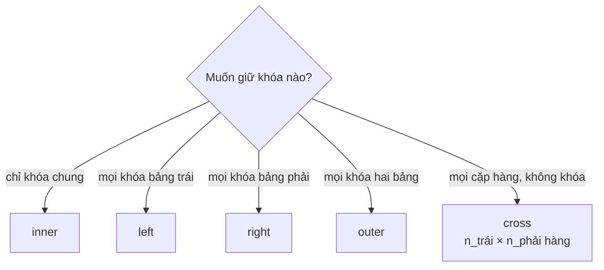

# Merge, concat và combine_first · Kết hợp các tập dữ liệu

> **abstract** Tóm tắt
> Dữ liệu thường nằm rải rác ở nhiều nguồn. Pandas có 3 công cụ ghép (tr. 45, tr. 46):
> - **`pd.merge()`** — nối **hàng** của hai bảng theo **khóa chung**, giống **JOIN** trong SQL.
> - **`pd.concat()`** — **xếp** các đối tượng dọc theo một trục (hàng hoặc cột). Hợp với dữ liệu **cùng cấu trúc**.
> - **`DataFrame.combine_first()`** — hai đối tượng cấu trúc tương tự; **ô thiếu** ở đối tượng thứ nhất được lấp bằng ô tương ứng của đối tượng thứ hai. Dùng khi làm sạch, bổ sung dữ liệu.


---

## 1. Gộp và nối dữ liệu với merge

### Vì sao cần merge?

Nguồn tr. 49, tr. 50.

- Bảng 1 (khách hàng): mã khách, tên, giới tính, năm sinh.
- Bảng 2 (giao dịch): mã đơn, mã khách, giá trị đơn.
- Câu hỏi "Khách nào mua nhiều nhất?", "Giá trị trung bình mỗi đơn của từng khách?" cần **cả hai bảng** → phải ghép qua **mã khách**.

```python
customers = pd.DataFrame({
    'code': ['001', '002', '003', '004'],
    'name': ['Hoa', 'Hùng', 'Linh', 'An'],
    'gender': ['Nữ', 'Nam', 'Nữ', 'Nữ'],
    'birthYear': [1985, 1999, 2001, 2005]})
orders = pd.DataFrame({
    'order_number': [100, 101, 102, 103, 104],
    'customer_code': ['001', '002', '001', '003', '001'],
    'amount': [120_000, 245_000, 150_000, 340_000, 230_000]})
```

### Cú pháp (tr. 51)

```python
pd.merge(left, right, how='inner', on=None, left_on=None, right_on=None,
         left_index=False, right_index=False, sort=False,
         suffixes=('_x', '_y'), copy=True, indicator=False, validate=None)
```

### Tham số `how` (tr. 52)


> **note** Bảng dạng chữ
> | *`how`* | Hành vi | Ghi nhớ |
> | --- | --- | --- |
> | `'inner'` (mặc định) | Chỉ giữ tổ hợp khóa có ở **cả hai** bảng | Phần giao |
> | `'left'` | Giữ mọi khóa của bảng **trái** | Thiếu bên phải → NaN |
> | `'right'` | Giữ mọi khóa của bảng **phải** | Thiếu bên trái → NaN |
> | `'outer'` | Giữ mọi khóa của **cả hai**, điền NaN nếu thiếu | Phần hợp |
> | `'cross'` | **Tích Descartes**: mọi hàng trái × mọi hàng phải | Không dùng khóa |



### Các tham số khác (tr. 53, tr. 54)


> **note** Bảng dạng chữ
> | Tham số | Ý nghĩa |
> | --- | --- |
> | *`on`* | Tên cột khóa **chung tên** ở hai bảng |
> | *`left_on`* / *`right_on`* | Cột khóa ở bảng trái / phải khi **tên khác nhau**. Một tên hoặc list tên |
> | *`left_index`* / *`right_index`* | Dùng **index hàng** của bảng trái / phải làm khóa (MultiIndex → nhiều khóa) |
> | *`sort`* | Sắp kết quả theo khóa (thứ tự từ điển). Mặc định `False` |
> | *`suffixes`* | Hậu tố cho cột **trùng tên** không phải khóa. Ví dụ cột *`data`* ở hai bảng → `data_x`, `data_y` |
> | *`copy`* | `False`: tránh sao chép trong một số trường hợp. Mặc định luôn sao chép |
> | *`validate`* | Kiểm tra loại quan hệ: `'1:1'`, `'1:m'`, `'m:1'`, `'m:m'` (hoặc `'one_to_one'`, …). Sai → `MergeError` |
> | *`indicator`* | Thêm cột `_merge` với giá trị `'left_only'`, `'right_only'`, `'both'` |

### Ví dụ inner join (tr. 55)

```python
merged = pd.merge(orders, customers, left_on='customer_code', right_on='code', how='inner')
print(merged)
```

```text
   order_number customer_code  amount code  name gender  birthYear
0           100           001  120000  001   Hoa     Nữ       1985
1           101           002  245000  002  Hùng    Nam       1999
2           102           001  150000  001   Hoa     Nữ       1985
3           103           003  340000  003  Linh     Nữ       2001
4           104           001  230000  001   Hoa     Nữ       1985
```

Giải thích từng bước:
1. Tên khóa khác nhau (`customer_code` và `code`) → dùng *`left_on`*, *`right_on`*. Kết quả giữ **cả hai** cột khóa.
2. Hoa (001) có 3 đơn → xuất hiện 3 lần. Trả lời câu hỏi tr. 50: Hoa mua **3 đơn**, trung bình (120 000 + 150 000 + 230 000)/3 ≈ **166 667**.
3. **Không thấy An (004)**: An chưa có đơn nào, mà `inner` chỉ giữ khóa chung. Muốn giữ An, dùng *`how='right'`* (hoặc `'outer'`): thêm một hàng An với `order_number`, `amount` = NaN, `_merge = 'right_only'`.

### Ghép nhiều–nhiều (many-to-many) (tr. 56, tr. 57)

Một khách mua nhiều sản phẩm, đồng thời thích nhiều sản phẩm.

```python
purchases = pd.DataFrame({
    'customer': ['Alice','Alice','Bob','Charlie','Charlie'],
    'product_purchased': ['Laptop','Mouse','Tablet','Phone','Mouse']})
favorites = pd.DataFrame({
    'customer': ['Alice','Bob','Alice','Charlie'],
    'favorite_product': ['Keyboard','Mouse','Monitor','Laptop']})
print(pd.merge(purchases, favorites, on='customer', how='inner'))
```

```text
  customer product_purchased favorite_product
0    Alice            Laptop         Keyboard
1    Alice            Laptop          Monitor
2    Alice             Mouse         Keyboard
3    Alice             Mouse          Monitor
4      Bob            Tablet            Mouse
5  Charlie             Phone           Laptop
6  Charlie             Mouse           Laptop
```

Số hàng của inner join là:

$$
\text{số hàng} = \sum_{k \in \text{khóa chung}} n_{\text{trái}}(k)\cdot n_{\text{phải}}(k) = 2\cdot2 + 1\cdot1 + 2\cdot1 = 7
$$

Ý nghĩa nghiệp vụ: Alice đã mua Laptop, Mouse nhưng còn thích Keyboard, Monitor → khả năng cao sẽ mua → gợi ý khuyến mại.


> **tip** Mẹo thi: đếm hàng theo từng khóa
> | Kiểu | Khóa chung $k$ | Khóa chỉ ở trái | Khóa chỉ ở phải |
> | --- | --- | --- | --- |
> | inner | $n_L n_R$ | 0 | 0 |
> | left | $n_L n_R$ | $n_L$ | 0 |
> | right | $n_L n_R$ | 0 | $n_R$ |
> | outer | $n_L n_R$ | $n_L$ | $n_R$ |
> | cross | — | — | tổng $= N_L \times N_R$ |

> **warning** Dễ nhầm
> - Khóa lặp ở **cả hai** phía nhân số hàng. Cộng `amount` sau merge như vậy sẽ bị **nhân đôi doanh thu**.
> - Phòng bằng *`validate='many_to_one'`* (bảng phải mỗi khóa một dòng). Ví dụ trên với *`validate='one_to_many'`* báo `MergeError: Merge keys are not unique in left dataset`.
> - Không ghi *`on`* thì pandas lấy **mọi cột trùng tên** làm khóa.
> - Kiểu khóa phải khớp: `'001'` (chuỗi) không khớp `1` (số).

> **question** Tự kiểm tra
> Trái có khóa A, A, B. Phải có A, A, A, C. Số hàng inner, left, right, outer?
> → inner $2\cdot3=6$; left $6+1=7$ (B); right $6+1=7$ (C); outer $6+1+1=8$.

---

## 2. Kết hợp dữ liệu dựa trên index

Nguồn tr. 59 – tr. 65.

Khi khóa nằm ở **index** chứ không ở cột, dùng *`left_index=True`* và/hoặc *`right_index=True`*.

### So sánh ba cách viết

```python
customers = pd.DataFrame({'customer_code': ['C001','C002','C003'],
                          'name': ['Alice','Bob','Charlie'],
                          'city': ['Hanoi','Saigon','Danang']})
orders = pd.DataFrame({'order_id': [101,102,103,104],
                       'customer_code': ['C001','C002','C002','C003'],
                       'amount': [250,150,300,200]})
```

| Trang | Khóa trái | Khóa phải | Lệnh |
| --- | --- | --- | --- |
| tr. 60 | cột | cột | **`pd.merge(customers, orders, on="customer_code", how="left")`** |
| tr. 61 | cột | index | **`pd.merge(orders, customers, left_on='customer_code', right_index=True)`** (orders index = `order_id`, customers index = `customer_code`) |
| tr. 62 | index | index | **`pd.merge(customers, orders, left_index=True, right_index=True, how="left")`** (cả hai index = `customer_code`) |

Kết quả tr. 61 (giữ index `order_id` của bảng trái):

```text
         customer_code  amount     name    city
order_id
101               C001     250    Alice   Hanoi
102               C002     150      Bob  Saigon
103               C002     300      Bob  Saigon
104               C003     200  Charlie  Danang
```

Kết quả tr. 62 (index chung `customer_code`, Bob có 2 đơn nên lặp 2 lần):

```text
                  name    city  order_id  amount
customer_code
C001             Alice   Hanoi       101     250
C002               Bob  Saigon       102     150
C002               Bob  Saigon       103     300
C003           Charlie  Danang       104     200
```

Kết quả tr. 60 có cùng 4 hàng nhưng index `0..3` và `customer_code` là cột thường.

> **info** Mở rộng
> **`orders.join(customers, on='customer_code')`** là cách viết ngắn cho "cột trái ghép index phải", mặc định là left join. Kết quả giống tr. 61.

### Vì sao merge theo index nhanh hơn? (tr. 63 – tr. 65)

- **Index** được tối ưu để tra cứu (thường là bảng băm *hash map* hoặc cây *B-tree*). Pandas khớp khóa ngay trên cấu trúc đó.
- **Cột** chỉ là mảng NumPy. Merge theo cột phải quét dữ liệu, tạo bảng băm trung gian rồi mới join → tốn **thời gian và bộ nhớ**.
- Ví dụ tr. 64: hai bảng 1 000 000 hàng, `%timeit -n 3 -r 3`. Merge theo cột ≈ **38.1 ms**, theo index ≈ **12.6 ms**. Hai kết quả có cùng dữ liệu; bản theo index dùng *`key`* làm index.


> **note** Bảng dạng chữ
> | | Merge theo cột | Merge theo index |
> | --- | --- | --- |
> | Ưu | Linh hoạt | Nhanh hơn nhiều với dữ liệu lớn |
> | Nhược | Chậm hơn | Phải **`set_index`** trước |

> **warning** Dễ nhầm
> - Chỉ đặt *`left_on`* mà quên *`right_on`*/*`right_index`* → lỗi.
> - Merge index–index: index kết quả là khóa chung. Merge cột–index: index kết quả lấy từ **bảng trái**.

> **question** Tự kiểm tra
> **`pd.merge(customers, orders, left_index=True, right_index=True, how='left')`** (tr. 62) có mấy hàng? → 4 (C002 có 2 đơn). Có hàng NaN không? → Không, khách nào cũng có đơn.

---

## 3. Nối dữ liệu theo một trục với concat

Nguồn tr. 67 – tr. 77.

Dữ liệu thực tế hay bị chia nhỏ: nhân viên khác nhau thu thập khách hàng; mỗi đại lý giữ dữ liệu bán hàng riêng. Muốn bảng đầy đủ thì nối theo **dòng** (*`axis=0`*) hoặc theo **cột** (*`axis=1`*).

### Cú pháp và tham số (tr. 68, tr. 69)

```python
pd.concat(objs, axis=0, join='outer', ignore_index=False, keys=None,
          levels=None, names=None, verify_integrity=False, sort=False, copy=True)
```


> **note** Bảng dạng chữ
> | Đối số | Mô tả |
> | --- | --- |
> | `objs` | List hoặc dict các DataFrame/Series. **Đối số bắt buộc duy nhất** |
> | *`axis`* | `0`/`'index'`: nối theo hàng (mặc định). `1`/`'columns'`: nối theo cột |
> | *`join`* | `'outer'` (mặc định, **hợp** nhãn trục còn lại) hoặc `'inner'` (**giao**) |
> | *`ignore_index`* | `True`: bỏ nhãn cũ trên trục nối, tạo **`range(tổng độ dài)`** mới |
> | *`keys`* | Gắn nhãn cho từng đối tượng → tạo **MultiIndex** dọc trục nối |
> | *`levels`* | Dùng khi *`keys`* có nhiều tầng |
> | *`names`* | Tên cho các cấp MultiIndex tạo bởi *`keys`*/*`levels`* |
> | *`verify_integrity`* | `True`: nhãn trục mới trùng → **báo lỗi** (chậm nhưng an toàn) |
> | *`sort`* | Sắp nhãn trục không nối khi *`join='outer'`* |
> | *`copy`* | Sao chép dữ liệu (mặc định `True`) |

### Nối theo dòng: tổng hợp bán hàng các đại lý (tr. 70 – tr. 74)

```python
sales_hanoi = pd.DataFrame({'product': ['Laptop','Mouse'], 'quantity': [2, 5], 'unit_price': [1200, 20]})
sales_hanoi['amount'] = sales_hanoi['quantity'] * sales_hanoi['unit_price']
sales_hanoi['branch'] = 'Hanoi'
# sales_saigon: Laptop 1 x 1250, Keyboard 3 x 30   ; branch = 'Saigon'
# sales_danang: Monitor 2 x 200, Mouse 4 x 18      ; branch = 'Danang'

all_sales = pd.concat([sales_hanoi, sales_saigon, sales_danang], axis=0)   # Bước 1
all_sales_indexed = all_sales.set_index(['branch', 'product'])              # Bước 2
print(all_sales_indexed.groupby('product')['quantity'].sum())
total_revenue = all_sales_indexed['amount'].sum()
print(all_sales_indexed.groupby('branch')['amount'].sum() / total_revenue * 100)
print(all_sales_indexed.groupby('product')['amount'].sum() / total_revenue * 100)
```

```text
    product  quantity  unit_price  amount  branch      <- all_sales
0    Laptop         2        1200    2400   Hanoi
1     Mouse         5          20     100   Hanoi
0    Laptop         1        1250    1250  Saigon
1  Keyboard         3          30      90  Saigon
0   Monitor         2         200     400  Danang
1     Mouse         4          18      72  Danang

product              <- tổng số lượng
Keyboard    3
Laptop      3
Monitor     2
Mouse       9

total_revenue = 4312
branch               <- tỷ trọng % theo chi nhánh
Danang    10.946197
Hanoi     57.977737
Saigon    31.076067
product              <- tỷ trọng % theo sản phẩm
Keyboard     2.087199
Laptop      84.647495
Monitor      9.276438
Mouse        3.988868
```

Trả lời bài toán tr. 71:
1. **Bán chạy nhất (số lượng)**: Mouse = 5 + 4 = 9.
2. **Tỷ trọng doanh thu lớn nhất**: Laptop = (2400 + 1250)/4312 ≈ 84.6%.
3. Chú ý index của `all_sales` là `0, 1, 0, 1, 0, 1` (giữ nhãn cũ). Dùng *`ignore_index=True`* để được `0..5`, hoặc *`keys=['HN','SG','DN']`* để biết hàng đến từ nguồn nào.

> **info** Mở rộng
> **`pd.concat([sales_hanoi, sales_saigon], verify_integrity=True)`** báo `ValueError: Indexes have overlapping values` vì nhãn 0, 1 lặp.

### Nối theo cột: thông tin khác nhau về cùng đối tượng (tr. 75 – tr. 77)

Chăm sóc khách hàng có tên, giới tính, tuổi; kinh doanh có tổng chi tiêu; tài chính có điểm tín dụng. Ghép cạnh nhau **theo index** (mã khách).

```python
customers = pd.DataFrame({'name': ['Alice','Bob','Charlie','Anna'],
                          'gener': [1, 1, 0, 0], 'age': [20, 30, 40, 24]}, index=[1, 2, 3, 4])
purchases = pd.DataFrame({'total_spent': [5000, 2000, 3000]}, index=[3, 4, 2])
scores    = pd.DataFrame({'credit_score': [650, 720, 700]}, index=[2, 3, 1])
customer_info = pd.concat([customers, purchases, scores], axis=1)
print(customer_info)
```

```text
      name  gener  age  total_spent  credit_score
1    Alice      1   20          NaN         700.0
2      Bob      1   30       3000.0         650.0
3  Charlie      0   40       5000.0         720.0
4     Anna      0   24       2000.0           NaN
```

Theo dấu từng bước:
1. *`axis=1`* → căn theo **nhãn index**, không theo vị trí. `purchases` có index `[3, 4, 2]` nên 5000 thuộc khách 3 (Charlie), không phải khách 1.
2. *`join='outer'`* → hợp nhãn `{1, 2, 3, 4}`. Alice không có `total_spent` → NaN. Anna không có `credit_score` → NaN.
3. Cột có NaN chuyển sang float (3000 → 3000.0).


> **example** Biến thể
> - *`join='inner'`* → chỉ còn nhãn chung `{2, 3}`: Bob và Charlie, không NaN.
> - *`axis=0`* với hai bảng khác cột → cột là **hợp** tên cột, ô không có → NaN.

> **warning** Dễ nhầm
> - **`concat(axis=1)`** **không** ghép theo vị trí. Nhãn lệch là ra NaN.
> - **`concat`** không dùng khóa cột như **`merge`**. Muốn ghép theo cột mã khách thì dùng **`merge`**, hoặc **`set_index`** trước rồi **`concat(axis=1)`**.
> - Mặc định *`join='outer'`*, còn **`merge`** mặc định *`how='inner'`*.

> **question** Tự kiểm tra
> **`pd.concat([a, b], axis=1)`** với index `a = [0, 1]`, `b = [1, 2]` cho index nào? → `[0, 1, 2]`; hàng 0 thiếu phần *`b`*, hàng 2 thiếu phần `a`.

---

## 4. Lấp đầy dữ liệu chồng chéo với combine_first

Nguồn tr. 79 – tr. 82.

```python
Series.combine_first(other)
DataFrame.combine_first(other)   # other: Series/DataFrame có index/columns cùng hoặc tương thích
```

**Cách hoạt động** (tr. 80):
- Ô ở A thiếu (NaN) → lấy ô tương ứng (cùng nhãn) từ B.
- Ô ở A đã có giá trị → **giữ nguyên**, không thay bằng B.

**Khi nào dùng?** Điền khuyết từ nguồn khác; gộp hai bảng mà **ưu tiên dữ liệu gốc**; thay NaN mà không mất thông tin có sẵn.

### Ví dụ GDP (tr. 81, tr. 82)

```python
gdp_main = pd.DataFrame({'Year': [2018, 2019, 2020, 2021],
                         'GDP': [2450, np.nan, np.nan, 3400]}).set_index('Year')   # tỷ USD
gdp_backup = pd.DataFrame({'Year': [2018, 2019, 2020, 2021],
                           'GDP': [2445, 2600, 3000, 3380]}).set_index('Year')
result = gdp_main.combine_first(gdp_backup)
print(result)
```

```text
         GDP
Year
2018  2450.0     <- giữ của main (không lấy 2445)
2019  2600.0     <- main thiếu, lấy backup
2020  3000.0     <- main thiếu, lấy backup
2021  3400.0     <- giữ của main (không lấy 3380)
```

> **warning** Dễ nhầm
> - Thứ tự quan trọng: **`A.combine_first(B)`** **ưu tiên A**. **`B.combine_first(A)`** sẽ ra 2445, 2600, 3000, 3380.
> - Kết quả lấy **hợp** nhãn của hai bên. Nhãn chỉ có ở B cũng được thêm vào.
> - Căn theo **nhãn**, không theo vị trí.

> **question** Tự kiểm tra
> `s1 = Series([8, NaN], index=['A','B'])`, `s2 = Series([9, 2, 3], index=['A','B','C'])`. **`s1.combine_first(s2)`**?
> → *`A=8.0, B=2.0, C=3.0`*.

---

## Bảng so sánh ba cách ghép


> **note** Bảng dạng chữ
> | | **`merge`** | **`concat`** | **`combine_first`** |
> | --- | --- | --- | --- |
> | Căn theo | **Giá trị khóa** (cột hoặc index) | **Nhãn** của trục không nối | **Nhãn** hàng và cột |
> | Mặc định | *`how='inner'`* | *`axis=0`*, *`join='outer'`* | ưu tiên bên gọi |
> | Có thể nhân hàng? | Có (khóa lặp hai phía) | Không | Không |
> | Dùng khi | Bổ sung thuộc tính từ bảng khác | Xếp các phần cùng cấu trúc | Lấp ô thiếu từ nguồn dự phòng |

**Áp dụng ở.** F601 Ghép bảng theo khóa · F602 Nối theo trục · [Thực hành thêm - Ghép theo index và tổng hợp doanh số](Th%E1%BB%B1c%20h%C3%A0nh%20th%C3%AAm%20-%20Gh%C3%A9p%20theo%20index%20v%C3%A0%20t%E1%BB%95ng%20h%E1%BB%A3p%20doanh%20s%E1%BB%91.md).

**Cần biết trước.** [MultiIndex](01%20MultiIndex.md) (cho `keys=` và **`set_index`**), [Thiếu và trùng](../05%20L%C3%A0m%20s%E1%BA%A1ch/01%20Thi%E1%BA%BFu%20v%C3%A0%20tr%C3%B9ng.md) (NaN).

Mục lục chương 6 · Nguồn Lec 6, tr. 45.
