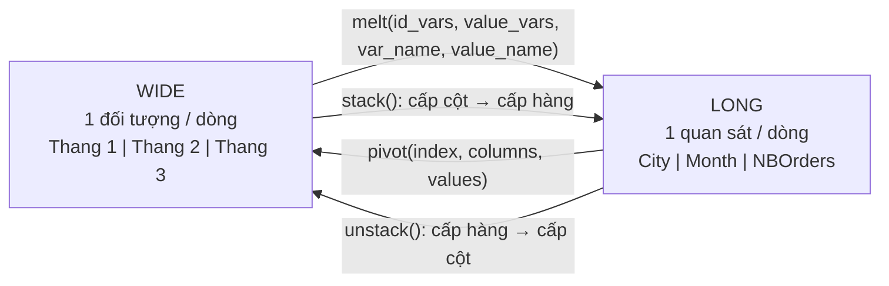

# Melt, pivot, stack và unstack · Tổ chức và cấu trúc lại dữ liệu

> **abstract** Tóm tắt
> - **Reshaping** (cấu trúc lại) đổi **hình dạng** (shape) của dữ liệu mà **không đổi bản chất** dữ liệu (tr. 85).
> - Hai kiểu biểu diễn: **wide** (rộng) và **long** (dài).
> - Wide → long: **`melt`**. Long → wide: **`pivot`**.
> - Khi có MultiIndex: **`stack`** (cột → hàng, ra long) và **`unstack`** (hàng → cột, ra wide).



---

## 1. Dạng rộng và dạng dài

Nguồn tr. 85, tr. 86.


> **note** Bảng dạng chữ
> | | **Wide** (rộng) | **Long** (dài) |
> | --- | --- | --- |
> | Một dòng là | Một **đối tượng**; mỗi thuộc tính một cột | Một **quan sát**; cột chứa giá trị của quan sát |
> | Ví dụ | Bảng điểm: mỗi sinh viên một dòng, mỗi môn một cột | Giá cổ phiếu theo ngày |
> | Gặp ở | Phần mềm quản lý, Excel, báo cáo | Chuỗi thời gian, ghi nhận quan sát liên tục |
> | Dùng cho | Báo cáo, nhập liệu, trình bày | Phân tích, học máy, thống kê, trực quan hóa |

> **example** Cùng dữ liệu, hai cách bày
> | id | math | english |
> | --- | --- | --- |
> | 1 | 90 | 85 |
> | 2 | 80 | 75 |
>
> ⇅
>
> | id | subject | score |
> | --- | --- | --- |
> | 1 | math | 90 |
> | 2 | math | 80 |
> | 1 | english | 85 |
> | 2 | english | 75 |

---

## 2. Wide sang long với melt

Nguồn tr. 88 – tr. 92.

```python
DataFrame.melt(id_vars=None, value_vars=None, var_name=None,
               value_name='value', col_level=None, ignore_index=True)
```


> **note** Bảng dạng chữ
> | Tham số | Ý nghĩa |
> | --- | --- |
> | *`id_vars`* | Cột **giữ nguyên** (định danh) |
> | *`value_vars`* | Cột bị "làm phẳng" (*unpivot*) thành hàng. `None` → lấy **mọi cột trừ** *`id_vars`* |
> | *`var_name`* | Tên cột mới chứa **tên cột cũ**. `None` → `'variable'` |
> | *`value_name`* | Tên cột mới chứa **giá trị**. Mặc định `'value'` |
> | *`col_level`* | Dùng khi cột là MultiIndex: melt ở cấp nào |
> | *`ignore_index`* | `True` (mặc định): index mới `0..n-1`. `False`: giữ index cũ (sẽ lặp) |

### Ví dụ điểm (tr. 89)

```python
df = pd.DataFrame({"id": [1, 2, 3], "math": [90, 80, 70], "english": [85, 75, 65]})
df_melted = df.melt(id_vars=["id"], value_vars=["math", "english"],
                    var_name="subject", value_name="score")
print(df_melted)
```

```text
   id  subject  score
0   1     math     90
1   2     math     80
2   3     math     70
3   1  english     85
4   2  english     75
5   3  english     65
```

Bước đọc:
1. Đi **theo từng cột** trong *`value_vars`*: hết `math` (3 dòng) rồi mới đến `english` (3 dòng).
2. Số dòng $= n_{\text{dòng}} \times |\text{value\_vars}| = 3 \times 2 = 6$.
3. Số cột $= |\text{id\_vars}| + 2 = 3$.
4. Không đặt *`var_name`*/*`value_name`* → hai cột tên `variable` và `value`. Với *`ignore_index=False`*, index là `0, 1, 2, 0, 1, 2`.

### Ví dụ đơn hàng theo tháng (tr. 91, tr. 92)

Yêu cầu: **số đơn trung bình theo từng tháng** toàn hệ thống. Mỗi tháng là một cột nên khó **`groupby`** theo tháng → chuyển sang long với cột `Month`.

```python
data = {'City': ['Hà Nội', 'TP.HCM', 'Đà Nẵng'],
        'Thang 1': [500, 700, 300], 'Thang 2': [600, 800, 350], 'Thang 3': [550, 750, 400]}
df = pd.DataFrame(data)
df_long = df.melt(id_vars=['City'], value_vars=['Thang 1', 'Thang 2', 'Thang 3'],
                  var_name='Month', value_name='NBOrders')
print(df_long.groupby('Month')['NBOrders'].mean())
```

```text
      City    Month  NBOrders
0   Hà Nội  Thang 1       500
1   TP.HCM  Thang 1       700
2  Đà Nẵng  Thang 1       300
3   Hà Nội  Thang 2       600
...                          (9 dòng)
Month
Thang 1    500.000000
Thang 2    583.333333
Thang 3    566.666667
```

Tháng 1: (500 + 700 + 300)/3 = 500. Tháng 2: (600 + 800 + 350)/3 ≈ 583.33.

> **warning** Dễ nhầm
> - Quên *`id_vars`* → cột định danh (City) cũng bị làm phẳng.
> - Ô NaN vẫn thành **một dòng** (giá trị NaN). **`melt`** không tự bỏ NaN.
> - *`value_vars`* chỉ liệt kê một phần → các cột khác (không thuộc *`id_vars`*) **bị bỏ**.

> **question** Tự kiểm tra
> Bảng 4 cửa hàng × 3 cột quý, **`melt(id_vars='store')`** có shape? → `(12, 3)`.

---

## 3. Long sang wide với pivot

Nguồn tr. 94 – tr. 98.

```python
DataFrame.pivot(index=None, columns=None, values=None)
```


> **note** Bảng dạng chữ
> | Tham số | Trở thành |
> | --- | --- |
> | *`index`* | Chỉ số hàng (row index) |
> | *`columns`* | Nhãn cột (column headers) |
> | *`values`* | Giá trị điền vào ô. `None` → dùng **mọi cột còn lại** (cột ra MultiIndex) |

### Ví dụ điểm (tr. 95)

```python
df = pd.DataFrame({"id": [1, 1, 2, 2], "subject": ["math", "english", "math", "english"],
                   "score": [90, 85, 80, 75]})
print(df.pivot(index="id", columns="subject", values="score"))
```

```text
subject  english  math
id
1             85    90
2             75    80
```

Cột được **sắp theo tên** (english trước math). Tên cột `subject` thành **tên của trục cột**.

### Chấm công nhân viên (tr. 96, tr. 97)

Mỗi ngày ghi số giờ của từng nhân viên (long). Báo cáo cho quản lý cần nhìn ngay mỗi người làm bao nhiêu giờ mỗi ngày → wide.

```python
df_long = pd.DataFrame({"Employee": ["An", "Bình", "An", "Bình"],
                        "Date": ["2025-08-01", "2025-08-01", "2025-08-02", "2025-08-02"],
                        "Hours": [8, 6, 7, 8]})
df_wide = df_long.pivot(index="Employee", columns="Date", values="Hours")
df_wide['total_hours'] = df_wide.sum(axis=1)
print(df_wide)
```

```text
Date      2025-08-01  2025-08-02  total_hours
Employee
An                 8           7           15
Bình               6           8           14
```

**`sum(axis=1)`** cộng **theo hàng** (qua các cột ngày).

### Quay lại bảng đơn hàng (tr. 98)

```python
df_wide2 = df_long.pivot(index='City', columns='Month', values='NBOrders')
print(df_wide2.index)
print(df_wide2.columns)
```

```text
Month    Thang 1  Thang 2  Thang 3
City
Hà Nội       500      600      550
TP.HCM       700      800      750
Đà Nẵng      300      350      400
Index(['Hà Nội', 'TP.HCM', 'Đà Nẵng'], dtype='object', name='City')
Index(['Thang 1', 'Thang 2', 'Thang 3'], dtype='object', name='Month')
```

Khác bảng gốc: `City` giờ là **index** (không còn là cột) và trục cột có tên `Month`. Dùng **`reset_index()`** để đưa City về cột.

> **info** Mở rộng: khi một ô có nhiều giá trị
> **`pivot`** yêu cầu mỗi cặp (index, columns) **duy nhất**. Thêm dòng `(1, 'math', 70)` vào ví dụ tr. 95 thì **`pivot`** báo `ValueError: Index contains duplicate entries, cannot reshape`.
> **`pivot_table(index='id', columns='subject', values='score')`** gộp bằng `aggfunc` (mặc định **mean**): ô (1, math) = (90 + 70)/2 = 80.0. Dùng *`aggfunc='sum'`* nếu đề yêu cầu cộng.

> **question** Tự kiểm tra
> Vì sao **`df_long.pivot(index='City', columns='Month', values='NBOrders')`** chạy được? → Mỗi cặp City–Month chỉ xuất hiện một lần.

---

## 4. So sánh melt và pivot


> **note** Bảng dạng chữ
> | | **`melt`** | **`pivot`** |
> | --- | --- | --- |
> | Hướng | Wide → long | Long → wide |
> | Số dòng | Tăng: $n \times k$ | Giảm: số giá trị khác nhau của *`index`* |
> | Tên cột cũ | Thành **giá trị** trong cột *`var_name`* | Giá trị trong cột *`columns`* thành **tên cột** |
> | Index kết quả | `0..n-1` | Giá trị của cột *`index`* |
> | Lỗi hay gặp | Quên *`id_vars`* | Cặp (index, columns) lặp |

---

## 5. Reshaping khi có chỉ số phân cấp với stack và unstack

Nguồn tr. 100 – tr. 104.

- **`df.stack()`**: **"nén"** một cấp index **cột** xuống thành index **hàng**. Thường dùng wide → long.
- **`df.unstack()`**: **"giải nén"** một cấp index **hàng** lên thành index **cột**. Thường dùng long → wide.
- Bản chất: **hoán đổi vị trí cấp** giữa rows và columns trong MultiIndex.

### Cú pháp

```python
DataFrame.stack(level=-1, dropna=True, sort=True)
DataFrame.unstack(level=-1, fill_value=None)
```

| Hàm | Tham số | Ý nghĩa | Mặc định |
| --- | --- | --- | --- |
| **`stack`** (tr. 101) | *`level`* | Cấp **cột** đưa xuống hàng; số hoặc tên | `-1` (cấp trong cùng) |
| | *`dropna`* | Bỏ dòng NaN sau khi chuyển | `True` |
| | *`sort`* | Sắp index kết quả | `True` |
| **`unstack`** (tr. 102) | *`level`* | Cấp **hàng** đưa lên cột; số hoặc tên | `-1` (cấp trong cùng) |
| | *`fill_value`* | Giá trị điền ô thiếu (tổ hợp cấp không tồn tại) | `None` → để NaN |

### Ví dụ bảng điểm sinh viên (tr. 103, tr. 104)

```python
df = pd.DataFrame({"Name": ["An", "Bình"],
                   ("Score", "Math"): [8, 6],
                   ("Score", "Physics"): [7, 9]}).set_index('Name')
df.columns = pd.MultiIndex.from_tuples(df.columns)
print(df)
print(df.columns)
```

```text
     Score
      Math Physics
Name
An       8       7
Bình     6       9
MultiIndex([('Score',    'Math'),
            ('Score', 'Physics')],
           )
```

Cột có 2 cấp: level 0 = `Score`, level 1 = `Math`, `Physics`. **`pd.MultiIndex.from_tuples`** biến list tuple thành MultiIndex.

```python
df_stack = df.stack(level=1, future_stack=True)   # wide -> long
print(df_stack)
df_unstack = df_stack.unstack(level=1)            # long -> wide
print(df_unstack)
```

```text
              Score
Name
An   Math         8
     Physics      7
Bình Math         6
     Physics      9
# df_stack.index: MultiIndex [('An','Math'), ('An','Physics'), ('Bình','Math'), ('Bình','Physics')], names=['Name', None]
# df_stack.columns: Index(['Score'])

     Score
      Math Physics
Name
An       8       7
Bình     6       9
```

Theo dấu cấp:
1. Trước: hàng `[Name]`, cột `[cấp0: Score, cấp1: Math/Physics]`. Shape `(2, 2)`.
2. **`stack(level=1)`**: cấp 1 của cột xuống làm cấp **trong cùng** của hàng. Hàng `[Name, môn]`, cột `[Score]`. Shape `(4, 1)`.
3. **`unstack(level=1)`**: cấp 1 của hàng (môn) lên lại cột. Trở về shape `(2, 2)`.


> **info** Mở rộng: `future_stack=True` và `fill_value`
> - Slide dùng *`future_stack=True`* (pandas ≥ 2.1). Cách mới **không bỏ NaN** và không nhận *`dropna`*. Ví dụ bảng `A: Q1=10, Q2=30; B: Q1=NaN, Q2=40`: **`stack()`** kiểu cũ cho 3 dòng, **`stack(future_stack=True)`** cho 4 dòng (có `B, Q1 = NaN`).
> - Series index `(a,x)=1, (a,y)=2, (b,x)=3`: **`unstack()`** cho ô `(b, y)` = NaN và các số thành float. **`unstack(fill_value=0)`** điền 0 và giữ kiểu int. **`unstack(level=0)`** đưa cấp ngoài (`a`, *`b`*) lên cột.

> **warning** Dễ nhầm
> - Mặc định *`level=-1`* → **cấp trong cùng**, không phải cấp ngoài.
> - **`stack`** **thêm** cấp vào hàng ở vị trí trong cùng; **`unstack`** **thêm** cấp vào cột ở vị trí trong cùng.
> - Stack hết cấp cột của DataFrame một cấp cột → ra **Series**.
> - **`unstack`** khi index có cặp lặp → lỗi như **`pivot`**.

> **tip** Mẹo thi
> **stack = Sụp xuống** (cột → hàng, bảng cao lên). **unstack = Ủn lên** (hàng → cột, bảng béo ra).
> Đếm shape: stack nhân số hàng với số nhãn của cấp bị đưa xuống; unstack chia ngược lại.

> **question** Tự kiểm tra
> 1. Bảng 3 hàng × cột MultiIndex 2 × 4 (8 cột). **`stack()`** (cấp trong cùng, không NaN) có shape? → `(12, 2)`.
> 2. `df2` ở note MultiIndex có cột `(Revenue, Year, Quarter)`. **`df2.stack('Quarter', future_stack=True)`** có mấy cột? → 2 (`Revenue, 2024` và `Revenue, 2025`).

---

**Áp dụng ở.** F605 Đổi wide và long · F604 Stack và unstack.

**Cần biết trước.** [MultiIndex](01%20MultiIndex.md) để theo dõi cấp nhãn. Bảng long dùng tiếp ở Trực quan hóa.

Mục lục chương 6 · Nguồn Lec 6, tr. 84.
