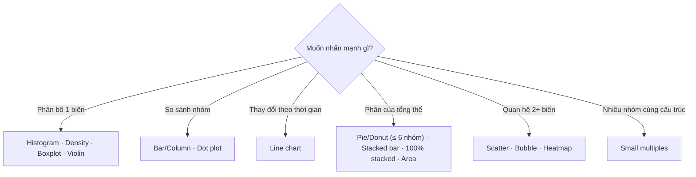

# Chọn và đọc biểu đồ · 7.2

> **abstract** Tóm tắt
> **Không có biểu đồ "tốt nhất" cho mọi tình huống.** Trước tiên hỏi: muốn nhấn mạnh **so sánh**, **phân bố**, **mối quan hệ** hay **thành phần**? tr. 22
>
> | Nhóm | Biểu đồ trong slide | Câu hỏi trả lời |
> | --- | --- | --- |
> | Phân phối (Distribution) | Histogram, Density, Boxplot, Violin | Dữ liệu tập trung ở đâu, trải rộng, lệch, ngoại lệ? |
> | So sánh (Comparison) | Bar/Column, Line, Dot plot | Nhóm nào lớn hơn, xếp hạng, xu hướng? |
> | Thành phần (Composition) | Pie, Donut, Stacked bar, 100% stacked, Area | Tổng thể chia thành phần thế nào? |
> | Quan hệ (Relationship) | Scatter, Bubble, Heatmap, Line | Hai biến có liên hệ, tương quan? |
> | Nâng cao | Small multiples | So sánh nhiều nhóm cùng cấu trúc |
>
> Slide 24 còn liệt kê **chuỗi thời gian (Time Series)** là một nhóm riêng. tr. 23 · tr. 24




## Chuẩn bị · Từ ô trong bảng đến dấu trên hình

Một **quan sát** là đối tượng ta đo, ví dụ một ngày bán hàng. **Biến** là thuộc tính ghi lại cho mỗi quan sát. **Kiểu biến** quyết định phép so sánh có nghĩa.


> **note** Bảng dạng chữ
> | Kiểu biến | Ví dụ | Cách đọc |
> | --- | --- | --- |
> | Định danh / danh mục | Mã cửa hàng, kênh Web/Quầy | Gom nhóm. Mã 101 vẫn là tên, cộng mã vô nghĩa |
> | Có thứ tự | Thấp, vừa, cao | So bậc. Khoảng cách giữa hai bậc chưa chắc bằng nhau |
> | Định lượng | 12 đơn, 20,5 triệu đồng | So độ lớn, tính tổng/trung bình cùng đơn vị |
> | Thời gian | 01/11, 02/11 | Sắp thứ tự, đọc khoảng cách theo lịch |

**Mã hóa trực quan** là quy tắc ánh xạ giá trị thành dấu nhìn thấy (vị trí $x$, $y$, độ dài, màu, kích thước). Chấm $(2,10)$ trên trục quảng cáo–doanh thu nghĩa là cửa hàng chi 2 triệu và thu 10 triệu.

> **warning** Dễ nhầm · Đếm, cộng, trung bình
> Kênh A có hai ngày bán 3 và 7 đơn. Kênh B có một ngày bán 8 đơn.
> - Đếm dòng: A = 2, B = 1.
> - Tổng: A = 10 > B = 8.
> - Trung bình: A = 5 < B = 8.
> Cùng dữ liệu, ba cột khác nhau. Luôn đọc nhãn trục y để biết cột là gì.

## 7.2.1 Biểu đồ phân phối (Distribution)

tr. 26 · tr. 27

**Định nghĩa.** Thể hiện **cách dữ liệu được phân bố**: tập trung ở đâu, trải rộng thế nào, có lệch, có ngoại lệ không.

Câu hỏi trả lời: giá trị nào xuất hiện nhiều nhất · lệch trái/phải · trải rộng hay tập trung · có outlier không.

**Khi nào dùng:** hiểu đặc điểm **một biến** (doanh thu, tuổi, KPI) · **so sánh phân phối giữa nhóm** (nam/nữ, quý 1/quý 2) · **khám phá trước khi mô hình hóa**.


> **note** Bảng dạng chữ
> | Biểu đồ | Cách làm | Ghi nhớ |
> | --- | --- | --- |
> | **Histogram** (tần suất) | Chia dữ liệu thành khoảng (**bins**), đếm số giá trị mỗi khoảng | Dữ liệu **liên tục**. Chọn bin width hợp lý |
> | **Density plot** (mật độ) | Đường cong ước lượng phân bố xác suất | Mượt, **không phụ thuộc số bin**. Trục y là **mật độ** |
> | **Boxplot** (hộp) | Tóm tắt bằng median, quartile, outlier | So sánh **nhiều nhóm** nhanh |
> | **Violin** (nâng cao) | Boxplot + mật độ **đối xứng** hai bên | Tiết kiệm chỗ, thấy chi tiết hình dạng |

### Histogram

tr. 28

- Mỗi cột biểu diễn **tần suất** trong một bin.
- Cho thấy **hình dạng tổng thể**: chuẩn (hình chuông), lệch, nhiều đỉnh.
- **Bin quá rộng → mất chi tiết. Bin quá hẹp → nhiễu.**

> **example** Ví dụ · Biên bin thay đổi hình
> Bốn hóa đơn 9, 12, 19, 20 nghìn đồng.
> 1. Hai khoảng $[0,15)$ và $[15,30)$: khoảng đầu chứa 9, 12; khoảng sau chứa 19, 20 → hai cột cao 2.
> 2. Một khoảng $[0,30]$ → một cột cao 4. Mất cấu trúc "hai cụm".
> Ngoặc tròn `)` nghĩa là không lấy cận phải.

### Density plot

tr. 29

- Phiên bản **"mềm"** của histogram, ước lượng **mật độ xác suất**.
- Mượt hơn, **không phụ thuộc số bin**. Rất trực quan khi so sánh nhiều phân bố (nam vs nữ).
- **Cẩn thận:** trục y là **mật độ**, không phải số lượng tuyệt đối. Diện tích dưới đường cong bằng 1.

> **info** Mở rộng
> Density không phụ thuộc bin nhưng phụ thuộc **độ rộng làm mượt** (bandwidth). Bandwidth nhỏ → gồ ghề, lớn → quá phẳng. Đây là tương tự của "chọn bin".

### Boxplot

tr. 30 · tr. 31 · tr. 32

Tạo từ **năm đại lượng**, chia dữ liệu thành 4 phần, mỗi phần khoảng **25%** số điểm.


> **note** Bảng dạng chữ
> | Thành phần | Ký hiệu | Ý nghĩa | % dữ liệu ≤ |
> | --- | --- | --- | --- |
> | Giá trị nhỏ nhất | Min | Nhỏ nhất **không phải ngoại lai** (đầu râu dưới) | — |
> | Tứ phân vị thứ nhất | $Q_1$ | Biên dưới của hộp | 25% |
> | Trung vị (Median) | $Q_2$ | Vạch ngang trong hộp, chia đôi dữ liệu | 50% |
> | Tứ phân vị thứ ba | $Q_3$ | Biên trên của hộp | 75% |
> | Giá trị lớn nhất | Max | Lớn nhất **không phải ngoại lai** (đầu râu trên) | — |

- **Hộp:** chiều dài = **khoảng tứ phân vị** $IQR = Q_3 - Q_1$, phạm vi của **50% dữ liệu giữa**. Hộp ngắn → tập trung, ít biến động. Hộp dài → phân tán.
- **Râu (whiskers):** từ $Q_1$ xuống Min và từ $Q_3$ lên Max. Độ dài râu cho biết độ phân tán của 25% thấp nhất và 25% cao nhất.
- **Ngoại lai:** chấm/sao/vòng tròn ngoài râu. Thường là giá trị $< Q_1 - 1.5\,IQR$ hoặc $> Q_3 + 1.5\,IQR$. Là điểm bất thường **cần điều tra**.


> **example** Ví dụ · Tính tay từng bước
> Dữ liệu đã sắp: `2, 4, 4, 5, 6, 7, 8, 9, 30` (9 giá trị).
> 1. $Q_1 = 4$, $Q_2 = 6$, $Q_3 = 8$ (theo **`np.percentile`**, nội suy tuyến tính).
> 2. $IQR = 8 - 4 = 4$.
> 3. Hàng rào dưới $= 4 - 1.5 \times 4 = -2$. Hàng rào trên $= 8 + 6 = 14$.
> 4. Ngoại lai: 30 (vượt 14).
> 5. Râu trên dừng ở **9** (giá trị lớn nhất ≤ 14), không phải ở 14. Râu dưới dừng ở 2.
>
> ```python
> import numpy as np
> data = np.array([2, 4, 4, 5, 6, 7, 8, 9, 30])
> q1, q2, q3 = np.percentile(data, [25, 50, 75])
> iqr = q3 - q1
> print(q1, q2, q3, iqr, q1 - 1.5*iqr, q3 + 1.5*iqr)
> # 4.0 6.0 8.0 4.0 -2.0 14.0
> ```
> **`plt.boxplot(data)`** vẽ râu tới 2 và 9, điểm rời tại 30 (đã chạy kiểm chứng).

> **warning** Dễ nhầm
> - Đầu râu **không** phải $Q_3 + 1.5IQR$. Đầu râu là **quan sát thật** lớn nhất còn nằm trong hàng rào.
> - "Max" trong boxplot là max **không tính ngoại lai**, khác **`max()`** của dữ liệu.
> - Cùng trung vị chưa chắc cùng phân phối: so IQR, râu, ngoại lệ, và xem histogram/violin để biết có nhiều đỉnh không.

### Violin plot

tr. 33

Kết hợp **boxplot và mật độ** → thấy thêm chi tiết phân bố (ví dụ hai đỉnh mà boxplot che mất). Ưu điểm: **tiết kiệm không gian**, dễ so sánh nhiều nhóm trong một hình.

> **question** Tự kiểm tra
> 1. Histogram nhìn "răng cưa" lởm chởm. Nguyên nhân thường gặp?
> > Bin quá hẹp → nhiễu. Tăng bin width (giảm số bin).
> 2. $Q_1 = 10$, $Q_3 = 22$. Giá trị 41 có phải ngoại lai?
> > $IQR = 12$, hàng rào trên $= 22 + 18 = 40$. 41 > 40 → ngoại lai.
> 3. Trục y của density plot đọc là "số người" được không?
> > Không. Đó là mật độ xác suất.

## 7.2.2 Biểu đồ so sánh (Comparison)

tr. 35 · tr. 36 · tr. 37 · tr. 38 · tr. 39

**Định nghĩa.** So sánh các nhóm theo một hoặc nhiều tiêu chí. Mục tiêu: nhận biết **khác biệt, xu hướng, thứ hạng**.

Trả lời: nhóm nào lớn/nhỏ hơn · xu hướng giữa các thời điểm · chênh lệch giữa danh mục · thứ tự xếp hạng.


> **note** Bảng dạng chữ
> | Biểu đồ | Dùng khi | Ví dụ slide |
> | --- | --- | --- |
> | **Bar / Column** (thanh/cột) | So giá trị giữa **danh mục rời rạc** | Doanh thu 5 sản phẩm; chi tiêu phòng ban; điểm TB 4 lớp (tr. 38) |
> | **Line** (đường) | So **xu hướng theo thời gian** | Doanh thu theo quý của 3 chi nhánh |
> | **Dot plot** (chấm) | So giá trị khi có **nhiều danh mục** | — |

**Khi nào dùng:** khác biệt giữa sản phẩm/dịch vụ · hiệu suất phòng ban/chi nhánh · thay đổi giữa các thời kỳ · báo cáo KPI, doanh thu.

**Dot plot** (tr. 39): thay thế **gọn hơn** bar chart. Mỗi danh mục là **một chấm** tại vị trí giá trị. Dễ đọc khi nhiều danh mục (không có rừng cột dày đặc). Nhấn mạnh **giá trị chính xác** thay vì diện tích cột.

> **tip** Mẹo thi
> Bar chart dùng **chiều dài** → trục phải từ 0. Dot plot dùng **vị trí** → có thể thu hẹp trục.

## 7.2.3 Biểu đồ thành phần (Composition)

tr. 41 · tr. 42 · tr. 43

**Định nghĩa.** Thể hiện **tổng thể được chia thành các phần** và mỗi phần đóng góp bao nhiêu.

Mục tiêu: minh họa **cơ cấu, tỷ trọng, phân bổ** · so sánh đóng góp giữa các thành phần · theo dõi **thay đổi cơ cấu theo thời gian**.

Các loại: **Pie** · **Donut** (tròn rỗng tâm) · **Stacked bar/column** (xếp chồng) · **100% stacked bar** · **Area chart** (diện tích xếp lớp).

Câu hỏi: "Phần nào lớn nhất?" · "Tổng thể chia thế nào?" · "Tỷ trọng thay đổi theo thời gian ra sao?" · "Sản phẩm nào đóng góp doanh thu nhiều nhất?"

Ví dụ kinh tế: cơ cấu doanh thu theo dòng sản phẩm · tỷ trọng chi phí theo phòng ban · cơ cấu khách hàng theo khu vực · danh mục đầu tư theo ngành.

### Pie chart

tr. 44

- Hiển thị **% từng thành phần** trong tổng thể. Hợp với **ít nhóm (dưới 6)**. Ví dụ: cơ cấu doanh thu sản phẩm A/B/C.
- Hạn chế: người xem **khó so chính xác góc/diện tích** → dễ nhầm. **Wilke khuyên dùng bar chart thay thế.**

### Stacked bar chart

tr. 45

- Mỗi thanh gồm nhiều đoạn, mỗi đoạn là một nhóm.
- Thấy **vừa tổng vừa tỷ lệ**. Quá nhiều nhóm → rối.
- Ví dụ: cơ cấu chi phí marketing theo quý (online, offline, sự kiện).

> **example** Ví dụ · Stacked thường và 100% stacked
> Quý 1: 10 đơn trực tiếp, 30 online. Quý 2: 30 trực tiếp, 90 online.
> - **Stacked số đơn:** cột quý 2 cao 120, gấp 3 quý 1 (40) → thấy **tổng tăng**.
> - **100% stacked:** cả hai quý online chiếm $30/40 = 90/120 = 75\%$ → thấy **cơ cấu không đổi**.

> **warning** Dễ nhầm
> Trong stacked bar, chỉ đoạn **dưới cùng** có chung gốc. Các đoạn phía trên khó so giữa các cột vì gốc lệch nhau.

## 7.2.4 Biểu đồ quan hệ (Relationship)

tr. 47 · tr. 48 · tr. 49

**Định nghĩa.** Thể hiện **mối liên hệ giữa hai hoặc nhiều biến** — có liên quan, tương quan hay ảnh hưởng lẫn nhau không.

Trả lời: tương quan **dương hay âm** · **tuyến tính hay phi tuyến** · có xu hướng, nhóm, outlier · độ phân tán.

Các loại: **Scatter** · **Bubble** · **Heatmap** · **Line relationship** (theo thời gian/xu hướng).

**Khi nào dùng:** xác định có liên hệ · dự đoán xu hướng · phát hiện nhóm/ngoại lệ · hỗ trợ **hồi quy, mô hình dự báo**.

Ví dụ kinh tế: giá – lượng cầu · doanh thu – ngân sách marketing · nợ vay – tài sản · lợi nhuận – quy mô nhân sự.

| Biểu đồ | Đặc điểm | Trang |
| --- | --- | --- |
| **Scatter** | Tốt nhất cho **2 biến liên tục**. Mỗi điểm = **một quan sát**. Thêm màu/kích thước/hình dạng để biểu diễn **biến thứ 3**. Dễ thấy tuyến tính, phi tuyến, ngoại lai | tr. 50 |
| **Bubble** | Scatter có **kích thước điểm** mã hóa biến thứ 3 | tr. 48 |
| **Line** | Dữ liệu **theo thời gian** hoặc có **thứ tự liên tục**. Nối điểm để nhấn **xu hướng, chu kỳ, biến động**. **Chỉ nối khi thứ tự có nghĩa** | tr. 51 |
| **Heatmap** | Ma trận dữ liệu bằng **cường độ màu**. Mạnh với bảng 2 chiều, ví dụ **ma trận tương quan** | tr. 52 |

> **warning** Dễ nhầm
> - Tương quan trên scatter/heatmap **không** chứng minh nhân quả.
> - Nối đường giữa các danh mục không thứ tự (Hà Nội – Huế – Cần Thơ) là sai: đường hàm ý có trạng thái trung gian.
> - Tháng 2 thiếu dữ liệu mà vẫn nối tháng 1 với tháng 3 → người xem tưởng đã biết tháng 2.

> **question** Tự kiểm tra
> Muốn biểu diễn giá nhà theo diện tích, màu theo quận, kích thước theo số phòng. Đây là biểu đồ gì?
> > Scatter (bubble) với biến thứ 3 mã hóa bằng màu và biến thứ 4 bằng kích thước.

## 7.2.5 Biểu đồ nâng cao · Small multiples

tr. 54 · tr. 55 · tr. 56 · tr. 57

**Small multiples** (nhiều biểu đồ nhỏ song song): tách dữ liệu thành **nhiều biểu đồ nhỏ cùng một kiểu**, mỗi ô một nhóm. So sánh nhiều nhóm **không cần chồng (overlay)** lên một hình.

Slide 55 minh họa các biến thể: Area, Bar, Bubble, Geographic map, Line, Radar, Scatter — mỗi loại đều có dạng small multiples (ví dụ Coca-Cola / Diet Coke / Coke Zero cạnh nhau).


> **note** Bảng dạng chữ
> | Khi nên dùng | Ưu điểm |
> | --- | --- |
> | So nhiều nhóm **cùng cấu trúc** | So sánh trực quan dễ |
> | Tránh lộn xộn khi vẽ tất cả vào một hình | Tránh chồng chéo dữ liệu |
> | Cần thấy xu hướng/khác biệt theo danh mục | Giữ **nhất quán** giữa các nhóm |
> | Trực quan đa chiều mà vẫn rõ | Hợp **dashboard, báo cáo kinh doanh** |

Ví dụ: doanh thu theo quý từng vùng · tăng trưởng khách hàng từng chi nhánh · tỷ trọng chi phí từng phòng ban qua năm · KPI giữa nhóm nhân sự · chỉ số thị trường các quốc gia.

> **tip** Mẹo thi
> Trong code, small multiples = **`plt.subplots(nrows, ncols, sharey=True)`**, **`df.plot(subplots=True)`** hoặc **`sns.catplot(..., col=..., row=...)`**. Dùng **chung thang đo** (sharey) nếu muốn so trực tiếp. Xem [09 Chương 07 - Pandas và Seaborn](09%20Ch%C6%B0%C6%A1ng%2007%20-%20Pandas%20v%C3%A0%20Seaborn.md).

> **question** Tự kiểm tra tổng hợp
> 1. Cơ cấu chi phí 4 phòng ban thay đổi qua 5 năm, muốn thấy cơ cấu (không cần tổng) → ?
> > 100% stacked bar (hoặc area chuẩn hóa).
> 2. So điểm trung bình 30 lớp học → bar hay dot plot?
> > Dot plot (nhiều danh mục), hoặc bar ngang đã sắp xếp.
> 3. Pie chart 12 lát có vấn đề gì?
> > Quá 6 nhóm, khó so góc → dùng bar chart.

**Áp dụng ở.** F701 Chọn loại biểu đồ theo câu hỏi · F709 Đọc phân phối – histogram, boxplot, violin, KDE · F710 Đọc quan hệ hai biến và tương quan · F711 Đọc biểu đồ cột, đường và tỷ lệ
