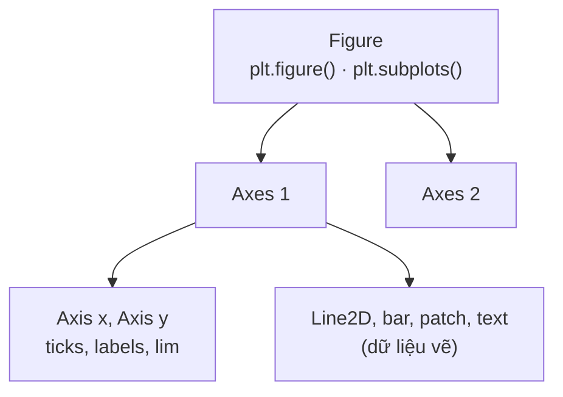

# Figure, Axes và subplot · 7.3.1–7.3.2

> **abstract** Tóm tắt
> - Import chuẩn: `import matplotlib.pyplot as plt`, `numpy as np`, `pandas as pd`.
> - **Figure** = khung chứa toàn bộ hình. **Axes** (subplot) = một vùng vẽ có trục riêng. Figure trống **không vẽ được** → phải thêm Axes.
> - Hai cách tạo lưới: **`fig.add_subplot(nrows, ncols, index)`** (index **từ 1**) và `fig, axes = plt.subplots(nrows, ncols)` (truy cập `axes[i, j]` **từ 0**).
> - Chỉnh khoảng cách: **`plt.subplots_adjust(left, right, bottom, top, wspace, hspace)`**.



## 7.3.1 Import và vẽ biểu đồ cơ bản

tr. 60 · tr. 61

```python
import matplotlib.pyplot as plt
import numpy as np
import pandas as pd
```

Sau `%matplotlib notebook` (Jupyter) hoặc `%matplotlib` (IPython), thử vẽ:

```python
data = np.arange(100)
print(data)        # [ 0  1  2 ... 99]
plt.plot(data)     # chỉ truyền y → x tự là 0, 1, ..., 99
```

Kết quả là **đường thẳng chéo** từ (0, 0) tới (99, 99), vì giá trị bằng chỉ số.

> **warning** Dễ nhầm
> **`plt.plot(y)`** với **một** mảng: mảng đó là **y**, còn x là chỉ số `0..n-1`. Không phải x.

## 7.3.2 Figure và subplot

### Figure

tr. 63 · tr. 64

```python
fig = plt.figure()
fig      # Jupyter hiển thị: <Figure size 640x480 with 0 Axes>
```

Kích thước mặc định **6.4 × 4.8 inch** với dpi 100 → **640 × 480** điểm ảnh, chưa có Axes nào.

[](../../diagrams/07%20Tr%E1%BB%B1c%20quan%20h%C3%B3a/B%E1%BA%A3ng%20tr%E1%BB%B1c%20quan/C7%2003%20Ch%C6%B0%C6%A1ng%2007%20-%20Figure%20Axes%20v%C3%A0%20d%E1%BB%AF%20li%E1%BB%87u%20v%E1%BA%BD%20%E2%80%93%20b%E1%BA%A3ng%201.excalidraw.md)

> **note** Bảng dạng chữ
> | Tham số **`plt.figure(...)`** | Ý nghĩa |
> | --- | --- |
> | `num` | ID hoặc tên Figure |
> | *`figsize`* | Kích thước **(rộng, cao)** theo **inch** |
> | *`dpi`* | Độ phân giải |
> | *`facecolor`* | Màu nền |
> | *`edgecolor`* | Màu viền |
> | **`tight_layout`** | Tự căn chỉnh bố cục (mặc định `False`) |

### add_subplot

tr. 65 · tr. 66 · tr. 67 · tr. 68

```python
ax = fig.add_subplot(nrows, ncols, index)
# nrows: số hàng lưới, ncols: số cột, index: vị trí (đánh số từ 1, theo hàng)
```

Trả về đối tượng **AxesSubplot** (slide). Ví dụ lưới 2×2:

```python
fig = plt.figure()
ax1 = fig.add_subplot(2, 2, 1)   # trên trái
ax2 = fig.add_subplot(2, 2, 2)   # trên phải
ax3 = fig.add_subplot(2, 2, 3)   # dưới trái
ax4 = fig.add_subplot(2, 2, 4)   # dưới phải
plt.show()
```

Vẽ lên từng Axes bằng phương thức của nó:

```python
ax1.plot(np.random.standard_normal(50).cumsum(), color="red", linestyle="dashed")
ax2.plot(np.random.standard_normal(50).cumsum(), color="green", linestyle="dashed")
ax3.plot(np.random.standard_normal(50).cumsum(), color="blue", linestyle="dashed")
ax4.plot(np.random.standard_normal(50).cumsum(), color="orange", linestyle="solid")
```

**`standard_normal(50).cumsum()`** = cộng dồn 50 số ngẫu nhiên chuẩn → **bước đi ngẫu nhiên** (random walk).

Mỗi ô có thể là loại biểu đồ khác (tr. 68):

```python
ax1.hist(np.random.standard_normal(100), bins=20, alpha=0.5)       # histogram 20 bin, mờ 50%
ax2.scatter(np.arange(30), np.arange(30) + 3 * np.random.standard_normal(30))  # scatter có nhiễu
ax3.plot(np.random.standard_normal(50).cumsum(), linestyle="dashed")
```

> **warning** Dễ nhầm
> - Slide 67 chỉ tạo `ax1, ax2, ax3` mà vẫn gọi **`ax4.plot(...)`** → nếu chạy riêng sẽ **NameError**. Phải có dòng `ax4 = fig.add_subplot(2, 2, 4)`.
> - Matplotlib ≥ 3.7 in kiểu là `Axes`, không còn `AxesSubplot` (đã chạy: `type(ax).__name__` → `Axes`). Trong đề, "AxesSubplot" và "Axes" chỉ cùng một thứ.
> - Dấu `;` cuối dòng trong Jupyter chỉ để **ẩn** kết quả trả về, không ảnh hưởng hình.

### plt.subplots

tr. 69 · tr. 70

Tạo **Figure + lưới Axes trong một lệnh**, tiện hơn **`plt.figure()`** + **`add_subplot()`**.

[](../../diagrams/07%20Tr%E1%BB%B1c%20quan%20h%C3%B3a/B%E1%BA%A3ng%20tr%E1%BB%B1c%20quan/C7%2003%20Ch%C6%B0%C6%A1ng%2007%20-%20Figure%20Axes%20v%C3%A0%20d%E1%BB%AF%20li%E1%BB%87u%20v%E1%BA%BD%20%E2%80%93%20b%E1%BA%A3ng%202.excalidraw.md)

> **note** Bảng dạng chữ
> | Tham số | Mặc định | Ý nghĩa |
> | --- | --- | --- |
> | *`nrows`*, `ncols` | 1, 1 | Số hàng, số cột |
> | *`sharex`*, *`sharey`* | False | Các subplot **dùng chung trục** X/Y |
> | `squeeze` | True | Chỉ 1 subplot → trả **Axes** thay vì mảng |
> | `subplot_kw` | None | Tham số truyền cho từng subplot |
> | `gridspec_kw` | None | Bố cục nâng cao (GridSpec) |
> | *`figsize`*, *`dpi`* | — | Kích thước (inch), độ phân giải |
> | *`facecolor`*, *`edgecolor`* | — | Màu nền, viền Figure |
> | *`layout`* | None | `'tight'` hoặc `'constrained'` |
> | **`clear`** | False | Xóa Figure cũ nếu tồn tại |

**Trả về** `fig` (Figure) và *`ax`* (**một Axes** hoặc **mảng Axes**).

So sánh hai cách vẽ cùng lưới 2×3 (tr. 70):

[](../../diagrams/07%20Tr%E1%BB%B1c%20quan%20h%C3%B3a/B%E1%BA%A3ng%20tr%E1%BB%B1c%20quan/C7%2003%20Ch%C6%B0%C6%A1ng%2007%20-%20Figure%20Axes%20v%C3%A0%20d%E1%BB%AF%20li%E1%BB%87u%20v%E1%BA%BD%20%E2%80%93%20b%E1%BA%A3ng%203.excalidraw.md)

> **note** Bảng dạng chữ
> | **`add_subplot`** (index từ 1) | *`subplots`* (chỉ số `[hàng, cột]` từ 0) |
> | --- | --- |
> | **`fig.add_subplot(2,3,1).plot(x, np.sin(x))`** | `axes[0,0].plot(x, np.sin(x))` |
> | **`fig.add_subplot(2,3,2).plot(x, np.cos(x))`** | `axes[0,1].plot(x, np.cos(x))` |
> | **`fig.add_subplot(2,3,3).plot(x, np.tan(x))`** | `axes[0,2].plot(x, np.tan(x))` |
> | **`fig.add_subplot(2,3,4).plot(x, np.cosh(x))`** | `axes[1,0].plot(x, np.cosh(x))` |

[](../../diagrams/07%20Tr%E1%BB%B1c%20quan%20h%C3%B3a/L%C6%B0%E1%BB%9Bi%20subplot%20v%C3%A0%20ch%E1%BB%89%20s%E1%BB%91.excalidraw.md)

Công thức đổi: với lưới `ncols` cột, ô *`index`* (từ 1) nằm ở `axes[(index-1)//ncols, (index-1)%ncols]`. Ví dụ index 4 trong lưới 2×3 → `axes[1, 0]`.

> **example** Kết quả kiểm chứng (đã chạy)
> ```python
> fig, axes = plt.subplots(2, 3); print(type(axes).__name__, axes.shape)  # ndarray (2, 3)
> fig, ax = plt.subplots();       print(type(ax).__name__)                # Axes
> fig, axes = plt.subplots(1, 2); print(axes.shape)                       # (2,)
> ```
> Lưới 1×2 trả mảng **1 chiều** → dùng `axes[0]`, không phải `axes[0, 0]`. Muốn luôn 2 chiều: *`squeeze=False`*.

### subplots_adjust

tr. 71 · tr. 72 · tr. 73

[](../../diagrams/07%20Tr%E1%BB%B1c%20quan%20h%C3%B3a/B%E1%BA%A3ng%20tr%E1%BB%B1c%20quan/C7%2003%20Ch%C6%B0%C6%A1ng%2007%20-%20Figure%20Axes%20v%C3%A0%20d%E1%BB%AF%20li%E1%BB%87u%20v%E1%BA%BD%20%E2%80%93%20b%E1%BA%A3ng%204.excalidraw.md)

> **note** Bảng dạng chữ
> | Tham số | Ý nghĩa |
> | --- | --- |
> | *`left`*, `right`, *`bottom`*, `top` | Lề của Figure, **tỷ lệ 0–1** |
> | *`wspace`* | Khoảng **ngang** giữa các subplot (**w**idth) |
> | *`hspace`* | Khoảng **dọc** giữa các subplot (**h**eight) |

```python
fig, axes = plt.subplots(2, 2, sharex=True, sharey=True)
for i in range(2):
    for j in range(2):
        axes[i, j].hist(np.random.standard_normal(500), bins=50, color="black", alpha=0.5)
fig.subplots_adjust(wspace=0, hspace=0)   # 4 ô dính sát nhau
```

`sharex/sharey=True` giúp 4 histogram dùng chung thang → so sánh trực tiếp. *`wspace=0, hspace=0`* bỏ khe hở.

```python
fig1 = plt.figure()
for k in range(1, 5):
    fig1.add_subplot(2, 3, k)
fig1.subplots_adjust(wspace=0.5, hspace=0.2)   # giãn ngang nhiều, dọc ít
```

> **warning** Dễ nhầm
> *`wspace`* là **ngang** (giữa các cột), *`hspace`* là **dọc** (giữa các hàng). Hay bị đảo.

## Ví dụ tổng hợp · Hai vùng vẽ từ bảng dài

**Bảng dài** có một hàng cho mỗi cặp quý–kênh. **Bảng rộng** đưa mỗi kênh thành một cột. Đổi sang bảng rộng giúp chia theo tổng từng quý.

```python
import matplotlib.pyplot as plt
import pandas as pd
import seaborn as sns

sales = pd.DataFrame({
    "quarter": [1, 1, 2, 2],
    "channel": ["Web", "Store", "Web", "Store"],
    "orders": [10, 30, 20, 35],
})
fig, axes = plt.subplots(1, 2, figsize=(9, 3), layout="constrained")
sns.barplot(data=sales, x="quarter", y="orders", hue="channel", ax=axes[0])
wide = sales.pivot(index="quarter", columns="channel", values="orders")
wide.div(wide.sum(axis=1), axis=0).plot.bar(stacked=True, ax=axes[1])
axes[0].set(title="Số đơn theo kênh", ylabel="Đơn")
axes[1].set(title="Tỷ trọng theo kênh", ylabel="Tỷ trọng")
fig.savefig("don-hang.png", dpi=150)
```

`wide` có 2 quý × 2 kênh, tổng quý là 40 và 55. Tỷ trọng Web: $10/40 = 0.25$ và $20/55 \approx 0.364$. **`sum(axis=1)`** cộng qua các cột để có tổng mỗi hàng. **`div(..., axis=0)`** ghép mẫu số theo chỉ số hàng. *`ax=axes[k]`* đặt hình Seaborn/Pandas vào đúng ô.

> **question** Tự kiểm tra
> 1. **`fig.add_subplot(3, 2, 5)`** là ô nào?
> > Lưới 3 hàng × 2 cột, đánh số theo hàng: 1-2 hàng 1, 3-4 hàng 2, 5 → hàng 3 cột 1 = `axes[2, 0]`.
> 2. `fig, ax = plt.subplots()` rồi gọi `ax[0].plot(...)` có lỗi không?
> > Có. Với 1 ô, *`squeeze=True`* trả Axes đơn, không đánh chỉ số được.
> 3. Muốn 3 ô theo hàng dọc dùng chung trục x?
> > **`plt.subplots(3, 1, sharex=True)`**.
> 4. Kích thước mặc định của **`plt.figure()`**?
> > 640×480 điểm ảnh (6.4×4.8 inch, dpi 100).

**Áp dụng ở.** F702 Figure, Axes và bố cục subplot · Tiếp theo: [07 Chương 07 - Các hàm vẽ Matplotlib](07%20Ch%C6%B0%C6%A1ng%2007%20-%20C%C3%A1c%20h%C3%A0m%20v%E1%BA%BD%20Matplotlib.md).
