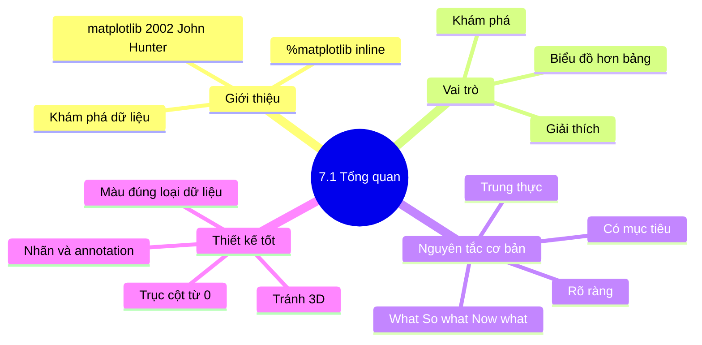

# Tổng quan và nguyên tắc thiết kế · 7.1

> **abstract** Tóm tắt
> - **Trực quan hóa dữ liệu** (data visualization) là tạo hình ảnh chứa thông tin, thường gọi là **đồ thị**. Đây là một trong những việc quan trọng nhất của phân tích dữ liệu.
> - Hai mục đích: **khám phá** (exploration) và **giải thích** (explanation).
> - Ba nguyên tắc cơ bản: **rõ ràng**, **trung thực**, **có mục tiêu**.
> - Bốn lỗi thiết kế slide nêu: cắt trục y của cột, 3D thừa, màu sai loại, thiếu nhãn/chú thích.
> - Thư viện chính của bài: **matplotlib** và **seaborn** (xây trên matplotlib).



## 7.1.1 Giới thiệu

tr. 5 · tr. 6 · tr. 7 · tr. 8

**Thuật ngữ.** Đồ thị (plot) là hình ảnh mang thông tin về dữ liệu.

Trực quan hóa là **một phần của khám phá dữ liệu**. Slide nêu các ví dụ dùng:


> **note** Bảng dạng chữ
> | Mục đích | Ví dụ |
> | --- | --- |
> | Tìm điểm ngoại lai (outlier) | Boxplot thấy một hóa đơn 30 triệu giữa các hóa đơn 2–9 triệu |
> | Gợi ý phép biến đổi dữ liệu | Histogram lệch phải mạnh → thử lấy log |
> | Tìm ý tưởng xây mô hình | Scatter thấy quan hệ gần tuyến tính → thử hồi quy tuyến tính |
> | Trình bày tương tác trên web | Biểu đồ động nhúng trang web |

**Python có nhiều thư viện**, cả biểu đồ tĩnh lẫn động. Bài giảng tập trung vào **matplotlib** và thư viện xây trên nó (**seaborn**).

**matplotlib** — những ý thi hay hỏi:


> **note** Bảng dạng chữ
> | Câu hỏi | Đáp án |
> | --- | --- |
> | Mục tiêu thiết kế | Biểu đồ chất lượng cao, phù hợp công bố và in ấn |
> | Ai khởi xướng, năm nào | **John Hunter**, năm **2002** |
> | Lấy cảm hứng từ | Giao diện vẽ giống **MATLAB** trong Python |
> | Hợp tác với | Cộng đồng **IPython** → nay là Jupyter notebook, vẽ tương tác dễ hơn |
> | Định dạng xuất | Cả **vector** (PDF, SVG) và **raster** (JPG, PNG, BMP, GIF) |

Trong Jupyter, chạy lệnh "phép thuật" (magic command) sau trong một ô để hình hiện ngay dưới ô:

```python
%matplotlib inline
```

> **warning** Dễ nhầm
> - `%matplotlib inline` là lệnh IPython/Jupyter, không phải cú pháp Python thường. Chạy trong tệp **`.py`** sẽ báo lỗi cú pháp.
> - Slide 61 còn nhắc `%matplotlib notebook` (Jupyter, hình tương tác) và `%matplotlib` (IPython shell).
> - Vector (SVG, PDF) phóng to không vỡ nét. Raster (PNG, JPG) là lưới điểm ảnh, phóng to sẽ vỡ.

> **info** Mở rộng
> Seaborn, Pandas **`.plot`** đều gọi matplotlib ở bên dưới. Vì vậy mọi hàm chỉnh trục của matplotlib (**`ax.set_title`**, **`ax.set_xlim`**) dùng được trên hình do chúng vẽ.

## 7.1.2 Vai trò của trực quan hóa

tr. 10 · tr. 11


> **note** Bảng dạng chữ
> | | Khám phá (exploration) | Giải thích (explanation) |
> | --- | --- | --- |
> | Người xem | Chính người phân tích | Người khác (sếp, khách hàng) |
> | Kiểu hình | Nhanh, giản lược, vẽ nhiều | Chọn lọc, chăm chút thiết kế |
> | Mục tiêu | "Soi" dữ liệu: xu hướng, mẫu lặp, ngoại lệ, đặt câu hỏi tiếp | Truyền **một thông điệp rõ**, nhấn kết luận chính và bối cảnh |

- **Cùng một bộ dữ liệu có thể cần hai cách vẽ khác nhau** cho hai mục đích.
- Trích Wilke: *"Visualization makes patterns of data visible that are otherwise hidden in tables."*
- Trực quan hóa vừa là **công cụ tư duy**, vừa là **kênh truyền thông**.

> **example** Ví dụ · Vì sao biểu đồ hiệu quả hơn bảng? (tr. 11)
> Slide đặt cạnh nhau một **bảng** nhiệt độ hằng ngày của 4 trạm (Chicago, San Diego, Houston, Death Valley) và một **heatmap** theo tháng. Bảng chỉ cho từng con số. Heatmap cho thấy ngay: Death Valley nóng nhất vào mùa hè, Chicago lạnh nhất mùa đông, San Diego gần như ổn định quanh năm.

> **question** Tự kiểm tra
> Bạn vẽ 20 histogram nhanh để tìm biến lệch. Đó là mục đích gì?
> > Khám phá. Hình phục vụ chính người phân tích, chưa cần chăm chút.

## 7.1.3 Các nguyên tắc cơ bản

tr. 13 · tr. 14 · tr. 15


> **note** Bảng dạng chữ
> | Nguyên tắc | Làm gì | Tránh gì |
> | --- | --- | --- |
> | **Rõ ràng** | Mã hóa phù hợp: **vị trí/độ dài tốt hơn góc/diện tích**. Dùng màu tiết kiệm để phân nhóm hoặc nhấn mạnh | 3D không cần thiết, hiệu ứng rườm rà, tỷ lệ trục méo |
> | **Trung thực** | Ghi **đơn vị** và **nguồn dữ liệu** | "Bẻ" trục gây hiểu lầm, cắt bớt bối cảnh cần thiết |
> | **Có mục tiêu** | Mỗi biểu đồ trả lời **một câu hỏi cụ thể**. Tiêu đề là **thông điệp** | Tiêu đề mô tả máy móc ("Biểu đồ doanh thu") |

Trích Wilke: *"Good visualizations show the data clearly. Bad visualizations obscure it, or worse, mislead."* → Ưu tiên **nội dung và khả dụng trước, thẩm mỹ sau**.

**Kể chuyện bằng dữ liệu.** Một biểu đồ tốt cô đọng câu chuyện mà hàng trăm dòng chữ khó truyền đạt:


> **note** Bảng dạng chữ
> | Lĩnh vực | Ý nghĩa của biểu đồ |
> | --- | --- |
> | Khoa học | Minh họa giả thuyết và kết quả thí nghiệm |
> | Kinh doanh | Làm rõ hiệu quả, nguyên nhân gốc rễ, lựa chọn chiến lược |
> | Truyền thông | Giúp nắm vấn đề phức tạp nhanh và đúng |

**Hãy dùng** (tr. 15): tiêu đề mang thông điệp · chú thích/annotation dẫn mắt người xem · điểm nhấn bằng màu tiết kiệm. Câu chuyện thuyết phục là câu chuyện **đúng dữ liệu, đúng bối cảnh, đúng khán giả**.

> **example** Ví dụ · Tiêu đề máy móc và tiêu đề thông điệp
> - Máy móc: "Doanh thu theo quý 2025".
> - Thông điệp: "Doanh thu quý 4 tăng 30% nhờ kênh online".

> **tip** Mẹo thi
> Câu hỏi "mã hóa nào chính xác nhất" → **vị trí trên trục chung**, rồi **độ dài**. Góc (pie) và diện tích (bong bóng) kém chính xác hơn.

## 7.1.4 Nguyên tắc thiết kế tốt

tr. 17 · tr. 18 · tr. 19 · tr. 20 · tr. 21

- **Thiết kế tốt** = dữ liệu rõ, người xem hiểu nhanh, không bị lừa bởi hình thức.
- **Thiết kế xấu** = dữ liệu bị che giấu, gây nhầm lẫn, làm người xem hiểu sai.
- Wilke: *"Good design makes data clear. Bad design hides or misleads."*

### Lỗi 1 · Trục y của cột không bắt đầu từ 0

Hai cột 100 và 110. Trục y bắt đầu từ 90.

1. Phần cột nhìn thấy: $100-90=10$ và $110-90=20$.
2. Mắt so độ dài: cột sau "gấp đôi".
3. Thực tế chỉ hơn $\frac{110-100}{100}=10\%$.

→ Chênh lệch nhỏ bị **thổi phồng**. Biểu đồ cột mã hóa bằng **chiều dài**, nên phải bắt đầu từ 0.

> **warning** Dễ nhầm
> Quy tắc "trục từ 0" áp dụng cho **cột/thanh** (đọc chiều dài). Với **biểu đồ đường** hay scatter, ta đọc vị trí và độ dốc, nên có thể thu hẹp trục để thấy biến động — miễn là ghi rõ thang đo.

### Lỗi 2 · 3D không cần thiết

3D làm **mất độ chính xác**, khó so chiều cao hoặc diện tích (phối cảnh làm phần gần trông to hơn). Tạo cảm giác "ấn tượng" nhưng hiếm khi thêm giá trị phân tích.

### Lỗi 3 · Dùng màu sai


> **note** Bảng dạng chữ
> | Loại dữ liệu | Bảng màu | Ví dụ |
> | --- | --- | --- |
> | Phân loại (categorical) | **Định tính** (qualitative): các màu khác biệt rõ | Kênh Web / Quầy / App |
> | Liên tục (sequential) | Thang **nhạt → đậm** | Mật độ dân số |
> | Hai cực (diverging) | Thang **đối xứng**, ví dụ xanh – trắng – đỏ | Tương quan từ −1 đến +1, lãi/lỗ quanh 0 |

**Tránh**: quá nhiều màu gây rối · màu không thân thiện với người **mù màu** (colorblind), ví dụ cặp đỏ–xanh lá.

### Lỗi 4 · Thiếu nhãn và chú thích (Labels & Annotations)

- Có **tiêu đề rõ**, **tên trục**, **đơn vị đo**.
- Hạn chế viết tắt khó hiểu: "GDP per capita" thay vì "GDPpc".
- Tránh legend rời rạc → **gắn nhãn trực tiếp** lên biểu đồ nếu có thể.
- Annotation dẫn mắt người xem tới điểm quan trọng.

> **question** Tự kiểm tra
> 1. Heatmap ma trận tương quan nên dùng bảng màu nào?
> > Diverging (đối xứng quanh 0), vì tương quan có hai cực âm và dương.
> 2. Một báo cáo vẽ cột 3D đẹp mắt. Vấn đề chính là gì?
> > 3D làm sai lệch cảm nhận chiều cao, khó so sánh chính xác, không thêm thông tin.
> 3. Biểu đồ có legend 8 màu ở góc. Slide gợi ý cải thiện thế nào?
> > Giảm số màu, và gắn nhãn trực tiếp cạnh từng đường/cột thay cho legend rời.

**Áp dụng ở.** F701 Chọn loại biểu đồ theo câu hỏi · F711 Đọc biểu đồ cột, đường và tỷ lệ · Tiếp theo: [01 Chương 07 - Chọn và đọc biểu đồ](01%20Ch%C6%B0%C6%A1ng%2007%20-%20Ch%E1%BB%8Dn%20v%C3%A0%20%C4%91%E1%BB%8Dc%20bi%E1%BB%83u%20%C4%91%E1%BB%93.md).
