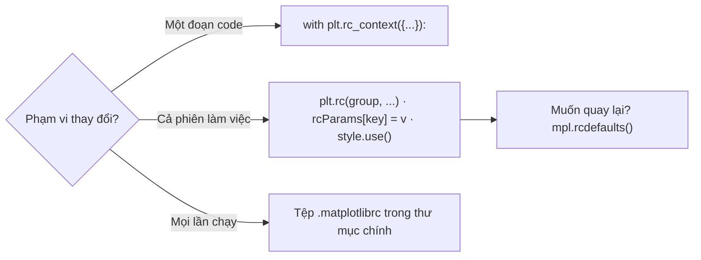

# Trục, chú giải, lưu hình và cấu hình · 7.3.4–7.3.6

> **abstract** Tóm tắt
> - Mỗi hàm **`plt.xxx`** chỉnh trục ứng với cặp **`ax.get_xxx` / `ax.set_xxx`**. Gọi không đối số → **đọc**; có đối số → **đặt**.
> - **`ax.set(...)`** đặt nhiều thuộc tính một lần.
> - Chú giải: `label=` khi vẽ + **`ax.legend(loc=...)`**. Chữ: **`ax.text`**. Mũi tên: **`ax.annotate(xy, xytext, arrowprops)`**. Hình: **`ax.add_patch(...)`**.
> - Lưu: **`fig.savefig(fname, dpi, bbox_inches, transparent, format, ...)`**.
> - Cấu hình toàn cục: **`rc()`**, `rcParams`, **`style.use()`**, tệp `matplotlibrc`, **`rc_context()`**; về mặc định: **`rcdefaults()`**.

## 7.3.4 Thao tác với trục

tr. 100 · tr. 101

Hầu hết trang trí đồ thị truy cập qua **phương thức của đối tượng Axes**.

[](../../diagrams/07%20Tr%E1%BB%B1c%20quan%20h%C3%B3a/B%E1%BA%A3ng%20tr%E1%BB%B1c%20quan/C7%2008%20Ch%C6%B0%C6%A1ng%2007%20-%20Tr%E1%BB%A5c%20ch%C3%BA%20gi%E1%BA%A3i%20l%C6%B0u%20h%C3%ACnh%20v%C3%A0%20%E2%80%93%20b%E1%BA%A3ng%201.excalidraw.md)

> **note** Bảng dạng chữ
> | Nhóm | Hàm pyplot | Trên Axes |
> | --- | --- | --- |
> | Phạm vi | *`xlim`*, *`ylim`* | **`ax.get_xlim`** / **`ax.set_xlim`**, **`ax.get_ylim`** / **`ax.set_ylim`** |
> | Vị trí vạch chia | *`xticks`*, *`yticks`* | **`ax.get_xticks`** / **`ax.set_xticks`**, ... |
> | Nhãn vạch chia | `xticklabels`, `yticklabels` | **`ax.get_xticklabels`** / **`ax.set_xticklabels`**, ... |
> | Nhãn trục | *`xlabel`*, *`ylabel`* | **`ax.get_xlabel`** / **`ax.set_xlabel`**, ... |
> | Tiêu đề | *`title`* | **`ax.get_title`** / **`ax.set_title`** |

**Hai cách gọi:**
- Không đối số → trả giá trị hiện tại: **`plt.xlim()`** trả phạm vi trục x.
- Có đối số → đặt giá trị: **`plt.xlim([0, 10])`** đặt trục x từ 0 đến 10.

Các hàm **`plt.xxx`** tác động lên **Axes đang hoạt động hoặc vừa tạo gần nhất**.

```python
fig, ax = plt.subplots()
ax.plot([2, 4, 3, 5])
print(ax.get_xlim())    # (-0.15, 3.15)  — tự thêm lề 5%
ax.set_xlim([0, 10])
print(ax.get_xlim())    # (0.0, 10.0)
```

> **warning** Dễ nhầm
> Với nhiều subplot, **`plt.title("...")`** chỉ đặt tiêu đề cho **ô vừa tạo gần nhất**. Muốn ô cụ thể → `axes[0, 1].set_title(...)`.

### Vạch chia: set_xticks và set_xticklabels

tr. 102 · tr. 103 · tr. 104

[](../../diagrams/07%20Tr%E1%BB%B1c%20quan%20h%C3%B3a/B%E1%BA%A3ng%20tr%E1%BB%B1c%20quan/C7%2008%20Ch%C6%B0%C6%A1ng%2007%20-%20Tr%E1%BB%A5c%20ch%C3%BA%20gi%E1%BA%A3i%20l%C6%B0u%20h%C3%ACnh%20v%C3%A0%20%E2%80%93%20b%E1%BA%A3ng%202.excalidraw.md)

> **note** Bảng dạng chữ
> | Phương thức | Tham số |
> | --- | --- |
> | **`ax.set_xticks(ticks, minor=False)`** | `ticks`: **danh sách vị trí** (bắt buộc). *`minor=True`* → tick phụ |
> | **`ax.set_xticklabels(labels, fontdict=None, minor=False, rotation=None, ha=None, **kwargs)`** | *`labels`*: **chuỗi** tương ứng từng tick. *`rotation`*: xoay (độ). *`ha`*: căn ngang. kwargs: fontsize, color... |

```python
fig, ax = plt.subplots()
ax.plot(np.random.standard_normal(1000).cumsum())     # bước đi ngẫu nhiên 1000 bước
ticks = ax.set_xticks([0, 250, 500, 750, 1000])
labels = ax.set_xticklabels(["one", "two", "three", "four", "five"], rotation=30, fontsize=8)
```

Từng bước: (1) đặt 5 **vị trí**; (2) thay số bằng 5 **chữ**, xoay **30°**, cỡ 8. Số nhãn phải bằng số tick.

> **warning** Dễ nhầm
> **`set_xticks`** = **ở đâu**. **`set_xticklabels`** = **ghi gì**. Gọi **`set_xticklabels`** trước khi cố định vị trí dễ làm nhãn lệch tick.

### Nhãn trục và tiêu đề

tr. 105 · tr. 106 · tr. 107

[](../../diagrams/07%20Tr%E1%BB%B1c%20quan%20h%C3%B3a/B%E1%BA%A3ng%20tr%E1%BB%B1c%20quan/C7%2008%20Ch%C6%B0%C6%A1ng%2007%20-%20Tr%E1%BB%A5c%20ch%C3%BA%20gi%E1%BA%A3i%20l%C6%B0u%20h%C3%ACnh%20v%C3%A0%20%E2%80%93%20b%E1%BA%A3ng%203.excalidraw.md)

> **note** Bảng dạng chữ
> | Phương thức | Tham số riêng | Ví dụ |
> | --- | --- | --- |
> | **`ax.set_xlabel(xlabel, fontdict, labelpad, loc, **kw)`** | `labelpad`: khoảng cách nhãn–trục. *`loc`*: `'left'/'center'/'right'` | **`ax.set_xlabel("Thời gian (năm)", fontsize=12, labelpad=10, loc='center')`** |
> | **`ax.set_ylabel(ylabel, fontdict, labelpad, loc, **kw)`** | như trên (với y, loc là `'bottom'/'center'/'top'`) | **`ax.set_ylabel("Doanh số", fontsize=12, labelpad=10, loc='center')`** |
> | **`ax.set_title(label, fontdict, loc, pad, **kw)`** | `pad`: khoảng cách tiêu đề–biểu đồ | **`ax.set_title("Doanh thu theo quý", fontsize=14, pad=12, loc='center')`** |

> **tip** Mẹo thi
> Nhãn trục dùng **`labelpad`**, tiêu đề dùng **`pad`**. Cả hai có *`loc`* để căn lề.

### ax.set() — đặt nhiều thứ một lần

tr. 108 · tr. 109

Nhận: `xlabel, ylabel, title, xlim, ylim, xticks, yticks, xticklabels, yticklabels, **kwargs`.

```python
fig, ax = plt.subplots()
ax.plot([2, 4, 3, 5])
ax.set(title="Biểu đồ mẫu", xlabel="Thời gian", ylabel="Giá trị",
       xlim=(0, 5), ylim=(0, 6), xticks=[0, 1, 2, 3, 4], yticks=[0, 2, 4, 6])
```

Tương đương gọi lần lượt **`set_title`**, `set_xlabel`, `set_ylabel`, **`set_xlim`**, ... Viết gọn hơn.

## 7.3.5 Chú giải và chú thích

### Legend

tr. 110 · tr. 112

Cách đơn giản nhất: truyền **`label=`** khi vẽ từng phần, rồi gọi **`legend()`**.

```python
fig, ax = plt.subplots()
ax.plot(np.random.randn(1000).cumsum(), color="black", label="one")
ax.plot(np.random.randn(1000).cumsum(), color="black", linestyle="dashed", label="two")
ax.plot(np.random.randn(1000).cumsum(), color="black", linestyle="dotted", label="three")
ax.legend()
```

Ba đường cùng màu đen → phân biệt bằng **kiểu nét**. Legend hiện 3 dòng "one / two / three".

[](../../diagrams/07%20Tr%E1%BB%B1c%20quan%20h%C3%B3a/B%E1%BA%A3ng%20tr%E1%BB%B1c%20quan/C7%2008%20Ch%C6%B0%C6%A1ng%2007%20-%20Tr%E1%BB%A5c%20ch%C3%BA%20gi%E1%BA%A3i%20l%C6%B0u%20h%C3%ACnh%20v%C3%A0%20%E2%80%93%20b%E1%BA%A3ng%204.excalidraw.md)

> **note** Bảng dạng chữ
> | Tham số **`legend()`** | Ý nghĩa |
> | --- | --- |
> | *`loc`* | Vị trí (tự động hoặc chỉ định) |
> | *`labels`* | Danh sách tên hiển thị |
> | *`title`* | Tiêu đề chú giải |
> | *`fontsize`* | Cỡ chữ |
> | `frameon` | Có khung (True/False) |
> | `shadow` | Đổ bóng |
> | `bbox_to_anchor` | Đặt vị trí tùy ý bằng tọa độ (có thể ra ngoài Axes) |

| *`loc`* chữ | Số | Vị trí |
| --- | --- | --- |
| `'best'` (mặc định) | 0 | Tự động chỗ ít che dữ liệu nhất |
| `'upper right'` | 1 | Trên phải |
| `'upper left'` | 2 | Trên trái |
| `'lower left'` | 3 | Dưới trái |
| `'lower right'` | 4 | Dưới phải |
| `'right'` | 5 | Phía phải |
| `'center left'` | 6 | Giữa trái |
| `'center right'` | 7 | Giữa phải |
| `'lower center'` | 8 | Dưới giữa |
| `'upper center'` | 9 | Trên giữa |
| `'center'` | 10 | Chính giữa |

> **tip** Mẹo nhớ mã `loc`
> 1→4 đi **ngược chiều kim đồng hồ** từ góc trên phải: trên phải (1) → trên trái (2) → dưới trái (3) → dưới phải (4). Sau đó 5 right, 6–7 center left/right, 8–9 lower/upper center, 10 center.

> **warning** Dễ nhầm
> Vẽ mà **không có `label=`** rồi gọi **`legend()`** → legend trống (kèm cảnh báo "No artists with labels"). Nhãn bắt đầu bằng `_` cũng bị bỏ qua.

### Chèn chữ: ax.text()

tr. 113

```python
ax.text(x, y, string, fontdict=None, withdash=False, **kwargs)
font_settings = {"fontsize": 12, "fontweight": "bold", "family": "serif", "color": "blue"}
ax.text(1, 2, "Nội dung", fontdict=font_settings)
```

- `x, y`: vị trí chữ (tọa độ **dữ liệu**).
- *`fontdict`*: dict kiểu chữ.
- *`withdash`* (hiếm dùng): vẽ gạch nhỏ nối chữ với điểm dữ liệu.
- **kwargs** (dùng rất nhiều):

[](../../diagrams/07%20Tr%E1%BB%B1c%20quan%20h%C3%B3a/B%E1%BA%A3ng%20tr%E1%BB%B1c%20quan/C7%2008%20Ch%C6%B0%C6%A1ng%2007%20-%20Tr%E1%BB%A5c%20ch%C3%BA%20gi%E1%BA%A3i%20l%C6%B0u%20h%C3%ACnh%20v%C3%A0%20%E2%80%93%20b%E1%BA%A3ng%205.excalidraw.md)

> **note** Bảng dạng chữ
> | Thuộc tính | Ý nghĩa |
> | --- | --- |
> | *`fontsize`* | Cỡ chữ |
> | *`color`* | Màu chữ |
> | *`family`* | Font |
> | `style` | `'normal'`, `'italic'` |
> | `weight` | `'bold'`, `'light'`, `'normal'`... |
> | *`rotation`* | Xoay (0, 45, 90...) |
> | *`ha`* / `horizontalalignment` | `'left'`, `'center'`, `'right'` |
> | `va` / *`verticalalignment`* | `'top'`, `'center'`, `'bottom'`, `'baseline'` |
> | `bbox` | Hộp nền cho chữ |
> | *`alpha`* | Độ trong suốt 0–1 |

> **info** Mở rộng
> *`withdash`* đã bị **gỡ khỏi matplotlib mới** (từ 3.3). Chạy **`ax.text(..., withdash=False)`** trên bản mới sẽ báo lỗi thuộc tính lạ. Đề thi theo slide thì vẫn coi là một tham số.

### Chú thích có mũi tên: ax.annotate()

tr. 114 · tr. 115

```python
ax.annotate("Nội dung chú thích",
            xy=(x_data, y_data),        # ĐIỂM được chỉ (đầu mũi tên)
            xytext=(x_text, y_text),    # NƠI đặt chữ (đuôi mũi tên)
            arrowprops=dict(arrowstyle="->", lw=1.5))
```

[](../../diagrams/07%20Tr%E1%BB%B1c%20quan%20h%C3%B3a/Annotate%20xy%20v%C3%A0%20xytext.excalidraw.md)

> **example** Ví dụ slide · Khủng hoảng tài chính 2008 (chỉ số S&P 500)
> ```python
> fig, ax = plt.subplots(figsize=(12, 6))
> data = pd.read_csv("spx.csv", index_col=0, parse_dates=True)
> spx = data["SPX"]
> spx.plot(ax=ax, color="black")
> crisis_data = [(datetime(2007, 10, 11), "Peak of bull market"),
>                (datetime(2008, 3, 12), "Bear Stearns Fails"),
>                (datetime(2008, 9, 15), "Lehman Bankruptcy")]
> for date, label in crisis_data:
>     ax.annotate(label, xy=(date, spx.asof(date) + 75),
>                 xytext=(date, spx.asof(date) + 225),
>                 arrowprops=dict(facecolor="black", headwidth=4, width=2, headlength=4),
>                 horizontalalignment="left", verticalalignment="top")
> ax.set_xlim(["1/1/2007", "1/1/2011"])     # zoom 2007–2010
> ax.set_ylim([600, 1800])
> ax.set_title("Important dates in the 2008–2009 financial crisis")
> ```
> Từng bước:
> 1. **`spx.asof(date)`**: giá trị gần nhất **tại hoặc trước** ngày đó (ngày nghỉ vẫn có giá).
> 2. Đầu mũi tên ở **+75** trên đường giá, chữ ở **+225** → mũi tên dài 150 điểm, chỉ xuống.
> 3. **`set_xlim`**/**`set_ylim`** phóng to giai đoạn khủng hoảng.
>
> (Slide thiếu dấu `)` đóng `ax.annotate(` — lỗi gõ.)

### Thêm hình (patches)

tr. 116 · tr. 117

Hai bước: **tạo đối tượng patch** → **`ax.add_patch(patch)`**.

```python
fig, ax = plt.subplots()
rect = plt.Rectangle((0.2, 0.75), 0.4, 0.15, color="black", alpha=0.3)   # góc dưới-trái, rộng, cao
circ = plt.Circle((0.7, 0.2), 0.15, color="blue", alpha=0.3)            # tâm, bán kính
pgon = plt.Polygon([[0.15, 0.15], [0.35, 0.4], [0.2, 0.6]], color="green", alpha=0.5)  # các đỉnh
print(type(rect))      # <class 'matplotlib.patches.Rectangle'>
ax.add_patch(rect); ax.add_patch(circ); ax.add_patch(pgon)
```

Dùng module `matplotlib.patches` (tr. 117):

```python
import matplotlib.patches as patches
fig, ax = plt.subplots(figsize=(6, 6))
rect = patches.Rectangle((1, 1), 2, 1, linewidth=2, edgecolor='red', facecolor='none')  # chỉ viền đỏ
circle = patches.Circle((3, 3), 0.5, color='green', alpha=0.5)
ellipse = patches.Ellipse((4, 2), 1.5, 0.8, color='purple', alpha=0.3)   # tâm, rộng, cao
arrow = patches.FancyArrow(0, 5, 2, -1, width=0.1, color='orange')       # gốc (0,5), dx=2, dy=-1
for p in (rect, circle, ellipse, arrow):
    ax.add_patch(p)
ax.set_xlim(0, 6); ax.set_ylim(0, 6)
ax.set_title("Thêm các hình dạng vào biểu đồ")
```

[](../../diagrams/07%20Tr%E1%BB%B1c%20quan%20h%C3%B3a/B%E1%BA%A3ng%20tr%E1%BB%B1c%20quan/C7%2008%20Ch%C6%B0%C6%A1ng%2007%20-%20Tr%E1%BB%A5c%20ch%C3%BA%20gi%E1%BA%A3i%20l%C6%B0u%20h%C3%ACnh%20v%C3%A0%20%E2%80%93%20b%E1%BA%A3ng%206.excalidraw.md)

> **note** Bảng dạng chữ
> | Patch | Tham số đầu |
> | --- | --- |
> | **`Rectangle`** | `(x, y)` góc **dưới trái**, *`width`*, *`height`* |
> | **`Circle`** | `(x, y)` **tâm**, `radius` |
> | **`Ellipse`** | `(x, y)` tâm, *`width`*, *`height`* (đường kính, không phải bán kính) |
> | **`Polygon`** | Danh sách các đỉnh |
> | **`FancyArrow`** | `x, y, dx, dy` |

> **warning** Dễ nhầm
> **`add_patch`** **không tự chỉnh giới hạn trục** như **`plot`**. Patch nằm ngoài [0, 1] mặc định sẽ không thấy → phải `set_xlim/set_ylim` (vì vậy ví dụ 117 đặt 0–6).

## 7.3.6 Lưu đồ thị bằng savefig

tr. 118 · tr. 119

```python
fig.savefig(fname, dpi=None, facecolor='w', edgecolor='w', orientation='portrait',
            transparent=False, bbox_inches=None, pad_inches=0.1, format=None, metadata=None)
```

[](../../diagrams/07%20Tr%E1%BB%B1c%20quan%20h%C3%B3a/B%E1%BA%A3ng%20tr%E1%BB%B1c%20quan/C7%2008%20Ch%C6%B0%C6%A1ng%2007%20-%20Tr%E1%BB%A5c%20ch%C3%BA%20gi%E1%BA%A3i%20l%C6%B0u%20h%C3%ACnh%20v%C3%A0%20%E2%80%93%20b%E1%BA%A3ng%207.excalidraw.md)

> **note** Bảng dạng chữ
> | Tham số | Ý nghĩa |
> | --- | --- |
> | `fname` | Tên/đường dẫn tệp: `"output.png"`, `"charts/my_plot.pdf"` |
> | *`dpi`* | Điểm ảnh mỗi inch. Mặc định khoảng **100**, in ấn thường **300** |
> | *`facecolor`* | Màu nền figure (mặc định trắng `'w'`) |
> | *`edgecolor`* | Màu viền figure |
> | *`transparent`* | `True` → nền trong suốt |
> | *`bbox_inches`* | `"tight"` → cắt khoảng trắng thừa quanh hình |
> | *`pad_inches`* | Lề khi dùng *`bbox_inches="tight"`* (mặc định 0.1) |
> | *`format`* | Định dạng khi `fname` **không có đuôi** |
> | *`metadata`* | Thông tin meta (tác giả, mô tả) |

```python
fig, ax = plt.subplots()
ax.plot(np.random.standard_normal(30).cumsum(), color="black", linestyle="dashed", marker="o")
fig.savefig("figpath.svg")                 # đuôi .svg → định dạng vector SVG
# fig.savefig("figpath.png", dpi=400)      # PNG raster 400 dpi
```

> **example** Tính kích thước ảnh
> *`figsize=(6.4, 4.8)`* lưu với *`dpi=400`* → $6.4 \times 400 = 2560$ × $4.8 \times 400 = 1920$ điểm ảnh.

> **warning** Dễ nhầm
> - Định dạng suy ra từ **đuôi tên tệp**; `format=` chỉ cần khi tên không có đuôi.
> - Gọi **`savefig`** **trước** **`plt.show()`**. Sau **`show()`** (ở chế độ script) figure có thể đã đóng → lưu ra ảnh trắng.
> - *`dpi`* chỉ có ý nghĩa với ảnh **raster** (PNG, JPG). SVG/PDF là vector.

## 7.3.6 Cấu hình Matplotlib

tr. 120 · tr. 121

matplotlib có sẵn lược đồ màu và giá trị mặc định. Hầu hết đều chỉnh được qua **tham số toàn cục**: kích thước hình, khoảng cách subplot, màu, cỡ chữ, kiểu lưới...

[](../../diagrams/07%20Tr%E1%BB%B1c%20quan%20h%C3%B3a/B%E1%BA%A3ng%20tr%E1%BB%B1c%20quan/C7%2008%20Ch%C6%B0%C6%A1ng%2007%20-%20Tr%E1%BB%A5c%20ch%C3%BA%20gi%E1%BA%A3i%20l%C6%B0u%20h%C3%ACnh%20v%C3%A0%20%E2%80%93%20b%E1%BA%A3ng%208.excalidraw.md)

> **note** Bảng dạng chữ
> | Cách | Dùng khi | Ví dụ |
> | --- | --- | --- |
> | **`matplotlib.rc()`** | Thay **từng nhóm** thuộc tính | **`plt.rc('font', size=12)`** |
> | `matplotlib.rcParams` | Truy cập/sửa **trực tiếp** cấu hình toàn cục theo khóa | `plt.rcParams['figure.figsize'] = [8, 5]` |
> | **`matplotlib.style.use()`** | Áp **phong cách có sẵn** | **`plt.style.use('ggplot')`** |
> | Tệp `matplotlibrc` | Thiết lập **vĩnh viễn** cho cả môi trường | đặt trong thư mục cấu hình |
> | `with plt.rc_context():` | Cấu hình **tạm thời** cho một đoạn code | — |



### rc()

tr. 122 · tr. 123 · tr. 124 · tr. 125

```python
mpl.rc(group, **kwargs)
plt.rc("figure", figsize=(10, 10))      # kích thước mặc định 10 × 10 inch
```

Đối số đầu là **thành phần** cần chỉnh, sau đó là tham số từ khóa.

[](../../diagrams/07%20Tr%E1%BB%B1c%20quan%20h%C3%B3a/B%E1%BA%A3ng%20tr%E1%BB%B1c%20quan/C7%2008%20Ch%C6%B0%C6%A1ng%2007%20-%20Tr%E1%BB%A5c%20ch%C3%BA%20gi%E1%BA%A3i%20l%C6%B0u%20h%C3%ACnh%20v%C3%A0%20%E2%80%93%20b%E1%BA%A3ng%209.excalidraw.md)

> **note** Bảng dạng chữ
> | Nhóm | Ý nghĩa | Tham số ví dụ |
> | --- | --- | --- |
> | `'font'` | Font chữ | family, style, size, weight |
> | `'axes'` | Trục tọa độ | titlesize, labelsize, grid, facecolor |
> | `'lines'` | Đường vẽ | linewidth, linestyle, color, marker |
> | `'legend'` | Chú giải | fontsize, loc, frameon |
> | `'figure'` | Hình tổng thể | figsize, dpi, facecolor |
> | `'grid'` | Lưới | color, linestyle, alpha |
> | `'xtick'`, `'ytick'` | Nhãn trục X/Y | labelsize, direction, color |

```python
mpl.rc('font', family='sans-serif', size=11)
mpl.rc('axes', titlesize=14, labelsize=12, facecolor='#f7f7f7', grid=True)
mpl.rc('lines', linewidth=2)
mpl.rc('grid', linestyle='--', alpha=0.6)
mpl.rc('legend', fontsize=10, loc='best')
plt.plot([1, 2, 3, 4], [1, 4, 9, 16], label='y = x²')
```

Tra nhanh (tr. 124): **`mpl.rc('font', family='serif', size=12)`** · **`mpl.rc('axes', titlesize=14, labelsize=12)`** · **`mpl.rc('lines', linewidth=2, linestyle='--')`** · **`mpl.rc('legend', fontsize=10, loc='best')`** · **`mpl.rc('figure', figsize=[8,5], dpi=100)`**.

Viết gọn nhiều tùy chọn (tr. 125): **`plt.rc("font", family="monospace", weight="bold", size=8)`**. Có thể gom thành dict rồi giải nén: **`plt.rc("font", **font_options)`**.

Quay về mặc định: **`mpl.rcdefaults()`**.

### Tệp matplotlibrc và seaborn

tr. 126 · tr. 127

- matplotlib kèm tệp cấu hình **`matplotlibrc`** trong thư mục `matplotlib/mpl-data`.
- Sửa tệp này, đặt vào **thư mục chính** với tên **`.matplotlibrc`** → tự nạp mỗi lần dùng matplotlib.
- **Seaborn** có các chủ đề (theme) dựng sẵn, bên trong dùng chính hệ cấu hình của matplotlib.
- Mọi cài đặt hiện tại nằm trong dict **`plt.rcParams`**; khôi phục bằng **`plt.rcdefaults()`**.

### rcParams

tr. 128 · tr. 129 · tr. 130

`mpl.rcParams` là **từ điển cấu hình toàn cục**: chứa mọi cặp khóa–giá trị. Xem/sửa thiết lập mặc định mà không chỉnh từng biểu đồ.

[](../../diagrams/07%20Tr%E1%BB%B1c%20quan%20h%C3%B3a/B%E1%BA%A3ng%20tr%E1%BB%B1c%20quan/C7%2008%20Ch%C6%B0%C6%A1ng%2007%20-%20Tr%E1%BB%A5c%20ch%C3%BA%20gi%E1%BA%A3i%20l%C6%B0u%20h%C3%ACnh%20v%C3%A0%20%E2%80%93%20b%E1%BA%A3ng%2010.excalidraw.md)

> **note** Bảng dạng chữ
> | Tác vụ | Cú pháp |
> | --- | --- |
> | Xem toàn bộ | **`mpl.rcParams.keys()`** |
> | Xem một giá trị | `mpl.rcParams['font.size']` |
> | Đổi một giá trị | `mpl.rcParams['font.size'] = 14` |
> | Cập nhật nhiều | **`mpl.rcParams.update({...})`** |
> | Về mặc định | **`mpl.rcdefaults()`** |
> | Lưu ra tệp | Ghi ra **`.mplstyle`** hoặc **`.matplotlibrc`** |

Khóa phổ biến — dạng **`'nhóm.thuộc_tính'`**:

[](../../diagrams/07%20Tr%E1%BB%B1c%20quan%20h%C3%B3a/B%E1%BA%A3ng%20tr%E1%BB%B1c%20quan/C7%2008%20Ch%C6%B0%C6%A1ng%2007%20-%20Tr%E1%BB%A5c%20ch%C3%BA%20gi%E1%BA%A3i%20l%C6%B0u%20h%C3%ACnh%20v%C3%A0%20%E2%80%93%20b%E1%BA%A3ng%2011.excalidraw.md)

> **note** Bảng dạng chữ
> | Nhóm | Khóa | Ý nghĩa | Ví dụ |
> | --- | --- | --- | --- |
> | Figure | `'figure.figsize'` · `'figure.dpi'` | Kích thước (inch) · độ phân giải | `[8, 6]` · `100` |
> | Font | `'font.size'` · `'font.family'` | Cỡ chữ · họ font | `12` · `'serif'`, `'sans-serif'`, `'monospace'` |
> | Axes | `'axes.titlesize'` · `'axes.labelsize'` · `'axes.grid'` · `'axes.facecolor'` | Cỡ tiêu đề · cỡ nhãn · lưới · nền trục | `14` · `12` · `True` · `'whitesmoke'` |
> | Lines | `'lines.linewidth'` · `'lines.linestyle'` · `'lines.marker'` | Độ dày · kiểu · marker | `2` · `'--'` · `'o'` |
> | Legend | `'legend.fontsize'` · `'legend.loc'` | Cỡ chữ · vị trí | `10` · `'best'` |
> | Grid | `'grid.color'` · `'grid.linestyle'` · `'grid.alpha'` | Màu · kiểu · trong suốt | `'gray'` · `'--'` · `0.5` |
> | Ticks | `'xtick.labelsize'` · `'ytick.labelsize'` | Cỡ chữ nhãn trục | `10` |

```python
import matplotlib as mpl
mpl.rcParams['figure.figsize'] = [8, 5]
mpl.rcParams['font.size'] = 12
mpl.rcParams['axes.titlesize'] = 14
mpl.rcParams['axes.labelsize'] = 12
mpl.rcParams['lines.linewidth'] = 2
mpl.rcParams['axes.grid'] = True
mpl.rcParams['grid.alpha'] = 0.5
plt.plot([1, 2, 3, 4], [1, 4, 2, 3], label="Dữ liệu 1")
```

> **example** Giá trị mặc định (đã chạy, matplotlib 3.11)
> `figure.figsize` = `[6.4, 4.8]` · `figure.dpi` = `100.0` · `font.size` = `10.0` · `lines.linewidth` = `1.5` · `legend.loc` = `'best'` · **`axes.grid`** = `False`.

> **warning** Dễ nhầm · rc và rcParams
> - **`plt.rc('font', size=12)`** ⇔ `plt.rcParams['font.size'] = 12`. `rc` dùng **nhóm + từ khóa**, `rcParams` dùng **khóa có dấu chấm**.
> - **`rcdefaults()`** (có **s**) về mặc định. Không có **`rc.reset()`**.
> - **`style.use('grayscale')`** đổi **cả bảng màu**; `rcParams` đổi **từng khóa**.

> **question** Tự kiểm tra
> 1. Lệnh đọc giới hạn trục y hiện tại của *`ax`*?
> > **`ax.get_ylim()`** (hoặc **`plt.ylim()`** không đối số).
> 2. **`legend(loc=3)`** đặt ở đâu?
> > Dưới trái (`'lower left'`).
> 3. Trong **`annotate`**, chữ nằm ở *`xy`* hay *`xytext`*?
> > *`xytext`*. *`xy`* là điểm mũi tên chỉ tới.
> 4. Lưu ảnh cắt sát khoảng trắng, nền trong suốt, 300 dpi?
> > **`fig.savefig("a.png", dpi=300, bbox_inches="tight", transparent=True)`**.
> 5. Đặt cỡ chữ mặc định 14 bằng hai cách?
> > **`plt.rc('font', size=14)`** hoặc `mpl.rcParams['font.size'] = 14`.
> 6. Muốn đổi kiểu chỉ trong một khối code?
> > `with plt.rc_context({...}):`.

**Áp dụng ở.** F704 Giới hạn trục, vạch chia và thang log · F705 Chú thích, chữ và hình trên biểu đồ · F706 Lưu hình, dpi và cấu hình toàn cục · F703 Màu, kiểu đường, marker và chú giải · Tiếp theo: [09 Chương 07 - Pandas và Seaborn](09%20Ch%C6%B0%C6%A1ng%2007%20-%20Pandas%20v%C3%A0%20Seaborn.md).
