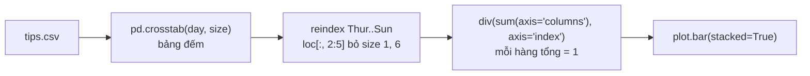

# Vẽ biểu đồ với Pandas và Seaborn · 7.4

> **abstract** Tóm tắt
> - **matplotlib** khá "cơ bản": lắp đồ thị từ từng thành phần (dữ liệu, chú giải, tiêu đề, nhãn vạch chia, chú thích). tr. 132
> - **Pandas**: **`Series.plot()`** / **`DataFrame.plot()`** — mặc định vẽ **đường**; họ phương thức `plot.bar`, `plot.barh`, `plot.hist`, `plot.density`...
> - **Seaborn**: thư viện **đồ họa thống kê cấp cao** xây trên matplotlib; **tự tổng hợp** dữ liệu trước khi vẽ (**`barplot`**, **`histplot`**, **`regplot`**, **`pairplot`**, **`catplot`**).
>
> | Mục | Pandas | Seaborn |
> | --- | --- | --- |
> | 7.4.1 Đường | **`s.plot()`**, **`df.plot()`** | — |
> | 7.4.2 Cột | `plot.bar`, `plot.barh`, *`stacked=True`*, **`value_counts().plot.bar()`** | **`sns.barplot(..., hue=)`** |
> | 7.4.3 Tần suất | **`plot.hist(bins=)`**, **`plot.density()`** | **`sns.histplot`** |
> | 7.4.4 Phân tán | — | **`sns.regplot`**, **`sns.pairplot`** |
> | 7.4.5 Lưới đa diện | — | **`sns.catplot(kind=, col=, row=, hue=)`** |

tr. 131 · tr. 133

## 7.4.1 Biểu đồ đường với Pandas

tr. 134 · tr. 135 · tr. 136

Series và DataFrame có thuộc tính **`plot`**. **Mặc định `plot()` vẽ đường.**

```python
s = pd.Series(np.random.standard_normal(10).cumsum(), index=np.arange(0, 100, 10))
s.plot()     # x = index 0, 10, ..., 90 ; y = giá trị
```

**Index của Series thành trục x** (vì *`use_index=True`* mặc định).

| Đối số | Ý nghĩa |
| --- | --- |
| *`label`* | Nhãn cho chú giải |
| *`ax`* | Subplot matplotlib để vẽ lên; không truyền → dùng subplot đang hoạt động |
| `style` | Chuỗi kiểu truyền cho matplotlib, ví dụ `"ko--"` |
| *`alpha`* | Độ trong suốt 0–1 |
| *`kind`* | `"area"`, `"bar"`, `"barh"`, `"density"`, `"hist"`, `"kde"`, `"line"`, `"pie"`; **mặc định `"line"`** |
| *`figsize`* | Kích thước hình |
| `logx`, `logy` | `True` → thang **log**; `"sym"` → log **đối xứng** cho phép giá trị âm |
| *`title`* | Tiêu đề |
| `use_index` | Dùng index làm nhãn vạch chia |
| `rot` | Xoay nhãn vạch chia (0–360) |
| *`xticks`*, *`yticks`* | Giá trị vạch chia |
| *`xlim`*, *`ylim`* | Giới hạn trục, ví dụ `[0, 10]` |
| *`grid`* | Hiện lưới (**tắt mặc định**) |

Hầu hết phương thức vẽ của pandas nhận **`ax=`** tùy chọn → đặt hình vào ô subplot bất kỳ, linh hoạt bố cục. **`s.plot()`** **trả về Axes** (đã chạy).

### DataFrame.plot

tr. 137 · tr. 138 · tr. 139

```python
df = pd.DataFrame(np.random.standard_normal((10, 4)).cumsum(0),
                  columns=["A", "B", "C", "D"], index=np.arange(0, 100, 10))
plt.style.use('styles/bluestyle.txt')   # tệp style riêng của giảng viên
df.plot()
```

- **Mỗi cột vẽ thành một đường** trên **cùng** subplot, **tự tạo chú giải**.
- **`cumsum(0)`**: cộng dồn theo **trục 0 (dọc cột)** → 4 bước đi ngẫu nhiên.

**Lưu ý (tr. 138):**
- **`plt.style.use('grayscale')`** → bảng màu hợp **in đen trắng**.
- **`plot`** là một **"họ" phương thức**: **`df.plot()` ≡ `df.plot.line()`**.
- Tham số từ khóa thừa được **chuyển tiếp** cho hàm matplotlib tương ứng.


> **note** Bảng dạng chữ
> | Tham số riêng DataFrame | Ý nghĩa |
> | --- | --- |
> | *`subplots`* | Mỗi cột vẽ ở **subplot riêng** |
> | `layouts` (thực tế: *`layout`*) | Tuple `(hàng, cột)` bố cục subplot |
> | *`sharex`* | Khi *`subplots=True`*, dùng chung trục x |
> | *`sharey`* | Khi *`subplots=True`*, dùng chung trục y |
> | **`legend`** | Thêm chú giải (mặc định True) |
> | `sort_columns` | Vẽ cột theo thứ tự chữ cái (mặc định giữ thứ tự cột) |

> **example** Small multiples bằng Pandas (đã chạy)
> ```python
> axs = df.plot(subplots=True, layout=(2, 2))
> print(axs.shape)    # (2, 2)
> ```

> **info** Mở rộng
> Tham số đúng tên là *`layout`* (slide ghi `layouts`). `sort_columns` đã bị gỡ khỏi pandas 2.x. Đề theo slide vẫn có thể hỏi ý nghĩa.

## 7.4.2 Biểu đồ cột với Pandas và Seaborn

### plot.bar và plot.barh

tr. 141 · tr. 142 · tr. 143 · tr. 144

**Index** của Series/DataFrame thành **vạch chia x** (**`bar`**) hoặc **y** (**`barh`**).

```python
fig, axes = plt.subplots(2, 1)
data = pd.Series(np.random.uniform(size=16), index=list("abcdefghijklmnop"))
data.plot.bar(ax=axes[0], color="black", alpha=0.7)    # 16 cột dọc, nhãn a..p trên trục x
data.plot.barh(ax=axes[1], color="black", alpha=0.7)   # 16 thanh ngang, nhãn trên trục y
plt.tight_layout()     # tránh subplot chồng lên nhau
```

**DataFrame**: mỗi **hàng** thành **một nhóm cột** đặt cạnh nhau, mỗi **cột** DataFrame là một màu.

```python
df = pd.DataFrame(np.random.uniform(size=(6, 4)),
                  index=["one", "two", "three", "four", "five", "six"],
                  columns=pd.Index(["A", "B", "C", "D"], name="Genus"))
ax = df.plot.bar()
print(ax.get_legend().get_title().get_text(), len(ax.patches))   # Genus 24
```

- 6 nhóm × 4 cột = **24** thanh.
- Tên `"Genus"` của index cột → **tiêu đề chú giải**.

**Xếp chồng:** **`df.plot.barh(stacked=True, alpha=0.8)`** → giá trị mỗi hàng chồng nối tiếp trong một thanh.

**Công thức hay dùng:** vẽ tần suất giá trị của Series:

```python
s = pd.Series(['a', 'b', 'a', 'c', 'a'])
s.value_counts()            # a 3, b 1, c 1
s.value_counts().plot.bar() # 3 cột cao 3, 1, 1
```

### Ví dụ tips · crosstab → tỷ lệ → stacked bar

tr. 145 · tr. 146 · tr. 147

Mục tiêu: cột xếp chồng thể hiện **% số bữa theo quy mô bàn (size)** cho mỗi ngày.



```python
tips = pd.read_csv("../data/tips.csv")
party_counts = pd.crosstab(tips["day"], tips["size"])
party_counts = party_counts.reindex(index=["Thur", "Fri", "Sat", "Sun"])   # sắp thứ tự ngày
party_counts = party_counts.loc[:, 2:5]      # ít bàn 1 và 6 người → bỏ
party_pcts = party_counts.div(party_counts.sum(axis="columns"), axis="index")
party_pcts.plot.bar(stacked=True, alpha=0.8)
```

> **example** Kiểm chứng trên dữ liệu nhỏ (8 dòng tự tạo, đã chạy)
> | day | size 2 | 3 | 4 | → tỷ lệ 2 | 3 | 4 |
> | --- | --- | --- | --- | --- | --- | --- |
> | Thur | 1 | 0 | 0 | 1.0 | 0.0 | 0.0 |
> | Fri | 1 | 1 | 0 | 0.5 | 0.5 | 0.0 |
> | Sat | 0 | 1 | 1 | 0.0 | 0.5 | 0.5 |
> | Sun | 1 | 0 | 1 | 0.5 | 0.0 | 0.5 |
>
> **`sum(axis="columns")`** = tổng **mỗi hàng**. **`div(..., axis="index")`** chia từng hàng cho tổng của chính hàng đó. Mỗi hàng cộng lại = 1.

Kết luận của slide trên dữ liệu thật: **quy mô bàn tăng vào cuối tuần**.

> **warning** Dễ nhầm
> - `loc[:, 2:5]` cắt theo **nhãn** cột (2, 3, 4, 5) và **gồm cả 5**.
> - **`sum(axis="columns")`** nghe như "tổng mỗi cột" nhưng thực ra là **cộng dọc theo các cột → một tổng cho mỗi hàng**.

### Seaborn barplot

tr. 148 · tr. 149

Dữ liệu cần **tổng hợp trước khi vẽ** → seaborn làm gọn hơn nhiều.

```python
import seaborn as sns
tips["tip_pct"] = tips["tip"] / (tips["total_bill"] - tips["tip"])   # tiền boa / hóa đơn trước boa
sns.barplot(x="tip_pct", y="day", data=tips, orient="h", alpha=0.8)
```

- Hàm seaborn nhận **`data=`** là một **DataFrame** và tên cột cho x, y.
- Mỗi thanh = **trung bình** `tip_pct` của ngày đó; vạch đen trên thanh = **khoảng tin cậy 95%** (seaborn tự tính).
- **`hue="time"`**: tách thêm theo biến phân loại → mỗi ngày có 2 thanh màu (Lunch / Dinner).

```python
sns.barplot(x="tip_pct", y="day", hue="time", data=tips, orient="h", alpha=0.8)
```

> **example** Tính tay trung bình (dữ liệu nhỏ, đã chạy)
> Một hóa đơn 17, boa 2 → $2/(17-2) = 0.133$. Trung bình `tip_pct` theo ngày: Thur 0.133 · Fri 0.165 · Sat 0.183 · Sun 0.169 → đó là chiều dài 4 thanh.

> **warning** Dễ nhầm
> - **`sns.barplot`** mặc định vẽ **trung bình**, không phải tổng, không phải số dòng. Đếm dòng → **`sns.countplot`**.
> - `plot.bar` của pandas **không tổng hợp**: vẽ đúng từng giá trị có trong bảng.
> - `tip_pct` của slide chia cho `total_bill - tip`, không phải `total_bill`.

## 7.4.3 Biểu đồ tần suất với Pandas và Seaborn

tr. 151 · tr. 152 · tr. 153

```python
tips["tip_pct"].plot.hist(bins=50)    # histogram 50 bin
tips["tip_pct"].plot.density()        # đường mật độ
```

**Đồ thị mật độ**: ước tính một **phân phối xác suất liên tục** có thể đã sinh ra dữ liệu. `plot.density` dùng ước tính **hỗn hợp các phân phối chuẩn** (kernel density estimate, **KDE**). *`kind="kde"`* và *`kind="density"`* là một.

**Seaborn `histplot`** vẽ **cả histogram và mật độ cùng lúc** (thêm *`kde=True`*). Ví dụ phân phối **hai mode** (hai đỉnh):

```python
comp1 = np.random.standard_normal(200)            # quanh 0, độ lệch chuẩn 1
comp2 = 10 + 2 * np.random.standard_normal(200)   # quanh 10, độ lệch chuẩn 2
values = pd.Series(np.concatenate([comp1, comp2]))
sns.histplot(values, bins=100)
```

Hình có **hai cụm**: một cụm hẹp cao quanh 0, một cụm rộng thấp hơn quanh 10.

> **tip** Mẹo thi
> Biến đổi chuẩn: $10 + 2Z$ có trung bình 10, độ lệch chuẩn 2. Cụm có độ lệch chuẩn lớn hơn thì **thấp và bè** hơn (cùng 200 điểm).

## 7.4.4 Đồ thị phân tán với Pandas và Seaborn

tr. 155 · tr. 156 · tr. 157 · tr. 158

Scatter dùng kiểm tra **quan hệ giữa hai chuỗi dữ liệu**. Ví dụ: chi phí quảng cáo **TV** và **doanh thu (Sales)** của các cửa hàng.

```python
path = 'https://raw.githubusercontent.com/nguyenquanghuy85/Khdl-ktkd-python/refs/heads/main/Sales%20dataset.csv'
df = pd.read_csv(path, index_col=0, parse_dates=True)
df.head()

ax = sns.regplot(x="TV", y="Sales", data=df)    # scatter + đường hồi quy tuyến tính
ax.set_title("Mối liên hệ giữa chi phí quảng cáo truyền hình và doanh thu")
```

- **`regplot`** = scatter **+ khớp đường hồi quy tuyến tính** (kèm dải tin cậy). Trả về **Axes** → chỉnh tiếp bằng **`ax.set_title`**.

**Đồ thị cặp / ma trận đồ thị phân tán** (pair plot, scatter plot matrix): xem **mọi cặp biến** cùng lúc — tự viết cần vòng lặp. Seaborn có **`pairplot`**:

```python
sns.pairplot(df, diag_kind="kde", plot_kws={"alpha": 0.8})
```

- Ô **ngoài đường chéo**: scatter từng cặp biến.
- Ô **đường chéo**: histogram hoặc **KDE** của từng biến (*`diag_kind="kde"`*).
- *`plot_kws`*: dict tham số chuyển cho hàm vẽ ngoài đường chéo (ở đây độ trong suốt 0.8).
- Trả về **PairGrid** (đã chạy).

> **warning** Dễ nhầm
> Với $k$ biến số, pairplot có lưới $k \times k$. Ô $(i, j)$ và $(j, i)$ là cùng cặp biến nhưng **đảo trục**.

## 7.4.5 Lưới đa diện và dữ liệu phân loại

tr. 160 · tr. 161 · tr. 162 · tr. 163

**Lưới đa diện** (facet grid): bố cục **hai chiều** các đồ thị, dữ liệu được **chia** theo giá trị riêng biệt của một biến trên mỗi trục (hàng/cột). Seaborn có **`catplot`** để tạo nhanh đồ thị đa diện chia theo biến phân loại.

```python
sns.catplot(x="day", y="tip_pct", hue="time", col="smoker",
            kind="bar", data=tips[tips.tip_pct < 1])
```

- *`col="smoker"`* → **2 ô theo cột** (No / Yes).
- *`hue="time"`* → trong mỗi ô, thanh **tô màu** theo Lunch/Dinner.
- `tips[tips.tip_pct < 1]` → lọc bỏ tỷ lệ boa ≥ 100% (ngoại lai).

Thay màu bằng **thêm hàng**:

```python
sns.catplot(x="day", y="tip_pct", row="time", col="smoker",
            kind="bar", data=tips[tips.tip_pct < 1])
```

→ lưới **2 hàng (time) × 2 cột (smoker)**. Đã chạy: `g.axes.shape` = `(1, 2)` với lệnh đầu, `(2, 2)` với lệnh sau. **`catplot`** trả về **FacetGrid**.


*`kind`* còn có `"box"`, `"violin"`, `"strip"`, `"swarm"`, `"point"`, `"count"`... Ví dụ boxplot:

```python
sns.catplot(x="tip_pct", y="day", kind="box", data=tips[tips.tip_pct < 0.5])
```

x là số, y là danh mục → hộp **nằm ngang**, mỗi ngày một hộp.


> **note** Bảng dạng chữ
> | Tham số catplot | Tác dụng |
> | --- | --- |
> | *`hue`* | Chia nhóm bằng **màu** trong cùng ô |
> | *`col`* | Mỗi giá trị → một **cột** ô |
> | *`row`* | Mỗi giá trị → một **hàng** ô |
> | *`kind`* | Loại đồ thị trong mỗi ô (mặc định `"strip"`) |

> **question** Tự kiểm tra
> 1. **`df.plot()`** với DataFrame 4 cột vẽ gì?
> > 4 đường trên cùng một Axes, tự có chú giải A–D.
> 2. *`kind`* mặc định của pandas **`plot`**?
> > `"line"`.
> 3. Muốn trục y thang log trong pandas plot?
> > *`logy=True`* (`"sym"` nếu có giá trị âm).
> 4. **`sns.barplot`** vẽ chiều cao bằng gì theo mặc định?
> > Trung bình của biến số theo nhóm, kèm khoảng tin cậy.
> 5. **`sns.catplot(..., row="time", col="smoker")`** với time 2 giá trị, smoker 2 giá trị → bao nhiêu ô?
> > 4 ô (2 × 2).
> 6. Hàm seaborn vẽ scatter kèm đường hồi quy?
> > **`sns.regplot`** (hoặc `lmplot`).
> 7. **`pairplot(df, diag_kind="kde")`** — đường chéo hiện gì?
> > Đường mật độ KDE của từng biến.

**Áp dụng ở.** F707 Vẽ bằng Pandas – Series.plot và DataFrame.plot · F708 Seaborn – thống kê vẽ sẵn và giao diện · F710 Đọc quan hệ hai biến và tương quan · [Thực hành thêm - Bố cục chú thích và biểu đồ tỷ lệ](Th%E1%BB%B1c%20h%C3%A0nh%20th%C3%AAm%20-%20B%E1%BB%91%20c%E1%BB%A5c%20ch%C3%BA%20th%C3%ADch%20v%C3%A0%20bi%E1%BB%83u%20%C4%91%E1%BB%93%20t%E1%BB%B7%20l%E1%BB%87.md)
