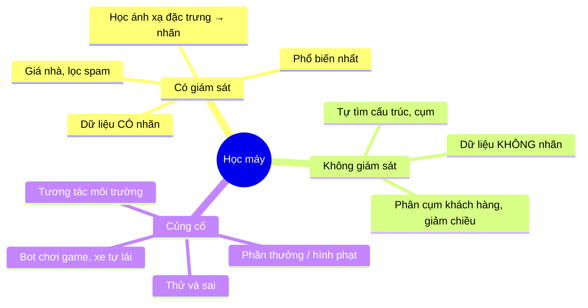
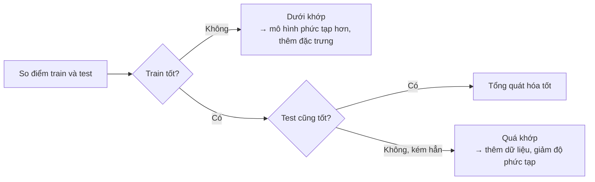
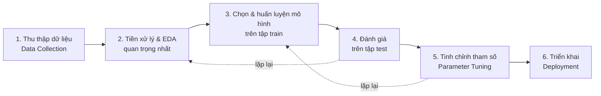
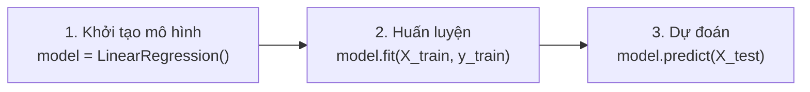

# Tổng quan học máy, train/test và rò rỉ

> **abstract** Tóm tắt
> - Học máy (Machine Learning, ML) = cho máy **học quy tắc từ dữ liệu**, thay vì lập trình viên viết tay từng quy tắc.
> - Ba loại: **có giám sát** (có nhãn), **không giám sát** (không nhãn), **củng cố** (thử–sai, nhận thưởng/phạt).
> - Bài giảng 8 chỉ học **có giám sát**: **hồi quy** (đoán số liên tục) và **phân loại** (đoán nhãn rời rạc).
> - Luôn chia **train 70–80% / test 20–30%**. Test là "đề thi cuối kỳ" mô hình chưa từng thấy.
> - Train tốt, test kém → **quá khớp**. Cả hai kém → **dưới khớp**.
> - Scikit-learn: **khởi tạo → `.fit()` → `.predict()`**.

## 1. Học máy là gì

Nguồn: tr. 6, tr. 7

**Học máy (Machine Learning, ML)** là một lĩnh vực của trí tuệ nhân tạo (AI). Nó dùng dữ liệu và thuật toán để bắt chước cách con người học, rồi cải thiện độ chính xác dần dần. Nói gọn: ta không viết quy tắc, ta "dạy" máy tự rút quy tắc từ dữ liệu.

> **example** Ví dụ slide: lọc email spam (tr. 7)
> | | Lập trình truyền thống | Học máy |
> | --- | --- | --- |
> | Cách làm | Viết tay quy tắc: có "trúng thưởng" hoặc "miễn phí 100%" → spam; người gửi trong danh bạ → không spam | Đưa cho máy hàng ngàn email **đã gắn nhãn** "spam"/"không spam" |
> | Ai tìm đặc trưng? | Con người | Máy tự học (tần suất từ, cấu trúc câu, địa chỉ gửi…) |
> | Điểm yếu | Tốn công, dễ bị email "viết khéo" lách qua | Cần dữ liệu có nhãn |
> | Email mới chưa thấy | Chỉ bắt được nếu khớp quy tắc cố định | Phát hiện được vì đã học **quy luật** |

## 2. Ba loại kỹ thuật học máy

Nguồn: tr. 8, tr. 9




> **note** Bảng dạng chữ
> | Loại | Dữ liệu | Mô hình làm gì | Ví dụ slide |
> | --- | --- | --- | --- |
> | Có giám sát (Supervised Learning) | Đã gán nhãn | Học ánh xạ từ **đặc trưng (features)** sang **nhãn (labels)** | Giá nhà (diện tích, số phòng → giá); spam/không spam |
> | Không giám sát (Unsupervised Learning) | Không nhãn | Tự tìm cấu trúc, quy luật, **cụm (cluster)** | Phân cụm khách hàng theo hành vi mua; giảm chiều dữ liệu |
> | Củng cố (Reinforcement Learning) | Tương tác với môi trường | Thử và sai, nhận **phần thưởng/hình phạt** cho mỗi hành động | Bot chơi game, xe tự lái |

> **warning** Dễ nhầm
> - "Phân cụm" (clustering) là **không giám sát**, còn "phân loại" (classification) là **có giám sát**. Phân loại cần nhãn có sẵn, phân cụm thì không.
> - Học có giám sát là loại **phổ biến nhất** (slide tr. 9 nhấn mạnh).

### Từ một bảng tới X và y


> **note** Bảng dạng chữ
> | Nhà | Diện tích m² | Số phòng | Giá đã bán, triệu đồng |
> | --- | ---: | ---: | ---: |
> | A | 40 | 1 | 1.000 |
> | B | 60 | 2 | 1.400 |
> | C | 80 | 3 | 1.900 |

- **Mẫu** là một hàng, ở đây là một căn nhà.
- **Đặc trưng** là thông tin có trước lúc dự đoán (diện tích, số phòng). Xếp thành bảng $X$ (3 hàng × 2 cột).
- **Đích/nhãn** là đáp án cần học (giá). Vector $y$ chứa 3 giá thật cùng thứ tự mẫu.
- **Mô hình** là quy tắc từ đặc trưng ra dự đoán $\hat y$ ("y mũ"). Ví dụ "20 triệu/m² + 200 triệu" cho nhà A: $40\times20+200=1.000$.

## 3. Hai dạng bài toán và năm mô hình của bài giảng

Nguồn: tr. 10, tr. 11


> **note** Bảng dạng chữ
> | Dạng | Đầu ra | Ví dụ slide |
> | --- | --- | --- |
> | **Hồi quy (Regression)** | Một **giá trị liên tục** | Nhiệt độ, giá cổ phiếu, lương, giá nhà |
> | **Phân loại (Classification)** | Một **nhãn/danh mục rời rạc** | Chó/mèo, chẩn đoán bệnh, Đạt/Trượt |


> **note** Bảng dạng chữ
> | Mô hình | Bài toán | Ý tưởng ngắn (tr. 11) |
> | --- | --- | --- |
> | Linear Regression | Hồi quy | Tìm "đường thẳng" phù hợp nhất để đoán giá trị liên tục |
> | Logistic Regression | **Phân loại** (dù tên có "Regression") | Dùng một đường (ranh giới) chia dữ liệu vào các nhóm dựa trên **xác suất** |
> | K-Nearest Neighbors (KNN) | Hồi quy & Phân loại | Dựa vào "hàng xóm" gần nhất. Phân loại → **số đông**; hồi quy → **trung bình** |
> | Decision Tree | Hồi quy & Phân loại | Cây quy tắc "nếu – thì" |
> | Random Forest | Hồi quy & Phân loại | "Bỏ phiếu" của nhiều cây; số đông quyết định để tăng độ chính xác |

> **warning** Dễ nhầm
> **Logistic Regression là mô hình phân loại.** Đề hay bẫy bằng chữ "Regression". Ngược lại, nhãn được mã hóa bằng số (0/1, mã dịch vụ 1–5) vẫn là phân loại.

> **question** Tự kiểm tra: dự đoán "nhóm giá rẻ/trung bình/đắt" là bài toán gì? Mô hình nào trong bảng **chỉ** làm được hồi quy?
> Phân loại đa lớp (nhãn rời rạc). Linear Regression chỉ dùng cho hồi quy; Logistic chỉ cho phân loại; KNN, cây, rừng làm được cả hai.

## 4. Quy tắc chia Train–Test

Nguồn: tr. 13

**Không bao giờ dùng toàn bộ dữ liệu để huấn luyện.** Chia thành:


> **note** Bảng dạng chữ
> | Tập | Tỷ lệ thường dùng | Vai trò |
> | --- | --- | --- |
> | **Tập huấn luyện (Training Set)** | 70–80% | "Dạy" mô hình |
> | **Tập kiểm tra (Test Set)** | 20–30% | Đánh giá sau khi huấn luyện xong. Giống "đề thi cuối kỳ" mô hình chưa thấy |

**Tại sao?** Để đo **khả năng tổng quát hóa**. Train tốt nhưng test kém nghĩa là mô hình **quá khớp (overfitting)**, tức "học vẹt".

> **example** Cách chia trong ví dụ slide
> Cả hai bộ dữ liệu của bài giảng có 10 quan sát: **8 điểm đầu là train, 2 điểm cuối là test** (cắt theo vị trí bằng `X[:8]`, `X[8:]`). Xem [dữ liệu hồi quy](03%20Ch%C6%B0%C6%A1ng%2008%20-%20H%E1%BB%93i%20quy%20v%C3%A0%20KNN.md) và [dữ liệu phân loại](04%20Ch%C6%B0%C6%A1ng%2008%20-%20Logistic%20c%C3%A2y%20v%C3%A0%20r%E1%BB%ABng.md).

> **info** Mở rộng: `train_test_split` (dạng câu thi rất hay gặp)
> ```python
> import numpy as np
> from sklearn.model_selection import train_test_split
> X = np.arange(20).reshape(10, 2); y = np.array([0, 1] * 5)
> X_tr, X_te, y_tr, y_te = train_test_split(X, y, random_state=42)
> print(X_tr.shape, X_te.shape)
> X_tr, X_te, y_tr, y_te = train_test_split(X, y, test_size=0.2, random_state=42, stratify=y)
> print(X_tr.shape, X_te.shape, y_te)
> ```
> Kết quả (đã chạy):
> ```text
> (7, 2) (3, 2)
> (8, 2) (2, 2) [0 1]
> ```
> - Không truyền *`test_size`* → mặc định **0.25**; số mẫu test = làm tròn **lên** $\lceil n\times\text{test\_size}\rceil$ ($\lceil 10\times0.25\rceil=3$).
> - Thứ tự trả về: **X_train, X_test, y_train, y_test**.
> - *`random_state`* cố định cách xáo; *`stratify=y`* giữ tỷ lệ lớp trong cả hai tập.

> **info** Mở rộng: tập validation và rò rỉ dữ liệu
> | Nhóm | Câu hỏi | Ví dụ |
> | --- | --- | --- |
> | Train | Mô hình học từ đâu? | Fit đường hồi quy |
> | Validation (hoặc cross-validation trong train) | Chọn cấu hình nào? | Chọn $k=1$ hay $k=3$ cho KNN |
> | Test | Cấu hình đã chốt chạy ra sao trên dữ liệu chưa dùng? | Báo cáo RMSE cuối |
>
> **Siêu tham số** đặt trước khi fit (*`n_neighbors`*, *`max_depth`*). **Tham số học được** tìm từ train (`coef_`, `intercept_`).
>
> **Rò rỉ dữ liệu (data leakage)**: quy trình học dùng thông tin lẽ ra chưa biết. Ví dụ train $x=[10,20,30]$ (mean 20), test $x=100$. Nếu chuẩn hóa bằng mean của cả 4 điểm (=40), thông tin test đã lọt vào train. Đúng: **chia trước**, **`fit`** scaler/imputer/encoder trên train, rồi **`transform`** test bằng thống kê train. Không dùng đặc trưng chỉ biết sau thời điểm dự đoán (ví dụ giá chốt sau giao dịch).


> **question** Tự kiểm tra: bạn thử nhiều $k$ rồi chọn $k$ có RMSE thấp nhất **trên test**. Sai ở đâu?
> Test đã bị dùng để chọn cấu hình, nên không còn là "đề thi chưa thấy". Chọn $k$ trên validation/cross-validation, giữ test cho lần đánh giá cuối.

## 5. Chỉ số đánh giá cơ bản

Nguồn: tr. 15


> **note** Bảng dạng chữ
> | Bài toán | Chỉ số | Công thức | Ý nghĩa |
> | --- | --- | --- | --- |
> | Hồi quy | **MSE** (Mean Squared Error) | $\text{MSE}=\frac1n\sum_{i=1}^n(y_{\text{thực tế}}-y_{\text{dự đoán}})^2$ | "Phạt" rất nặng sai lệch lớn (do bình phương) |
> | Hồi quy | **RMSE** (Root MSE) | $\text{RMSE}=\sqrt{\text{MSE}}$ | Đưa sai số về **cùng đơn vị** với biến mục tiêu → dễ diễn giải |
> | Phân loại | **Accuracy** (độ chính xác) | $\dfrac{\text{Số dự đoán đúng}}{\text{Tổng số dự đoán}}$ | Tỷ lệ dự đoán đúng |

Các chỉ số nâng cao (MAE, R², Precision, Recall, F1, ROC–AUC) ở [05 Chương 08 - Ma trận nhầm lẫn và chỉ số](05%20Ch%C6%B0%C6%A1ng%2008%20-%20Ma%20tr%E1%BA%ADn%20nh%E1%BA%A7m%20l%E1%BA%ABn%20v%C3%A0%20ch%E1%BB%89%20s%E1%BB%91.md).

> **tip** Mẹo thi
> RMSE, MAE: **càng thấp càng tốt**. Accuracy, R², AUC: **càng cao càng tốt**. MSE có đơn vị **bình phương** (triệu² nếu y là triệu).

## 6. Quá khớp và dưới khớp

Nguồn: tr. 17


> **note** Bảng dạng chữ
> | | **Dưới khớp (Underfitting)** | **Quá khớp (Overfitting)** |
> | --- | --- | --- |
> | Hiện tượng | Mô hình **quá đơn giản**, không nắm quy luật cơ bản | Mô hình **quá phức tạp**, học thuộc cả **nhiễu (noise)** |
> | Train | Kém | **Cực tốt** |
> | Test | Kém | **Rất kém** |
> | Ví dụ slide | Dùng **đường thẳng** mô tả quan hệ **parabol** | Đường cong uốn lượn đi qua **chính xác mọi điểm** train |
> | Khắc phục | Mô hình phức tạp hơn, **thêm đặc trưng** | **Thêm dữ liệu**, **giảm độ phức tạp** |



> **warning** Dễ nhầm
> "Thêm dữ liệu" chữa **quá khớp**; "thêm đặc trưng" chữa **dưới khớp**. Đừng đảo. Với cây, giảm *`max_depth`* là giảm độ phức tạp → chống quá khớp.

> **question** Tự kiểm tra: train accuracy 0.99, test 0.62. Hiện tượng và hai cách khắc phục theo slide?
> Quá khớp. Thêm dữ liệu; giảm độ phức tạp mô hình (ví dụ giảm *`max_depth`*).

## 7. Quy trình chuẩn của một dự án học máy

Nguồn: tr. 19, tr. 20

Một dự án không chỉ có bước huấn luyện. Đó là **chuỗi giai đoạn lặp đi lặp lại**:




> **note** Bảng dạng chữ
> | Bước | Việc chính |
> | --- | --- |
> | Thu thập dữ liệu | Tìm, gom dữ liệu thô từ nhiều nguồn |
> | Tiền xử lý & Phân tích khám phá (EDA) | **Giai đoạn quan trọng nhất**: xử lý giá trị thiếu, **ngoại lai (outliers)**, chuẩn hóa, khám phá dữ liệu |
> | Lựa chọn & Huấn luyện mô hình | Chọn vài mô hình tiềm năng, huấn luyện trên train |
> | Đánh giá mô hình | Dùng test đo hiệu suất, chọn mô hình tốt nhất |
> | Tinh chỉnh tham số | Tối ưu tham số của mô hình tốt nhất |
> | Triển khai | Đưa vào môi trường thật để dự đoán dữ liệu mới |

### Ba bước với Scikit-learn

Scikit-learn là thư viện học máy phổ biến nhất trong Python. Điểm mạnh: **giao diện lập trình nhất quán**, dễ dùng. Mọi mô hình đều theo 3 bước:



> **info** Mở rộng: chi tiết hay hỏi
> - `X` phải **2 chiều** (n_mẫu, n_đặc_trưng): một mẫu một đặc trưng viết `7`, không phải `[7]`. *`y`* là 1 chiều.
> - Khởi tạo chỉ đặt cấu hình (siêu tham số). Chỉ **`fit`** mới học. **`predict`** trả về **mảng**, lấy `[0]` nếu chỉ có một mẫu.
> - Thuộc tính học được có dấu gạch dưới ở cuối: `coef_`, `intercept_`, `estimators_`, `tree_`, `classes_`.
> - Trước khi mô hình hóa: dùng **`info()`**, **`describe()`**, đếm nhãn để biết thiếu, thang đo, mất cân bằng lớp (EDA).

> **question** Tự kiểm tra: sắp lại đúng thứ tự: Đánh giá, Triển khai, Thu thập, Tinh chỉnh, Tiền xử lý & EDA, Huấn luyện. Bước nào "quan trọng nhất"?
> Thu thập → Tiền xử lý & EDA → Chọn & Huấn luyện → Đánh giá → Tinh chỉnh → Triển khai. Tiền xử lý & EDA quan trọng nhất.

**Áp dụng ở:** F801 Chia train-test, F802 Rò rỉ dữ liệu, F810 Quá khớp, F811 Quy trình scikit-learn, F812 EDA.
