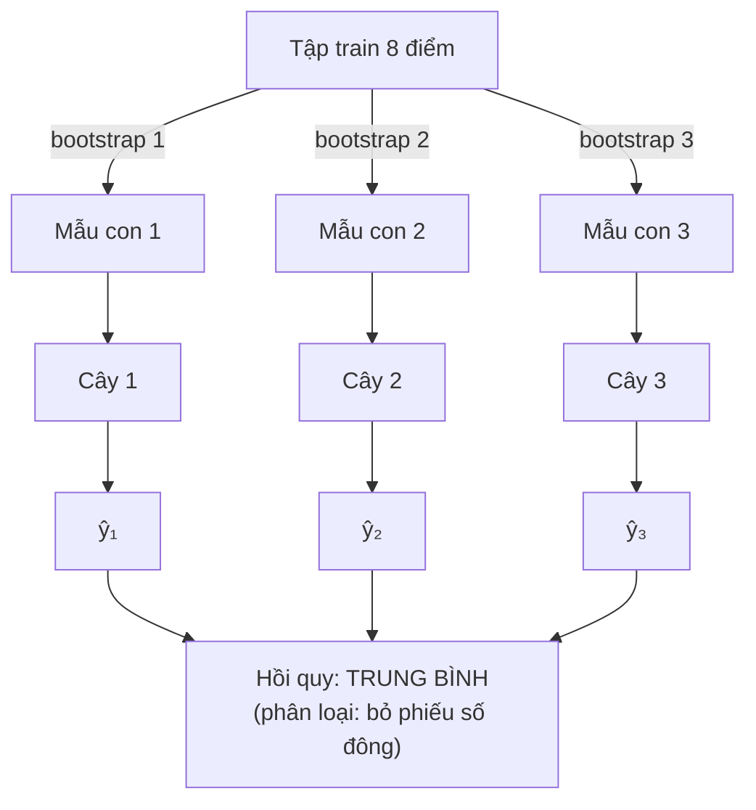

# Bài toán hồi quy: Linear, KNN, cây và rừng

> **abstract** Tóm tắt
> Cùng một bộ dữ liệu **lương theo kinh nghiệm** (8 train, 2 test là $x=7$ và $x=8$), slide cho 4 mô hình dự đoán rồi so RMSE:
>
> | Mô hình | Cách dự đoán | $\hat y(7)$ | $\hat y(8)$ | RMSE |
> | --- | --- | ---: | ---: | ---: |
> | Linear Regression | Thay vào $\hat y=10.19+4.82x$ | 43.95 | 48.78 | **2.3951** |
> | KNN ($k=3$) | Trung bình lương 3 hàng xóm (6; 5.5; 5) | 37 | 37 | 12.0208 |
> | Decision Tree (*`max_depth=1`*) | Trung bình lá $x\ge4.5$ | 37 | 37 | 12.0208 |
> | Random Forest (3 cây) | Trung bình các cây | 37 | 37 | 12.0208 |
>
> Linear Regression thắng vì dữ liệu gần tuyến tính và điểm test **nằm ngoài** khoảng train (ngoại suy). KNN và cây chỉ trả về giá trị đã thấy trong train.

## 1. Bài toán hồi quy và dữ liệu mẫu

Nguồn: tr. 24, tr. 25, tr. 26

**Hồi quy** là dự đoán **giá trị số liên tục** từ dữ liệu đầu vào.

> **example** Ví dụ giá nhà (tr. 24)
> - Đầu vào (features): diện tích (m²), số phòng ngủ, khoảng cách tới trung tâm, tuổi căn nhà.
> - Đầu ra (output): giá nhà (triệu đồng).
> - Cho mô hình hàng ngàn căn nhà có thông tin và giá bán → nó học quan hệ giữa các yếu tố và giá → nhập căn nhà mới thì dự đoán được giá.

**Bộ dữ liệu dùng xuyên suốt 8.2:** dự đoán lương (triệu VND) theo số năm kinh nghiệm, 10 quan sát.

| | 1 | 2 | 3 | 4 | 5 | 6 | 7 | 8 | 9 | 10 |
| --- | --- | --- | --- | --- | --- | --- | --- | --- | --- | --- |
| Kinh nghiệm $x$ | 1 | 1.5 | 2.5 | 3 | 4 | 5 | 5.5 | 6 | **7** | **8** |
| Lương $y$ | 15 | 18 | 22 | 25 | 28 | 35 | 36 | 40 | **45** | **52** |
| Tập | train | train | train | train | train | train | train | train | test | test |

```python
# Thư viện và dữ liệu dùng chung cho BG8 (tr. 26)
import numpy as np
import matplotlib.pyplot as plt
from sklearn.linear_model import LinearRegression, LogisticRegression
from sklearn.neighbors import KNeighborsRegressor, KNeighborsClassifier
from sklearn.tree import DecisionTreeRegressor, DecisionTreeClassifier, plot_tree
from sklearn.ensemble import RandomForestRegressor, RandomForestClassifier
from sklearn.metrics import mean_squared_error, accuracy_score, roc_curve, roc_auc_score

X_reg = np.array([[1], [1.5], [2.5], [3], [4], [5], [5.5], [6], [7], [8]])
y_reg = np.array([15, 18, 22, 25, 28, 35, 36, 40, 45, 52])
X_train_reg, X_test_reg = X_reg[:8], X_reg[8:]   # 8 dòng đầu / 2 dòng cuối
y_train_reg, y_test_reg = y_reg[:8], y_reg[8:]
```

> **tip** Mẹo thi: nhớ module của từng lớp
> `linear_model` → LinearRegression, LogisticRegression · `neighbors` → KNeighbors… · `tree` → DecisionTree…, `plot_tree` · `ensemble` → RandomForest… · `metrics` → **`mean_squared_error`**, **`accuracy_score`**, **`roc_curve`**, **`roc_auc_score`**. Hậu tố **Regressor** = hồi quy, **Classifier** = phân loại.

## 2. Linear Regression

Nguồn: tr. 28, tr. 29, tr. 30, tr. 31

**Mô hình học thế nào?** Tìm đường thẳng phù hợp nhất với train:

$$\hat y = \beta_0 + \beta_1 x$$

- $\beta_1$ — **hệ số góc (slope)**: lương thay đổi bao nhiêu khi kinh nghiệm tăng 1 năm.
- $\beta_0$ — **hệ số chặn (intercept)**: lương cơ bản khi kinh nghiệm bằng 0.
- Học bằng cách điều chỉnh $\beta_0,\beta_1$ để **tổng bình phương sai số (MSE)** trên train nhỏ nhất.

> **example** Tính tay (tr. 29)
> Hệ số học được: **Lương ≈ 10.19 + 4.82 × Kinh nghiệm**.
> 1. $x=7$: $10.19+4.82\times7\approx 43.95$ (thật 45, sai 1.05).
> 2. $x=8$: $10.19+4.82\times8\approx 48.78$ (thật 52, sai 3.22).
> 3. $\text{RMSE}=\sqrt{\dfrac{(45-43.95)^2+(52-48.78)^2}{2}}=\sqrt{\dfrac{1.1025+10.3684}{2}}\approx 2.395$.

```python
model_lr = LinearRegression()                 # 1. khởi tạo
model_lr.fit(X_train_reg, y_train_reg)        # 2. huấn luyện
preds_lr = model_lr.predict(X_test_reg)       # 3. dự đoán
rmse_lr = np.sqrt(mean_squared_error(y_test_reg, preds_lr))
print(f"Hệ số β₁ (slope): {model_lr.coef_[0]:.4f}")
print(f"Hệ số β₀ (intercept): {model_lr.intercept_:.4f}")
print(f"Dự đoán: {preds_lr.flatten()}")
print(f"RMSE: {rmse_lr:.4f}")
```

```text
Hệ số β₁ (slope): 4.8232
Hệ số β₀ (intercept): 10.1923
Dự đoán: [43.95483871 48.77806452]
RMSE: 2.3951
```

**Trực quan hóa (tr. 31):** **`plt.scatter`** vẽ điểm train (xanh dương), test thực tế (xanh lá), test dự đoán (dấu *`x`* đỏ, *`s=100`*); `X_plot = np.linspace(0, 10, 100).reshape(-1, 1)` rồi **`model_lr.predict(X_plot)`** để vẽ **đường hồi quy** nét đứt đỏ; lưu bằng **`plt.savefig('ml_image1.png')`**. Hình cho thấy đường thẳng đi sát mọi điểm.

> **warning** Dễ nhầm
> - `coef_` là **mảng** (mỗi đặc trưng một hệ số) nên in `coef_[0]`; `intercept_` của LinearRegression là **một số**.
> - **`reshape(-1, 1)`** biến dãy 1 chiều thành **cột** để **`predict`** nhận được (X phải 2 chiều).
> - Với nhiều biến $\hat y=\beta_0+\beta_1x_1+\beta_2x_2+\dots$, $\beta_j$ đọc là mức đổi của $\hat y$ khi $x_j$ tăng 1 **và giữ các biến khác cố định**.

> **question** Tự kiểm tra: với mô hình slide, người 0 năm kinh nghiệm và người 10 năm được dự đoán bao nhiêu? Kinh nghiệm bao nhiêu thì lương dự đoán 40?
> $x=0$: 10.19. $x=10$: $10.19+48.2=58.39$. Giải $10.19+4.82x=40$ → $x\approx6.18$ năm.

## 3. KNN hồi quy

Nguồn: tr. 33, tr. 34, tr. 35, tr. 36, tr. 37

KNN là **"mô hình học lười" (lazy learner)**: không học hàm số nào, chỉ **ghi nhớ toàn bộ train**. Khi cần dự đoán điểm mới:

1. Tính khoảng cách từ điểm mới đến **tất cả** điểm train.
2. Chọn $K$ điểm gần nhất ($K$ "hàng xóm").
3. **Lấy trung bình** giá trị đích (lương) của $K$ hàng xóm.

> **example** Theo dấu $K=3$ cho $x=7$ (tr. 34)
> | Điểm train $x$ | 1 | 1.5 | 2.5 | 3 | 4 | 5 | 5.5 | 6 |
> | --- | --- | --- | --- | --- | --- | --- | --- | --- |
> | $\lvert x-7\rvert$ | 6 | 5.5 | 4.5 | 4 | 3 | **2** | **1.5** | **1** |
> | Lương | | | | | | **35** | **36** | **40** |
>
> Ba hàng xóm gần nhất: 6, 5.5, 5 → $\hat y=(40+36+35)/3=37$ (thật 45).
> Với $x=8$ khoảng cách là 2, 2.5, 3 cho cùng ba điểm → $\hat y=37$ (thật 52).
> $\text{RMSE}=\sqrt{\dfrac{(45-37)^2+(52-37)^2}{2}}=\sqrt{\dfrac{64+225}{2}}=\sqrt{144.5}\approx12.02$.

```python
model_knn_reg = KNeighborsRegressor(n_neighbors=3)
model_knn_reg.fit(X_train_reg, y_train_reg)
preds_knn_reg = model_knn_reg.predict(X_test_reg)
rmse_knn_reg = np.sqrt(mean_squared_error(y_test_reg, preds_knn_reg))
print(f"Dự đoán: {preds_knn_reg.flatten()}")
print(f"RMSE: {rmse_knn_reg:.4f}")
```

```text
Dự đoán: [37. 37.]
RMSE: 12.0208
```

**Trực quan hóa (tr. 36–37):** cùng mẫu vẽ như Linear, đường dự đoán KNN là **hình bậc thang**; từ khoảng $x>5$ trở đi đường **nằm ngang ở 37**. KNN không thể dự đoán vượt giá trị lớn nhất mà 3 hàng xóm có, nên dự đoán kém cho điểm ngoài khoảng train.

> **info** Mở rộng: khoảng cách nhiều chiều
> Khoảng cách Euclid $d(a,b)=\sqrt{\sum_j(a_j-b_j)^2}$. Từ $(1,2)$ tới $(4,6)$: $\sqrt{3^2+4^2}=5$. Khi các đặc trưng khác thang đo, phải chuẩn hóa trước — xem [chuẩn hóa](08%20Ch%C6%B0%C6%A1ng%2008%20-%20%C4%90i%E1%BB%81u%20ki%E1%BB%87n%20d%E1%BB%ABng%20v%C3%A0%20chu%E1%BA%A9n%20h%C3%B3a.md). $k$ nhỏ dễ nhạy nhiễu (quá khớp); $k$ lớn làm mượt (dễ dưới khớp).

> **warning** Dễ nhầm
> KNN hồi quy lấy trung bình **giá trị đích** ($y$) của hàng xóm, **không** lấy trung bình khoảng cách hay trung bình $x$.

> **question** Tự kiểm tra: với $K=2$, dự đoán cho $x=7$ là bao nhiêu? Với $K=1$?
> $K=2$: hàng xóm 6 và 5.5 → $(40+36)/2=38$. $K=1$: hàng xóm 6 → 40.

## 4. Decision Tree hồi quy

Nguồn: tr. 39, tr. 40, tr. 41, tr. 42, tr. 43, tr. 44, tr. 45

**Mô hình học thế nào?**
- Đặt một loạt câu hỏi **Có/Không** để chia train, ví dụ "Kinh nghiệm < 3.5 năm?".
- Mỗi bước, tìm câu hỏi (một **đặc trưng** + một **ngưỡng**) chia dữ liệu thành **hai nhóm con**.
- Tiêu chí: chọn phép chia có **MSE trung bình (có trọng số) của các nhóm con nhỏ nhất** → giá trị trong mỗi nhóm gần nhau nhất.
- Lặp đến khi gặp **điều kiện dừng** → được cây quy tắc.
- Dự đoán: điểm mới đi từ gốc xuống lá; giá trị dự đoán = **trung bình các điểm train trong lá**.

**Bước 1 – nút gốc (tr. 40).** Mốc so sánh = MSE khi chỉ dự đoán bằng trung bình toàn train:
- Trung bình: $(15+18+22+25+28+35+36+40)/8=27.375$.
- MSE ban đầu: $\frac18\sum(y_i-27.375)^2\approx71.23$ (slide).

**Bước 2 – thử mọi ngưỡng (tr. 41).** Ngưỡng = **điểm giữa** hai giá trị kinh nghiệm liên tiếp. Công thức:

$$\text{MSE}_{\text{sau chia}}=\frac{n_{\text{trái}}}{n_{\text{tổng}}}\text{MSE}_{\text{trái}}+\frac{n_{\text{phải}}}{n_{\text{tổng}}}\text{MSE}_{\text{phải}}$$


> **note** Bảng dạng chữ
> | Ngưỡng (<) | MSE trái | MSE phải | MSE sau chia |
> | ---: | ---: | ---: | ---: |
> | 1.25 | 0.0 | 55.27 | 48.36 |
> | 2.0 | 2.25 | 33.56 | 25.73 |
> | 2.75 | 8.22 | 26.24 | 19.48 |
> | 3.5 | 14.5 | 18.69 | 16.60 |
> | **4.5** | **21.84** | **4.67** | **15.40** |
> | 5.25 | 41.81 | 4.0 | 32.35 |
> | 5.75 | 47.63 | 0.0 | 41.68 |

→ Chọn **Kinh nghiệm < 4.5** (MSE giảm từ 71.23 xuống 15.40). Kiểm tra dòng thắng: $\frac58\times21.84+\frac38\times4.67=13.65+1.75=15.40$.


> **warning** Số liệu trong bảng slide
> Tính lại bằng numpy/sklearn: MSE gốc chính xác là **70.98** (sklearn in `squared_error = 70.98`), và các dòng 1.25, 2.0, 2.75, 5.25, 5.75 của slide lệch vài đơn vị (ví dụ ngưỡng 1.25 đúng ra 56.12 / 49.11). Dòng **4.5 (21.84; 4.67; 15.40)** và dòng 3.5 khớp, nên **kết luận chọn 4.5 vẫn đúng**. Khi thi, làm theo công thức; nếu đề chép số slide thì chọn theo số slide.

**Bước 3 – dự đoán (tr. 42).** $x=7$ và $x=8$ đều $\ge4.5$ → lá phải, trung bình $(35+36+40)/3=37$. RMSE $\approx12.02$ (giống KNN). Lá trái dự đoán $(15+18+22+25+28)/5=21.6$.

```python
# max_depth=1 để khớp với tính tay
model_dt_reg = DecisionTreeRegressor(max_depth=1, random_state=42)
model_dt_reg.fit(X_train_reg, y_train_reg)
preds_dt_reg = model_dt_reg.predict(X_test_reg)
rmse_dt_reg = np.sqrt(mean_squared_error(y_test_reg, preds_dt_reg))
print(f"Dự đoán: {preds_dt_reg.flatten()}")
print(f"RMSE: {rmse_dt_reg:.4f}")
```

```text
Dự đoán: [37. 37.]
RMSE: 12.0208
```

**Trực quan hóa (tr. 44–45):** đường dự đoán của cây là **một bậc thang hai mức** (21.6 rồi 37, nhảy tại 4.5) — lưu `ml_image3.png`. **`plot_tree(model_dt_reg, feature_names=['Kinh nghiệm'], filled=True, rounded=True, precision=2)`** vẽ cây (`ml_image4.png`): gốc `Kinh nghiệm <= 4.5`, `samples = 8`, `value = 27.38`; nhánh True (trái) `samples = 5`, `value = 21.6`; nhánh False (phải) `samples = 3`, `value = 37.0`.

> **warning** Dễ nhầm
> Slide viết "< 4.5", còn sklearn in **`<= 4.5`** và nhánh **True đi sang trái**. Với dữ liệu này hai cách cho cùng kết quả vì không có điểm nào bằng đúng 4.5.

> **question** Tự kiểm tra: dự đoán của cây cho $x=4$ và $x=4.6$?
> $x=4\le4.5$ → lá trái 21.6. $x=4.6>4.5$ → lá phải 37.

## 5. Random Forest hồi quy

Nguồn: tr. 47, tr. 48, tr. 49, tr. 50, tr. 51, tr. 52

**Mô hình học thế nào?** Xây **nhiều cây quyết định khác nhau** rồi kết hợp:
1. Tạo nhiều **mẫu dữ liệu con** từ train bằng **lấy mẫu ngẫu nhiên có lặp lại** (bootstrap).
2. Huấn luyện **một cây riêng** trên mỗi mẫu con. Để các cây đa dạng, mỗi lần chia chỉ xét **một tập con đặc trưng ngẫu nhiên**.
3. Dự đoán = **trung bình** kết quả của mọi cây trong "rừng".



**Dự đoán và đánh giá (tr. 48).** Với *`random_state=42`*, *`n_estimators=3`*, slide báo trung bình 3 cây = **37.0** cho cả $x=7$ và $x=8$ → RMSE 12.0208.

```python
model_rf_reg = RandomForestRegressor(random_state=42, n_estimators=3)  # 3 cây
model_rf_reg.fit(X_train_reg, y_train_reg)
preds_rf_reg = model_rf_reg.predict(X_test_reg)
rmse_rf_reg = np.sqrt(mean_squared_error(y_test_reg, preds_rf_reg))
print(f"Dự đoán: {preds_rf_reg.flatten()}")
print(f"RMSE: {rmse_rf_reg:.4f}")
```

```text
Theo slide:                 Chạy lại với scikit-learn 1.9.1:
Dự đoán: [37. 37.]          Dự đoán: [40. 40.]
RMSE: 12.0208               RMSE: 9.1924
```

> **warning** Kết quả rừng phụ thuộc phiên bản
> Mẫu bootstrap do bộ sinh số ngẫu nhiên quyết định, nên cùng *`random_state=42`* nhưng **phiên bản sklearn khác** có thể cho cây khác. Thi theo số slide (37.0). Ý cần nhớ: rừng hồi quy = **trung bình** các cây; RMSE vẫn kém Linear vì cây không ngoại suy được.

**Trực quan hóa (tr. 50–52):** đường dự đoán rừng cũng là bậc thang (`ml_image5.png`). Vòng `for index, tree_in_forest in enumerate(model_rf_reg.estimators_)` duyệt **từng cây con** (thuộc tính `estimators_`), vẽ bằng **`plot_tree(..., ax=axes[index])`** trên **`plt.subplots(nrows=1, ncols=3)`** (`ml_image6.png`). Hình tr. 52 cho thấy **3 cây sâu nhiều tầng, ngưỡng gốc khác nhau** vì mỗi cây học trên một mẫu bootstrap khác và không giới hạn *`max_depth`*.

> **info** Mở rộng: `feature_importances_`
> Rừng (và cây) có `feature_importances_`: mức đóng góp giảm sai số/độ hỗn tạp của từng đặc trưng, **tổng bằng 1**. *`n_estimators`* = số cây; nó **không** đổi độ sâu từng cây (*`max_depth`*).

> **question** Tự kiểm tra: 3 cây dự đoán 30, 37, 44 cho một điểm. Rừng hồi quy trả về gì? Nếu là rừng phân loại với phiếu Đạt, Trượt, Đạt?
> Trung bình $(30+37+44)/3=37$. Phân loại: số đông → Đạt.

## 6. So sánh các mô hình hồi quy

Nguồn: tr. 54, tr. 55


> **note** Bảng dạng chữ
> | Mô hình | RMSE (slide) |
> | --- | ---: |
> | Linear Regression | **2.3951** |
> | K-Nearest Neighbors | 12.0208 |
> | Decision Tree | 12.0208 |
> | Random Forest | 12.0208 |

**Nhận xét:** RMSE **càng thấp càng tốt** → Linear Regression tốt nhất trên bộ dữ liệu này.

```python
models = ['Linear Regression', 'KNN', 'Decision Tree', 'Random Forest']
rmses = [rmse_lr, rmse_knn_reg, rmse_dt_reg, rmse_rf_reg]
plt.figure(figsize=(10, 6))
plt.bar(models, rmses)                 # biểu đồ cột
plt.xlabel('Mô hình'); plt.ylabel('Chỉ số RMSE')
plt.title('So sánh hiệu suất các mô hình Hồi quy')
plt.ylim(0, 15)                        # cố định trục y để dễ so
for i, v in enumerate(rmses):
    plt.text(i, v + 0.2, f"{v:.2f}", ha='center')   # ghi số trên đỉnh cột
plt.savefig('ml_image7.png')
```


> **tip** Mẹo thi
> Ba mô hình KNN, cây, rừng **cùng ra 37** vì đều lấy trung bình của nhóm điểm {5; 5.5; 6} (lương 35, 36, 40). Đây là lý do RMSE trùng nhau.

**Áp dụng ở:** F803 Hồi quy tuyến tính, F804 Sai số hồi quy, F805 KNN, F807 Cây quyết định, F808 Rừng ngẫu nhiên. Luyện thêm tính ngưỡng: [Thực hành thêm - Tính điểm chia cây và đọc rừng](Th%E1%BB%B1c%20h%C3%A0nh%20th%C3%AAm%20-%20T%C3%ADnh%20%C4%91i%E1%BB%83m%20chia%20c%C3%A2y%20v%C3%A0%20%C4%91%E1%BB%8Dc%20r%E1%BB%ABng.md).
