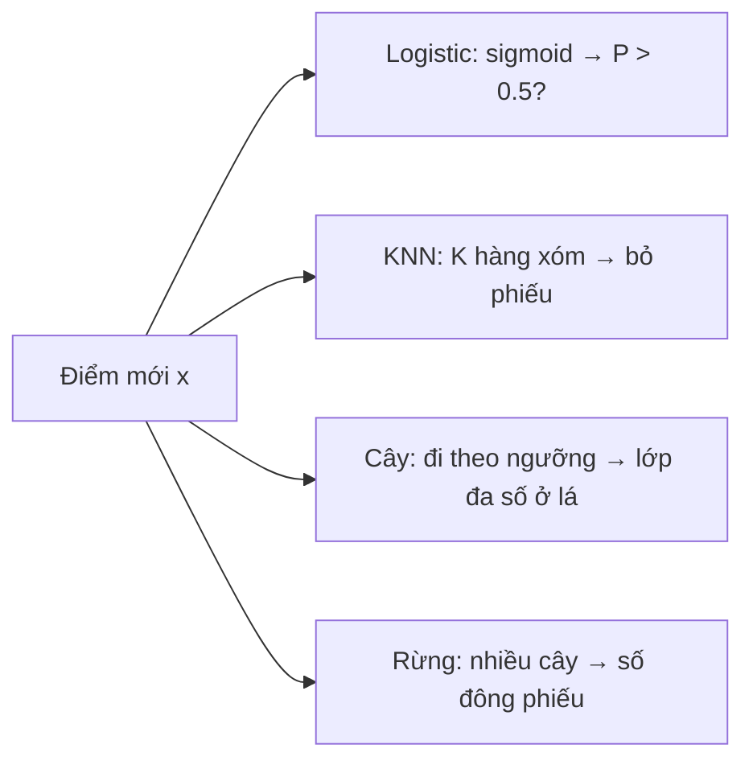

# Bài toán phân loại: Logistic, KNN, cây và rừng

> **abstract** Tóm tắt
> Dữ liệu: **số giờ tự học → Đạt/Trượt** (8 train; test là $x=4$ Trượt và $x=9$ Đạt).
>
> | Mô hình | Quy tắc quyết định | $x=4$ | $x=9$ | Accuracy |
> | --- | --- | --- | --- | ---: |
> | Logistic Regression | $P(\text{Đạt})>0.5$ | 0.29 → Trượt | 0.99 → Đạt | 100% |
> | KNN ($k=3$) | Bỏ phiếu 3 hàng xóm | 2 Trượt/1 Đạt → Trượt | 3 Đạt → Đạt | 100% |
> | Decision Tree (*`max_depth=1`*) | Giờ học < 5.0 → Trượt | Trượt | Đạt | 100% |
> | Random Forest (3 cây) | Số đông phiếu các cây | Trượt | Đạt | 100% |
>
> Dữ liệu phân tách tuyến tính rõ nên mọi mô hình đều đúng tuyệt đối.

## 1. Bài toán phân loại và dữ liệu mẫu

Nguồn: tr. 59, tr. 60, tr. 61

**Phân loại**: đầu ra là **nhãn (label) rời rạc**, không phải số liên tục. Mục tiêu: học cách gán nhãn đúng cho mẫu mới dựa trên dữ liệu đã biết.


> **note** Bảng dạng chữ
> | Ví dụ slide | Đầu vào | Đầu ra | Loại |
> | --- | --- | --- | --- |
> | Lọc email | Nội dung, tiêu đề, địa chỉ gửi… | "Spam" / "Không spam" | **Nhị phân (binary)** – 2 lớp |
> | Nhận dạng con vật | Ảnh | "Mèo", "Chó", "Thỏ", "Ngựa"… | **Đa lớp (multi-class)** – nhiều nhãn |

**Bộ dữ liệu dùng xuyên suốt 8.3:**

| Số giờ tự học $x$ | 1 | 2 | 3 | 4.5 | 5.5 | 6 | 7 | 8 | **4** | **9** |
| --- | --- | --- | --- | --- | --- | --- | --- | --- | --- | --- |
| Kết quả | Trượt | Trượt | Trượt | Trượt | Đạt | Đạt | Đạt | Đạt | **Trượt** | **Đạt** |
| $y$ (0 Trượt, 1 Đạt) | 0 | 0 | 0 | 0 | 1 | 1 | 1 | 1 | 0 | 1 |
| Tập | train ×8 | | | | | | | | test | test |

```python
X_cls = np.array([[1], [2], [3], [4.5], [5.5], [6], [7], [8], [4], [9]])
y_cls = np.array([0, 0, 0, 0, 1, 1, 1, 1, 0, 1])  # 0: Trượt, 1: Đạt
X_train_cls, X_test_cls = X_cls[:8], X_cls[8:]
y_train_cls, y_test_cls = y_cls[:8], y_cls[8:]
```

(Phần import giống [tr. 26](03%20Ch%C6%B0%C6%A1ng%2008%20-%20H%E1%BB%93i%20quy%20v%C3%A0%20KNN.md).)

> **warning** Dễ nhầm
> Ở đây hai điểm test là $x=4$ và $x=9$ — **không** theo thứ tự tăng dần như dữ liệu hồi quy. Điểm $x=4$ nằm **giữa** vùng train, còn $x=9$ nằm ngoài.

## 2. Logistic Regression

Nguồn: tr. 63, tr. 64, tr. 65, tr. 66, tr. 67

**Mô hình học thế nào?** Biến đầu vào $x$ thành **xác suất (0 → 1)** bằng **hàm Sigmoid**. Xác suất này là $\hat y$ cho **lớp 1 (Đạt)**. Hệ số học được: $\beta_0\approx-5.5288$, $\beta_1\approx1.1590$.

$$\hat y = P(y=1\mid x)=\frac{1}{1+e^{-(\beta_0+\beta_1x)}}=\frac{1}{1+e^{-(-5.5288+1.1590x)}}$$

Nếu xác suất **> 0.5** → "Đạt", ngược lại → "Trượt".

> **example** Tính tay (tr. 64)
> | $x$ | $z=-5.5288+1.1590x$ | $e^{-z}$ | $P=\frac1{1+e^{-z}}$ | Nhãn | Đúng? |
> | --- | --- | --- | --- | --- | --- |
> | 4 | $-0.8928$ | $e^{0.8928}\approx2.442$ | $\approx0.29$ | 0.29 < 0.5 → **Trượt** | Đúng |
> | 9 | $4.9022$ | $e^{-4.9022}\approx0.0074$ | $\approx0.99$ | 0.99 > 0.5 → **Đạt** | Đúng |
>
> Accuracy $=2/2=100\%$.

```python
model_log_reg = LogisticRegression(random_state=42)
model_log_reg.fit(X_train_cls, y_train_cls)
preds_log_reg = model_log_reg.predict(X_test_cls)
acc_log_reg = accuracy_score(y_test_cls, preds_log_reg)
print(f"Hệ số β₁ (coef): {model_log_reg.coef_[0][0]:.4f}")
print(f"Hệ số β₀ (intercept): {model_log_reg.intercept_[0]:.4f}")
print(f"Dự đoán: {preds_log_reg}")
print(f"Accuracy: {acc_log_reg:.2f}")
```

```text
Hệ số β₁ (coef): 1.1590
Hệ số β₀ (intercept): -5.5288
Dự đoán: [0 1]
Accuracy: 1.00
```

**Trực quan hóa (tr. 66–67):** điểm train lớp 0 màu xanh, lớp 1 màu cam; test vẽ *`marker='s'`*. Đường **sigmoid** vẽ từ `model_log_reg.predict_proba(X_plot)[:, 1]` (cột 1 = xác suất lớp Đạt). **Ranh giới quyết định** là nơi xác suất = 0.5, tức $z=0$:

$$x^*=-\frac{\beta_0}{\beta_1}=-\frac{\texttt{intercept\_}}{\texttt{coef\_[0]}}=\frac{5.5288}{1.1590}\approx4.77$$

vẽ bằng **`plt.axvline(x=decision_boundary, linestyle='--')`**, thêm **`plt.axhline(y=0.5, linestyle=':')`**. Lưu `ml_image8.png`.

> **warning** Dễ nhầm
> - Với LogisticRegression, `coef_` là mảng **2 chiều** → `coef_[0][0]`; `intercept_` là **mảng** → `intercept_[0]`. (LinearRegression: `coef_[0]`, `intercept_` là số.)
> - **`predict`** trả **nhãn** (0/1); **`predict_proba`** trả **ma trận xác suất** mỗi cột một lớp theo thứ tự `classes_` (ở đây `[0, 1]`), nên `[:, 1]` là P(Đạt).
> - $z=0$ ⇔ $P=0.5$. $z>0$ ⇔ $P>0.5$.

> **info** Mở rộng: đổi ngưỡng
> Ngưỡng 0.5 là mặc định của **`predict`**. Hạ ngưỡng → nhiều dự đoán dương hơn → recall thường tăng, precision thường giảm. Xác suất không đổi, chỉ quyết định đổi.

> **question** Tự kiểm tra: một sinh viên học 5 giờ được dự đoán gì? Học 4.5 giờ thì sao?
> $x=5$: $z=-5.5288+5.795=0.266>0$ → $P\approx0.57$ → Đạt. $x=4.5$: $z=-0.313<0$ → $P\approx0.42$ → Trượt. (Ranh giới ≈ 4.77.)

## 3. KNN phân loại

Nguồn: tr. 69, tr. 70, tr. 71, tr. 72, tr. 73

Giống KNN hồi quy: ghi nhớ train → tính khoảng cách đến mọi điểm train → chọn $K$ gần nhất → **các hàng xóm "bỏ phiếu"**, nhãn xuất hiện **nhiều nhất** là dự đoán.

> **example** Theo dấu $K=3$ (tr. 70)
> | Train $x$ | 1 | 2 | 3 | 4.5 | 5.5 | 6 | 7 | 8 |
> | --- | --- | --- | --- | --- | --- | --- | --- | --- |
> | Nhãn | T | T | T | T | Đ | Đ | Đ | Đ |
> | $\lvert x-4\rvert$ | 3 | 2 | **1** | **0.5** | **1.5** | 2 | 3 | 4 |
> | $\lvert x-9\rvert$ | 8 | 7 | 6 | 4.5 | 3.5 | **3** | **2** | **1** |
>
> - $x=4$: hàng xóm 4.5, 3, 5.5 → 2 Trượt, 1 Đạt → **Trượt** (đúng).
> - $x=9$: hàng xóm 8, 7, 6 → 3 Đạt → **Đạt** (đúng).
> - Accuracy = 100%.

```python
model_knn_cls = KNeighborsClassifier(n_neighbors=3)
model_knn_cls.fit(X_train_cls, y_train_cls)
preds_knn_cls = model_knn_cls.predict(X_test_cls)
acc_knn_cls = accuracy_score(y_test_cls, preds_knn_cls)
print(f"Dự đoán: {preds_knn_cls}")
print(f"Accuracy: {acc_knn_cls:.2f}")
```

```text
Dự đoán: [0 1]
Accuracy: 1.00
```

**Trực quan hóa (tr. 72–73):** các điểm đặt trên một đường ngang (**`np.zeros(...)`** làm tung độ, **`plt.yticks([])`** ẩn trục y). **Ranh giới** tìm bằng cách dự đoán 500 điểm **`np.linspace(0, 10, 500)`**, lấy **`np.diff(y_plot)`** và giữ chỗ `diff != 0` (nơi nhãn đổi) rồi vẽ `axvline`. Kết quả chạy lại: ranh giới KNN ≈ **4.49**.

> **warning** Dễ nhầm
> Với phân loại nhị phân, chọn $K$ **lẻ** để tránh hòa phiếu. KNN phân loại = **số đông**; KNN hồi quy = **trung bình**.

> **question** Tự kiểm tra: với $K=5$, điểm $x=4$ được dự đoán gì?
> 5 gần nhất: 4.5 (0.5), 3 (1), 5.5 (1.5), 2 và 6 (cùng 2). Phiếu: Trượt {4.5, 3, 2} = 3, Đạt {5.5, 6} = 2 → Trượt.

## 4. Decision Tree phân loại và chỉ số Gini

Nguồn: tr. 75, tr. 76, tr. 77, tr. 78, tr. 79, tr. 80, tr. 81, tr. 82

**Mô hình học thế nào?**
- Liên tục đặt câu hỏi Có/Không để chia dữ liệu.
- Duyệt **mọi đặc trưng và mọi ngưỡng** khả dĩ để tìm câu hỏi tốt nhất.
- "Tốt nhất" = tạo hai nhóm con **thuần khiết** nhất, đo bằng **chỉ số Gini**: **Gini càng gần 0, nhóm càng thuần**.
- Dự đoán: đi theo câu hỏi tới lá, gán **lớp chiếm đa số** trong lá.

$$\text{Gini}=1-\sum_{i=1}^{C}p_i^2\qquad(C\text{ = số lớp},\ p_i\text{ = tỷ lệ lớp }i\text{ trong nút})$$

**Bước 1 – nút gốc (tr. 76):** 8 điểm, 4 Trượt và 4 Đạt → $p_0=p_1=0.5$ → $\text{Gini}=1-(0.5^2+0.5^2)=1-0.5=0.5$ (hỗn loạn tối đa cho 2 lớp).

**Bước 2 – thử ngưỡng (tr. 77):** $\text{Gini}_{\text{sau chia}}=\frac{n_{\text{trái}}}{n}\text{Gini}_{\text{trái}}+\frac{n_{\text{phải}}}{n}\text{Gini}_{\text{phải}}$.

| Ngưỡng (<) | Trái | Phải | Gini trái | Gini phải | Gini sau chia |
| ---: | --- | --- | ---: | ---: | ---: |
| 1.5 | 1T | 3T 4Đ | 0.0 | 0.490 | 0.428 |
| 2.5 | 2T | 2T 4Đ | 0.0 | 0.444 | 0.333 |
| 3.75 | 3T | 1T 4Đ | 0.0 | 0.320 | 0.200 |
| **5.0** | **4T** | **4Đ** | **0.0** | **0.0** | **0.0** |
| 5.75 | 4T 1Đ | 3Đ | 0.320 | 0.0 | 0.200 |
| 6.5 | 4T 2Đ | 2Đ | 0.444 | 0.0 | 0.333 |
| 7.5 | 4T 3Đ | 1Đ | 0.490 | 0.0 | 0.428 |

→ Chọn **Giờ học < 5.0**: Gini giảm từ 0.5 xuống **0.0**, hai nhóm con **hoàn toàn thuần khiết**. (5.0 là điểm giữa của 4.5 và 5.5.)

> **example** Kiểm tra một dòng: ngưỡng 3.75
> Trái {1, 2, 3} toàn Trượt → Gini 0. Phải {4.5, 5.5, 6, 7, 8} = 1T 4Đ → $1-(0.2^2+0.8^2)=1-0.68=0.32$. Sau chia $=\frac38\cdot0+\frac58\cdot0.32=0.2$.

**Bước 3 – dự đoán (tr. 78):** $x=4<5.0$ → Trượt (đúng); $x=9\ge5.0$ → Đạt (đúng). Accuracy $=2/2=100\%$.

```python
model_dt_cls = DecisionTreeClassifier(max_depth=1, random_state=42)
model_dt_cls.fit(X_train_cls, y_train_cls)
preds_dt_cls = model_dt_cls.predict(X_test_cls)
acc_dt_cls = accuracy_score(y_test_cls, preds_dt_cls)
print(f"Dự đoán: {preds_dt_cls}")
print(f"Accuracy: {acc_dt_cls:.2f}")
```

```text
Dự đoán: [0 1]
Accuracy: 1.00
```

**Trực quan hóa (tr. 80–82):** ngưỡng nút gốc đọc từ `model_dt_cls.tree_.threshold[0]` (= 5.0) để vẽ `axvline` với nhãn `x < 5.00` (`ml_image10.png`). **`plot_tree(model_dt_cls, feature_names=['Số giờ tự học'], class_names=['Trượt', 'Đạt'], filled=True, rounded=True)`** vẽ cây (`ml_image11.png`): gốc `Số giờ tự học <= 5.0`, `gini = 0.5`, `samples = 8`, `value = [4, 4]`; hai lá `gini = 0.0`, `value = [4, 0]` (Trượt) và `[0, 4]` (Đạt).

> **info** Mở rộng: entropy và cây không giới hạn độ sâu
> - Tiêu chí thay thế: *`criterion='entropy'`*, $H=-\sum_i p_i\log_2p_i$. Nút 50/50 có $H=1$, nút thuần có $H=0$. Gini tối đa của 2 lớp là 0.5.
> - *`max_depth=None`* (mặc định) → cây mọc tới khi lá thuần → dễ **quá khớp**.
> - Cây phân loại trong sklearn đọc lá theo `value = [số mẫu lớp 0, lớp 1]` và `class =` lớp đa số.

> **question** Tự kiểm tra: nút có 6 mẫu gồm 2 Trượt, 4 Đạt. Gini? Nếu nút chỉ có 3 Đạt?
> $1-(1/3)^2-(2/3)^2=1-5/9=4/9\approx0.444$. Nút thuần → Gini 0.

## 5. Random Forest phân loại

Nguồn: tr. 84, tr. 85, tr. 86, tr. 87, tr. 88, tr. 89, tr. 90

- Giống rừng hồi quy: xây "khu rừng" nhiều cây khác nhau từ train.
- Dự đoán: **mỗi cây bỏ một phiếu** cho một lớp; lớp nhiều phiếu nhất là kết quả.
- Cách "**trí tuệ tập thể**" này làm mô hình **ổn định và chính xác hơn** một cây đơn lẻ.


> **note** Bảng dạng chữ
> | Điểm test | $\hat y$ (số đông) | Thực tế |
> | --- | --- | --- |
> | Số giờ = 4 | Trượt | Trượt |
> | Số giờ = 9 | Đạt | Đạt |

Accuracy = 100% (tr. 85).

```python
model_rf_cls = RandomForestClassifier(random_state=42, n_estimators=3)  # 3 cây
model_rf_cls.fit(X_train_cls, y_train_cls)
preds_rf_cls = model_rf_cls.predict(X_test_cls)
acc_rf_cls = accuracy_score(y_test_cls, preds_rf_cls)
print(f"Dự đoán: {preds_rf_cls}")
print(f"Accuracy: {acc_rf_cls:.2f}")
```

```text
Dự đoán: [0 1]
Accuracy: 1.00
```

**Ba cây con (tr. 89–90)**, vẽ bằng vòng lặp qua `model_rf_cls.estimators_`:


> **note** Bảng dạng chữ
> | Cây | Gốc | Gini gốc | samples (số mẫu **khác nhau**) | value (đếm có lặp) |
> | --- | --- | ---: | ---: | --- |
> | 1 | Số giờ ≤ 5.0 | 0.375 | 5 | [6, 2] |
> | 2 | Số giờ ≤ 5.25 | 0.469 | 5 | [3, 5] |
> | 3 | Số giờ ≤ 5.0 | 0.5 | 5 | [4, 4] |

Mỗi cây một mẫu bootstrap khác nhau nên Gini gốc và ngưỡng khác nhau, nhưng đều tách thành hai lá thuần. Ranh giới của rừng khi chạy lại ≈ **5.0** (`ml_image12.png`).

> **warning** Dễ nhầm: `samples` và `value` trong cây của rừng
> Do lấy mẫu **có lặp lại**, `samples` đếm số mẫu **khác nhau** được rút (5), còn `value` đếm **cả lần lặp** (tổng 8). Ví dụ cây 1: $[6,2]$ → Gini $=1-(6/8)^2-(2/8)^2=0.375$.

> **info** Mở rộng
> sklearn thực ra **trung bình xác suất lớp** của các cây rồi chọn lớp lớn nhất (soft voting). Khi mỗi lá thuần (xác suất 0/1) thì giống hệt bỏ phiếu số đông.

> **question** Tự kiểm tra: rừng 5 cây phân loại cho phiếu Đạt, Trượt, Đạt, Trượt, Đạt. Kết quả?
> 3 Đạt > 2 Trượt → Đạt.

## 6. So sánh các mô hình phân loại

Nguồn: tr. 92, tr. 93


> **note** Bảng dạng chữ
> | Mô hình | Accuracy |
> | --- | ---: |
> | Logistic Regression | 100% |
> | K-Nearest Neighbors | 100% |
> | Decision Tree | 100% |
> | Random Forest | 100% |

- Dữ liệu **phân tách tuyến tính rõ ràng** → mọi mô hình đều tốt.
- Thực tế, dữ liệu phức tạp hơn sẽ làm hiệu suất khác biệt rõ rệt.
- Biểu đồ so sánh dùng **`plt.bar(models, accuracies)`**, **`plt.ylim(0, 1.1)`**, ghi số **`plt.text(i, v + 0.02, f"{v:.2f}", ha='center')`**, lưu `ml_image14.png`.



> **question** Tự kiểm tra: mô hình nào có "ranh giới" là một công thức đóng $x^*=-\beta_0/\beta_1$?
> Logistic Regression (ranh giới ≈ 4.77). Cây có ranh giới là ngưỡng 5.0; KNN và rừng phải dò bằng cách dự đoán lưới điểm.

**Áp dụng ở:** F806 Logistic, F805 KNN, F807 Cây quyết định, F808 Rừng ngẫu nhiên. Luyện thêm: [Thực hành thêm - Tính điểm chia cây và đọc rừng](Th%E1%BB%B1c%20h%C3%A0nh%20th%C3%AAm%20-%20T%C3%ADnh%20%C4%91i%E1%BB%83m%20chia%20c%C3%A2y%20v%C3%A0%20%C4%91%E1%BB%8Dc%20r%E1%BB%ABng.md).
