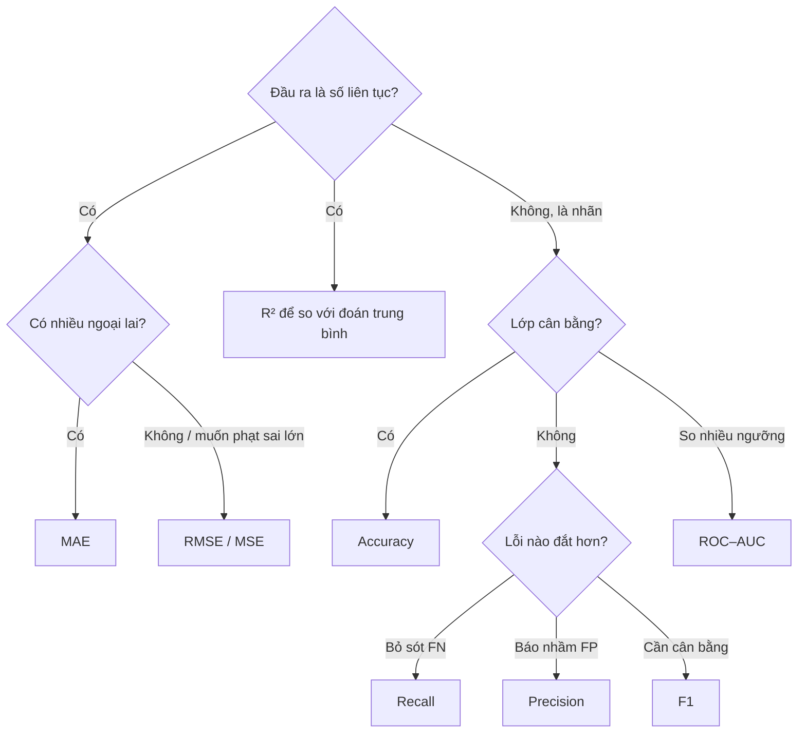

# Ma trận nhầm lẫn và chỉ số đánh giá nâng cao

> **abstract** Tóm tắt
> - RMSE và Accuracy hữu ích nhưng **không phải lúc nào cũng phù hợp** (tr. 99).
> - Hồi quy thêm: **MAE** (ít nhạy ngoại lai hơn MSE) và **R²** (so với mô hình luôn đoán trung bình; càng gần 1 càng tốt).
> - Phân loại thêm: **ma trận nhầm lẫn**, **Precision**, **Recall**, **F1**, **ROC–AUC**.
> - Bệnh hiếm 1%: mô hình "ai cũng bình thường" đạt Accuracy 99% nhưng **vô nghĩa** → cần chỉ số khác.

## 1. Chỉ số hồi quy nâng cao: MAE và R²

Nguồn: tr. 15, tr. 100


> **note** Bảng dạng chữ
> | Chỉ số | Công thức | Đọc |
> | --- | --- | --- |
> | MSE | $\frac1n\sum(y_{\text{thực tế}}-y_{\text{dự đoán}})^2$ | Phạt nặng sai lớn; đơn vị bình phương |
> | RMSE | $\sqrt{\text{MSE}}$ | Cùng đơn vị với $y$ |
> | **MAE** (Mean Absolute Error) | $\frac1n\sum\lvert y_{\text{thực tế}}-y_{\text{dự đoán}}\rvert$ | Trung bình trị tuyệt đối sai số; **ít bị ảnh hưởng bởi ngoại lai hơn MSE** |
> | **R²** (hệ số xác định) | $1-\dfrac{\sum(y_{\text{thực tế},i}-y_{\text{dự đoán},i})^2}{\sum(y_{\text{thực tế},i}-\bar y_{\text{thực tế}})^2}$ | % biến thiên của dữ liệu mà mô hình giải thích; **càng gần 1 càng tốt** |

$\bar y_{\text{thực tế}}$ là trung bình của tất cả giá trị thực tế. Mẫu số chính là sai số của "mô hình đơn giản" **luôn đoán trung bình**.

> **example** Tính trên 2 điểm test của Linear Regression (thật 45, 52; dự đoán 43.95, 48.78)
> 1. Sai số: $1.05$ và $3.22$.
> 2. MAE $=(1.05+3.22)/2\approx2.135$.
> 3. MSE $=(1.1025+10.3684)/2\approx5.735$ → RMSE $\approx2.395$.
> 4. $\bar y=48.5$; $\sum(y-\bar y)^2=3.5^2+3.5^2=24.5$; $\sum(y-\hat y)^2\approx11.47$ → $R^2\approx1-11.47/24.5\approx0.53$.
>
> ```python
> from sklearn.metrics import mean_absolute_error, mean_squared_error, r2_score
> yt, yp = [45, 52], [43.95, 48.78]
> print(mean_absolute_error(yt, yp), mean_squared_error(yt, yp), r2_score(yt, yp))
> # 2.135 5.73545 0.5318  (đã chạy, làm tròn)
> ```

> **warning** Dễ nhầm
> - RMSE ≥ MAE luôn đúng; chênh càng lớn khi có vài sai số rất lớn.
> - $R^2$ **có thể âm** khi mô hình tệ hơn đoán trung bình. $R^2=1$ khi dự đoán hoàn hảo; $R^2=0$ khi ngang đoán trung bình.
> - $R^2$ trong slide tính trên **dữ liệu đang đánh giá**; trung bình là trung bình của $y$ thực tế ở tập đó.

> **question** Tự kiểm tra: sai số ba điểm là 1, −1, 10. MAE và RMSE? Chỉ số nào bị điểm 10 kéo mạnh hơn?
> MAE $=12/3=4$. MSE $=(1+1+100)/3=34$ → RMSE $\approx5.83$. RMSE bị kéo mạnh hơn (bình phương).

## 2. Vì sao Accuracy chưa đủ

Nguồn: tr. 15, tr. 101, tr. 102

$\text{Accuracy}=\dfrac{\text{Số dự đoán đúng}}{\text{Tổng số dự đoán}}$.

> **example** Bệnh hiếm (tr. 101)
> 99% dân số "bình thường", 1% mắc bệnh. Mô hình luôn đoán "bình thường":
> - Accuracy = 99%.
> - Phát hiện được **0** ca bệnh → hoàn toàn vô nghĩa.
>
> ```python
> from sklearn.metrics import accuracy_score, recall_score
> yt = [0]*99 + [1]; yp = [0]*100
> print(accuracy_score(yt, yp), recall_score(yt, yp))   # 0.99 0.0
> ```

Các chỉ số thay thế (tr. 102): **ma trận nhầm lẫn**, **độ chuẩn (Precision)**, **độ phủ (Recall / độ nhạy)**, **điểm F1**, **đường cong ROC và AUC**.

## 3. Ma trận nhầm lẫn (Confusion Matrix)

Nguồn: tr. 103, tr. 104

Bảng cho thấy chi tiết dự đoán đúng và sai. Lớp dương = "Bệnh".


> **note** Bảng dạng chữ
> | Ô | Dự đoán | Thực tế | Ý nghĩa |
> | --- | --- | --- | --- |
> | **TP** – Dương tính thật | Bệnh | Bệnh | Tốt |
> | **TN** – Âm tính thật | Bình thường | Bình thường | Tốt |
> | **FP** – Dương tính giả | Bệnh | Bình thường | **Báo động giả** (lỗi loại I – Type 1 error) |
> | **FN** – Âm tính giả | Bình thường | Bệnh | **Bỏ sót, rất nguy hiểm!** (lỗi loại II – Type 2 error) |

Cách đọc tên: chữ thứ hai (P/N) = **mô hình dự đoán gì**; chữ đầu (T/F) = **dự đoán đó đúng hay sai**.

Hình tr. 104 (ví dụ mèo/chó, lớp dương = mèo) xếp **hàng = thực tế, cột = dự đoán, lớp dương đứng trước**:


> **note** Bảng dạng chữ
> | Thực tế \ Dự đoán | Dương (mèo) | Âm (không mèo) |
> | --- | --- | --- |
> | **Dương (mèo)** | TP "Đây là mèo" | FN "Không phải mèo" – Type 2 error |
> | **Âm (không mèo)** | FP "Đây là mèo" – Type 1 error | TN "Không phải mèo" |


> **warning** Dễ nhầm: bố cục slide khác bố cục sklearn
> **`confusion_matrix(y_true, y_pred)`** của sklearn cũng để **hàng = thật, cột = dự đoán**, nhưng sắp nhãn **tăng dần** (0 rồi 1) nên ô **dương đứng sau**:
>
> | sklearn, *`labels=[0,1]`* | Đoán 0 | Đoán 1 |
> | --- | --- | --- |
> | Thật 0 | TN | FP |
> | Thật 1 | FN | TP |
>
> ```python
> from sklearn.metrics import confusion_matrix
> y_true = [1,1,1,0,0,0,0,0,0,0]; y_pred = [1,1,0,1,0,0,0,0,0,0]
> print(confusion_matrix(y_true, y_pred))               # [[6 1] [1 2]]  → TN=6 FP=1 FN=1 TP=2
> print(confusion_matrix(y_true, y_pred, labels=[1,0]))  # [[2 1] [1 6]]  → bố cục giống slide
> ```
> Luôn xác định hàng/cột và lớp dương **trước khi** đọc số.

> **question** Tự kiểm tra: máy báo cháy kêu khi không có cháy là ô nào? Bỏ lọt một email lừa đảo vào hộp thư chính (dương = lừa đảo) là ô nào?
> Báo cháy giả = FP (lỗi loại I). Lọt email lừa đảo = FN (lỗi loại II).

## 4. Precision, Recall, F1

Nguồn: tr. 105


> **note** Bảng dạng chữ
> | Chỉ số | Công thức | Câu hỏi nó trả lời | Giúp giảm |
> | --- | --- | --- | --- |
> | **Độ chuẩn (Precision)** | $\dfrac{TP}{TP+FP}$ | Trong các lần **dự đoán "Bệnh"**, bao nhiêu đúng? | Báo động giả (FP) |
> | **Độ phủ (Recall / độ nhạy)** | $\dfrac{TP}{TP+FN}$ | Trong những người **thực sự "Bệnh"**, phát hiện được bao nhiêu? | Bỏ sót (FN) |
> | **F1-Score** | $2\times\dfrac{\text{Precision}\times\text{Recall}}{\text{Precision}+\text{Recall}}$ | **Trung bình điều hòa** của P và R | Dùng khi cần **cân bằng** cả hai |

> **example** Theo dấu từ ma trận (ví dụ code ở trên: TP=2, FP=1, FN=1, TN=6)
> 1. Accuracy $=(2+6)/10=0.8$.
> 2. Precision $=2/(2+1)\approx0.667$.
> 3. Recall $=2/(2+1)\approx0.667$.
> 4. F1 $=2\cdot\frac{0.667\cdot0.667}{0.667+0.667}\approx0.667$ (cũng bằng $\frac{2TP}{2TP+FP+FN}=4/6$).
>
> Đã chạy `precision_score`, **`recall_score`**, `f1_score` của sklearn: `0.6667 0.6667 0.6667`.

> **tip** Mẹo thi
> - **Precision** nhìn theo **cột "dự đoán dương"**; **Recall** nhìn theo **hàng "thực tế dương"**. TN **không** xuất hiện trong P, R, F1.
> - Ưu tiên **Recall** khi bỏ sót đắt (bệnh, gian lận). Ưu tiên **Precision** khi báo nhầm đắt (lọc spam xóa nhầm thư quan trọng).
> - F1 luôn nằm giữa P và R, và **gần số nhỏ hơn** (điều hòa).

> **question** Tự kiểm tra: TP=12, FP=8, FN=4, TN=76. Accuracy, Precision, Recall, F1?
> Accuracy $=88/100=0.88$. Precision $=12/20=0.6$. Recall $=12/16=0.75$. F1 $=2\cdot0.6\cdot0.75/1.35\approx0.667$.

## 5. Đường cong ROC và AUC

Nguồn: tr. 106, tr. 107

- **Đường cong ROC (Receiver Operating Characteristic)**: biểu đồ khả năng phân loại của mô hình **tại mọi ngưỡng**. Trục dọc: **tỷ lệ dương tính thật TPR** (= Recall); trục ngang: **tỷ lệ dương tính giả FPR** $=\frac{FP}{FP+TN}$.
- **AUC (Area Under the Curve)**: diện tích dưới đường ROC; đo toàn bộ hiệu suất hai chiều. **Càng gần 1 càng tốt**; đoán ngẫu nhiên có **AUC = 0.5** (đường chéo).

```python
# ROC/AUC cho Logistic Regression (tr. 107)
y_pred_proba = model_log_reg.predict_proba(X_test_cls)[:, 1]   # xác suất lớp 1 'Đạt'
fpr, tpr, thresholds = roc_curve(y_test_cls, y_pred_proba)
auc = roc_auc_score(y_test_cls, y_pred_proba)
print(f"Chỉ số AUC: {auc:.4f}")
plt.plot(fpr, tpr, color='orange', label=f'Đường cong ROC (AUC = {auc:.2f})')
plt.plot([0, 1], [0, 1], color='darkblue', linestyle='--', label='Đường đoán ngẫu nhiên')
plt.xlabel('Tỷ lệ Dương tính giả (False Positive Rate)')
plt.ylabel('Tỷ lệ Dương tính thật (True Positive Rate)')
```

```text
Chỉ số AUC: 1.0000
fpr = [0. 0. 1.]   tpr = [0. 1. 1.]   (đã chạy lại)
```

Hai điểm test có xác suất 0.29 (Trượt) và 0.99 (Đạt): ca dương được xếp **cao hơn** ca âm → AUC = 1. Đường ROC đi thẳng lên góc trên trái.

> **warning** Dễ nhầm
> - **`roc_curve`** và **`roc_auc_score`** cần **xác suất/điểm** (`predict_proba(...)[:, 1]`), **không** dùng nhãn từ **`predict`**.
> - Thứ tự tham số: `(y_true, y_score)`; **`roc_curve`** trả **(fpr, tpr, thresholds)** — FPR đứng trước.
> - AUC = 0.5 là ngẫu nhiên, **không phải** "tệ nhất". AUC không chọn ngưỡng vận hành.

> **example** Mở rộng: tính tay một đường ROC
> Hai ca dương điểm 0.9 và 0.6; hai ca âm điểm 0.8 và 0.2. Dự đoán dương khi điểm ≥ ngưỡng.
>
> | Ngưỡng | Dự đoán dương | TPR | FPR |
> | --- | --- | ---: | ---: |
> | 0.85 | 0.9 | 1/2 | 0/2 |
> | 0.70 | 0.9; 0.8 | 1/2 | 1/2 |
> | 0.50 | 0.9; 0.8; 0.6 | 2/2 | 1/2 |
>
> AUC = xác suất một ca dương ngẫu nhiên có điểm cao hơn một ca âm ngẫu nhiên: 4 cặp, 0.9 thắng cả hai, 0.6 chỉ thắng 0.2 → $3/4=0.75$.

> **question** Tự kiểm tra: một mô hình có AUC = 0.5, mô hình khác 0.92. Diễn giải?
> 0.5: không hơn đoán ngẫu nhiên. 0.92: xếp hạng ca dương trên ca âm rất tốt qua mọi ngưỡng.

## 6. Chọn chỉ số theo tình huống



**Áp dụng ở:** F809 Ma trận nhầm lẫn và metric, F804 Sai số hồi quy, F806 Logistic và ngưỡng. Bài mẫu: Ma trận nhầm lẫn và metric, Sai số hồi quy.
